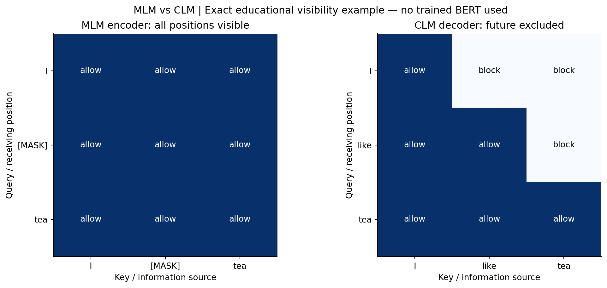

# Seven concepts and MLM versus CLM

This is submission-support material, not the final Medium article. New diagrams
are educational illustrations from the frozen package; trained evidence is marked
separately in the [figure index](README.md).

## 1. Why Transformers: a reasoned computation comparison

For sequence length n and width d, a recurrent layer must compute its hidden
states in n successive steps because h_i depends on h_(i-1). A causal Transformer
can compute all training positions in parallel from already known input tokens:
masking prevents information flow from later positions, without a recurrent
dependency between computations in the same layer. Stacking L layers still
requires L sequential layer computations. Teacher forcing supplies all inputs;
it does not expose future tokens through the mask.

The classic comparison is O(n²d) work for attention score/value products versus
O(nd²) for a dense recurrent layer. Attention's projections and FFN also cost
O(nd²), so O(n²d) is not the cost of the entire Transformer. Explicit attention
stores O(Hn²) scores per layer and batch element. Shorter paths between distant
positions improve information access, but growing n can be expensive in memory.
These are reasoned asymptotic comparisons, not measured RNN hardware benchmarks.
Autoregressive generation remains sequential over new tokens; this project's
generator recomputes a cropped context rather than using a KV cache.
See Vaswani et al., [Table 1 and Section 4](https://arxiv.org/abs/1706.03762).

## 2–5. Attention, heads, positions and the full block

Attention computes `softmax(QK^T/sqrt(d_k) + M)V`. The mask has -infinity above
the diagonal before row softmax; those probabilities become exactly zero.
The [manual derivation](hand_calculation_audit.md) includes every intermediate
matrix. [Actual shapes](figure_03_tensor_shapes.png) come from forward hooks
and split/score/value/merge operations, checked against the actual layer output.
Each head accesses a different learned projected subspace; heads are not separate
independently trained language models.

The required [sinusoidal encoding](figure_04_sinusoidal.png) is added to token
embeddings in E02. For position p, dimension pair i uses sine/cosine of
`p / 10000^(2i/d_model)`. Low-index pairs change faster; high-index pairs change
slowly. Addition makes position available even though attention itself processes
the sequence without a recurrence. B01/F01 instead rotate projected Q and K,
not V, with RoPE. They do not also add sinusoidal positions.

The [architecture figure](figure_05_architecture.png) follows actual pre-LayerNorm
code: `u=x+Dropout(Attention(LN(x)))`, then
`z=u+Dropout(Linear2(GELU(Linear1(LN(u)))))`.
Residual paths add transformations at constant model width; LayerNorm normalizes
features within each token, and the FFN changes features independently at each
position. Final LayerNorm and an untied vocabulary projection yield logits.
Dropout operates during training and is disabled for validation and inference.
These statements describe [the actual model](../../../src/nano_lm/model.py),
not an encoder-decoder Transformer or a pretrained framework architecture.

## 6. MLM versus CLM: exact visibility and prediction experiment



The example sequence is `I like tea`. This is an educational token-level example,
not a trained BERT prediction and not a claim that these are the project's BPE IDs.
Rows receive information; columns supply it. One means allowed attention.

```text
MLM input:   [I, MASK, tea]       CLM input:   [I, like, tea]
MLM target:  [ignore, like, ignore]
CLM targets: [like, tea, EOS]     EOS here is an illustrative boundary token.

MLM visibility                 CLM visibility
        I MASK tea                    I like tea
I       1  1   1              I       1  0    0
MASK    1  1   1              like    1  1    0
tea     1  1   1              tea     1  1    1
```

MLM loss is negative log probability of the original token at selected corrupted
positions, conditional on visible left and right input context. The target `like`
is hidden in the input, but `tea` can inform its reconstruction. Original BERT
uses more than one corruption strategy; the all-MASK example illustrates its
objective rather than reproducing its complete training recipe.
CLM loss averages negative log probability of shifted next tokens given only
preceding/current input positions. At the `I` position, it must predict `like`
without seeing the input `like` or `tea` positions. In real project batching,
`x=tokens[start:start+T]`, `y=tokens[start+1:start+T+1]`; no artificial EOS is added
to every Shakespeare window.

For a numerical comparison, the Figure 1 Q=K=V example is evaluated with and
without the causal mask using the same frozen attention function. Bidirectional
row 1 assigns token 3 probability .40111209; causal row 1 assigns it exactly 0.
Its value output changes from [.80222419,.59888791] to [1,0]. Thus the mask changes
available information even with identical representations and no learned BERT.
[Both full matrices and outputs are preserved](../verification/assignment_audit.json).
This short comparison experiment demonstrates masking/objectives; it does not
measure MLM language quality. Reference: Devlin et al.,
[BERT](https://arxiv.org/abs/1810.04805), Section 3.1.

## 7. GPT causal language modeling

The shared model returns vocabulary logits at each input position and computes
flattened token-level cross-entropy against shifted targets. The next input token
is a target, never an unmasked future source. At inference the last-position
logits choose the next ID by argmax or temperature sampling; append that ID and
repeat, cropping to configured context. The actual [API receipt](../verification/colab-final/receipts/api/receipt.json)
and [trained attention receipt](../verification/colab-final/receipts/attention/receipt.json)
demonstrate generation and future exclusion with B01 step 3000. No test likelihood
was used to select it. BPB reports scored original bytes, enabling the documented
cross-tokenizer comparison; token-level perplexities across character/BPE models
are not comparable.

## Attribution and limits

Equations, the complexity comparison and MLM terminology are attributed above.
The handout also recommends the [AI engineering curriculum](https://github.com/rohitg00/ai-engineering-from-scratch/tree/main/phases/07-transformers-deep-dive).
This audit does not assert that every historical learning resource or adapted
snippet has been independently traced. The authors must review complete
attribution and demonstrate personal understanding in the oral presentation.
All new figures here are generated from project code or recorded measurements;
there are no stock illustrations or external model-generated samples.
