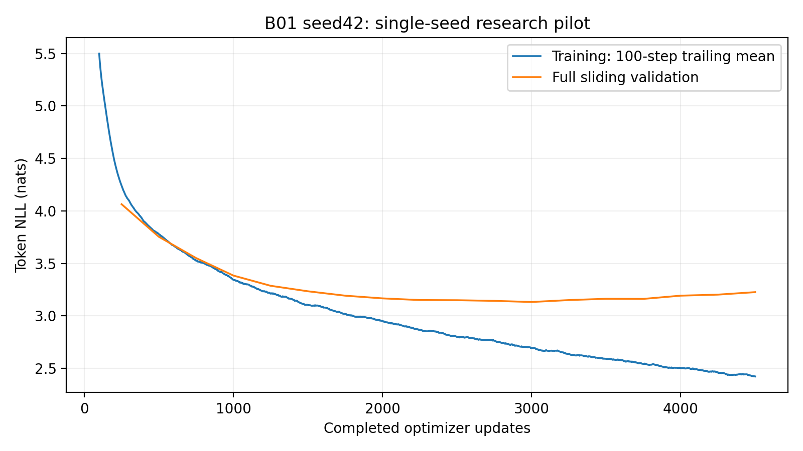
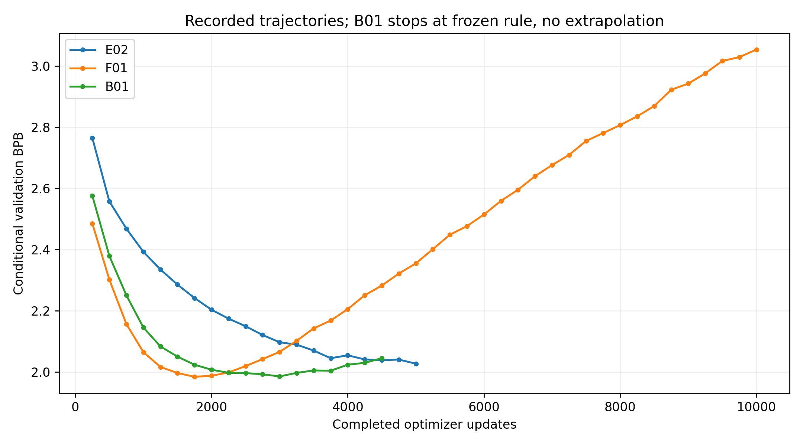
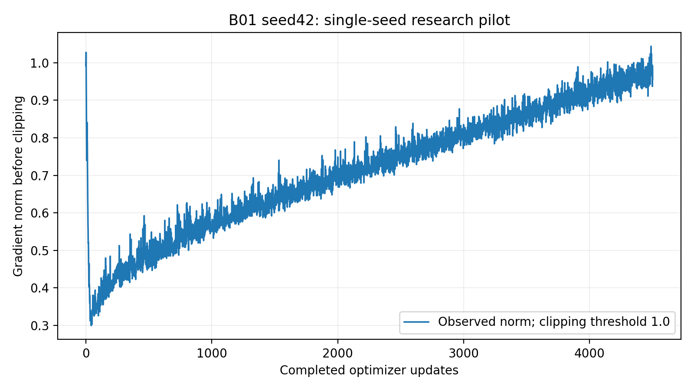
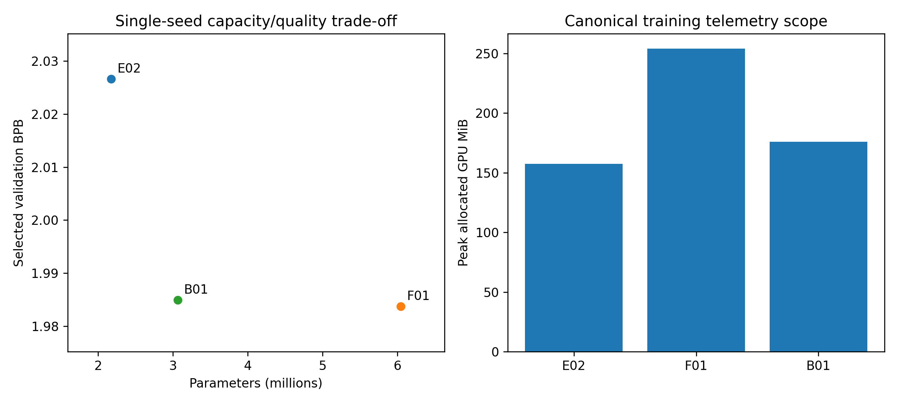
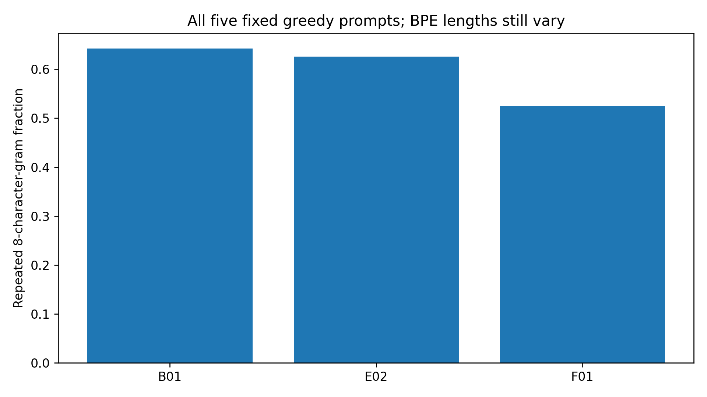

# B01 — NanoLM-Balanced seed 42: measured research analysis

## Objective, motivation and frozen hypothesis

Can a smaller BPE/RoPE model retain competitive held-out prediction and genuine text quality while avoiding F01's severe late deterioration? Capacity, repeated source exposure, constant LR, optimization and component interactions are hypotheses, not isolated causes of F01's failure. B01 combines six blocks/RoPE with original width 192; it is not a single-factor ablation or an optimal architecture claim.

## Exact architecture and provenance

```json
{
  "vocab_size": 1024,
  "d_model": 192,
  "n_heads": 6,
  "n_layers": 6,
  "context_length": 128,
  "mlp_expansion": 4,
  "activation": "gelu",
  "position": "rope",
  "dropout": 0.1
}
```

Exactly 3,062,784 parameters: embeddings 196,608 + six blocks 2,669,184 + final LN 384 + untied head 196,608. Head 32, MLP 192→768→192/GELU/preLN, dropout 0.1; Q/K RoPE only, scaled attention sqrt(32), causal masking and crop 128. No pretrained weights/black-box Transformer. Numerical CPU and actual qualified CUDA references check wrong scale/sign, future invariance, gradients, shifted manual CE, norms, relative position and BPE byte coverage.

Trained source `c2cf1c165d09e0fc8f64a2df714755a4d910d469`; scientific fingerprint `d5b205aecec5913cd11d921c0a84899badd95a014a490a7beaab3d2598c940f8`; aggregate `4dd230985194865487254e2e750b07f79aeabec491e4fa8f8e483fedda1de741`; resolved config `ec95f5c5d24a950b81ffe1b20dbbfc1ed95f9134965b77897e21924412228125`. Original implementation/E01–E14/F01 evidence remains unchanged. The B01 JSON changes the aggregate, not scientific semantics. Exact dependency/hardware records are in evidence/research; isolated Python 3.11.14/torch 2.5.1+cu124/CUDA 12.4/NumPy 1.26.4/T4 device 0/FP32.

## Data and method

Raw SHA256 `86c4e6aa9db7c042ec79f339dcb96d42b0075e16b8fc2e86bf0ca57e2dc565ed`; BPE checksum `2d7b1e84c8055eb5b9483a3fe6e4e3c9e348f5a28506ba19a0dc1644f0b36d55`. Original bytes 1,003,854/55,770/55,770. Canonical tokenizer artifacts were reused without refitting. Shared acquisition/splits/manifest validation preserve no cross-boundary sampling and train-only fit lineage. No original test likelihood or external dataset evaluation occurred.

AdamW constant 3e-4, weight decay 0.01, clipping 1, float32, microbatch 4/accumulation 8,32 sampled windows/4,096 targets per optimizer update, maximum 5,000. Full sliding validation every 250 scores 55,514 original bytes/24,386 BPE targets after 256-byte conditioning-only exclusion, dropout off, context 128 BPE, batch 32. BPB=NLL/(ln 2×55,514), a boundary/context-constrained conditional metric.

## Frozen stopping and complete observations

Reference initializes at 250; reset only if bpb < reference−0.001, strict unrounded double precision. Otherwise counter increments, including before eligibility 2,000. Stop at first eligible counter>=6 or budget 5,000. Absolute minimum selects the best without tolerance. Boundary/nextafter, cumulative tiny improvement, eligibility and stop-after-decision regression tests precede research.

Actual 4,500 authoritative and known physical updates, 18 full validations, stopping reason **early_stop**. Planned resumes=17; they are not failures or replay. No updates followed the decision. No unobserved later points are invented. Full patience receipt is preserved.

| Update | Loss (nats/token) | Conditional BPB | Token perplexity |
|---:|---:|---:|---:|
| 250 | 4.06380922 | 2.57540716 | 58.195569 |
| 500 | 3.75347991 | 2.37873840 | 42.669309 |
| 750 | 3.55054959 | 2.25013290 | 34.832456 |
| 1000 | 3.38403418 | 2.14460507 | 29.489497 |
| 1250 | 3.28658036 | 2.08284448 | 26.751228 |
| 1500 | 3.23421949 | 2.04966119 | 25.386550 |
| 1750 | 3.19238616 | 2.02314964 | 24.346453 |
| 2000 | 3.16660937 | 2.00681380 | 23.726899 |
| 2250 | 3.15072634 | 1.99674806 | 23.353021 |
| 2500 | 3.14917396 | 1.99576425 | 23.316796 |
| 2750 | 3.14289135 | 1.99178270 | 23.170765 |
| 3000 | 3.13207979 | 1.98493095 | 22.921602 |
| 3250 | 3.15035524 | 1.99651288 | 23.344356 |
| 3500 | 3.16279840 | 2.00439863 | 23.636648 |
| 3750 | 3.16165665 | 2.00367506 | 23.609676 |
| 4000 | 3.19244477 | 2.02318679 | 24.347880 |
| 4250 | 3.20228941 | 2.02942575 | 24.588760 |
| 4500 | 3.22600917 | 2.04445796 | 25.178971 |

| Update | BPB | Patience reference | Counter | Meaningful reset | Stop reason |
|---:|---:|---:|---:|---|---|
| 250 | 2.57540716 | 2.57540716 | 0 | True |  |
| 500 | 2.37873840 | 2.37873840 | 0 | True |  |
| 750 | 2.25013290 | 2.25013290 | 0 | True |  |
| 1000 | 2.14460507 | 2.14460507 | 0 | True |  |
| 1250 | 2.08284448 | 2.08284448 | 0 | True |  |
| 1500 | 2.04966119 | 2.04966119 | 0 | True |  |
| 1750 | 2.02314964 | 2.02314964 | 0 | True |  |
| 2000 | 2.00681380 | 2.00681380 | 0 | True |  |
| 2250 | 1.99674806 | 1.99674806 | 0 | True |  |
| 2500 | 1.99576425 | 1.99674806 | 1 | False |  |
| 2750 | 1.99178270 | 1.99178270 | 0 | True |  |
| 3000 | 1.98493095 | 1.98493095 | 0 | True |  |
| 3250 | 1.99651288 | 1.98493095 | 1 | False |  |
| 3500 | 2.00439863 | 1.98493095 | 2 | False |  |
| 3750 | 2.00367506 | 1.98493095 | 3 | False |  |
| 4000 | 2.02318679 | 1.98493095 | 4 | False |  |
| 4250 | 2.02942575 | 1.98493095 | 5 | False |  |
| 4500 | 2.04445796 | 1.98493095 | 6 | False | early_stop |

Best update 3000: loss 3.13207979, BPB 1.98493095, perplexity 22.921602. Final update 4500: loss 3.22600917, BPB 2.04445796, perplexity 25.178971. Final training loss 2.39718363; trailing 100 mean 2.42289018. First training step 1 and validation 250 are recorded; no fake step-zero measurement.




## Exact segmented execution and persistence preflight

Original nano_lm.train CLI runs complete 250-update segments with the same run/config/checkpoint. It reconstructs objects, restores saved optimizer/scheduler/scaler/RNG/sampler, and never trains newly initialized weights after a resume. Preflight uninterrupted 4-update versus 2+2 smoke trajectories match all five optimization/RNG fields and every nontelemetry nested training/history field exactly, including full sliding CUDA losses. Wall times/throughput/allocator peaks are measured separately and cannot be equal clocks; raw inequality is disclosed. Zero-update raw roundtrip matches all six fields including full telemetry/history. Published development was independently downloaded/CRC/hash/CPU verified before fresh compatible CUDA restore and smoke continuation; research only launched after those gates.

## Resources, exposure and gradients

Training-only 1827.392 s; full validation 264.547 s; 2.462526 updates/s and 10086.505 BPEtargets/s. Wrapper before archive 2647.212 s; archive/hash/CRC 38.810 s. Inner train/validation/IO scopes overlap wrapper and must not be double-counted; bootstrap/queue/publication/retrieval are separate. Peak 175.943 MiB is sampled training allocator telemetry, not all device/driver memory. Each planned segment resets the peak counter and ends at validation; validation/inference peaks are not separately recorded. F01 uninterrupted telemetry could include prior validation peaks, so this memory comparison has a measurement-scope confound.

Measured original checkpoint calls total 3.654 s and immutable export calls 31.489 s; these are included in wrapper time, not additional durations. Best/final full resumable checkpoints are 38,406,090/38,640,522 bytes, including optimization/history/provenance. Reaching selected update 3000 cost 1239.460 s training and 12,288,000 targets/29,994,269 source bytes. F01's selected 1,750 cost 747.174 s training; fewer B01 parameters did not produce a cheaper observed selected minimum in these sessions.

Actual predicted targets 18,432,000; original target-byte exposure 44,992,723; unique target bytes 1,003,827. Independent sampler RNG/union replay passes. These are repeated target exposure, not complete epochs/FLOPs. Inference latency uses only the actual fixed grid, synchronized before/after original generation; first request per policy is cold and remaining 49 statistics are in findings.json. CPU checkpoint-deserialize/model-build time excludes CUDA transfer and is cache-dependent. Comparable E02/F01 per-request latency was not recorded; no invented benchmark substitutes for it.

Preclip norm median 0.725126, p 950.954938, max 1.043929; 15/4500 exceeded 1.0. Every 250-update interval is in gradient_intervals.json; no clipping-caused-overfitting or longitudinal per-layer gradient claim is inferred.



## E02/F01/B01 measured comparison

| Model | Parameters | Updates | Best update | Best BPB | Final BPB | Training seconds | Peak MiB |
|---|---:|---:|---:|---:|---:|---:|---:|
| E02 | 2,173,056 | 5000 | 5000 | 2.02659521 | 2.02659521 | 1128.893 | 157.330 |
| F01 | 6,046,560 | 10000 | 1750 | 1.98376817 | 3.05346210 | 4269.206 | 253.975 |
| B01 | 3,062,784 | 4500 | 3000 | 1.98493095 | 2.04445796 | 1827.392 | 175.943 |

B01 selected-best difference versus E02=-0.04166426 BPB (-2.056%); versus F01-best=+0.00116279 BPB. Size is 49.3467% lower than F01 and 40.9436% above E02. Comparisons vary depth/position/capacity/initialization, stopping/budgets and selection opportunities. The relevant F01 reference is its early selected 1,750, not its worse final 10,000. Equal BPE/context aligns token/byte coverage but does not imply equal compute. No statistical significance or cross-seed SD.



## Genuine fixed generation and limitations

All 100 best/final slots are preserved in generation.json/md: five prompts, greedy, temperatures 0.7/1/1.2, sampling seeds 42/123/456 and 256 new BPE tokens. No repair, filtering, external-model rewriting, top-k/top-p or repetition penalty. Duplicate best/final weights=False; identical policy outputs are not independent samples. All 300 matched E02/F01/B01 strings/descriptors remain unedited in generation_comparison.json. All 100 B01 train-only longest literal substrings exclude prompt and record source offsets. Repetition/word diversity/speaker labels do not measure grammar or understanding; manual observations follow in B01_model_selection.md. Raw token/byte diagnostics found 5 invalid-UTF-8 outputs, retained without correction. The recovered fixed grid reproduces exactly.



## Durable publication and independent recovery

Research https://www.kaggle.com/code/rayyannmerchant/nano-b01-research-20261014-33317a00, saved version 1. Archive 604,825,667 bytes, SHA256 `41742da357777a6aee40bd7bc4a4063ee1e3d07f94b94e2344f082252a467edf`. Independent CRC/safe paths/exact 96-file inventory/allSHA256/allactual optimizer/scheduler/history counters, full stopping-rule replay and CPU best/final inference pass. Native 37 immutable snapshots verified in fresh qualified CUDA; complete model/optimizer/scheduler/scaler/allRNG/private sampling/history preserved at 4500→4500, zero additional research updates. All 100 fixed strings reproduce. Full checkpoints/journals/archives remain on D: and legitimate Kaggle saved outputs, outside Git. Detailed post-recovery report/figures are lightweight Git deliverables. No original test assessment was performed.

## Interpretation and remaining uncertainty

Early stopping is a predefined heuristic, not proven optimal, and changes the observation horizon. The unexecuted future is unknown; B01 cannot prove it would never deteriorate beyond its stop. Repeated validation-based architecture/checkpoint choices, one contiguous corpus/seed, unequal budgets and different sessions constrain claims. B01's compactness alone does not beat E02. Separate prediction, compactness and real text behavior; see B01_model_selection.md for observations, interpretations and negative results. No further model/seed/extension is authorized.

## Complete interpretation, acceptance and retrieval

[Model selection](B01_model_selection.md) analyzes prediction, capacity, measured
cost and all fixed outputs separately. B01 best greedy repeated8gram fraction
0.64201 exceeds E02's0.62577 and F01's0.52467. All100 B01 continuations were
checked against training text: maximum exact overlaps34 characters best and40
final, largely speaker labels/common phrases, with source offsets recorded.
No long copied passage appeared in this grid; this is not a global absence-of-
memorization claim. [Full-grid observations](B01_generation_observations.md)
include every poor-output category and all five invalidUTF8 slot identities.

[Acceptance checklist](B01_acceptance.md), [artifact retrieval](artifact_retrieval.md)
and [executed commands](B01_commands.md) provide the evidence chain, actual
failures/corrections, zero-update recovery and untouched historical boundaries.
Original published figures and measurements remain immutable; comparative
figures and interpretation are post-recovery deliverables. No research checkpoint,
dataset or full training journal is committed to Git.
