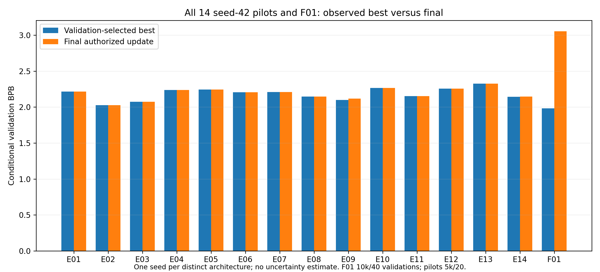

# All fourteen seed42 pilots and accepted F01

| Experiment | Width | Blocks | Tokenizer | Parameters | Best BPB | Final BPB | Best step | Training seconds |
|---|---:|---:|---|---:|---:|---:|---:|---:|
| E01 | 192 | 4 | character | 1,804,800 | 2.21405793 | 2.21599704 | 4750 | 916.708 |
| E02 | 192 | 4 | bpe | 2,173,056 | 2.02659521 | 2.02659521 | 5000 | 1128.893 |
| E03 | 192 | 4 | character | 1,804,800 | 2.07327076 | 2.07327076 | 5000 | 1107.721 |
| E04 | 192 | 4 | character | 1,829,376 | 2.23778869 | 2.23778869 | 5000 | 1001.785 |
| E05 | 192 | 4 | character | 1,804,800 | 2.24266813 | 2.24266813 | 5000 | 1106.074 |
| E06 | 192 | 4 | character | 1,804,800 | 2.20537989 | 2.20617553 | 4750 | 917.232 |
| E07 | 192 | 4 | character | 1,804,800 | 2.21051529 | 2.21051529 | 5000 | 946.000 |
| E08 | 192 | 6 | character | 2,694,528 | 2.14548940 | 2.14758132 | 4750 | 1511.357 |
| E09 | 192 | 8 | character | 3,584,256 | 2.10014737 | 2.11680859 | 4750 | 1811.126 |
| E10 | 192 | 4 | character | 1,213,440 | 2.26711868 | 2.26711868 | 5000 | 921.331 |
| E11 | 192 | 4 | character | 1,804,800 | 2.15396251 | 2.15396251 | 5000 | 1868.694 |
| E12 | 192 | 4 | character | 1,804,800 | 2.25627886 | 2.25627886 | 5000 | 475.030 |
| E13 | 144 | 4 | character | 1,021,824 | 2.32495848 | 2.32495848 | 5000 | 941.393 |
| E14 | 240 | 4 | character | 2,808,960 | 2.14189208 | 2.14505608 | 4750 | 978.158 |
| F01 | 240 | 8 | bpe | 6,046,560 | 1.98376817 | 3.05346210 | 1750 | 4269.206 |

The 14 configurations are different architectures, not 14 replications. F01 adds combined factors and 10,000 updates; others use 5,000. Mean/SD across seeds cannot be estimated. All original configs/reports remain unchanged. See master_comparison.csv/JSON for complete shapes, source-byte exposure and resource fields, F01_architecture_decision.md for the frozen rationale, and F01_10000_analysis.md for measured comparisons/negative outcomes. E02 BPE and F01 are ranked using same-byte BPB; token perplexities are incomparable across tokenizers. Context/depth/width affect information/capacity/compute together. E07 replay accounting remains in its original report; retained trajectory time is not substituted for total known physical work. E12 records no observed replay. No test-set model selection occurred.

## Actual efficiency and baseline-relative prediction

| Experiment | Best BPB change vs E01 | Parameters vs E01 | Retained training seconds | Updates/s | Peak allocated MiB | Full-validation seconds |
|---|---:|---:|---:|---:|---:|---:|
| E01 | +0.000% | +0.000% | 916.708 | 5.4543 | 151.712 | 420.908 |
| E02 | -8.467% | +20.404% | 1128.893 | 4.4291 | 157.330 | 198.577 |
| E03 | -6.359% | +0.000% | 1107.721 | 4.5138 | 151.712 | 447.515 |
| E04 | +1.072% | +1.362% | 1001.785 | 4.9911 | 152.087 | 413.797 |
| E05 | +1.292% | +0.000% | 1106.074 | 4.5205 | 151.712 | 413.366 |
| E06 | -0.392% | +0.000% | 917.232 | 5.4512 | 145.712 | 389.111 |
| E07 | -0.160% | +0.000% | 946.000 | 5.2854 | 161.728 | 425.209 |
| E08 | -3.097% | +49.298% | 1511.357 | 3.3083 | 166.104 | 593.279 |
| E09 | -5.145% | +98.596% | 1811.126 | 2.7607 | 199.370 | 739.049 |
| E10 | +2.397% | -32.766% | 921.331 | 5.4269 | 139.705 | 315.430 |
| E11 | -2.714% | +0.000% | 1868.694 | 2.6757 | 116.146 | 267.250 |
| E12 | +1.907% | +0.000% | 475.030 | 10.5256 | 277.908 | 927.393 |
| E13 | +5.009% | -43.383% | 941.393 | 5.3113 | 132.291 | 310.326 |
| E14 | -3.259% | +55.638% | 978.158 | 5.1116 | 177.283 | 490.769 |
| F01 | -10.401% | +235.027% | 4269.206 | 2.3424 | 253.975 | 945.441 |

Costs describe the recorded trajectory, not repeated controlled speed trials.
F01 has 40 validations and 10,000 updates; the pilots have 20 and 5,000.
E07's retained 946.000384 seconds exclude 38.317729 seconds from 207 superseded
attempts: known physical training was at least 984.318113 seconds and 5,207
updates. Later unsaved work is unknown. E12 records no observed replay.
Mean or standard deviation across different architectures would not be a
cross-seed uncertainty estimate; each condition has only one observed seed.

## Factor-level observations and negative outcomes

- **Tokenization:** E02 has the lowest pilot BPB, but BPE changes vocabulary,
  effective byte context, source-byte exposure, parameters and generation length.
  Its token perplexity cannot be ranked against character models. BPE does not
  eliminate dialogue loops, malformed words or invalid sampled byte sequences.
- **Positions:** E03 RoPE improves character-model BPB versus E01; E04 learned
  positions regress while adding parameters. RoPE's greedy repetition remains
  severe in the fixed grid. Lower predictive loss is not a coherence result.
- **Activation and feed-forward capacity:** E05 ReLU and E10 expansion 2× have
  worse recorded best BPB than E01. E10 saves 591,360 parameters but does not
  reproduce baseline prediction quality. These outcomes do not prove GELU or
  larger MLPs always win on other widths, datasets or seeds.
- **Heads:** E06 four heads and E07 eight heads show small BPB reductions versus
  E01 at unchanged width/parameter count. Head dimension changes mechanically;
  the tiny single-seed differences do not justify a general optimum claim.
- **Depth:** E08 six blocks and E09 eight blocks improve best BPB over four-block
  E01 while increasing capacity, memory and time. E09 is stronger predictively
  than E08, but its final score is worse than its selected minimum. Depth cannot
  be isolated from capacity/compute here; repeated or malformed text persists.
- **Context:** E11 context 64 scores better than E01; E12 context 256 scores
  worse. E11 samples 64 windows/update with accumulation 16; E01 samples 32/8;
  E12 samples 16/4. All predict 4,096 targets/update, but conditioning information,
  sequence grouping and compute differ. A shorter context is not automatically
  faster, and these results do not show that long context is intrinsically bad.
- **Width:** E13 width 144 saves 782,976 parameters and worsens prediction;
  E14 width 240 improves best BPB while adding 1,004,160 parameters. Head and MLP
  dimensions and initialization RNG consumption change with width. Memory and
  validation costs differ; neither outcome isolates parameter count alone.

## F01 selection and outcome

The pre-run decision retained BPE, RoPE, eight blocks and width 240 from the
strongest relevant pilot directions, and preserved the explicitly approved
six-head/GELU/MLP4×/context128 settings. It did not sum pilot improvements or
search combinations. [The frozen decision](F01_architecture_decision.md) records
that reasoning before the F01 trajectory began.

F01's early selected BPB is lower than all pilot minima, but its 5,000- and
10,000-update states are worse than the strongest pilots. The extra 5,000 updates
show sustained validation deterioration rather than improved generalization.
Early F01 greedy text remains highly repetitive; later text can look locally
more fluent while showing worse prediction and literal training-passage copying.
Five sampled outputs contain invalid UTF-8 bytes. Complete unedited outputs and
negative observations are preserved in [interpretation.md](interpretation.md).

The single reserved F01 test assessment followed immutable validation selection;
it did not choose between architectures. Repeated validation-based architecture
choices, one contiguous corpus, one seed, different sessions and differing byte
context/exposure restrict generalization. No cross-seed significance, additive
factor attribution, global language understanding or general superiority is
claimed. The former three-seed grid was explicitly discontinued, not completed.
