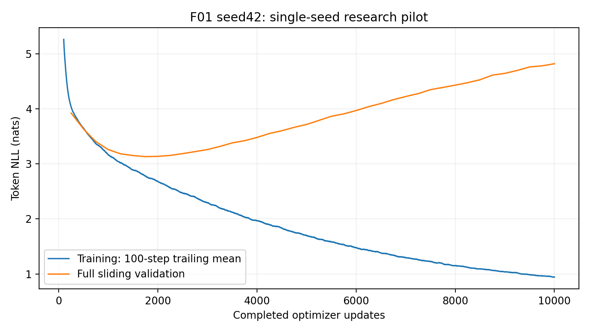
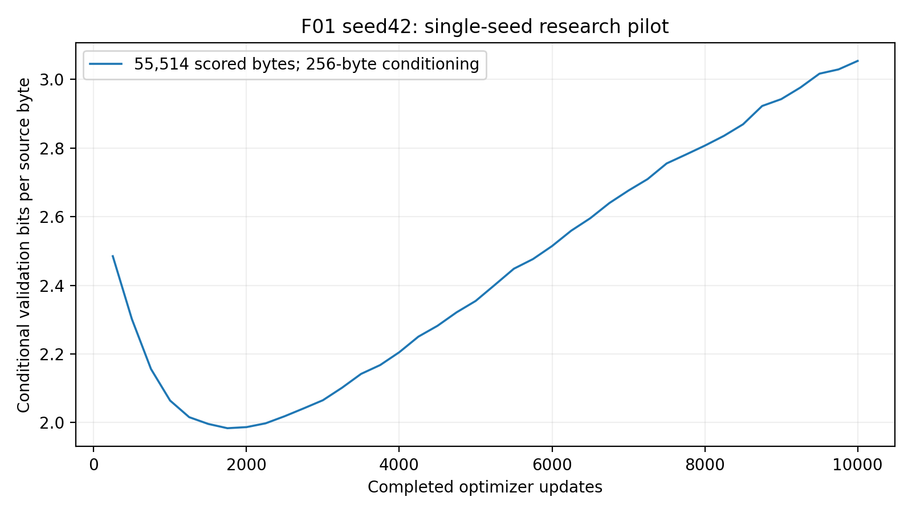
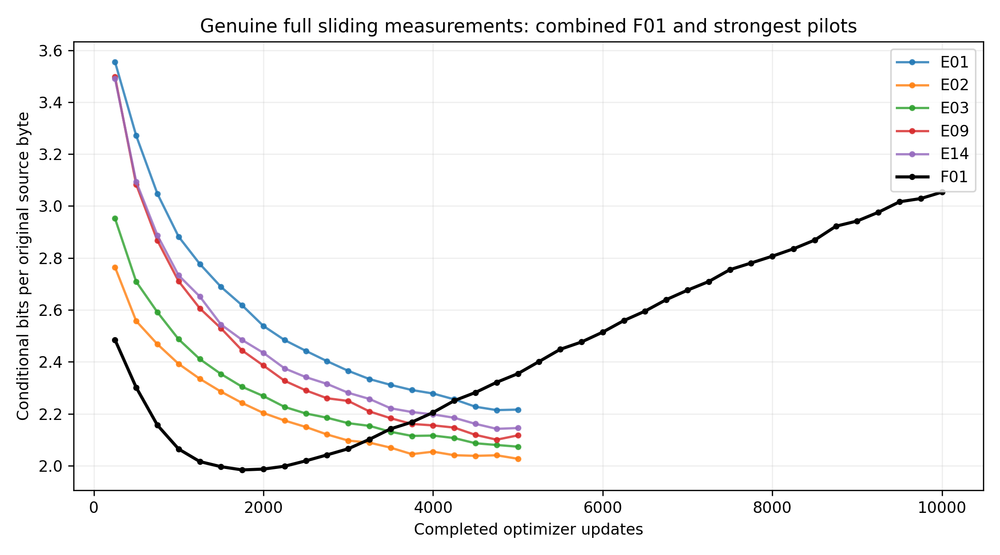
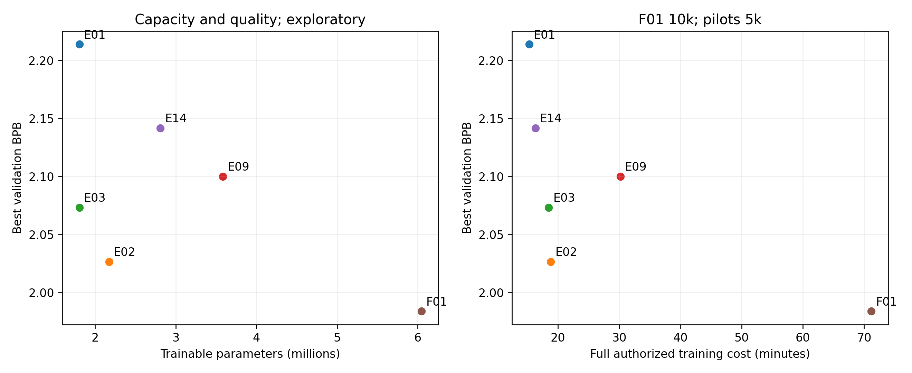
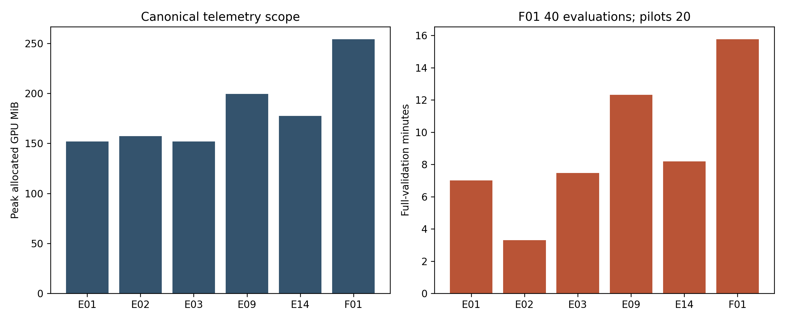
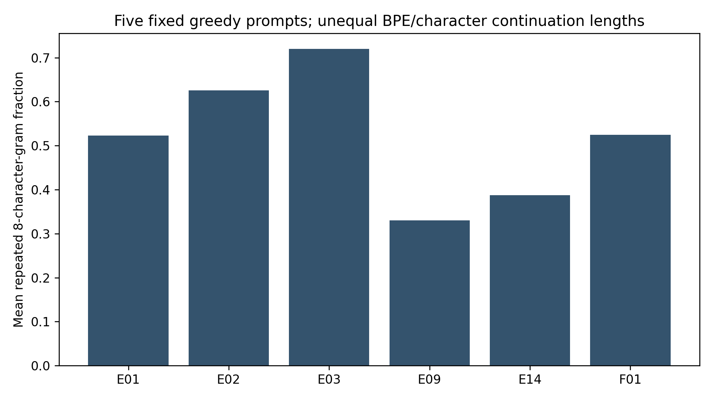

# F01 — NanoLM-Final: 10,000-update research analysis

## Acceptance and purpose

One fresh seed 42 combined model completed 10000 authoritative optimizer updates and 40 full sliding validations. Independent archive/CPU and fresh compatible CUDA acceptance receipts passed. Research notebook: https://www.kaggle.com/code/rayyannmerchant/nano-f01-research-20261014-05b5949a. No further architecture, seed or extension was launched. The original three-seed study was discontinued by explicit user decision, not completed as a replicated study.

Primary predictive target: beat E02 best conditional BPB 2.02659521. **Observation:** F01 best BPB=1.98376817 at update 1750; final BPB=3.05346210. Target met: True. Generation quality is assessed separately below and in interpretation.md; lower BPB is not a semantic-coherence result.

## Frozen rationale and confounders

[Pre-training architecture decision](F01_architecture_decision.md) records all 14 pilot outcomes and fixed choices. BPE, RoPE, eight blocks and width 240 were jointly approved. Context 128, six heads, GELU and MLP 4× were retained. Hypothesis: the combined capacity/representation might improve validation coding and text; interactions and longer training might instead worsen either outcome. The pilot gains were never added to forecast F01. This is an exploratory combined architecture, not a single-factor ablation.

## Architecture and parameter derivation

```json
{
  "vocab_size": 1024,
  "d_model": 240,
  "n_heads": 6,
  "n_layers": 8,
  "context_length": 128,
  "mlp_expansion": 4,
  "activation": "gelu",
  "position": "rope",
  "dropout": 0.1
}
```

```json
{
  "token_embeddings": 245760,
  "per_block": {
    "qkv_projections": 173520,
    "attention_output": 57840,
    "two_pre_LayerNorms": 960,
    "MLP_first": 231360,
    "MLP_second": 230640
  },
  "eight_blocks": 5554560,
  "final_LayerNorm": 480,
  "untied_LM_head": 245760,
  "total": 6046560
}
```

The eight blocks are independently allocated, pre-LayerNorm, with 240→960→240 GELU MLPs. Six heads use 40 coordinates; explicit QKᵀ scores divide by√40, then causal mask/softmax/value aggregation. RoPE rotates adjacent projected Q/K pairs at local positions 0–127 using m·10000^(−2 i/40); V remains unrotated. No additive sinusoidal or learned positional table is active. Embedding and LM projection are untied. The manual-attention/rotary ideas are related to [Attention Is All You Need](https://arxiv.org/abs/1706.03762) and [RoFormer](https://arxiv.org/abs/2104.09864); our basic-layer decoder and its exact implementation are in the frozen project package, without pretrained weights or ready-made Transformer blocks.


## Source, environment and verification

Trained source `06291e11630eaaa316873740e8223b1fc00ba3cb`; original reviewed scientific source `e4f768d53038662f0f24bcb9cb84a5210ad38a85`. Original aggregate `cdea42adb930904fb0cefcd282d784bb3ac8caa311d3f1e12ef568622f9c12d6`. Scientific implementation fingerprint `d5b205aecec5913cd11d921c0a84899badd95a014a490a7beaab3d2598c940f8`. F01 aggregate `0c3765c7e1d6a9c8698e12e0525496ecd59c6713998ece0d5b3218054c2ab8ff`; resolved configuration hash `77b440e75d90f8c07fde555d66837f67ff03cf1bd8d7f9594e3f0b06743b2626`. Adding F01.json changed the aggregate while scientific implementation and all historical configurations stayed unchanged. The independently committed launcher records its own builder commit in notebook metadata; it invokes the frozen execution source.

Actual GPU Tesla T 4, CUDA 0, Python 3.11.14, PyTorch 2.5.1+cu 124, runtimeCUDA 12.4. Exact package freeze and driver/device memory are in evidence/research/environment.json and hardware.json. Driver capability and torch CUDA runtime are different recorded values. No native CPU wheel replacement or environment upgrade occurred.

CPU combined numerical audit passed; corrected full CPU suite 77 passed/one CUDA-onlyskip. Actual qualified CUDA suite 78 passed in 39.52 s. GitHub CI for source 06291 e 1 and launcher 9 a 93 b 7 a succeeded. Tests include independent head 40 rotation/attention, wrong scaling/rotation references, preLN/GELU, shifted manual CE, future invariance, finite block gradients, dropout, deterministic fresh initialization, context cropping, tokenizer roundtrip and same-byte BPB. The initial exactly 14-config-files assertion failed after authorized F01 addition and was corrected while retaining all original override assertions. No scientific defect was found.

Mandatory development publication and recovery preceded research. Published 134170219-byte smoke archive SHA 256fed6afe393ed333e9549d5160e3b0d528ec294aedfc298bad5885794e9c79479 independently verified 44 files and CPU inference. Fresh CUDA preserved all six state fields and smoke-only resumed/reference tensors, losses and exposure matched. Roundtrip added 0 updates; continuity executed 1 resumed plus 2 reference smoke updates, separate from research. Development benchmark 10 updates excludes first 2 for throughput; estimates remain in evidence/development/feasibility.json, not research outcomes.

## Dataset, training and evaluation

Pinned Tiny Shakespeare rawSHA 25686c4e6aa9db7c042ec79f339dcb96d42b0075e16b8fc2e86bf0ca57e2dc565ed; canonical BPE checksum2d7b1e84c8055eb5b9483a3fe6e4e3c9e348f5a28506ba19a0dc1644f0b36d55. Original train/validation/test bytes 1003854/55770/55770, contiguous partitions, no normalization, no cross-boundary windows, train-only 1024 vocabulary. The complete unchanged manifest is preserved in the native artifacts.

Fresh seed 42 initialization; AdamW 3e-4 constant, weight decay.01, clipping 1.0, float 32, microbatch 4, accumulation 8. Thirty-two independent windows/update predict 4096 BPE targets. Total target exposure 40960000; actual original target-byte exposure 99,988,450, unique covered bytes 1,003,829. Sampler replay confirms private RNG, source-byte sums and union. Input/evaluation byte-context statistics are in findings.json;128 BPEtokens do not equal 128 original bytes.

Full sliding validation every 250 updates excludes the common 256 conditioning bytes and scores 55514 original bytes / 24386 BPE targets exactly once, batch 32, dropout disabled, at most 128 preceding tokens. Prefix/suffix tokenization separately prevents boundary merges. Local positions reset with truncation. BPB=NLL/(ln 2×55514); token loss/perplexity are within-tokenizer diagnostics, not cross-tokenizer rankings.

## All 40 observed validation measurements

| Update | Token loss (nats) | Conditional BPB | Token perplexity |
|---:|---:|---:|---:|
| 250 | 3.92077936 | 2.48476311 | 50.439740 |
| 500 | 3.63138147 | 2.30135947 | 37.764952 |
| 750 | 3.40220254 | 2.15611913 | 30.030170 |
| 1000 | 3.25725582 | 2.06426028 | 25.978151 |
| 1250 | 3.18093436 | 2.01589215 | 24.069232 |
| 1500 | 3.14980877 | 1.99616655 | 23.331602 |
| 1750 | 3.13024499 | 1.98376817 | 22.879584 |
| 2000 | 3.13521011 | 1.98691477 | 22.993466 |
| 2250 | 3.15265912 | 1.99797294 | 23.398201 |
| 2500 | 3.18530671 | 2.01866310 | 24.174702 |
| 2750 | 3.22151998 | 2.04161297 | 25.066191 |
| 3000 | 3.25877062 | 2.06522027 | 26.017532 |
| 3250 | 3.31606446 | 2.10152979 | 27.551706 |
| 3500 | 3.37979689 | 2.14191972 | 29.364806 |
| 3750 | 3.42046314 | 2.16769164 | 30.583576 |
| 4000 | 3.47939265 | 2.20503775 | 32.440014 |
| 4250 | 3.55097809 | 2.25040446 | 34.847385 |
| 4500 | 3.60079483 | 2.28197543 | 36.627335 |
| 4750 | 3.66272385 | 2.32122246 | 38.967340 |
| 5000 | 3.71513860 | 2.35443990 | 41.064278 |
| 5250 | 3.78870738 | 2.40106353 | 44.199230 |
| 5500 | 3.86316656 | 2.44825145 | 47.615892 |
| 5750 | 3.90749352 | 2.47634332 | 49.774038 |
| 6000 | 3.96738255 | 2.51429752 | 52.846028 |
| 6250 | 4.03783138 | 2.55894391 | 56.703242 |
| 6500 | 4.09522609 | 2.59531735 | 60.052915 |
| 6750 | 4.16494956 | 2.63950405 | 64.389434 |
| 7000 | 4.22239959 | 2.67591256 | 68.196933 |
| 7250 | 4.27490906 | 2.70919002 | 71.873602 |
| 7500 | 4.34705143 | 2.75490968 | 77.250349 |
| 7750 | 4.38752680 | 2.78056063 | 80.441226 |
| 8000 | 4.42890533 | 2.80678395 | 83.839590 |
| 8250 | 4.47386968 | 2.83527976 | 87.695421 |
| 8500 | 4.52695690 | 2.86892336 | 92.476717 |
| 8750 | 4.61110050 | 2.92224871 | 100.594793 |
| 9000 | 4.64260364 | 2.94221357 | 103.814291 |
| 9250 | 4.69576256 | 2.97590262 | 109.482264 |
| 9500 | 4.75954402 | 3.01632362 | 116.692704 |
| 9750 | 4.77922133 | 3.02879396 | 119.011643 |
| 10000 | 4.81814590 | 3.05346210 | 123.735460 |

Initial recorded training loss 7.09613281 at step 1; initial validation at step 250, notstep 0. Final batch loss 0.92398473; trailing 100-update mean 0.94353615. Best loss 3.13024499, BPB 1.98376817, perplexity 22.879584 at step 1750. Final loss 4.81814590, BPB 3.05346210, perplexity 123.735460 at step  10000. Full per-step history is external; summary.json and validation.csv preserve actual points.




## Internal 5 k-versus 10 k diagnostic and pilot comparisons

F01 step 5000 BPB 2.35443990, step 10000 BPB 3.05346210; absolute change +0.69902221. Best uses all 40 observations. The complete predeclared 50-slot step 5000 grid is in step5000_generation.json. It is an internal diagnostic, not an E02 model. The descriptive 6000–10000 BPB slope is +0.13526886/1000 updates; final minus best BPB +1.06969393. These descriptors do not establish significant overfitting or a mechanistic double-descent claim.

| Reference | Reference 5 k best BPB | F01 at 5 k BPB | Equal-step difference | F01 best minus reference | Relative difference |
|---|---:|---:|---:|---:|---:|
| E01 | 2.21405793 | 2.35443990 | +0.14038197 | -0.23028976 | -10.401% |
| E02 | 2.02659521 | 2.35443990 | +0.32784468 | -0.04282705 | -2.113% |
| E03 | 2.07327076 | 2.35443990 | +0.28116913 | -0.08950260 | -4.317% |
| E09 | 2.10014737 | 2.35443990 | +0.25429253 | -0.11637920 | -5.541% |
| E14 | 2.14189208 | 2.35443990 | +0.21254781 | -0.15812392 | -7.382% |

Equal-step comparisons still vary multiple architectural factors, parameters, original-byte context/exposure, initialization and compute. Final F01 comparisons additionally double the update budget. One seed supplies no variance or significance estimate. Validation selection across architectures/checkpoints is exploratory; final reserved test assessment follows selection.




## Resources and gradient observations

Measured training-only 4269.206 s,40 full validations 945.441 s; throughput 2.342356 updates/s and 9594.291 targets/s. Peak allocated telemetry 253.975 MiB. Canonical peak is queried before validation after optimizer updates, so earlier validation can contribute; final-validation/postprocessing peak is not separately measured. CUDA memory is allocated memory, not total device/driver memory.

Checkpoint IO 15.380 s; immutable exports 80.292 s; journal/fsync 36.637 s. Wrapper through test/generations 6161.320 s; archive construction/hash/CRC 156.122 s. These sequential measured components sum 6317.442 s; tiny manifest writes, environment bootstrap, queue/publication and network retrieval are separately scoped or unmeasured, not invented as exact whole-session time. Test evaluation 24.292 s. Native 100-slot generation time 476.220 s; step 5000-generation timing is not separately instrumented.

Global preclip gradient median 1.359267, p 95 1.666919, maximum 1.783468; 6988/10000 updates exceeded 1.0. Connectivity probes cover every block. Aggregate norms do not establish longitudinal vanishing/exploding layer gradients.



## Complete genuine generation evidence

generation.json/md contains all 100 best/final fixed slots unchanged. Every setting generates 256 newBPEtokens; continuation character lengths vary and exceed character-model lengths in many cases. All five prompts, greedy and temperatures.7/1/1.2 with seeds 42/123/456 remain fixed. Ten predetermined best outputs (all fivegreedy and all fiveattemperature.7/seed 42) follow; favorable and unfavorable strings are retained.

### Prompt 'To be, or not to be'; greedy=True, temperature=1.0, seed=42

Checkpoint `step_001750.pt`; 256 new BPE tokens, text unchanged.

```text
To be, or not to be a king.

KING RICHARD II:
Say, I will not be a king: but I am a king,
And I am intent to be a king,
And I will not be a king: but I am a king,
And I am into my brother's name is gone,
And I will not be a king: but I am a king,
And I am intent to be a king,
And I will not be a king: but I am a king,
And I, I'll not be a king,
And I am a king, I'll not believe
To be a fool. What is the king?

KING RICHARD II:
Stanley, my lord, I'll not be a king.

KING RICHARD III:
Say, I will not be a king: I will not be
To seek you to the king, and I'll be a king.

KING RICHARD III:
Stay, I'll tell thee, and I will not be a king.

QUEEN MARGARET:
O, I will not be a king: but I am a king.
```

### Prompt 'ROMEO:\n'; greedy=True, temperature=1.0, seed=42

Checkpoint `step_001750.pt`; 256 new BPE tokens, text unchanged.

```text
ROMEO:
I am a king, and I am a king,
To be a far in my sorrow's best.

KING RICHARD III:
Say, I will not be a king:
And I will not be a king, I'll not be a king.

KING RICHARD III:
Stay, I'll not be a king, but not a word.

KING RICHARD III:
Stay, I'll not be a king, but not a word.

KING RICHARD III:
Say, I will not be a king: but I am a king,
And I am a king, I'll not be a king.

KING RICHARD III:
Stay, I'll not be a king, but not a word.

KING RICHARD III:
Stay, I'll not be a king, but not a word.

KING RICHARD III:
Stay, I'll not be a king, but not a word.

KING RICHARD III:
Say, I will not be a king: but I am a king,
And I am a king, and I'll be a king.

QUEEN ELIZABETH
```

### Prompt 'JULIET:\n'; greedy=True, temperature=1.0, seed=42

Checkpoint `step_001750.pt`; 256 new BPE tokens, text unchanged.

```text
JULIET:
I am a king, and I am a king,
To be a farmery-beding battle,
And I am a brave to a brave-day,
And I am a bark of careless careless cares.

KING RICHARD II:
Say, I will not be a brave to thee.

QUEEN MARGARET:
O, I will not be a traitor to the crown.

KING RICHARD III:
Say, I will not be a king: but I am a king,
And I am a king, and I'll be a king.

QUEEN ELIZABETH:
And I, my lord, I'll not be a king.

KING RICHARD III:
Stay, I'll not be a king, but not my soul.

KING RICHARD III:
Say, I will not be a king: I will not be
To seek the king's daughter.

KING RICHARD III:
Stay, I am a king: I will not be a king.

KING RICHARD III:
S
```

### Prompt 'First Citizen:\n'; greedy=True, temperature=1.0, seed=42

Checkpoint `step_001750.pt`; 256 new BPE tokens, text unchanged.

```text
First Citizen:
They are i' the city,
That you have been a city, you have been
Are younger into the city.

First Senator:
I am a careless person.

CORIOLANUS:
I have been a careless cares.

CORIOLANUS:
I have been a care of you.

CORIOLANUS:
I have been a brave fellow, and I am a brave
To make a brave-day; and I am a bark.

First Servingman:
Are you not so, sir, sir, sir, sir, sir, sir,
so you, sir, sir, sir, sir, sir, sir, sir, you
speak to your air, sir, sir, sir, sir, a
conspirator, and you shall be a merry, sir, I
being you have a careless careless you have a careless corrections.

AUTOLYCUS:
I am a bitter.

C
```

### Prompt 'The king'; greedy=True, temperature=1.0, seed=42

Checkpoint `step_001750.pt`; 256 new BPE tokens, text unchanged.

```text
The king's son,
And so I am, and I am a king,
To make my power to be a far into my life.

KING RICHARD II:
Say, I will not be a king:
And I will not be a king, I'll not be a king.

KING RICHARD III:
Say, I will not be a king:
And I will not be a king, I'll not be a king.

KING RICHARD III:
Stay, I'll not be a king, but not a word.

KING RICHARD III:
Stay, I'll not be a king, but not a word.

KING RICHARD III:
Say, I will not be a king: but I am a king,
And I am a king, and I'll be a king.

KING RICHARD III:
Stay, I'll not be a king, but not a king.

KING RICHARD III:
Stay, I'll not be a king, but not a word.

KING RICHARD III:
Stay, I'll not be a king, but not a word.

KING RICHARD III:

```

### Prompt 'To be, or not to be'; greedy=False, temperature=0.7, seed=42

Checkpoint `step_001750.pt`; 256 new BPE tokens, text unchanged.

```text
To be, or not to be a side.

LORD WILLOUGHBY:
Nay, O passing, give me for your pitchrehen,
I'll stay fall in your drumsy banish'd.

FRIAR LAURENCE:
O God! condemn'd to the foulest.

POLIXENES:
Why, no; it is it so: I, my lord,
Although my leave with me; I will not return;
Or, with that I will intelligence to yours;
And I, by some other reiness, I'll tell thee
To the duke and fair Bolingbroke:
They are in my sight, and that time,
Anon farewell.

COMINIUS:
My lord, I'll find
Than those that was down I aspect to know.

CATESBY:
Tell me, my lord; I'll still a ministerhion.

Provost:
We will
```

### Prompt 'ROMEO:\n'; greedy=False, temperature=0.7, seed=42

Checkpoint `step_001750.pt`; 256 new BPE tokens, text unchanged.

```text
ROMEO:
What side is a judge; letters, becomes,
Being another passing, give us for your pitch,
That I may say, I fall, for I'll my high.

KING RICHARD III:
There's a little cousin, I'll prophesy.
This is the matter, I am Duke of Norfolk,
Though I am seen a guilty-contagine,
Where is your father's son, but unclawds,
Which murder me from the skin of the valour.

KING RICHARD III:
Good, I am dead, and I'll plain my goodest.

HASTINGS:
No, that I have no thought of you, my lord,
I'll crave your honour, you know your blushion.

KING RICHARD III:
Nay, he is sound to be mipper than his soul.

GLOUCESTER:

STANLEY:
What, will you say?

BUCKING
```

### Prompt 'JULIET:\n'; greedy=False, temperature=0.7, seed=42

Checkpoint `step_001750.pt`; 256 new BPE tokens, text unchanged.

```text
JULIET:
What side is a hunt?

JULIET:
Not your grace,
Not another pimony.

ANGELO:
It is a duke.

QUEEN:
Why, how is my soul?

DUKE VINCENTIO:
Farewell, my lord?

Provost:
Why, to the foulest.

LEONTES:
Nay, I am then: no more will give it so.

Provost:
Prumery, young measure.

ISABELLA:
Pray you, Marcius!

LUCIO:
Not your grace, my lord:
'Tis not likely Isabel,
And his pain in a power, you might well ask
Against the time, a thought of private life,
As I am a bound of grave, I will not be revolted
Against the gates, yet I have mipp'd his
The city of Isabel: if it be gone,
Put off my careless majesty
```

### Prompt 'First Citizen:\n'; greedy=False, temperature=0.7, seed=42

Checkpoint `step_001750.pt`; 256 new BPE tokens, text unchanged.

```text
First Citizen:
What!

MENENIUS:
Come, sirs: suretly your worship is an air,
Or else?

First Citizen:
'Twas faults o' the Lord of your mother,
Turn you to your child.

CORIOLANUS:
Holdest thou Coriolanus, to be prove a
corrow Duke of Norfolk, this is act.

Provost:
Lest you, sir?

ESCALUS:
Why, sir, it is your honour, what you Marcius?

LUCIO:
Not your grace, sir, sir! I will not plead I
thath and you are in your goodest power, sir, if you
have not your honours, a thought of you, sir, sir, you
bow your because you know your goodness is to you.

AUTOLYCUS:
I do few you to be a beat, sir, sir, as you
chan, I'll tell you with you.

First Soldier:

```

### Prompt 'The king'; greedy=False, temperature=0.7, seed=42

Checkpoint `step_001750.pt`; 256 new BPE tokens, text unchanged.

```text
The king was sound'd:
The duke issisted with the house of York
And then an ending death, which he could pass
Suppared and could fall upon our droof,
To take the business, or else a banishment
And yet reason to my mistress' justice,
Like one in the duke's purpose.

HENRY BOLINGBROKE:
Any side, to't, unclock'd an order'd or Marcius.

KING RICHARD II:
Ha! what news? Is it in this Italy mercy
To the inest power, which I will have purpose;
The castle and private life to change him
To be the grave by perpetual joys may be
Against Angelo:
They shall be sitify forward, I do still
Till I'll tell thee with a word no correction.
S
```

## Automatic text descriptors and interpretation boundary

| Policy | Greedy | Temperature | Outputs | Mean continuation characters | Repeated 8 gram fraction | Replacement characters |
|---|---|---:|---:|---:|---:|---:|
| best | True | 1.0 | 5 | 656.80 | 0.524674 | 0 |
| best | False | 0.7 | 15 | 613.67 | 0.028552 | 0 |
| best | False | 1.0 | 15 | 644.60 | 0.006543 | 0 |
| best | False | 1.2 | 15 | 642.93 | 0.001575 | 6 |
| final | True | 1.0 | 5 | 626.00 | 0.042478 | 0 |
| final | False | 0.7 | 15 | 621.67 | 0.036054 | 0 |
| final | False | 1.0 | 15 | 628.13 | 0.022723 | 0 |
| final | False | 1.2 | 15 | 639.07 | 0.009310 | 0 |

All 600 matched outputs for F01/E01/E02/E03/E09/E14 are compared in generation_diagnostics.json. Word spans, training-lexicon novelty, speaker labels, distinct ngrams and repeated 24/48 character phrases are string statistics. Novel words include legitimate names/unseen vocabulary; they are not an automatic grammar score. Prompt-prefix preservation is not semantic prompt adherence. Replacement counts retain native decoding failures without repaired output. Fresh compatibleCUDA independently reproduced every 100 fixed text outputs exactly and retained their generated token IDs; strict byte reconstruction found 5 invalid-UTF 8 outputs. Original and reproduced decoded texts remain unchanged. Unequal BPE/character lengths affect repetition measures. Manual observations and demonstration-temperature recommendation are in interpretation.md; no unvalidated repetition penalty/top-k/top-p/decoding change was introduced.



## Frozen final test assessment

Selection receipt fixes checkpoint SHA 256 `ff30ec7b18237ff3e0578155f4c5c3f9958dd32b2e458d1a43d2fa61ecc3266f` at step 1750 using validation BPB only. The source writes this immutable freeze before invoking one full sliding test evaluation. Test loss 3.48200190, BPB 2.24333983, perplexity 32.524768, scoredbytes 55514, scoredtokens 24791, prefix 256, context 128 BPEtokens. No weights/checkpoint/architecture/decoding choices changed from test results, and no retraining was launched. The conditioning-constrained metric is not unconditional corpus entropy.

## Publication and independent recovery

Saved research output version 1 at https://www.kaggle.com/code/rayyannmerchant/nano-f01-research-20261014-05b5949a. Archive 2,648,712,125 bytes; SHA 256 `96de06da78ecb1416c8029eaf792003991a45a3dfa160eade43157bbe6ed78ab`. Exact 82 file inventory, CRC, safe paths, every file hash,40 optimizer/scheduler counters,10000 history rows,40 full validations and 41 snapshot manifests independently checked. Fresh qualifiedCUDA verified all native snapshot files and complete model/optimizer/scheduler/scaler/RNG/sampling/history roundtrip 10000→10000 with 0 additional updates. Best/finalCPU and CUDA inference receipts identify each checksum. Raw snapshots remain in published outputs; ZIP contains every research checkpoint once plus all native analysis/evidence and snapshot index.

Independent Windows archive transfer took 11213.970 s, separately from training and notebook execution. Completed ranges and failed-attempt partial transfer evidence remain on D:; retries do not represent optimizer replay. Local complete archive/CPU inspection took 205.529 s. The actual transfer duration must not be substituted for training-only cost or concealed inside an unmeasured whole-platform wall-clock claim.

Authoritative 10000 updates; recorded journal attempts 10000; uninterrupted sequential journal=True. If any resume/failure/attempt discrepancy exists, the receipt records it and physical work needs explicit reconciliation; no attempt history is silently merged. HTTP chunked log-stream reconnects are preserved separately from training evidence and do not count as optimizer restarts. The initial development launcher redirected child logs tobootstrap.log; later committed launcher exposes progress and records its own commit without changing frozen scientific execution.

## Limitations and final interpretation

The predictive outcome, actual generations and resource costs are separate results. A combined six-million-parameter model and doubled budget cannot isolate tokenizer/RoPE/depth/width contributions. Matchingseed 42 does not imply identical initialization tensors across changed shapes. Original-byte exposure, effective byte context, single contiguous corpus, repeated validation-based choices, one seed and separate GPU sessions restrict generalization. No statistical-significance claim, general model superiority, reasoning competence or global memorization rate follows from these observations. Literal training-passage reproduction is recorded separately in fixed20_training_overlaps.json. See interpretation.md for evidence-backed qualitative findings and demonstration recommendation. Further training/decoding work requires new authorization; this task stops at 10000.
