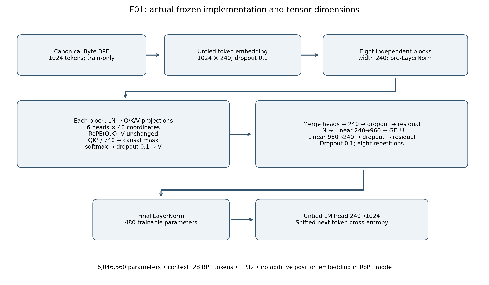
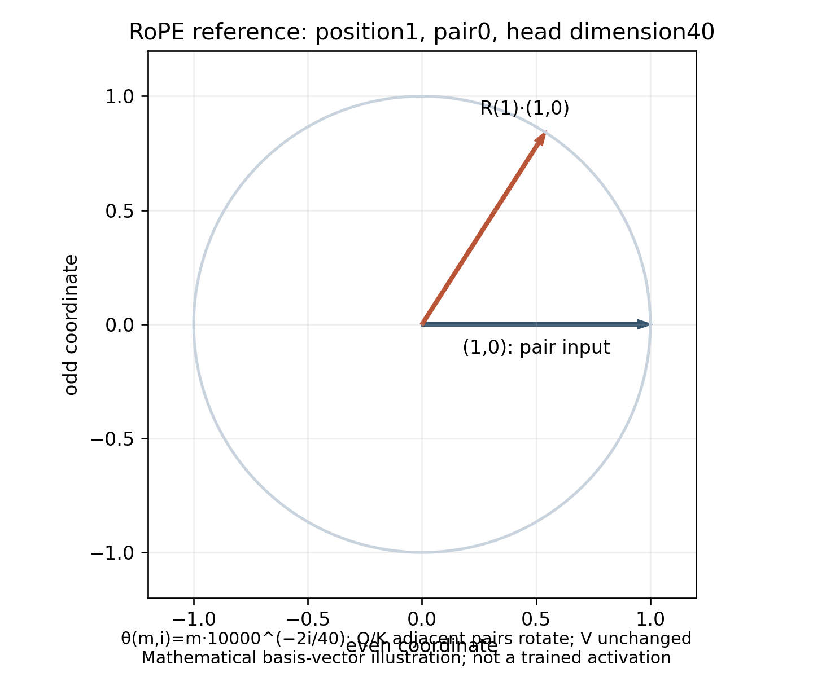

# Actual F01 attention and rotary dimensions

The implemented decoder projects each normalized `(B, T, 240)` input through
three independent biased linear maps, each 240 → 240. Reshaping/splitting gives
Q, K and V of shape `(B, 6, T, 40)`. RoPE rotates **projected Q and K**, after
head splitting, at local positions 0–127. It does not rotate V or add a learned
or sinusoidal position embedding.

Adjacent coordinate pair `i` uses angle
`theta(m,i) = m * 10000 ** (-2*i/40)`. The pair `(x_even, x_odd)` becomes
`(x_even*cos(theta) - x_odd*sin(theta),
x_even*sin(theta) + x_odd*cos(theta))`.
The numerical audit independently verifies this rotation, norm preservation,
query/key application and gradients. The image is a mathematical basis-vector
example, not a visualization of measured trained activations.

Attention scores have shape `(B, 6, T, T)` and scale by `sqrt(40)` before the
upper-triangular future-token mask. Softmax, training-only probability dropout
0.1 and multiplication by V return `(B, 6, T, 40)`. Merging returns width 240;
the output projection and residual dropout preserve that width.

Each independently allocated block is pre-LayerNorm attention plus residual,
then pre-LayerNorm MLP `240 → 960 → GELU → 240`, dropout and residual. There are
eight blocks, followed by final LayerNorm and untied `240 → 1024` logits.
The shifted target loss is mean categorical cross-entropy; the evaluator scores
each suffix token once and divides NLL by scored **original bytes** for BPB.

Training uses 32 sampled context-128 BPE windows per update: microbatch 4 ×
accumulation 8, or 4,096 predicted targets. A BPE window spans a variable number
of bytes. Generation crops token history to its final 128 tokens and uses the
same local-position convention. No pretrained Transformer module or model
weights were used.

