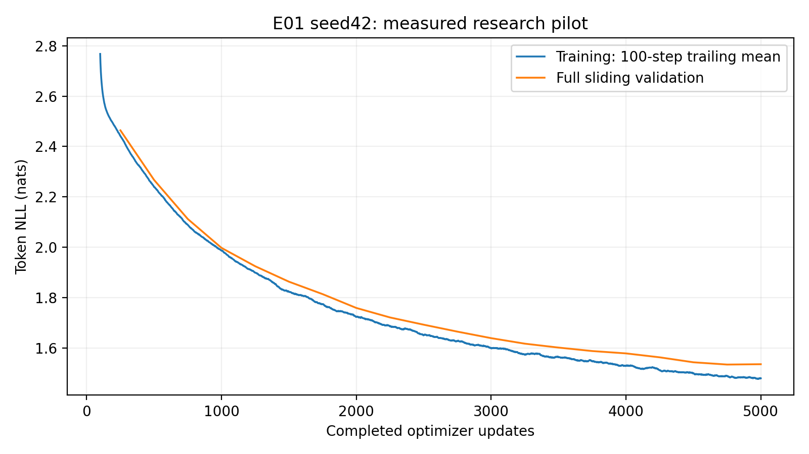
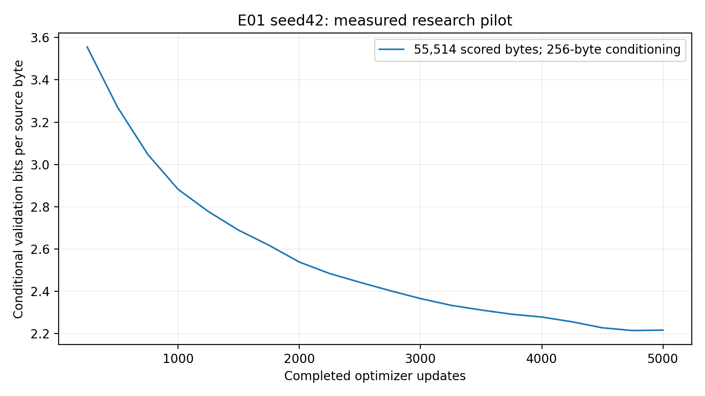

# E01 seed42 baseline training pilot — 2026-10-12

This is one genuine single-seed baseline pilot, not a completed three-seed result
or 14-configuration study. It executed exactly **5000 optimizer updates**.
Study-wide NO-GO remains because the second independent Kaggle account is unavailable.
The user explicitly authorized this one-account pilot as a scoped exception.

## Objective and hypotheses

Assess whether 5000 updates is a reasonable initial screening budget for the
locked Tiny Shakespeare ablations, and establish real learning/storage costs.
Before execution, improvement, plateau and deterioration were all possible;
overfitting and double descent were not assumed. A single baseline curve cannot
establish convergence of every deeper/wider/tokenizer/context variant.

## Exact source and reproducibility

- Trained source: `444bca4c4ac19f97f46fae210a9fd361f8561537`; clean committed checkout.
- Canonical main synchronized before orchestration: `36ffee3926f12f58582b3502f725aecc529a1f8d`.
- Code hash: `cdea42adb930904fb0cefcd282d784bb3ac8caa311d3f1e12ef568622f9c12d6`; unchanged qualified model/training/evaluation code.
- Config hash: `bbac12422871307f3acb4bbe99a217c6b2cd452fed7c931a9ccce0664b882b3e`.
- Run identity: `E01_seed42_520167c37bfa4a11a25d565111d52de5`.
- Saved private Kaggle notebook version1: https://www.kaggle.com/code/rayyannmerchant/nano-e01-pilot-20261012-37785014
- GPU: Tesla T4; GPU0 only, 2 devices allocated.
- Python 3.11.14, PyTorch 2.5.1+cu124, torch CUDA 12.4.
- Qualified resolved freeze reproduced exactly except the editable project SHA.
- Full metadata, hardware/driver output, command arguments and freeze are in the
  checksum-verified archive, not copied from uncommitted Windows source.

Canonical architecture: explicit decoder-only causal Transformer, character
vocabulary65, sinusoidal positions, width192, layers4, heads6, context128,
MLP expansion4, GELU, dropout0.1. Parameters: **1,804,800**.
No pretrained weights or substitute architecture were used.

Optimizer AdamW, constant LR0.0003, weight decay0.01, clipping norm1.0,
seed42, float32 CUDA. Microbatch4, accumulation8, context128 gives exactly
4096 predicted tokens/update. No early stopping, AMP, schedule change, architecture
change or automatic 10k extension. A separate one-update development preflight
verified backward/save/reload; the engine reseeded for the independent research run.

## Data and evaluation

Pinned Karpathy char-rnn revision `6f9487a6fe5b420b7ca9afb0d7c078e37c1d1b4e`.
Raw SHA256 `86c4e6aa9db7c042ec79f339dcb96d42b0075e16b8fc2e86bf0ca57e2dc565ed`.
Character tokenizer SHA256 `ed96787d2f3f9741d69eba15160f31634ba6755b47e4c261ffedbb975fa0af77`.
Train/validation/test contiguous source bytes:1003854/55770/55770. All reference
source/split/tokenizer/manifest fields matched. Train-only fitting and windows;
no test likelihood was evaluated or used for selection.

Full sliding validation every250 updates, batch32, context128, on the complete
55770-byte validation text. First256 original bytes condition predictions and
are excluded; **55514 bytes/tokens scored** once per evaluation. Conditional BPB
is summed NLL / (ln(2)*scored bytes), not whole-file compression entropy. Perplexity
is exp(mean token NLL). There is no invented step-zero evaluation.

Training loss measures sampled batches with dropout active; validation uses eval
mode without dropout. Same-step generalization gaps are noisy diagnostics, not
equal-protocol measurements of train/validation corpus likelihood. The last100
training losses are averaged only as a clearly labeled descriptive smoother.
Context truncation resets local position indices, as in the canonical evaluator.

## Actual measured results

| Quantity | Recorded value |
|---|---:|
| Initial training loss, update1 | 4.46012336 |
| First validation loss, update250 | 2.46425110 |
| Final same-step training loss | 1.46865343 |
| Final100-step trailing training mean | 1.48018185 |
| Final validation loss, update5000 | 1.53601210 |
| Best validation loss | 1.53466801 |
| Best validation update | 4750 |
| Final conditional BPB | 2.21599704 |
| Best conditional BPB | 2.21405793 |
| Final validation perplexity | 4.64602540 |
| Processed predicted tokens/source bytes | 20,480,000 / 20,480,000 |
| Unique target source bytes | 1,003,848 |
| Peak PyTorch allocated GPU memory, MiB | 151.712 |

Repeated target bytes count exposure, not independent examples or completed
nonoverlapping epochs. The first training byte cannot be a next-token target
without a preceding token. GPU allocated-memory peaks exclude driver overhead
and reserved memory; they are not whole-device memory use.

| Update | Full validation loss | Conditional BPB | Perplexity |
|---|---:|---:|---:|
| 250 | 2.46425110 | 3.55516284 | 11.75467578 |
| 500 | 2.26721599 | 3.27090127 | 9.65249075 |
| 750 | 2.11220971 | 3.04727447 | 8.26648762 |
| 1000 | 1.99768526 | 2.88205062 | 7.37197214 |
| 1250 | 1.92482598 | 2.77693689 | 6.85395583 |
| 1500 | 1.86354672 | 2.68852962 | 6.44656044 |
| 1750 | 1.81413472 | 2.61724317 | 6.13576475 |
| 2000 | 1.75925914 | 2.53807444 | 5.80813280 |
| 2250 | 1.72154866 | 2.48366971 | 5.59318370 |
| 2500 | 1.69282241 | 2.44222650 | 5.43479831 |
| 2750 | 1.66527225 | 2.40248002 | 5.28711247 |
| 3000 | 1.63945360 | 2.36523157 | 5.15235348 |
| 3250 | 1.61751165 | 2.33357603 | 5.04053207 |
| 3500 | 1.60199293 | 2.31118726 | 4.96291332 |
| 3750 | 1.58823999 | 2.29134596 | 4.89512589 |
| 4000 | 1.57893347 | 2.27791948 | 4.84978061 |
| 4250 | 1.56335215 | 2.25544039 | 4.77480029 |
| 4500 | 1.54364829 | 2.22701373 | 4.68163913 |
| 4750 | 1.53466801 | 2.21405793 | 4.63978492 |
| 5000 | 1.53601210 | 2.21599704 | 4.64602540 |

## Measured time and overhead

| Scope | Seconds |
|---|---:|
| Training only, engine measurement | 916.708 |
| Full validation total,20 actual evaluations | 420.908 |
| Actual checkpoint function calls | 2.555 |
| Actual verified snapshot-export calls | 7.016 |
| Journal append/flush/fsync calls | 17.733 |
| Training CLI wall time | 1373.384 |
| Original notebook pipeline wall, clone through postprocessing failure | 1457.965 |

Original pipeline wall uses actual Kaggle elapsed-log timestamps and includes
isolated environment setup, data/preflight, training and the subsequent plotting
import failure. Postprocessing/recovery pipeline time is reported separately;
the original notebook did not produce its planned archive. Queue before execution,
final platform conversion/output publication and network retrieval are separate. IO hook timings
forwarded original calls without changing their arguments/returns or training
math. CLI wall minus measured scopes includes setup, loop bookkeeping and other
unattributed overhead; it is not relabeled checkpoint IO. Individual validation
durations were not separately logged; their cumulative engine duration is genuine.

## Figures from genuine history

Lines connect observed validation points, not invented intermediate evaluations.
Training smoothing is the declared100-step trailing mean. PDFs remain in the
verified full artifact; the PNG copies below are provided for the research report.







## Convergence observations

Measured validation improvement from3000 to5000: **0.10344149 nats/token**.
Descriptive linear slope over actual3000–5000 validation points:
**-0.05359160 nats/token per1000 updates**.
Best observed checkpoint is step4750; final validation
is 0.00134409 above that minimum.
These descriptors have no single-seed significance interpretation. A negative
slope means the fitted late trend improved, not that every interval improved.
Gradient norms exceeded clipping threshold on 0.14%
of updates; the norms are measured before clipping. LR remained constant.

Interpretation, sample-quality review and the budget recommendation follow the
descriptive measurements after inspection of the full curve and unedited generations. Neither plateau,
overfitting nor double descent is inferred solely from a local fluctuation.

## Genuine generations and limitations

[Complete unedited generation grid](https://github.com/rayyan-merchant/Nano-Language-Model/blob/5f3bfd8b3a95c346be9f70aa0404e1cdf2fbd430/report/pilots/E01_seed42/generation.md) and generation.json preserve
all5 fixed prompts, greedy decoding and temperatures0.7/1.0/1.2 with sampling
seeds42/123/456,256 new tokens, from both best and final checkpoints. GPU samples
come directly from this project's generate function. No external model produced
or corrected them. Five predetermined best-checkpoint greedy examples follow;
they are selected by protocol, not favorable quality. Character spelling,
syntactic coherence, dialogue structure, repetitions and training-text overlaps
are diagnostics; fluent-looking samples do not establish semantic understanding.

### Prompt 'To be, or not to be'

Checkpoint `step_004750.pt`, greedy, seed42,256 new tokens.

```text
To be, or not to be the seast of the son,
And the serve the send of the seal of the seal of the
shall be so so like a man of the world the world of the world
That the send of the world the world of the world
That the send of the world the world of the world
That the send of 
```

### Prompt 'ROMEO:\n'

Checkpoint `step_004750.pt`, greedy, seed42,256 new tokens.

```text
ROMEO:
What shall I will not the world of the seal of the son
That the seal the serve of the sends of the seal of the
shall be so much a poor the world of the world,
And the send of the world the world of the world
That the send of the world the world of the worl
```

### Prompt 'JULIET:\n'

Checkpoint `step_004750.pt`, greedy, seed42,256 new tokens.

```text
JULIET:
The words the world of the world of the seal of the son
That the serve the serve of the send of the seal of the
shall be so much a poor the world of the world,
And the send of the world the world of the world
That the send of the world the world of the wor
```

### Prompt 'First Citizen:\n'

Checkpoint `step_004750.pt`, greedy, seed42,256 new tokens.

```text
First Citizen:
What she words the world of the seal of the son,
And the seal of the send of the seasure of the seal
And the serve the send of the world the world of the world
That the send of the world the world of the world
That the send of the world the world of the wo
```

### Prompt 'The king'

Checkpoint `step_004750.pt`, greedy, seed42,256 new tokens.

```text
The king of the season of the son,
And the serve the serve of the seal of the son,
And the serve the serve of the sends of the world
That the send of the world the world of the world
That the send of the world the world of the world
That the send of the world the 
```

## Artifact preservation and recovery

Final checkpoint: `runs/E01_seed42_520167c37bfa4a11a25d565111d52de5/checkpoints/step_005000.pt`.
Best checkpoint: `runs/E01_seed42_520167c37bfa4a11a25d565111d52de5/checkpoints/step_004750.pt`.
All20 validation/checkpoint states, including1k/2k/3k/4k/5k, remain in the complete
run and published notebook output. Optimizer/scheduler/scaler/RNG/sampling state,
tokenizer, dataset manifest, immutable metadata,5000-row append-only history,
20-point validation history, snapshots, plots and generations are preserved.

Archive SHA256: `ba88b3291bf92e962735a3d3b43c50f461b7c989b171fa74d25746ba57e6ac79`; bytes:402,620,581.
All **58 archive files** were independently retrieved,
CRC/hash/path-checked. Best/final checkpoints loaded and generated on Windows CPU.
Fresh Kaggle saved-output CUDA recovery passed exact model, optimizer, scheduler,
scaler, RNG and training-state roundtrip; **zero additional updates** executed.
The actual10k extension has not begun. Recovery source `42288f82ff4d83db1fd78e17e9289c7dacfc4d90`
adds only post-run utilities; canonical code hash and package freeze matched.

The archive contains checkpoints once; all immutable snapshot copies additionally
remain in saved notebook output. Publication/download are independently checked,
not inferred from successful /kaggle/working exports. Notebook batch execution
automatically ends to publish outputs; no manual runtime cancellation was issued.
Full file manifest/retrieval commands are recorded alongside this report.

## Scientific limitations and next stage

One seed provides no across-seed mean/SD or statistical significance. A baseline
curve cannot prove equal convergence budgets for deeper, wider, other-context or
BPE variants. Fixed4096-token budgets do not equal fixed FLOPs or equal unique
text exposure. Validation informs checkpoint selection; test data remains reserved.
Character-model BPB is tokenizer-specific conditional validation evidence; it is
not a completed cross-tokenizer comparison. The second environment is unavailable.
No other research run or automatic extension is authorized by this report.

## Interpretation and budget recommendation

**Observation:** Validation loss decreased at every recorded evaluation through
step4750. Improvements per1000 updates fell from0.23843 (1k–2k), to0.11981
(2k–3k),0.06052 (3k–4k), and0.04292 (4k–5k). The 3k–5k improvement was0.10344
nats/token. Final loss exceeded the observed minimum by only0.00134409.

**Interpretation:** Learning shows diminishing returns but has not established a
flat plateau. The single final uptick does not establish overfitting, a sustained
deterioration or double descent. Final validation minus trailing100 training
mean is approximately0.05583; different dropout/evaluation and sampling protocols
limit interpretation of this gap. There were no recorded nonfinite losses or
gradient norms, training interruptions, resumes or LR changes. All20 checkpoint
optimizer states and scheduler epochs independently matched their update numbers.

**Generation observations:** The five predetermined greedy samples repeatedly
return to "the world", "the son" and "the serve", with malformed words such as
"seast" and "seasure". These severe decoding loops appear across unrelated prompts.
Predetermined temperature0.7, seed42 samples have speaker labels and line breaks,
but poor grammar ("Such him as in my with house") and misspellings ("distrange",
"possship", "dooes"). Several prompts converge to nearly identical later text.
These are actual failures, despite improved validation likelihood. The entire
100-sample grid is preserved, including poorer outputs and the final checkpoint.

Descriptive diagnostics on the ten preselected best greedy/temperature0.7 seed42
outputs found repeated eight-character position fractions of0.41–0.61 for greedy
and0 for those five sampled continuations. Longest exact training substrings
were14–20 characters, ordinary phrases or speaker names. This limited train-only
overlap check does not demonstrate verbatim long-passage memorization, nor rule it
out in other samples; short repeated Shakespeare phrases are not proof of
memorization. No test text was evaluated for checkpoint selection or likelihood.

**Hypothesis, not a measured result:** Selected longer training extensions may
clarify whether the late gain continues and whether generation improves. They
may also reveal sustained validation deterioration. The present run cannot
predict which will occur, especially for other architectures.

**Recommendation: Keep5k for screening, but prioritize10k extensions of selected
configurations**, including this baseline, after separate approval. The measured
late improvement makes extensions informative; diminishing gains and low training
cost make5k a reasonable first screening point. A single baseline cannot prove
all deeper/wider/context/BPE variants converge by5k. Preserve optimizer,
constant-LR scheduler, RNG and sampling/history state for any approved extension;
do not restart, change the schedule or combine new histories under this run ID.
No extension or other research run was executed during this task.

## Failures and recovery actions

1. The research engine completed5000 updates and all20 full evaluations. Original
   notebook v1 then failed importing Matplotlib because inherited MPLBACKEND
   referenced an unavailable inline backend in the isolated environment. All
   checkpoints and immutable snapshots had already been saved. The original
   notebook remains ERROR; its failure.json is preserved, not rewritten as success.
   Setting MPLBACKEND=Agg before import fixed plotting without changing training.
2. Recovery attempt `nano-e01-recovery-20261012-5a026c37` could not attach an ERROR
   notebook as a kernel source and failed without training. Original artifacts
   were independently downloaded, hash-checked and uploaded as a private dataset.
   A Windows Kaggle upload cache/path failure was resolved by using the dataset
   directory as cwd with `datasets create -p .`.
3. Recovery attempt `nano-e01-recovery-20261012-5a425214` produced all genuine GPU
   generations and figures, then failed its snapshot audit because Kaggle
   expanded the compact ZIP into read-only input without duplicated snapshot
   weight copies. Outputs were preserved. The fix copies input to fresh writable
   output, rehydrates snapshot duplicates only from matching checkpoint hashes,
   and audits the writable copy. Real21-snapshot and corruption-rejection
   regressions passed. The original read-only dataset was not modified.
4. Final recovery `nano-e01-recovery-20261012-51b80b85/1` completed and published.
   It reused checksum-verified genuine analysis, verified every original file,
   restored CUDA training state exactly and executed zero extra updates. Best
   and final GPU inference worked. A separately downloaded final archive was
   CRC/path/file-hash checked and best/final CPU inference executed independently.
5. A local fixture test invocation hit Windows temporary-directory permissions;
   an explicit fresh writable --basetemp resolved it. Final full Windows suite:
   **34 passed,1 CUDA skip,155.11s**. The earlier CUDA qualification suite remains
   separate evidence; it was not falsely relabeled a full-suite pilot execution.
   One attempted output download used an unsupported CLI `-f` flag; corrected
   `--file-pattern` retrieval succeeded without modifying remote evidence.

All recovery attempts were postprocessing only. There was no retraining, CPU
training fallback, altered model, AMP enablement or optimizer-state restart.
Native original and successful final notebook outputs plus two private input
datasets and independently retrieved local artifacts preserve the evidence.

## Acceptance and remaining limits

The scoped E01 seed42 pilot completed5000 updates,20 full validations and all
required milestone/best/final states. Published output recovery and inference
were verified independently, as documented in evidence receipts. The shared
three-seed/14-configuration study remains **NO-GO** pending the other member's
environment. Training cost alone excludes queue, publication, network transfer,
failed recovery attempts and operator time. No dollar-cost estimate is invented.
Exact end-to-end elapsed project time including queue/publication/operator gaps
was not instrumented; measured pipeline and transfer scopes are reported instead.

The pilot explicitly uses250-update evaluation intervals; canonical CLI defaults
may differ. Future approved comparisons must explicitly freeze a common policy
and account for overhead. This report changes neither E01–E14 files nor baseline,
seed policy, model math, evaluation semantics or the future study scope.


## Durable locations, checksums and reproducible retrieval

- [Original research notebook v1 (ERROR after completed training)](https://www.kaggle.com/code/rayyannmerchant/nano-e01-pilot-20261012-37785014) (private, authenticated owner access).
- [Successful recovery notebook v1 (COMPLETE)](https://www.kaggle.com/code/rayyannmerchant/nano-e01-recovery-20261012-51b80b85) (private, authenticated owner access).
- [Original independently recovered artifact dataset v1](https://www.kaggle.com/datasets/rayyannmerchant/nano-e01-pilot-rescue-20261012-a2466cf6) (private, authenticated owner access).
- [Genuine GPU generation/figure dataset v1](https://www.kaggle.com/datasets/rayyannmerchant/nano-e01-pilot-analysis-20261012-3fc368d1) (private, authenticated owner access).

Archive `E01_seed42_pilot.zip`: **402,620,581 bytes**, SHA256 `ba88b3291bf92e962735a3d3b43c50f461b7c989b171fa74d25746ba57e6ac79`. Complete file manifest: [evidence/artifact_manifest.json](evidence/artifact_manifest.json). All20 periodic states are resumable; best4750 and final5000 are selected by recorded full validation.

| Checkpoint update | SHA256 |
|---|---|
| 250 | `4b81f1e1c6b99f28272b2c66e1d90b130e295bd3eed468bb5680c190da60202f` |
| 500 | `ddcc30d76b4c8bdf6d2ca2588e2216d54d30c4f303ad87758b8fe96788675ccb` |
| 750 | `95a61609d442c32b35acc7a4dc7e681884a02e87f44582b0624f55dbac4e82c9` |
| 1000 | `f7be5bd66713f92f42fee2b39bb950a56bee2f8232e3360adc2d5c1649bc0c2f` |
| 1250 | `2cb00f81c9e2dd3fb67e74cbf10af8bbd31b16ca0c8568775b3ce2c099cf9cb4` |
| 1500 | `bda941e6454d6b55dadeaf3948f696b36c18b9ff07abea624fef5ad753fcc934` |
| 1750 | `78542886559ce4fef2413e235195a6e063e9aab743110e089c1bade14c0d4a4f` |
| 2000 | `09f8eeb2b643d5ecd126487ebb0f100b6a672bbe129c7d10381b66e300e137e9` |
| 2250 | `a98670fb528df687431a050328b1d53f7a0968acf8c715612b5d3ae3cdbce5e0` |
| 2500 | `9f2b792ae67ad469d4633db52ca1d06476b2313aded0f8754052932cc1631f0e` |
| 2750 | `b751d9f6b1b1940e82db9fece3fa40ab6e5fc58665b40657278def6b66d71e67` |
| 3000 | `abb5a0b11ab703d3b63cd504b63d05bf462b1bdf911b1a5cae957b171af6852e` |
| 3250 | `65fbf21abadcc68398cb76f4b8217c2806ee8d428eb754474da3a06b182c6536` |
| 3500 | `00ebb53671cc8e46ffe6d8c1e3d2bc6cd8e547e66b5ecfcbd2dd5136e01e6242` |
| 3750 | `ba8d8487ea28c2645825eee2aed5e773c01a3a3d5e6813457b2518915994bb68` |
| 4000 | `144103ab2492be73071c84cda17332b79cd93287ae6e8d26e3befa7f19eb83c9` |
| 4250 | `778d03d52a0b867f70195c5f488b8d58ab135706a0235eea792d5a881f5a26fb` |
| 4500 | `91222cd5479d6dca7b59ff9396e183cc5d4cbb988c07b4f8cacc43940f06d280` |
| 4750 | `39f7c577ae183e0ecfdad5f8c770c0862ea2bcc4fd6e0f97b55d553606f47e6e` |
| 5000 | `e35494c3f6568df8f36f5965a4b2728b50e85c5b54d215778ca9851518599008` |

Successful fresh recovery pipeline: **111.630s**, including isolated environment setup and packaging. Packaging/compression/hash scope: **21.594s**. Genuine100-sample GPU generation scope: **178.547s**. Independent final archive retrieval: **263.015s** (CLI/API/auth/download scope; not publication latency). These post-run scopes must not be folded into measured training-only throughput.

```powershell
# Authenticate only as the legitimate owner rayyannmerchant.
kaggle kernels output rayyannmerchant/nano-e01-recovery-20261012-51b80b85/1 -p outputs/retrieved/E01_seed42 --file-pattern '^(E01_seed42_pilot.zip|artifact_manifest.json)$'
.venv/Scripts/python scripts/pilot/inspect_archive.py outputs/retrieved/E01_seed42/E01_seed42_pilot.zip outputs/retrieved/E01_seed42/artifact_manifest.json outputs/retrieved/E01_seed42_verified
```

Fresh destination paths are required. The archive contains the complete run and
all20 checkpoints once, plus snapshot_index.json identifying all21 immutable
snapshots. Full snapshot copies remain downloadable in saved notebook outputs.
Private dataset inputs are duplicated rescue evidence, not a new research run.
Every file receipt is preserved byte-for-byte; receipt_checksums.json verifies
the small committed evidence. Large weights, full journals and datasets stay out
of GitHub. The local fully verified artifact is outputs/logs/e01-pilot-verified;
the published archive is outputs/logs/e01-pilot-published-archive/E01_seed42_pilot.zip.

## Commands and actual verification

The exact research command is preserved in evidence/execution_command.json and
resolved package configuration in the archive. This task executed:

- Git fetch, clean latest-main verification and dedicated feature-branch commits.
- `scripts/pilot/build_notebook.py --commit 444bca4...`, then private Kaggle push
  with NvidiaTeslaT4 and7200-second session limit. Committed run.py invokes the
  canonical CLI: research E01, seed42,5000 steps,float32,microbatch4,accumulation8,
  eval250,checkpoint500,full sliding validation and immutable snapshot export.
- Actual one-update CUDA preflight forward/backward/save/load, then independently
  reseeded5000-update research engine. Dataset and dependency comparisons passed.
- GPU generation from best/final checkpoints: all100 fixed-protocol samples.
- Recovery-only notebook source42288f82, private datasets, NvidiaTeslaT4,
  timeout3600. Exact CUDA state roundtrip and best/final GPU generation passed,
  with zero optimizer updates. Its source was committed and CPU CI green.
- `scripts/pilot/diagnostics.py` independently checked all20 optimizer/scheduler
  step counters,5000 journal rows, analytic character BPB and train-only overlaps.
- `scripts/pilot/inspect_archive.py` checked downloaded archive SHA256, ZIP CRC,
  confined paths, exact file set and per-file hashes, then CPU best/final inference.
- `scripts/pilot/capture_platform_log.py` recorded actual terminal statuses and
  measured original/recovery pipeline elapsed timestamps.
- `python -m pytest -q --basetemp outputs/logs/e01-final-suite-temp-20261012`:
  **34 passed,1 CUDA skip in155.11s**. CUDA-only skip was local CPU hardware;
  actual pilot/recovery CUDA checks are separately recorded, not inferred.
- `scripts/pilot/write_report.py` regenerated the tables/figures from genuine
  retrieved metrics. No missing validation was interpolated as a measurement.

The report evidence commit is separate from trained source444bca4. PR4 contains
small reproducible orchestration/results and is submitted for review; no main
overwrite, force-push, architecture change or large artifact commit occurred.
