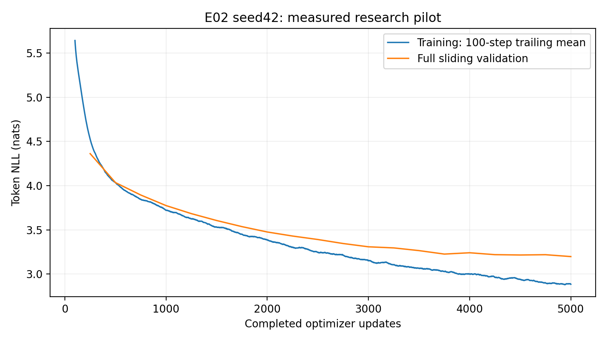
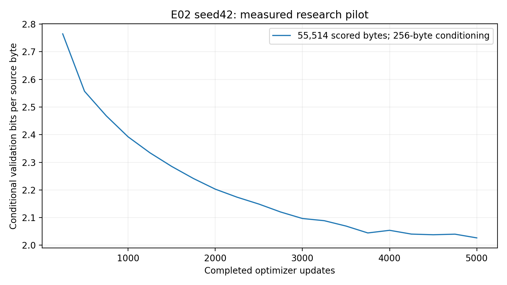

# E02 seed42 — Byte-BPE Colab pilot

E02 completed **5,000 optimizer updates**, **20 full sliding validations**, **20 resumable validation checkpoint states**, and **21 verified immutable snapshots**. Fresh-runtime recovery, actual best/final GPU inference, the complete fixed generation grid, and independent archive retrieval passed. The best and final checkpoint are both update **5000**, with conditional validation BPB **2.02659521**. PR publication is a separate review action; this report does not imply a merge or wider study approval.

## 1. Objective, hypothesis, and scope

This single authorized pilot tests the locked E02 tokenizer change against the [committed E01 seed42 reference](../E01_seed42/E01_seed42_analysis.md). The hypothesis was that train-only Byte-BPE may model reusable subword units more effectively than characters under the shared training protocol. The observed same-byte conditional validation score is lower for this E02 run. This is one observation with one seed and substantial parameter, context, exposure, and compute confounds; it does not establish a definitive tokenizer winner or statistical significance.

Authorization covered E02 seed42 for exactly 5,000 completed updates. No additional research configuration, seed, or 10k continuation was launched. The separate E02 preflight smoke restored at step 2 and continued to smoke step 4; it is excluded from every research table. The study-wide NO-GO remains.

## 2. Source and software equivalence

- Pinned clean training commit: `2cf39518492652e2ed05e459318e6166e4275814` (main after PR #4 was already merged).
- E01 trained commit: `444bca4c4ac19f97f46fae210a9fd361f8561537`.
- Both canonical source/configuration hashes: `cdea42adb930904fb0cefcd282d784bb3ac8caa311d3f1e12ef568622f9c12d6`.
- `git diff` across `src`, `configs`, and `experiments/configs` was empty. Changes after the E01 trained commit were reviewed orchestration/report changes merged through PR #4.
- E02 resolved configuration hash: `822afd303fcc1e67523a4811ecfe6a71f3b8325820b291c309c4950b0718e8e1`.
- Canonical training environment SHA256: `207137e911701ff436f1c4ae0c08db030c53e7b50091358c6721246a99d95ff2`. The normalized dependency-freeze hashes also match E01; see [environment hashes](evidence/environment_hashes.json).
- Python 3.11.14, PyTorch 2.5.1+cu124, CUDA 12.4, NumPy 1.26.4, tokenizers 0.21.0, pytest 8.3.4, matplotlib 3.9.4, and the exact 46-package E01 transitive freeze were qualified in an isolated environment.
- Colab's native Python 3.13.15 / PyTorch 2.11.0+cu130 remained installed. It did not execute research training. Standard-library archive finalization used the notebook's native Python; likelihood, recovery model inference, generation and figures used the qualified isolated environment.
- T4 CUDA matrix forward/backward and finite-gradient checks passed. The full automated suite passed: **35 tests in 30.96 seconds**.

The E02 checkpoint was freshly initialized with seed 42. No E01 weights were loaded. The committed analysis scripts import the shared package. The [thin launcher](https://github.com/rayyan-merchant/Nano-Language-Model/blob/8f88edee89dfceb6d0a8c84e385a886c4e058356/notebooks/colab_e02_seed42_pilot.ipynb) records the source and commands, with research execution disabled by default. [Executed Colab notebook](https://colab.research.google.com/drive/1Jiu1tKIHBN714tDjB4nu_6YGGE0-DSCJ).

## 3. Dataset and tokenizer provenance

Pinned Tiny Shakespeare revision: `6f9487a6fe5b420b7ca9afb0d7c078e37c1d1b4e`.

| Artifact | Verified value |
|---|---|
| Raw source SHA256 | `86c4e6aa9db7c042ec79f339dcb96d42b0075e16b8fc2e86bf0ca57e2dc565ed` |
| Dataset manifest hash | `76b594a1979107795734f8d2cda08b56c1520c8d44883dbaa5a61dbee53ba16f` |
| BPE tokenizer SHA256 | `2d7b1e84c8055eb5b9483a3fe6e4e3c9e348f5a28506ba19a0dc1644f0b36d55` |
| Validation source SHA256 | `c64e90c160750d91a9d2d9b1ace5eab1a440f5a1701d32a8e97a179b7839f1c8` |
| Original bytes: train / validation / test | 1,003,854 / 55,770 / 55,770 |
| BPE tokens: train / validation / test | 411,158 / 24,516 / 24,905 |
| Vocabulary | 1,024 |

Preparation and independent validation used the repository implementation. Contiguous partitions precede fitting and tokenization. BPE was fitted on the training text only; all partitions round-tripped losslessly with byte conservation. Held-out preprocessing checks establish encoding integrity, not test-set model selection. Training windows use only training IDs, with shifted next-token targets and no partition crossing. No test likelihood was evaluated.

## 4. Architecture and training/evaluation protocol

The from-scratch decoder-only causal Transformer has width 192, 4 blocks, 6 attention heads, a 128-token context, a 4× MLP, GELU, sinusoidal positions, and dropout 0.1. Explicit shared attention/model code is unchanged. E02 has **2,173,056 parameters**, versus E01's 1,804,800; vocabulary embedding/output growth adds 368,256 parameters (**20.40%**).

AdamW used constant LR 3e-4, weight decay 0.01, norm clipping 1.0, seed 42, float32, CUDA, microbatch 4, accumulation 8, and 4,096 predicted tokens per update. The run stopped at exactly 5,000 completed optimizer updates with zero skipped updates. Validation every 250 and nominal checkpoint cadence every 500 also preserved every validation/best state.

Conditional validation BPB follows [docs/bpb.md](../../../docs/bpb.md): the identical 55,770-byte validation text, first 256 original bytes as conditioning, exactly 55,514 scored bytes, separately tokenized prefix/suffix to force the common byte boundary, full sliding context, each suffix target scored once, reset local positions, and no future-token leakage. E02 scores 24,386 suffix tokens. NLL is divided by `ln(2) × 55,514`, rather than token count, for the cross-tokenizer metric. Prefix-boundary segmentation is constrained and is not unconstrained corpus entropy.

Token NLL and perplexity below are within-E02 diagnostics. Their units differ from E01 and must not be ranked across tokenizers. Best selection minimized the recorded full-validation token NLL; with this fixed E02 segmentation and denominator, it also minimized BPB.

## 5. Measured learning curves and checkpoint metrics

Initial recorded step loss: 7.11164474. Final batch loss: 2.78892311; final trailing-100 training mean: 2.88480975. Best/final validation NLL: 3.19782302; perplexity: 24.47918155; BPB: 2.02659521.

| Update | Token validation NLL | Perplexity | Conditional BPB |
|---:|---:|---:|---:|
| 250 | 4.36230453 | 78.43768837 | 2.76457622 |
| 500 | 4.03472710 | 56.52749181 | 2.55697659 |
| 750 | 3.89420875 | 49.11717404 | 2.46792419 |
| 1000 | 3.77464160 | 43.58188565 | 2.39214945 |
| 1250 | 3.68368440 | 39.79273679 | 2.33450604 |
| 1500 | 3.60571973 | 36.80816634 | 2.28509655 |
| 1750 | 3.53661773 | 34.35053953 | 2.24130369 |
| 2000 | 3.47601920 | 32.33076319 | 2.20289985 |
| 2250 | 3.43016620 | 30.88177493 | 2.17384088 |
| 2500 | 3.39091997 | 29.69325657 | 2.14896888 |
| 2750 | 3.34556227 | 28.37652646 | 2.12022380 |
| 3000 | 3.30843045 | 27.34217685 | 2.09669180 |
| 3250 | 3.29597192 | 27.00364672 | 2.08879630 |
| 3500 | 3.26535129 | 26.18930931 | 2.06939072 |
| 3750 | 3.22603937 | 25.17973169 | 2.04447710 |
| 4000 | 3.24106574 | 25.56094848 | 2.05399994 |
| 4250 | 3.21949926 | 25.01559065 | 2.04033235 |
| 4500 | 3.21574636 | 24.92188570 | 2.03795399 |
| 4750 | 3.21904281 | 25.00417493 | 2.04004308 |
| 5000 | 3.19782302 | 24.47918155 | 2.02659521 |






Lines join recorded validation points; no intermediate validation measurements were invented. Validation improved from BPB 2.09669180 at 3k to 2.02659521 at 5k, a decrease of 0.07009659. Small increases occurred from 3,750 to 4,000 and from 4,500 to 4,750. The final point was best; the run does not demonstrate a plateau. The within-E02 3k-to-5k token-NLL decrease was 0.11060743. A descriptive fitted late NLL slope was -0.05193113 per 1,000 updates; it is not a forecast or significance test.

The final validation minus trailing-100 training NLL is 0.31301327. Dropout, sampled batches, and evaluation mode differ, so this gap alone does not prove overfitting. Further approved continuation could clarify convergence, but none was started.

## 6. Throughput, exposure, and resource use

| Recorded quantity | E02 value |
|---|---:|
| Training-only seconds | 1128.893 |
| Full-validation seconds, 20 measurements | 198.577 |
| Engine segment wall time through summary creation | 1,371.960 |
| Remaining setup/journal/checkpoint/export overhead, unattributed | 44.490 s |
| Predicted tokens / training second | 18141.668 |
| Optimizer updates / training second | 4.429118 |
| Source-byte exposure / training second | 44284.035 |
| Peak PyTorch allocated GPU memory | 157.330 MiB |
| Training predicted-token exposure | 20,480,000 |
| Training source-byte exposure, repeats included | 49,991,931 |
| Unique target bytes | 1,003,827 / 1,003,854 |
| Exposure bytes / predicted token | 2.44101226 |
| Fresh snapshot verification/restore/counter audit | 87.084 s |
| Complete fixed-grid GPU generation | 211.224 s |

The 44.490-second residual includes setup and multiple IO operations and is not an individually measured save/export timing. Final post-summary export, environment installation, archive construction/retrieval and later recovery are outside the engine segment timing. Per-checkpoint/export timings and FLOPs were not recorded and remain unavailable. PyTorch allocated-memory peaks exclude driver and process overhead.

All possible sampled training 128-token contexts span mean **312.514 original bytes**, median 313, range 211–401. Canonical validation contexts span mean **291.128 bytes**, range 204–405. E01 spans 128 ASCII bytes. E02 therefore has longer effective byte context and **2.441×** repeated target-byte exposure at equal update/token counts. Unique target coverage was 99.997310%; these are sampled-target coverage counts, not FLOPs, unique epochs, or complete training-input traffic.

Both runs used the Tesla T4 model and matched software pins. E01 allocated two GPUs but trained on GPU0; E02's preflight exposed one. Kaggle versus Colab, host/driver and runtime conditions remain uncontrolled. E02 training-only time was 23.15% higher, while full-validation time was lower. Fewer BPE validation targets are a relevant workload difference. These timings do not isolate a causal tokenizer speed effect.


## 7. Genuine fixed-protocol generation

The shared generation protocol used five fixed prompts, greedy decoding, temperatures 0.7/1.0/1.2, seeds 42/123/456, and 256 new tokens. Best and final produced 100 labeled records (50 settings for each checkpoint policy). Both policies refer to the same step-5,000 weights here and their outputs match. The entire unedited grid is preserved in [generation.json](generation.json) and [generation.md](generation.md). No other language model generated or repaired these outputs.

The five predetermined greedy samples follow in full. They show speaker labels and locally readable phrases, followed by substantial repetition. The Romeo and citizen samples loop around “I'll tell you”; the king sample repeats field/kingdom language and invents word forms.


### Fixed greedy prompt 1: 'To be, or not to be'

```text
To be, or not to be sound.

KING RICHARD III:
What, is the matter?

QUEEN ELIZABETH:
Ah, my lord, I'll not be soldier.

KING RICHARD III:
Say, I'll be so.

KING RICHARD III:
What, is't?

KING RICHARD III:
Ay, my lord?

KING RICHARD III:
Ay, my lord.

KING RICHARD III:
What, is the matter?

QUEEN ELIZABETH:
Ay, but not so much.

KING RICHARD III:
What, what?

KING RICHARD III:
What, what?

TYBALT:
Atttt thou?

KING RICHARD III:
Ay, my lord.

KING RICHARD III:
What, what?

KING RICHARD III:
Ay, my lord?

KING RICHARD III:
Ay, my lord.

KING RICHARD III:
What, what?

KING RICHARD III:
Ay, my lord?

KING RICHARD III:
Ay, my lord.

KING RICHARD III:
What, what
```


### Fixed greedy prompt 2: 'ROMEO:\n'

```text
ROMEO:
I'll tell you, sir, I'll tell you.

ROMEO:
I'll tell you, I'll tell you.

ROMEO:
I'll tell you, I'll tell you.

ROMEO:
I'll tell you, I'll tell you.

ROMEO:
I'll tell you.

MERCUTIO:
I'll tell you, sir, I'll tell you.

MERCUTIO:
I will not be so.

MERCUTIO:
I'll tell you, sir, I'll tell you.

MERCUTIO:
I'll tell you, sir, sir, I'll tell you.

MERCUTIO:
I'll tell you, sir, sir, I'll tell you.

MERCUTIO:
I'll tell you, sir, sir, I'll tell you.

MERCUTIO:
I'll tell you, sir, sir, I'll tell you.

MERCUTIO:
I'll tell you, sir, sir, I'll tell you.

MERCUTIO:
I'll tell you, sir, sir
```


### Fixed greedy prompt 3: 'JULIET:\n'

```text
JULIET:
I'll not believe thee, and thou hast done.

ROMEO:
I'll tell thee, I'll tell thee, I'll not:
I'll tell thee, I'll not: I'll not believe thee.

ROMEO:
I'll tell thee, I'll tell thee, I'll tell thee.

ROMEO:
I'll tell thee, I'll tell thee, I'll play the world.

ROMEO:
I'll tell thee, I'll tell thee, I'll tell thee,
And I'll play the buildness of thy love.

ROMEO:
O, I'll tell thee, I'll tell thee, I'll play thee thee,
And thou wilt not so, I'll believe thee.

ROMEO:
I'll tell thee, I'll tell thee, I'll play thee,
And thou wilt not so.

ROMEO:
O, I pray thee, thou wilt not so.

ROMEO:
O, I pray thee, thou wilt not so?

ROMEO:
Nay, thou art not so?

ROMEO:
Nay, thou art
```


### Fixed greedy prompt 4: 'First Citizen:\n'

```text
First Citizen:
I'll tell you, sir, sir, I'll tell you.

First Citizen:
I'll tell you, sir, sir, I'll tell you.

Second Citizen:
I'll tell you, sir, sir, I'll tell you.

Second Citizen:
I'll tell you, sir, sir, I'll tell you.

First Citizen:
I'll tell you, sir, sir, sir, you are well.

First Citizen:
I'll tell you, sir, sir, sir, you are well.

First Citizen:
I'll tell you, sir, sir, sir, sir, I pray you, sir,
constantly.

First Citizen:
I'll tell you, sir, sir, sir, sir, I'll tell you.

Second Citizen:
I'll tell you, sir, sir, sir, sir, I'll tell you.

Second Citizen:
I'll tell you, sir, sir, sir, sir, I pray you, sir,
so, sir, you shall be a man.

First Citizen:
I'll tell you, sir,
```


### Fixed greedy prompt 5: 'The king'

```text
The kings,
And all the body of the kingdom of the king,
And crack'd the kingdom of the king's death
And could not stay with the king's death.

KING RICHARD II:
O, I'll not be so much.

HENRY BOLINGBROKE:
O, I am a king,
And I am a king, and nothing but to bed,
And I am a bawd, to be a bawd,
And brazen of the bird, and I am a chamber,
And in the midsts of the chamber-coming,
And, by the moons, and the duke's bukes,
And in the moons of the birds,
And in the moons, the moons, and fire
Strike up in the field of the field
Of the fielden pursues of the fire,
And cruelts the brave-bederke, and
```


Temperature 0.7 sometimes yields valid local dialogue phrases but also forms such as `sadsop`, `discocourse`, and `mippositions`. Higher temperatures diversify continuations and introduce further malformed word/subword blends. One unique setting—`To be, or not to be`, temperature 1.2, seed 456—contains a replacement character in `MAPSURE�ber`. It appears once in each identical best/final label. Dataset round-trip integrity passed; an unconstrained generated byte sequence can still yield invalid UTF-8 on decoding. This artifact was preserved unchanged.

| Best-checkpoint setting | Samples | Mean continuation characters | Mean repeated 8-gram position fraction | Replacement characters |
|---|---:|---:|---:|---:|
| greedy | 5 | 632.2 | 0.6258 | 0 |
| 0.7 | 15 | 595.2 | 0.0589 | 0 |
| 1.0 | 15 | 619.1 | 0.0281 | 0 |
| 1.2 | 15 | 638.8 | 0.0111 | 1 |

These descriptive repeated-character-window counts are within-E02 diagnostics and are not a quality score. Lower repetition at higher temperature does not prove improved coherence. Equal 256-token generation budgets produce longer BPE text than character text: mean greedy continuation length is 632.2 characters for E02. The E01 predetermined samples also loop and contain malformed words. E02 sometimes displays longer readable phrases, but stable word, narrative, or semantic coherence is not consistently established under these settings. More fluent-looking passages are not evidence of superior generalization by themselves.

## 8. Failures, durable storage, and recovery evidence

Drive access was initially declined, unmounted, then explicitly approved by the user. The exploratory direct Colab download did not reach the computer; the approved Drive route was used. Before research, a unique directory was created, writes checked, Drive Storage showed 8.03 GB of 400 GB used, three smoke snapshot manifests/hashes verified, and a fresh-directory checkpoint loaded, generated, and resumed on CUDA. A conservative 100-checkpoint storage budget was 2,722,343,600 bytes.

The training engine published verified immutable snapshots at every validation boundary, so the maximum exposure since a completed durable export was 250 updates plus an export in progress. All 20 validation states and the extra final-summary snapshot are preserved. The original local runtime disappeared after the completed log and snapshots were saved; the cause was not measured. The fresh matching runtime restored all checkpoint files solely from exact snapshot hash matches. It verified all 20 optimizer counters, scheduler epochs, history lengths, complete 5k journal, evaluation policy and byte counts. The research journal recorded no failure or resume events. Actual best/final GPU inference was executed after independent restores, with zero additional optimizer updates.

Postprocessing initially failed at final manifest publication because `atomic_json` used a hard link unsupported by mounted Drive. Generation and the complete ZIP had already succeeded. A staged-rename manifest publisher repaired this without repeating training or generation. The failure log remains stored. One subsequent repair-script upload did not arrive and its file-existence guard failed; direct standard-library archive verification then succeeded. These are postprocessing/transfer failures, not missing model updates.

The connector rejected the 477,310,968-byte ZIP because its per-download limit is 268,435,456 bytes. The same archive was split into checksum-tracked parts, independently downloaded, concatenated, and verified. ZIP paths, duplicate entries, CRC, all 52 archive file hashes, all 20 checkpoint files, and final checkpoint hash passed independent local checks. See [independent verification](evidence/independent_verification.json), [checkpoint audit](evidence/checkpoint_audit.json), [snapshot index](evidence/snapshot_index.json), and [failures](evidence/failures.json).

Independent local CPU inference used Python 3.10.0 / PyTorch 2.11.0 for inference migration only, with the shared package and tokenizer 0.21.0. From the recovered checkpoint it actually produced `'To be thus.\n\nKING RICHARD III:\nSay, I will not be'` for the fixed recovery prompt `To be` and 16 greedy new tokens. No local training continuation occurred. Local archive verification/inference took 6.587 seconds, excluding download. Transfer and archive-construction timings were not measured separately.

## 9. E01 versus E02 scientific comparison

| Measure | E01 seed42 | E02 seed42 |
|---|---:|---:|
| Model parameters | 1,804,800 | 2,173,056 |
| Vocabulary | 65 | 1024 |
| Optimizer updates | 5000 | 5000 |
| Predicted training tokens | 20,480,000 | 20,480,000 |
| Training source-byte exposure, repeats included | 20,480,000 | 49,991,931 |
| Unique target bytes | 1,003,848 | 1,003,827 |
| 128-token training context, original bytes | 128 | mean 312.514; range 211–401 |
| Validation preceding context, original bytes | 128 | mean 291.128; range 204–405 |
| Best validation BPB | 2.21405793 | 2.02659521 |
| Final validation BPB | 2.21599704 | 2.02659521 |
| Best-checkpoint update | 4750 | 5000 |
| Training-only seconds | 916.708 | 1128.893 |
| Full validation seconds, 20 evaluations | 420.908 | 198.577 |
| GPU | Tesla T4; GPU0 used of two allocated | Tesla T4; one visible in preflight |
| Generation behavior | Speaker turns; greedy loops and malformed words | Speaker turns and readable phrases; greedy loops, malformed subword blends; one unique replacement-character sample |
| Limitations | One seed; 128-byte context; character exposure | One seed; 20.40% more parameters; ~2.44× byte exposure and longer byte context |

Best E02 BPB is lower by **0.18746272 bits/byte (8.4669%)** than the committed E01 best. Both score the identical validation hash and same 55,514 original-byte suffix with the identical conditioning/evaluator policy and core source. Direct BPB comparison is therefore appropriate within this conditional policy. The advantage is associated with this full E02 configuration; more parameters, longer byte context and ~2.44× source-byte exposure prevent attributing it solely to BPE merges. Equal updates do not equal raw-text exposure, FLOPs, cost or effective context. One seed per configuration supplies no variance estimate, significance claim or definitive winner.

## 10. Storage and retrieval

Run ID: `E02_seed42_8130615f7e7144ad9a0abad20d0497e8`.

- [Private durable artifact directory](https://drive.google.com/drive/folders/16g4kvL_hYt6GDG-UIgVBDkD0-IW_t8-T).
- [Immutable research snapshots](https://drive.google.com/drive/folders/1vy59z7Mz1xyLHiEs93fqhfSar2Uj9euw).
- [Complete archive](https://drive.google.com/file/d/1js-oI8f4zew4R_Ix48KYov21YGbo22TP/view), 477,310,968 bytes.
- Archive SHA256: `a08db901c3adb9a70357f0f3beb54fbf11c273fbb95383184d442b195a30ee5c`.
- Best/final checkpoint SHA256: `80f2d80202f1af124fa18697258208ffc7bde9e3fa0d52009a8ceba591ab7606`.
- [Complete archive manifest](evidence/artifact_manifest.json) and [ordered part checksums](evidence/archive_parts.json).

Download the full ZIP through an authenticated client supporting its size, or download the numbered parts in `archive_parts` and concatenate them in numeric order. Verify the complete SHA256, ZIP CRC and each manifest entry before loading. The archive contains the complete recovered run, all 20 checkpoints, histories, tokenizer, dataset manifest, optimizer/scheduler/RNG/sampling state, figures, generations and recovery evidence. The pinned source plus dataset manifest allow original-data reacquisition; large weights and dataset files remain outside GitHub.

To restore a snapshot, use the shared `nano_lm.storage verify` and `restore` commands into a fresh directory. Future training continuation requires matching PyTorch/GPU, code, dataset, tokenizer and resolved training settings. The final saved state is sufficient for a separately approved 10k total target; no continuation is authorized by this report. CPU inference migration does not imply exact training-resume equivalence on another framework or device.

## 11. Recommendations and completion status

Preserve this 5k endpoint and evaluate additional approved seeds only after independent environment/storage gates are reconciled. Keep the locked optimization and evaluation protocol for the planned ablations. Treat final-is-best and the remaining late BPB improvement as reasons to review the 5k budget, not to extend it automatically. Any future matched-byte/context or parameter-controlled experiment would be a new design requiring approval. Sample looping and malformed words remain substantive model limitations even with lower BPB.

The scientific execution, required validations, all checkpoint states, durable exports, independent recovery/inference, generation grid, plots and analysis are complete. Publication requires opening the review PR; no branch merge has been performed. Every value here derives from recorded evidence; per-checkpoint IO timings and FLOPs are explicitly unavailable.
