# E03 seed42 RoPE research experiment — 2026-10-12

One explicitly authorized positional-encoding ablation: **5000 completed optimizer
updates**, seed42. E01 is a separately completed matched-seed baseline; E02 is the
other member's independent Colab execution and is not analyzed here. No other seed,
configuration or10k continuation was launched. The broader three-seed study remains
separately gated. This report presents observed measurements and limitations,
without assuming RoPE superiority or statistical significance.

## Research objective, hypothesis and technical rationale

Measure how replacing additive sinusoidal positions with RoPE affects next-token
prediction, learning dynamics, compute/memory and fixed-prompt generation in the
same small GPT. **Hypothesis:** rotating projected Q/K may change learned positional
relationships and sequential dependence. Improvement, equivalence and regression
were all possible; no result direction or overfitting was assumed.

For head dimension32, adjacent coordinates (2j,2j+1), j=0,…,15, rotate by
θ=p·10000^(-2j/32): (a,b)→(a cosθ−b sinθ,a sinθ+b cosθ). An orthogonal rotation
preserves each pair norm. The Q/K dot product contains the relative rotation
R(i)^T R(j); this mathematical structure is a rationale, not empirical proof of
better long-range reasoning or context extrapolation.

## Implementation audit and controlled factor

Canonical positions.py rotates **queries and keys only**, after their independent
linear projections and head splitting to (batch,6,sequence,32). Values remain
unrotated; logits are scaled by sqrt(32) and the unchanged upper-triangular causal
mask precedes softmax. No additive sinusoidal or learned position embedding is
active in RoPE mode. GPT still allocates an unused nonpersistent sinusoidal buffer;
it contributes no trainable parameters. Every other trainable tensor has the same
shape and exact seed42 initial value as E01, as the audit confirms. This is fresh
E03 initialization, never E01 fine-tuning.

Independent CPU and CUDA audit passed13 checks: scalar2x2 reference, per-pair norms,
rotation autograd, Q/K interception after projection/splitting, unrotated V
aggregation, finite full-context forward/cross entropy, causal shapes/mask, future
token invariance, nonzero finite Q/K/V gradients, no learned positions, poisoned
unused sinusoidal buffer and cropped generation consistency. The canonical
train/evaluator/generator use local indices0,…,L−1 after context truncation. No
absolute-position cache or extrapolation experiment was added.

## Exact source, environment and reproducibility

- Reviewed main: `2cf39518492652e2ed05e459318e6166e4275814`.
- Clean trained source: `0dd75296a773081f55a7a6d1da111e482562c1c1`.
- E01 trained source: `444bca4c4ac19f97f46fae210a9fd361f8561537`.
- Shared audited core hash: `cdea42adb930904fb0cefcd282d784bb3ac8caa311d3f1e12ef568622f9c12d6`.
- E03 resolved configuration hash: `e0b4b8ce7ab03c17a2a2664aabe4f58523531944c108fe552a7e79690f57b10c`.
- E03 unique research run: `E03_seed42_3eddd727e88a4748b23b605c7c3590fd`.
- [Private research notebook, saved version1](https://www.kaggle.com/code/rayyannmerchant/nano-e03-pilot-20261012-82f33b8a).
- [Private fresh recovery notebook](https://www.kaggle.com/code/rayyannmerchant/nano-e03-recovery-20261012-33b2c3ba).
- GPU: Tesla T4, device0, 2 allocated devices;
  GPU0 total 15,636,037,632 bytes.
- Python 3.11.14, PyTorch 2.5.1+cu124, torch CUDA 12.4.
- OS: Linux-6.18.48+-x86_64-with-glibc2.39. Full freeze and nvidia-smi/driver information: evidence.

The qualified Python3.11.14/torch2.5.1+cu124/NumPy1.26.4/transitive freeze was
reproduced; native Kaggle packages were untouched. E01/E03 freeze comparison passed
except editable Git SHA. Separate GPU sessions introduce clock/load/thermal and
instance variability; timing differences are descriptive, not isolated hardware
benchmarks. The source diff and tests reviewed orchestration only; no human PR
approval is represented as obtained. All code used for research was committed,
clean and CPU-CI tested before submission.

## Data, architecture, optimization and evaluation

Pinned Karpathy char-rnn revision6f9487a6fe5b420b7ca9afb0d7c078e37c1d1b4e;
raw SHA25686c4e6aa9db7c042ec79f339dcb96d42b0075e16b8fc2e86bf0ca57e2dc565ed.
Character tokenizer SHA256ed96787d2f3f9741d69eba15160f31634ba6755b47e4c261ffedbb975fa0af77;
vocabulary65. Source/splits/tokenizers/manifest match E01 exactly. Contiguous
train/validation/test bytes1003854/55770/55770; fit on training only and no windows
cross partitions. The test partition was not used for likelihood or selection.

Decoder-only pre-LayerNorm GPT: width192,4 blocks,6 heads,32 dimensions/head,
context128,MLP expansion4,GELU,dropout0.1,RoPE,**1,804,800 parameters**.
AdamW3e-4,constant schedule,weight decay0.01,gradient clip1,float32 CUDA,seed42,
microbatch4,accumulation8,4096 predicted targets/update,5000 optimizer updates.
No early stopping, AMP, LR change, architecture change or training-history restart.
Separate development checks precede a fully reseeded research run; they are not
counted as experimental optimizer updates or validation observations.

Full sliding validation every250 updates, complete55770-byte validation partition,
256 original conditioning bytes excluded,55514 target bytes/tokens scored once.
Conditional BPB=sum NLL/(ln2·scored bytes), perplexity=exp(token NLL). Character
BPB equals token loss/ln2 here; these are related measures, not independent evidence.
No capped/sampled validation or invented step-zero measurement is included.
The existing checkpoint policy saves every validation state and every500-step
boundary, selects best on actual validation and exports immutable snapshots.

Train loss uses sampled batches/dropout; validation is eval-mode/full sliding.
Same-step gaps are noisy, unequal-protocol diagnostics. Training100-step trailing
means are labeled smoothing, not additional measurements. Equal tokens/steps do
not guarantee equal FLOPs or bytes of usable conditional context across variants.

## Genuine measured E03 results

| Quantity | Recorded value |
|---|---:|
| First training loss, update1 | 4.38823789 |
| First validation loss, update250 | 2.04631346 |
| Final training loss | 1.36466110 |
| Final100-step trailing training mean | 1.36358169 |
| Best observed validation step | 5000 |
| Best validation loss / conditional BPB | 1.43708178 / 2.07327076 |
| Final validation loss / conditional BPB | 1.43708178 / 2.07327076 |
| Final validation perplexity | 4.20839687 |
| Processed predicted tokens / source bytes | 20,480,000 / 20,480,000 |
| Unique target source bytes | 1,003,848 |
| Gradient clipping updates | 7/5000 (0.14%) |
| Peak allocated GPU memory,MiB | 151.712 |

Source-byte exposure includes repeats, not independent epochs. Uncovered target
source bytes: **6**, as reflected in the measured coverage;
the first source byte cannot be a target without a preceding token. Allocated
GPU memory excludes reserved/driver/device overhead.

| Update | Validation loss | Conditional BPB | Perplexity |
|---|---:|---:|---:|
| 250 | 2.04631346 | 2.95220628 | 7.73931714 |
| 500 | 1.87746602 | 2.70861092 | 6.53691943 |
| 750 | 1.79613239 | 2.59127129 | 6.02629498 |
| 1000 | 1.72382080 | 2.48694772 | 5.60590665 |
| 1250 | 1.67081194 | 2.41047209 | 5.31648269 |
| 1500 | 1.63094455 | 2.35295562 | 5.10869787 |
| 1750 | 1.59672130 | 2.30358190 | 4.93681951 |
| 2000 | 1.57209796 | 2.26805793 | 4.81674295 |
| 2250 | 1.54311509 | 2.22624448 | 4.67914352 |
| 2500 | 1.52566536 | 2.20106985 | 4.59820201 |
| 2750 | 1.51427173 | 2.18463231 | 4.54610912 |
| 3000 | 1.49976438 | 2.16370263 | 4.48063322 |
| 3250 | 1.49259675 | 2.15336194 | 4.44863254 |
| 3500 | 1.47674206 | 2.13048844 | 4.37865700 |
| 3750 | 1.46578821 | 2.11468538 | 4.33095559 |
| 4000 | 1.46668331 | 2.11597674 | 4.33483398 |
| 4250 | 1.46007136 | 2.10643771 | 4.30626682 |
| 4500 | 1.44616722 | 2.08637828 | 4.24680622 |
| 4750 | 1.44156271 | 2.07973538 | 4.22729671 |
| 5000 | 1.43708178 | 2.07327076 | 4.20839687 |

## E01 versus E03: matched observations

Δ=E03−E01; negative loss/BPB differences favor E03. Relative differences are
percentages of the E01 metric, not statistical effect-size estimates.

| Metric | E01 | E03 | Δ | Relative,% |
|---|---:|---:|---:|---:|
| best_loss | 1.53466801 | 1.43708178 | -0.09758623 | -6.359 |
| final_loss | 1.53601210 | 1.43708178 | -0.09893032 | -6.441 |
| best_bpb | 2.21405793 | 2.07327076 | -0.14078717 | -6.359 |
| final_bpb | 2.21599704 | 2.07327076 | -0.14272628 | -6.441 |
| final_training_loss | 1.46865343 | 1.36466110 | -0.10399233 | -7.081 |
| training_seconds | 916.70840175 | 1107.72115184 | 191.01275010 | 20.837 |
| validation_seconds | 420.90800282 | 447.51543827 | 26.60743544 | 6.321 |
| peak_gpu_bytes | 159081984.00000000 | 159081984.00000000 | 0.00000000 | 0.000 |
| parameters | 1804800.00000000 | 1804800.00000000 | 0.00000000 | 0.000 |

| Update | E01 loss | E03 loss | Δ loss | E01 BPB | E03 BPB |
|---|---:|---:|---:|---:|---:|
| 250 | 2.46425110 | 2.04631346 | -0.41793764 | 3.55516284 | 2.95220628 |
| 500 | 2.26721599 | 1.87746602 | -0.38974997 | 3.27090127 | 2.70861092 |
| 750 | 2.11220971 | 1.79613239 | -0.31607731 | 3.04727447 | 2.59127129 |
| 1000 | 1.99768526 | 1.72382080 | -0.27386446 | 2.88205062 | 2.48694772 |
| 1250 | 1.92482598 | 1.67081194 | -0.25401404 | 2.77693689 | 2.41047209 |
| 1500 | 1.86354672 | 1.63094455 | -0.23260217 | 2.68852962 | 2.35295562 |
| 1750 | 1.81413472 | 1.59672130 | -0.21741342 | 2.61724317 | 2.30358190 |
| 2000 | 1.75925914 | 1.57209796 | -0.18716118 | 2.53807444 | 2.26805793 |
| 2250 | 1.72154866 | 1.54311509 | -0.17843357 | 2.48366971 | 2.22624448 |
| 2500 | 1.69282241 | 1.52566536 | -0.16715705 | 2.44222650 | 2.20106985 |
| 2750 | 1.66527225 | 1.51427173 | -0.15100052 | 2.40248002 | 2.18463231 |
| 3000 | 1.63945360 | 1.49976438 | -0.13968922 | 2.36523157 | 2.16370263 |
| 3250 | 1.61751165 | 1.49259675 | -0.12491489 | 2.33357603 | 2.15336194 |
| 3500 | 1.60199293 | 1.47674206 | -0.12525087 | 2.31118726 | 2.13048844 |
| 3750 | 1.58823999 | 1.46578821 | -0.12245179 | 2.29134596 | 2.11468538 |
| 4000 | 1.57893347 | 1.46668331 | -0.11225016 | 2.27791948 | 2.11597674 |
| 4250 | 1.56335215 | 1.46007136 | -0.10328079 | 2.25544039 | 2.10643771 |
| 4500 | 1.54364829 | 1.44616722 | -0.09748107 | 2.22701373 | 2.08637828 |
| 4750 | 1.53466801 | 1.44156271 | -0.09310530 | 2.21405793 | 2.07973538 |
| 5000 | 1.53601210 | 1.43708178 | -0.09893032 | 2.21599704 | 2.07327076 |

The shared results collector validated both final checkpoint histories, metadata,
configuration/data/tokenizer hashes and comparison policy. Final private sampling
RNG states and source-byte coverage arrays also matched exactly. Only position
differs in the models. One seed per configuration means sample SD is undefined,
not zero. Machine-readable comparison/CSV files preserve all20 matched validation
points and explicit incomplete-study seed counts. No E02 data are included.

| E01 reference update | E01 recorded loss | First observed E03 update at/below it |
|---|---:|---:|
| 1000 | 1.99768526 | 500 |
| 2000 | 1.75925914 | 1000 |
| 3000 | 1.63945360 | 1500 |
| 4000 | 1.57893347 | 2000 |
| 5000 | 1.53601210 | 2500 |

These are retrospective thresholds on actual250-update observations, not exact
crossing times, interpolated measurements or a modified stopping rule. Both runs
completed5000 updates irrespective of intermediate comparisons.

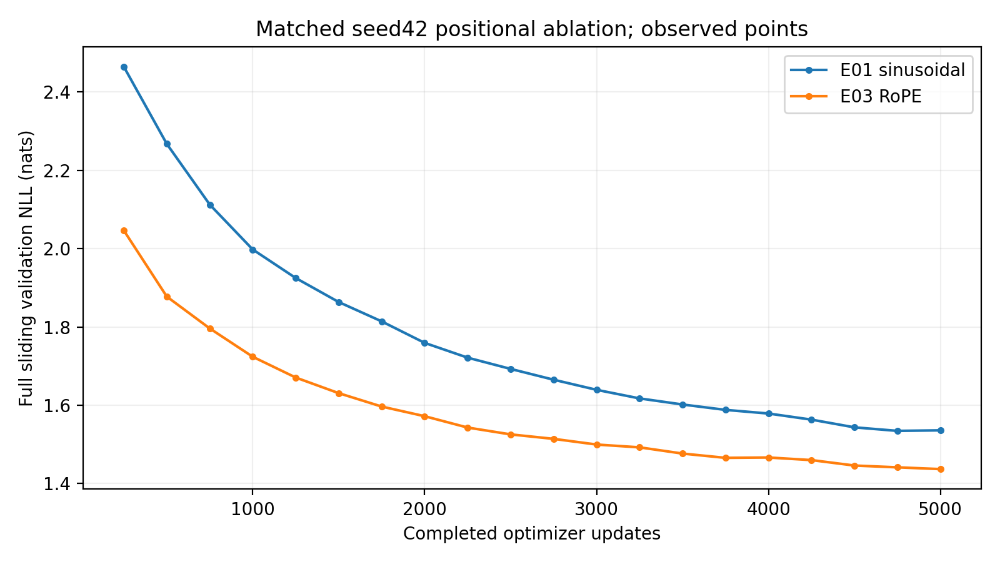

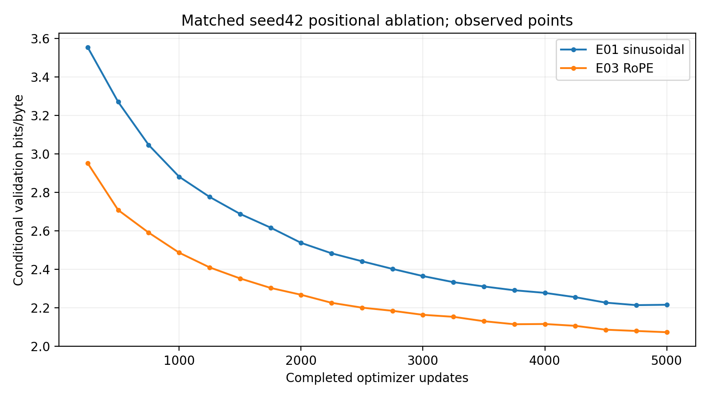

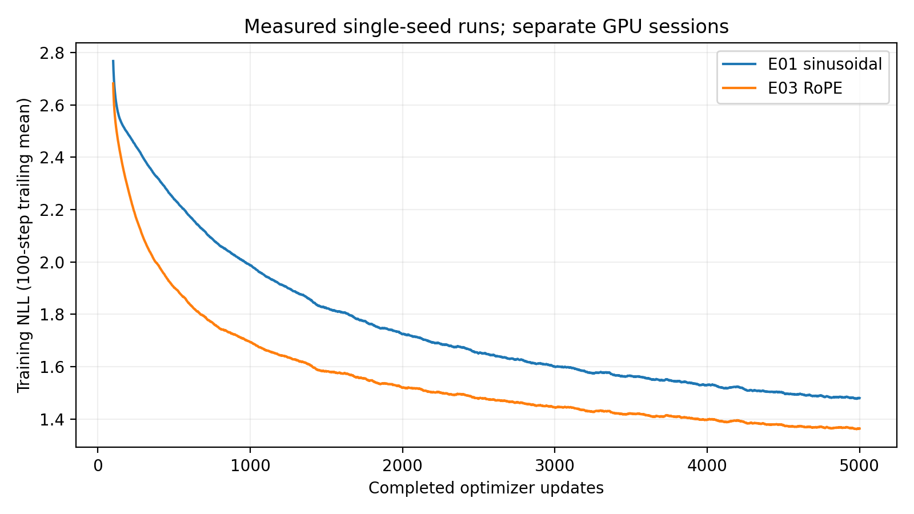

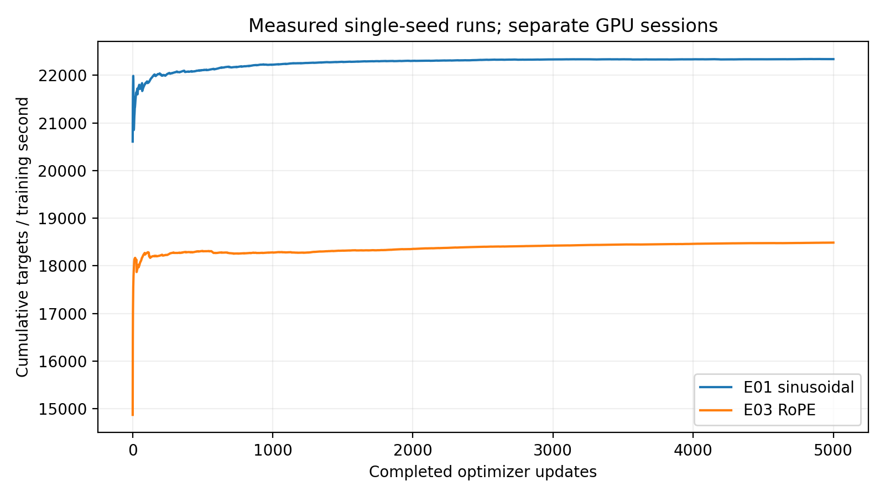

## Runtime, throughput and overhead

| Measured scope | Seconds |
|---|---:|
| Training only | 1107.721 |
| Full validation,20 evaluations | 447.515 |
| Checkpoint calls | 2.582 |
| Verified snapshot export calls | 6.797 |
| Journal fsync/flush calls | 18.127 |
| Training CLI wall | 1591.277 |
| Archive compression and checksum scope | 20.846 |
| Notebook clone→archive-complete pipeline | 1951.871 |
| Complete genuine100-sample generation | 240.684 |

Training-only average: 4.5138 updates/sec,
18488.41 predicted tokens/sec. Generation
and archive scopes lie within the measured notebook pipeline; do not double-count
them. Pipeline timestamps exclude queue, final notebook conversion/output
publication and external download. Recovery and transfer costs are separately
recorded below. Individual validation times were not logged; cumulative total is
genuine. No measured dollars or full-session lifetime is invented.

## E03 measured figures

Validation lines connect only20 actual observations. Training smoothing uses the
declared100-step trailing mean. Full PNG/PDF evidence is in the verified archive.

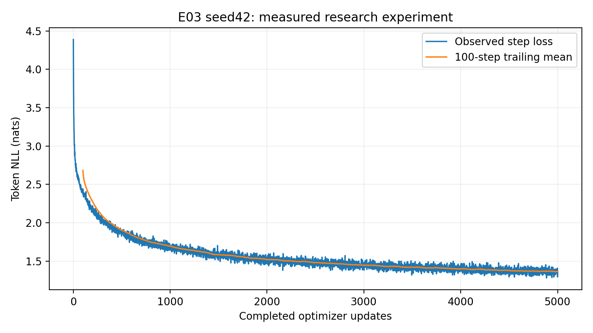

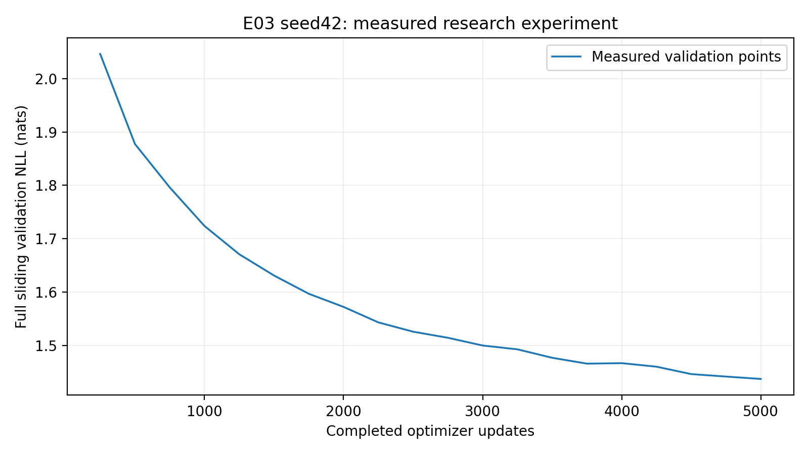

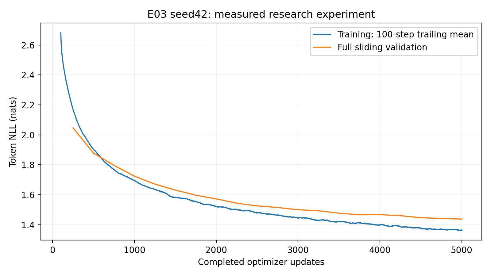

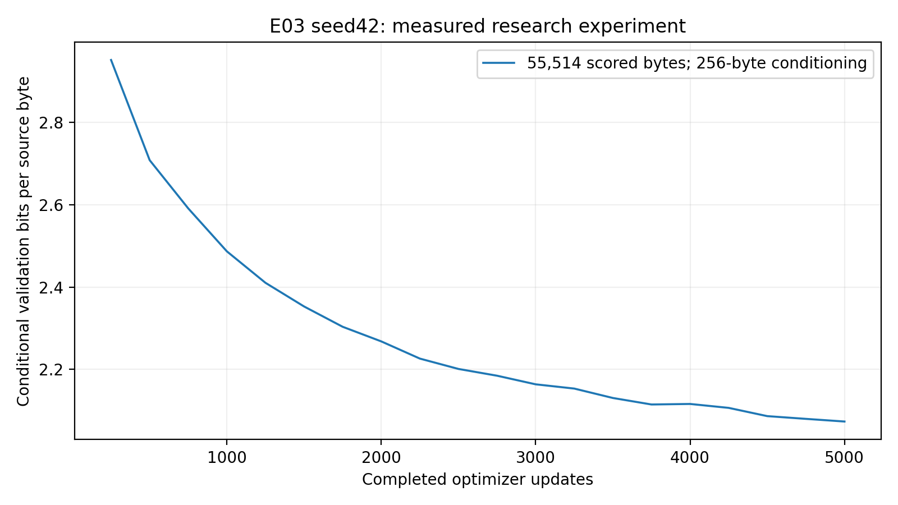

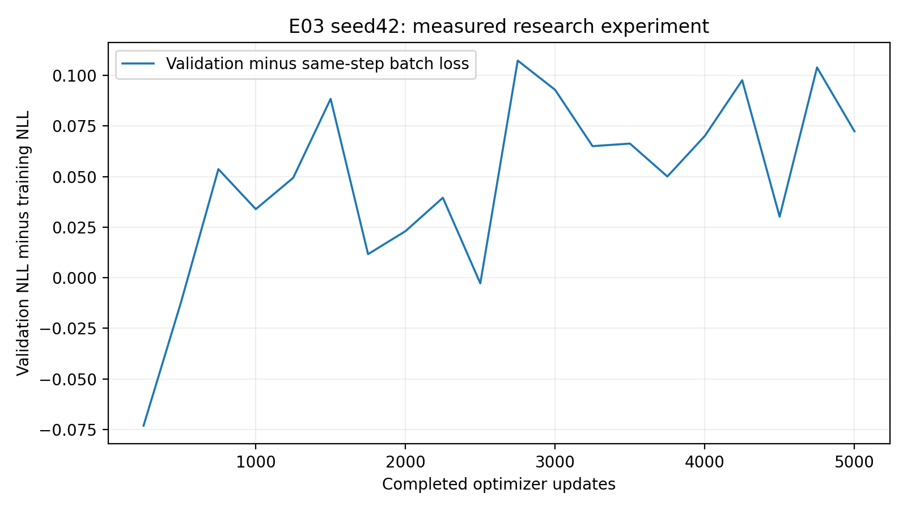

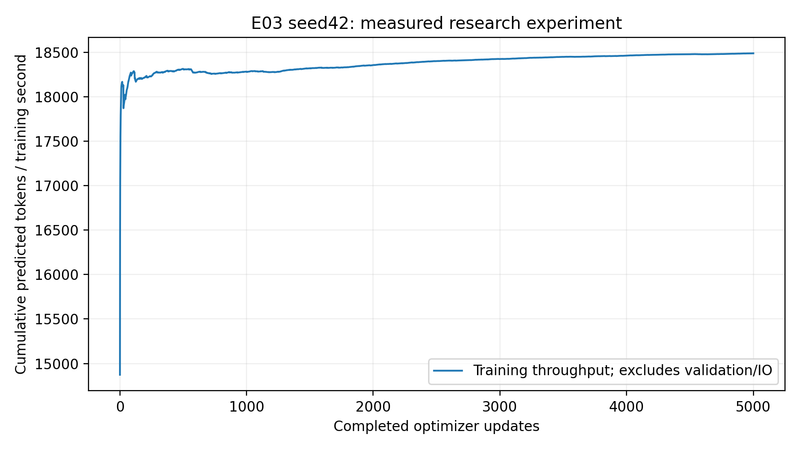

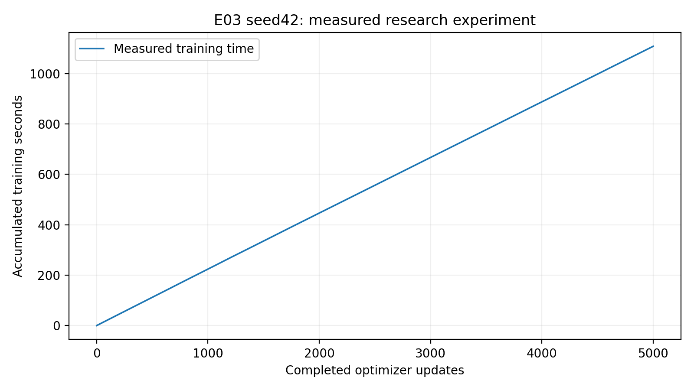

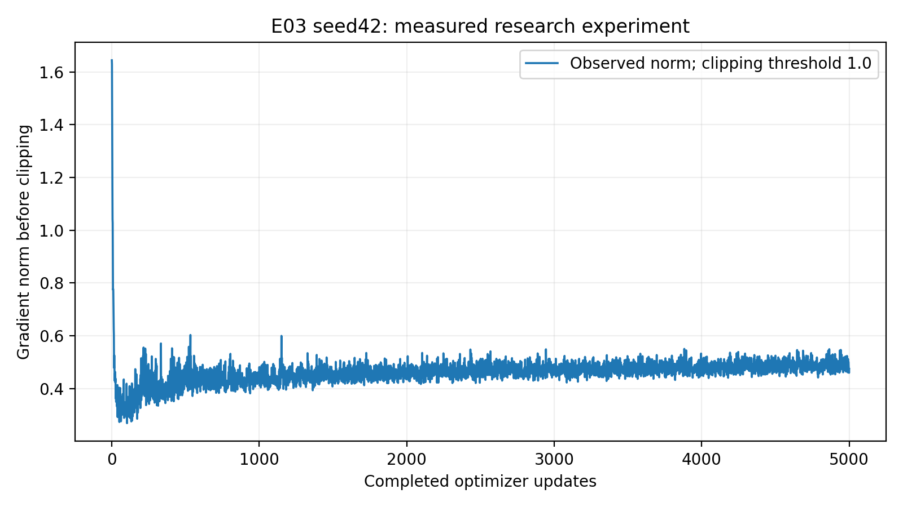

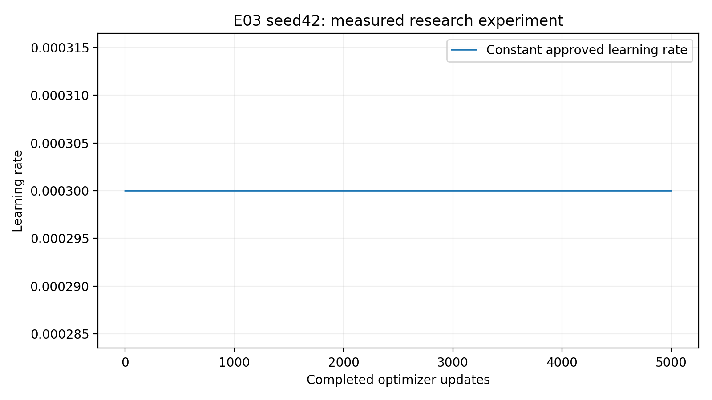

## Convergence descriptors and interpretation boundary

**Observation:** Actual3000→5000 validation loss improvement is
0.06268260 nats/token. A descriptive least-squares
slope through actual3000–5000 points is -0.03137993
nats/token per1000 updates. Best observed step5000; final
is 0.00000000 above that minimum.
The subsequent reviewed interpretation discusses the shape, intervals, generation
and E01 comparison without treating small fluctuations as conclusive overfitting.
Observed best is selected from scheduled evaluations, not unknown intermediate
steps. No claim about double descent or long-context extrapolation is implied.

## Genuine fixed-protocol text generation

[Complete unedited100-sample grid](generation.md) and generation.json preserve all
five prompts, best/final checkpoints, greedy seed42 and temperatures0.7/1.0/1.2
with seeds42/123/456,256 new tokens. No external model generated or edited text.
Five predetermined best-checkpoint greedy outputs follow, without cherry-picking.
Qualitative comparisons use the same settings; coherent-looking output does not
establish statistical superiority, understanding or memorization absence.

### Prompt 'To be, or not to be'

Checkpoint `step_005000.pt`, greedy,seed42,256 new tokens.

```text
To be, or not to be so the senators,
And the sense of the prince of the sea
The sense of the senators of the prince,
The sense of the prince of the prince,
The sense of the prince of the prince,
And the sense of the prince of the prince,
The sense of the prince of the prince
```

### Prompt 'ROMEO:\n'

Checkpoint `step_005000.pt`, greedy,seed42,256 new tokens.

```text
ROMEO:
The prince of the prince of the prince,
The sense of the prince of the prince,
And the sense of the prince of the prince,
The sense of the prince of the prince,
And the sense of the prince of the prince,
The sense of the prince of the prince,
And the sense
```

### Prompt 'JULIET:\n'

Checkpoint `step_005000.pt`, greedy,seed42,256 new tokens.

```text
JULIET:
The sense of the prince of the prince of the prince,
And the sentence of the prince of the prince,
The sense of the prince of the prince,
And the sense of the prince of the prince,
The sense of the prince of the prince,
And the sense of the prince of the p
```

### Prompt 'First Citizen:\n'

Checkpoint `step_005000.pt`, greedy,seed42,256 new tokens.

```text
First Citizen:
What we have so did so so shall be so soul
That the senators of the prince of the prince,
And the sense of the prince of the seas,
And the sense of the prince of the prince,
The sense of the prince of the prince,
The sense of the prince of the prince,
And 
```

### Prompt 'The king'

Checkpoint `step_005000.pt`, greedy,seed42,256 new tokens.

```text
The king of the senators of the prince,
And the sense of the prince of the sea
The sense of the senators of the prince,
The sense of the prince of the prince,
And the sense of the prince of the prince,
And the sense of the prince of the prince,
The sense of the pr
```

## Publication, independent recovery and checkpoint manifest

Final checkpoint: `runs/E03_seed42_3eddd727e88a4748b23b605c7c3590fd/checkpoints/step_005000.pt`.
Best checkpoint: `runs/E03_seed42_3eddd727e88a4748b23b605c7c3590fd/checkpoints/step_005000.pt`.
All20 resumable weights and21 immutable snapshots are preserved. Exact optimizer,
constant scheduler,scaler,RNG and sampling/training history are included. No
restart, unrelated history concatenation or additional optimizer update occurred.
Fresh compatible Kaggle CUDA state roundtrip passed all audited state fields,
and best/final generation worked. Independent downloaded archive best/final CPU
inference also passed. Actual10k continuation was not started.

Archive bytes: **402,094,081**; SHA256 `57feb9d606a1d733ce3ae301b9e401c12b200f32c1d3c3fca4c47c3c6117b110`.
All **58 archive files** were independently CRC/path/
file-set/hash verified. [Complete manifest](evidence/artifact_manifest.json).
The archive stores complete research checkpoints once; full immutable snapshot
copies remain in published notebook output. Dataset/tokenizer manifest,resolved
configuration,environment,full5000-step history,20 validations,figures and genuine
generations are included. Small receipts are committed byte-for-byte; checkpoints,
datasets and full journals are excluded from GitHub.

| Checkpoint update | SHA256 |
|---|---|
| 250 | `7be214bb80e47fa4e6a190396955bf90e4a3ed86f32bfb7411c5eb28d34b7be1` |
| 500 | `33e3fda12f57edacf765eeea8db96ed257d0d29b0489149d5b29678cf38db188` |
| 750 | `9b3a2153c917130f8d18e7c1b406ed15dff01ec07bc68fdfcd5e15b416dc5f61` |
| 1000 | `c015a3a726bbb9783d677e5f3dd93787374b1ae39e1b9c8a52739a65bfb75465` |
| 1250 | `62fdf97fbe6cddee9763a26196f7ad5cb4d5fdb09bc601fb7850c40e42da9851` |
| 1500 | `58144e26fdd0c4fea53ac6e2e9535de4dbd258de65958e533002cc7381febb7d` |
| 1750 | `e31e2c7608648f3651802d4a53a5c43deceddbd316d7d8855c723a9bf3e0c484` |
| 2000 | `d48404141941a5115e1f2c873b112d58de17d19e226ffe79a794df9769580403` |
| 2250 | `5fcea4d7f926962a74560c5d9da57087e2b234fd47dbcccc62d92cb3e99ff2e4` |
| 2500 | `af37b24e20c4759fa59bbb09c8e7ab25f6cfcb561a593c02b730c453f3b6fa20` |
| 2750 | `1fa01046d2fa5acab3cbbb02a6e839f9b1ec1d65a9c5a3ef5427b65f5eeb8792` |
| 3000 | `685b07155d685da39a3105a7404d49e5ea0d6c8ce392223a18f2f8d8d22e9cb5` |
| 3250 | `ab133027260abcb2a37a178c9161f9395a4cb9381acf62c72d023126521dd2cb` |
| 3500 | `0aa94b5e3a51688ff116b9e9e8d7a4fbecd3ebbe94691eb30d92cda51b99fc90` |
| 3750 | `11bc7fa0f7c3a07680a7f5dc8223c4226cf9a9f166eee9fee431be62e7e64bcb` |
| 4000 | `35c6b8cdfe14942370e2653545b46208956a9b59f679fb089f3fed00ecb26e67` |
| 4250 | `1227a9ae67f38d3e75c7a59c1f7ef9dff510db965a6268a36bed280d46b5570f` |
| 4500 | `c85462fd9433754090697a4f830a66e4563cf2829f73c4d720fa57baa257892e` |
| 4750 | `762cbd0ef8f421d4aad04dd23d86516447c59d374c7952a260edbe7986065725` |
| 5000 | `d251d9b2e2d5b30bda3cf6db3a6e88ce37e8a97c5b778646c4d2ea9eca8d7f0a` |

## Scientific limitations and remaining scope

[Reviewed interpretation, negative generation findings, recovery incident,
retrieval instructions and actual verification scope](interpretation.md) completes
this report. Reproducible numerical tables/figures are retained above and in the
machine-readable comparison files; the linked analysis distinguishes observations
from interpretation and recommendations.

Single matched seed provides no significance test or across-seed SD. Validation
selects checkpoints; held-out test remains reserved. This is a fixed-context
positional-mode comparison, not proof of improved extrapolation/long-range
reasoning. Speed comparisons use separate sessions of the same GPU model, not
controlled repeated timing trials. Framework/seed matching does not guarantee
identical optimization trajectories when attention math changes. Greedy and
stochastic decoding quality are different diagnostics. Short phrase overlaps
may be ordinary Shakespeare language; they neither prove nor exclude memorization.
Baseline convergence cannot establish every architecture's training requirement.
Further seeds,configurations or10k extensions require separate authorization.
