# E04 seed42 learned absolute positional embeddings — 2026-10-12

One explicitly authorized research run, exactly **5000 completed optimizer
updates**, all twenty full validations. No other configuration/seed/10k extension.
E01/E02/E03 historical evidence is preserved. This single-seed observation is not
a completed three-seed study or a statistical significance result.

## Research objective and hypothesis

Measure how trainable absolute position vectors change next-token prediction,
learning dynamics, runtime/memory and fixed-prompt generation relative to additive
sinusoidal positions and RoPE. **Hypothesis:** training-distribution-specific
position vectors might help or hurt prediction. No direction was assumed.

## Learned-position implementation and audit

Canonical GPT adds token embeddings to `nn.Embedding(128,192)` indexed0..L-1
before unchanged dropout and four pre-LayerNorm blocks. Neither sinusoidal addition
nor Q/K rotary transformation is active. Each head remains32 dimensions; unchanged
causal attention prevents future leakage. All position rows received finite,
nonzero gradients in the full-context numerical audit. Thirteen independent
checks passed on CPU and actual CUDA, including intercepted embedding addition,
poisoned unused sinusoidal buffer, prohibited RoPE, mask/shapes, manual CE,
future invariance and cropped generation indices.

E04 has **1829376 parameters**, +24576 (+1.3617%) versus
E01/E03. Shared parameter shapes are unchanged. The extra embedding initializes
before later layers and consumes seeded RNG draws: seed42 token embeddings match
E01, but later initial weights differ. The established implementation/initialization
was not altered. Added capacity and this initialization difference limit causal
attribution solely to the representation. Fresh E04 weights were used, never
E01/E03 fine-tuning. Local context indices reset after sliding/cropping exactly as
in training/evaluation/generation; no extrapolation beyond128 was tested.

## Exact reproducible setup

- Reviewed starting main:7b4d922c50e9f1663fff8f02829eb95545b9eb7f.
- Clean trained source:`b260264521ceb280f356b82ecd8cf4b69cb8af21`.
- Scientific code hash:`cdea42adb930904fb0cefcd282d784bb3ac8caa311d3f1e12ef568622f9c12d6`; equivalent to E01–E03.
- Configuration hash:`7dde8abeb38dc7d5e1aa48a46231ff6ff9571af5522aeaa2b375d43c055f55e1`.
- Run ID:`E04_seed42_f3121bbd190e44f984afbd5dfaea57a0`.
- Original private published Kaggle v1:https://www.kaggle.com/code/rayyannmerchant/nano-e04-pilot-20261012-5e7b13ef
- Fresh GPU recovery v1:https://www.kaggle.com/code/rayyannmerchant/nano-e04-recovery-20261012-d31e262c
- Python3.11.14,PyTorch2.5.1+cu124,torch CUDA12.4;Tesla T4 GPU0.
- NumPy1.26.4 and entire qualified dependency freeze reproduced; native runtime untouched.

Character65,width192,layers4,heads6,context128,MLP4,GELU,dropout.1,learned positions.
AdamW,constant LR.0003,weight decay.01,clip1,float32 CUDA,seed42,micro4/acc8,
4096 targets/update,validation250,checkpoint500 with existing validation saves.
Full command/environment/driver and source metadata are in evidence and archive.
Preflight development training/export/Agg figures/generation was labeled smoke;
the research engine reseeded independently. No development metric is mixed here.

## Dataset, separation and evaluation

Raw SHA256:`86c4e6aa9db7c042ec79f339dcb96d42b0075e16b8fc2e86bf0ca57e2dc565ed`.
Character tokenizer SHA256:`ed96787d2f3f9741d69eba15160f31634ba6755b47e4c261ffedbb975fa0af77`.
Canonical acquisition revision6f9487a6fe5b420b7ca9afb0d7c078e37c1d1b4e;
train/validation/test1003854/55770/55770bytes. All audited reference hashes matched.
Partitions precede token fitting/windows; no boundary crossing or test likelihood.
Full sliding validation excludes first256 conditioning bytes and scores55514
target bytes once. Conditional BPB=sum NLL/(ln(2)*55514); for ASCII character
targets this equals loss/ln(2), independently verified at every point. It is
conditional likelihood, not whole-file compression entropy. Validation uses
evaluation mode; sampled training has dropout. Generalization gaps are descriptive
and not equal-protocol corpus likelihood comparisons. No step-zero validation is invented.

## Genuine measured results

| Quantity | E04 recorded value |
|---|---:|
| Initial training loss,update1 | 4.33199036 |
| Initial validation loss,update250 | 2.49584552 |
| Final training batch loss | 1.48602149 |
| Final100-update training mean | 1.48525713 |
| Best validation step | 5000 |
| Best validation loss | 1.55111692 |
| Best conditional BPB | 2.23778869 |
| Final validation loss | 1.55111692 |
| Final conditional BPB | 2.23778869 |
| Final within-character perplexity | 4.71673547 |
| Predicted token exposure | 20480000 |
| Source-byte exposure including repeats | 20480000 |
| Unique target bytes | 1003848 |
| Updates with preclip gradient norm>1 | 5 (0.1000%) |

| Update | Full validation loss | Conditional BPB | Perplexity |
|---:|---:|---:|---:|
| 250 | 2.49584552 | 3.60074395 | 12.13198697 |
| 500 | 2.41877773 | 3.48955864 | 11.23212228 |
| 750 | 2.16808548 | 3.12788617 | 8.74153219 |
| 1000 | 2.04338283 | 2.94797828 | 7.71666931 |
| 1250 | 1.96407698 | 2.83356413 | 7.12832999 |
| 1500 | 1.89932190 | 2.74014228 | 6.68136227 |
| 1750 | 1.84568540 | 2.66276117 | 6.33243855 |
| 2000 | 1.80411684 | 2.60279041 | 6.07460421 |
| 2250 | 1.75853593 | 2.53703106 | 5.80393378 |
| 2500 | 1.73254652 | 2.49953628 | 5.65503627 |
| 2750 | 1.69616949 | 2.44705531 | 5.45301947 |
| 3000 | 1.67751109 | 2.42013693 | 5.35221818 |
| 3250 | 1.65268577 | 2.38432157 | 5.22098338 |
| 3500 | 1.62656595 | 2.34663862 | 5.08637780 |
| 3750 | 1.59780814 | 2.30514987 | 4.94218794 |
| 4000 | 1.59771479 | 2.30501520 | 4.94172661 |
| 4250 | 1.57870192 | 2.27758544 | 4.84865780 |
| 4500 | 1.56168874 | 2.25304061 | 4.76686447 |
| 4750 | 1.55170046 | 2.23863057 | 4.71948869 |
| 5000 | 1.55111692 | 2.23778869 | 4.71673547 |

## Three-way controlled character-position comparison

| Metric | E01 | E03 | E04 |
|---|---:|---:|---:|
| best_loss | 1.53466801 | 1.43708178 | 1.55111692 |
| final_loss | 1.53601210 | 1.43708178 | 1.55111692 |
| best_bpb | 2.21405793 | 2.07327076 | 2.23778869 |
| final_bpb | 2.21599704 | 2.07327076 | 2.23778869 |
| final_training_loss | 1.46865343 | 1.36466110 | 1.48602149 |
| training_seconds | 916.70840175 | 1107.72115184 | 1001.78457423 |
| validation_seconds | 420.90800282 | 447.51543827 | 413.79722973 |
| peak_gpu_bytes | 159081984.00000000 | 159081984.00000000 | 159475200.00000000 |
| parameters | 1804800.00000000 | 1804800.00000000 | 1829376.00000000 |

All twenty matching evaluations/deltas are in comparison/matched_validation.csv.
Final private sampling RNG and full target-byte coverage arrays matched all three.
Shared code/environment/settings are validated, not assumed from experiment names.

## Overall study BPB context, single seed each

| Configuration | Tokenizer | Parameters | Best BPB | Best step |
|---|---|---:|---:|---:|
| E01 | character | 1804800 | 2.21405793 | 4750 |
| E03 | character | 1804800 | 2.07327076 | 5000 |
| E04 | character | 1829376 | 2.23778869 | 5000 |
| E02 | BPE | 2173056 | 2.02659521 | 5000 |

E02 scores the same original suffix, but vocabulary1024, more parameters, longer
original-byte contexts and49991931 training target bytes differ. Its best BPB is
contextual conditional comparison, not a controlled position ablation. Do not rank
E02 token NLL or perplexity against characters. Fixed4096-token/update budgets
do not equal source exposure, FLOPs or compute. No cross-seed SD is estimated.

## Timing and hardware costs

| Measured scope | Seconds |
|---|---:|
| Training only | 1001.784574 |
| Full validation,20 evaluations | 413.797230 |
| Checkpoint function calls | 2.682099 |
| Snapshot export function calls | 7.066061 |
| Append/flush/fsync journal calls | 20.083412 |
| Canonical CLI wall | 1455.085975 |
| Original notebook clone-through-archive pipeline | 1766.157167 |

Training-only4.991093updates/sec,
20443.517026targets/sec. Peak allocated memory
159475200bytes (152.087402MiB), excluding reserved,
driver and whole-device overhead. Separate T4 sessions limit speed attribution.
Pipeline excludes pre-execution queue and final conversion/publication/retrieval;
unmeasured scopes are not inferred from timestamps. Full-validation time is
accumulated; individual evaluation durations were not separately logged.

## Convergence observations

Measured3k–5k improvement:0.12639416nats/token.
Descriptive late fitted slope:-0.06382621nats/token
per1000updates. Final loss minus best:0.00000000.
These describe scheduled observations, not unseen intermediate minima or
significance. [Reviewed interpretation and negative qualitative findings](interpretation.md)
discuss interval behavior, comparative learning and future budget recommendations.

## Figures from real history

Validation markers are actual observations; connecting lines are not extra
measurements. Training smoother is a declared100-update trailing mean.

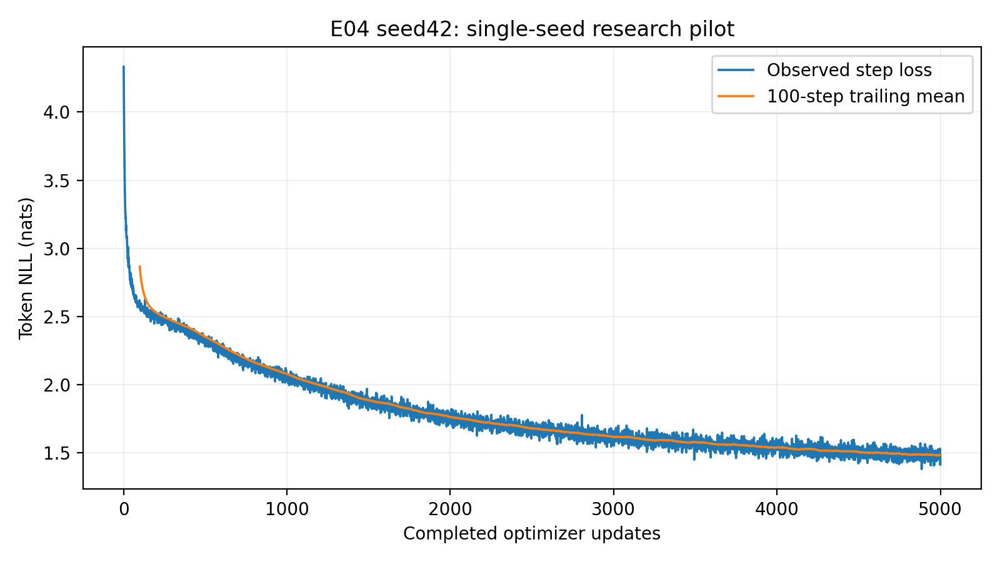

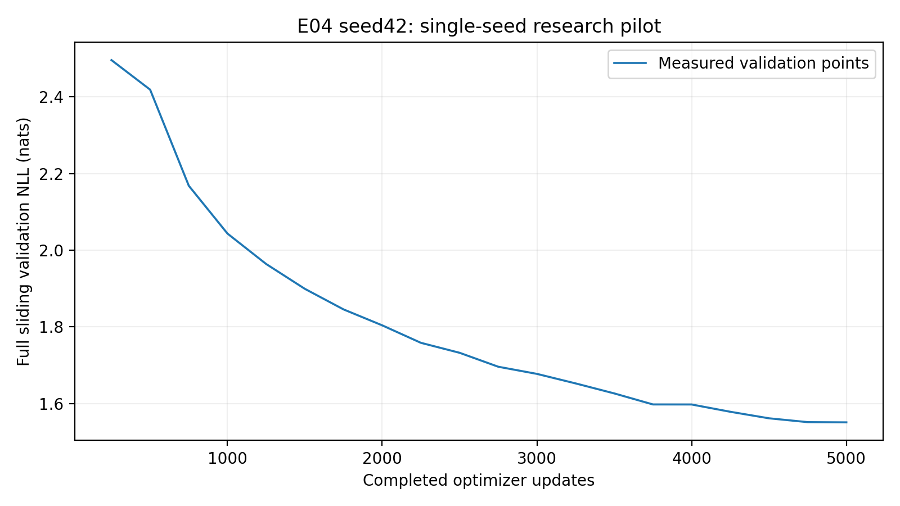

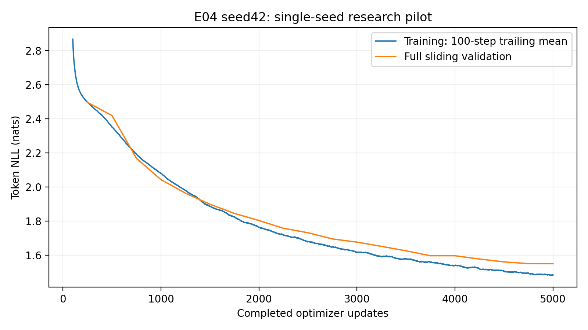

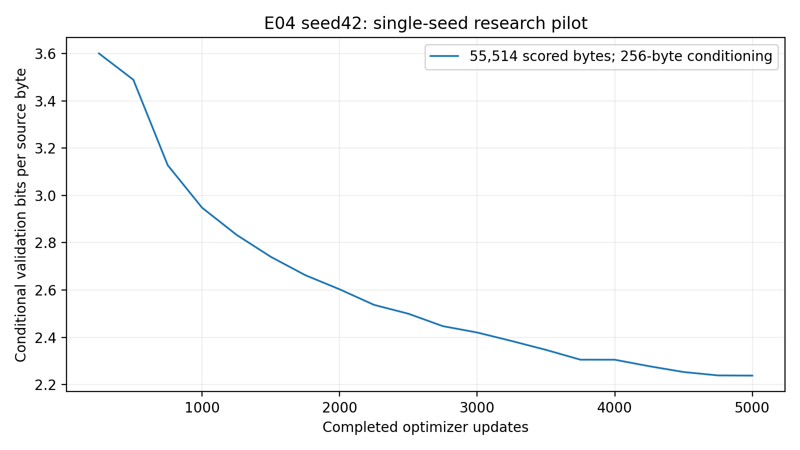

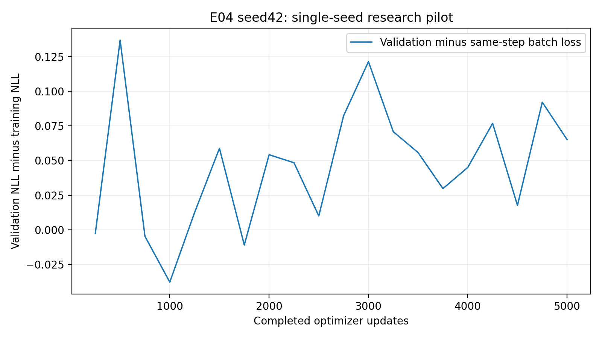

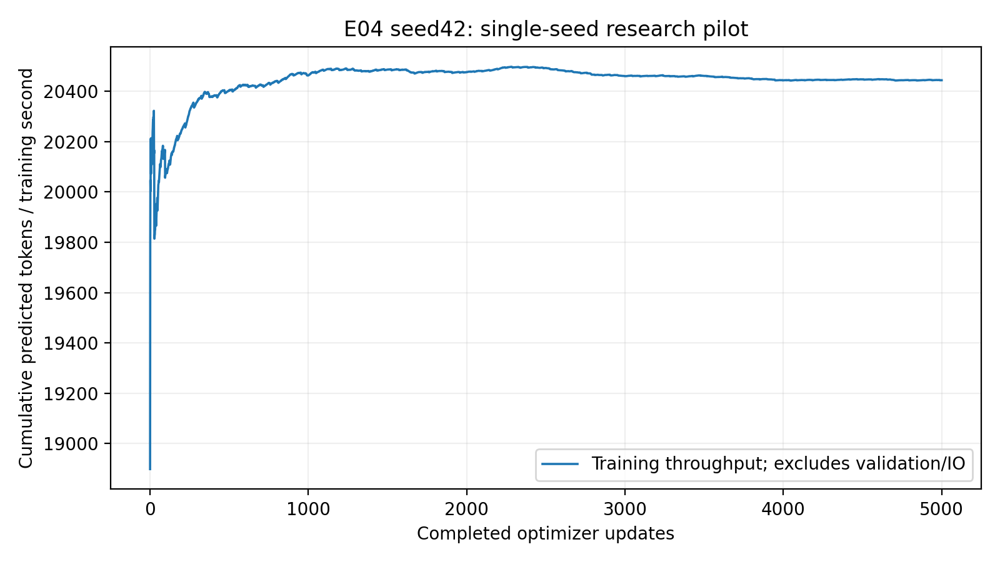

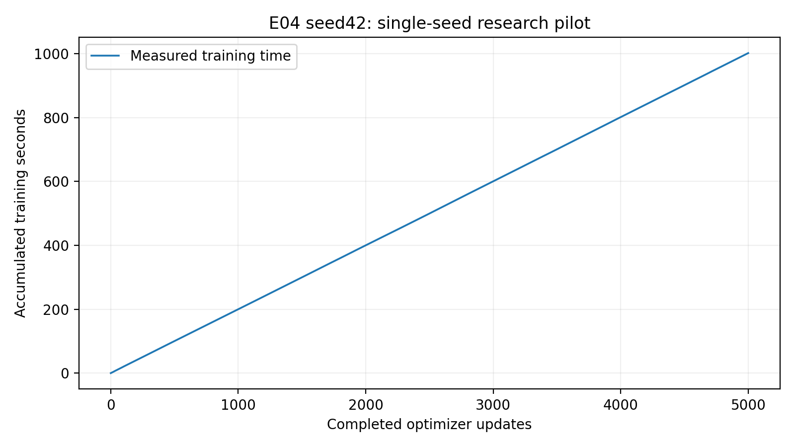

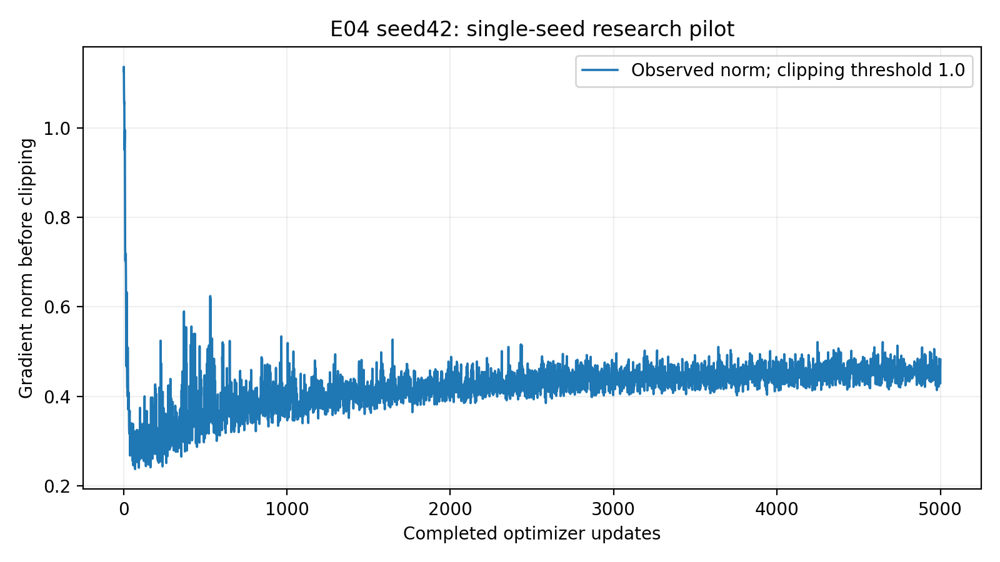

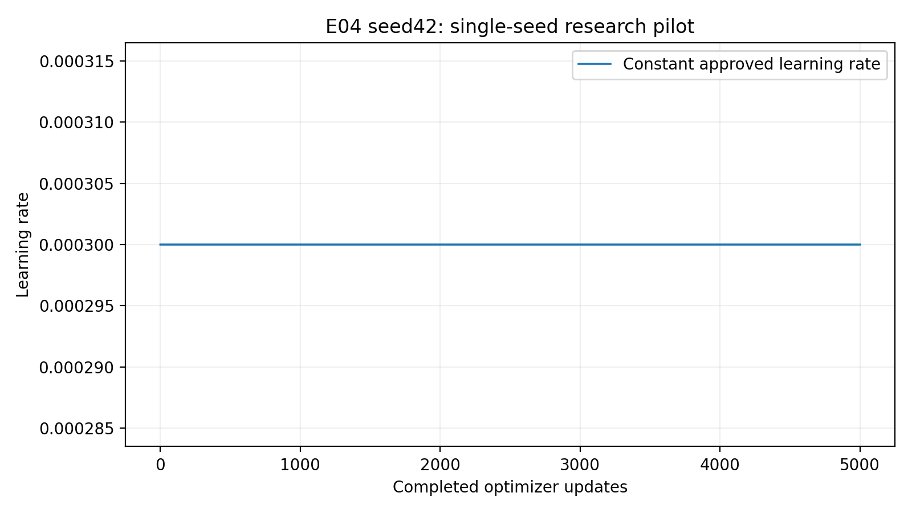

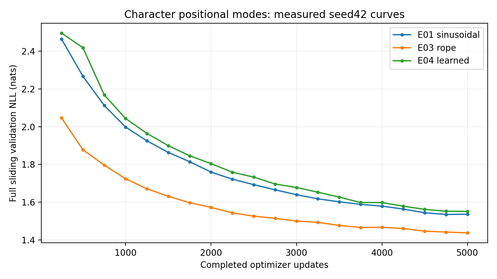

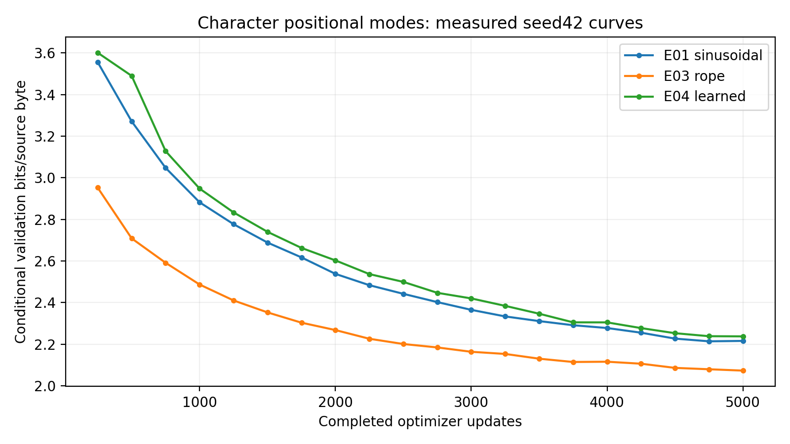

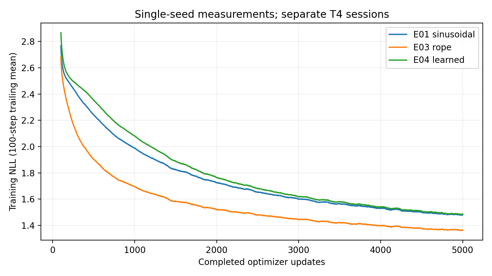

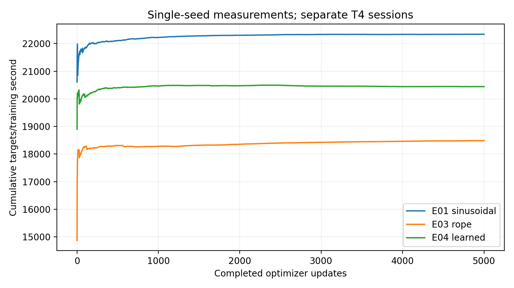

## Genuine fixed-protocol generations

[Complete unedited100-row grid](generation.md), generation.json: all five prompts,
greedy seed42 and temperatures.7/1/1.2,seeds42/123/456,256new tokens,best/final.
No external model edited outputs. Five preselected best greedy samples follow.

### Prompt 'To be, or not to be'

Checkpoint `step_005000.pt`, greedy seed42,256new tokens.

```text
To be, or not to be the senators of the sea
The senators of the season the senators of the sea
That the send of the senators of the seast of the seas
That the senators of the senators of the seas
That the senators of the senators of the seas
That the senators of the senators
```

### Prompt 'ROMEO:\n'

Checkpoint `step_005000.pt`, greedy seed42,256new tokens.

```text
ROMEO:
I will not the season of the senators of the season
That with the senators of the senators,
And the send the senators of the seast of the seas
That the senators of the senators of the seas
That the senators of the senators of the seas
That the senators of 
```

### Prompt 'JULIET:\n'

Checkpoint `step_005000.pt`, greedy seed42,256new tokens.

```text
JULIET:
What is the senators of the senators of the season
That with the senators of the senators,
And the sense of the sease of the seast of the seas
That the senself of the seast of the seast of the seas
That the senself of the seast of the seast of the seas
Tha
```

### Prompt 'First Citizen:\n'

Checkpoint `step_005000.pt`, greedy seed42,256new tokens.

```text
First Citizen:
What is the senators of the senators of the season
That the shall be the senators of the sea
And the senators of the senators of the seas
That the senators of the senators of the seas
That the senators of the senators of the seas
That the senators of the s
```

### Prompt 'The king'

Checkpoint `step_005000.pt`, greedy seed42,256new tokens.

```text
The king of the senators of the season,
And the send of the senators of the sease of the sea
That the senators of the seast of the seast of the seas
That the senself of the seast of the seast of the seas
That the senators of the senators of the seas
That the senat
```

## Durable publication, recovery and complete manifest

Final:`runs/E04_seed42_f3121bbd190e44f984afbd5dfaea57a0/checkpoints/step_005000.pt`. Best:`runs/E04_seed42_f3121bbd190e44f984afbd5dfaea57a0/checkpoints/step_005000.pt`.
Archive407744239bytes SHA256:`60b25eeab43606cedf1ef1e4ab86f9dfbbe10ccc366c1bac290015996e3a86fe`.
All58files passed independent CRC/safe-path/file-set/SHA verification.
All20 resumable checkpoints and21 immutable snapshots remain in saved outputs;
the compact archive stores checkpoint files once. Optimizer/scheduler/disabled
scaler/RNG/sampling/history/configuration/dataset/tokenizer/environment are retained.
CPU best/final inference passed after independent retrieval. Fresh compatible
CUDA restore exactly round-tripped all state fields at5000 with zero extra updates
and actual best/final generation. No10k continuation started.
[Complete per-file manifest](evidence/artifact_manifest.json) and checksum-preserved
receipts document actual publication and restore. Large artifacts stay outside GitHub.

| Checkpoint update | SHA256 |
|---:|---|
| 250 | `c47a1825096a78ce2d338267d3f150f474d347a2fdca1c9ce096272d40e46893` |
| 500 | `507dc1f7452b5a4f0c8c9668c9bc04fcd305f671c677a036f3108b4d6ee95b35` |
| 750 | `aa3ee42cd920d46ee511492feb5fc80ec61f7c8e2a0ae216dbe3d971cc3b60a8` |
| 1000 | `a0ca6c69af323b3cf6231c80fd4609583a5951b70eeb5ee545fb046ee8ea7705` |
| 1250 | `ef1f789464e32a2ab912446389f17938a55103f681be45d343aa6dd3e776d7bf` |
| 1500 | `807758cd54b9499dfa589b71f4942abc31ddc63a32ca7ba13d34013246f3bc26` |
| 1750 | `d4cff0eb78fe55035ff100f7ffccde2dd76c6ceaf73d0e91824e6c9c96c6c02d` |
| 2000 | `cd73b2efe67829dcc7fceb2dd69661c12e11bf676fe93c6c407ac7d73f00309d` |
| 2250 | `54a61c0e4ac4e82035c567a35014802cf9475d836038fe8bffb66f96d7398615` |
| 2500 | `b1e9c2be6e6dcab95765b0c4ef158ea8363d675e846e2695a820d064812f00b2` |
| 2750 | `a67f98bafffb4cabbe2ea42868e394582ad4d6913a866c43306a8c17f6ebfef5` |
| 3000 | `7f680d08112b157dc68f35ce3179d645baa31850ceb8ba771acb764352eca16b` |
| 3250 | `6b147dc75ffc9c4d4d596b3603259ab30f4a04b19da436611f30e111f7336424` |
| 3500 | `44ea5dd5e905f44d0021df1aedc6ded4fae44e133a2d846521cf84f9daae2778` |
| 3750 | `9973522387b46380e92d79ff4c2d397b01aa432b7d52e6ef4d570b4254a52354` |
| 4000 | `2b29e39b5ce32826ce2b6d366c0129993bf5a3a879eaf3ae2fdca070831b1c76` |
| 4250 | `d1ba044bef48035123e7c50e15db684a7b1c657e49450f860f463146f4a9aedb` |
| 4500 | `f3ecfde3984a74bbf45e9cdbfb1cf30f3bd588601dfb3750151719b39703e201` |
| 4750 | `b6c7a0290f5ab1463b9a1aaf6c72810cac105de150260ce7a893da5439d65d17` |
| 5000 | `c2041f88a6643bc6330c2fcf60b07216f7138d87037671ef5d62ca0d4878b317` |

## Limitations

One seed has no variance/significance estimate. Added capacity and canonical RNG
initialization effects confound pure representation attribution. Fixed128 context
does not test length extrapolation. Validation selects checkpoints; test remains
reserved. Teacher-forced prediction and autoregressive text quality differ. Short
training-phrase overlaps neither prove nor exclude memorization. Separate sessions
are not repeated controlled speed benchmarks. Read interpretation.md for actual
failures, tests, retrieval paths and the evidence-backed next-step recommendation.
