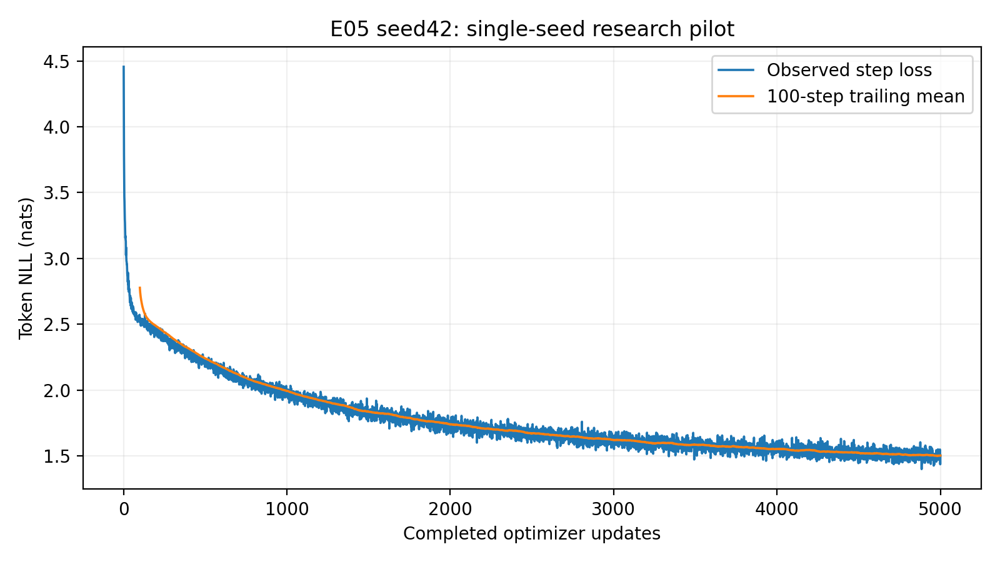
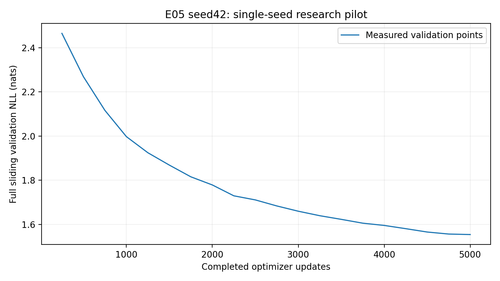
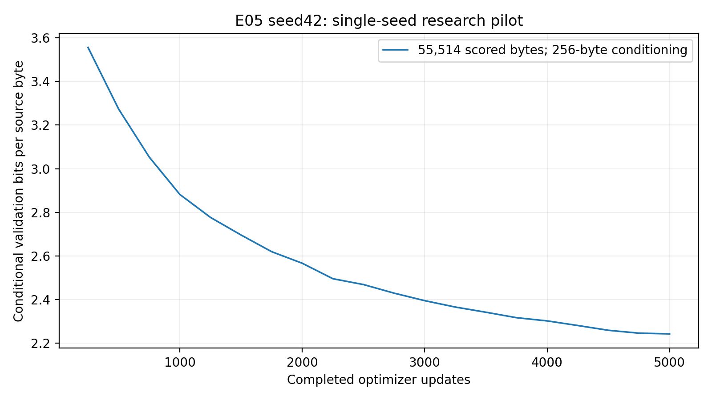
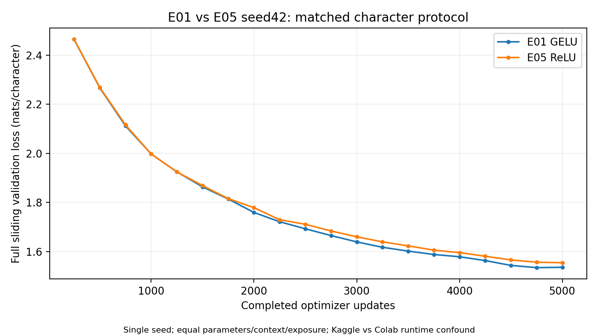
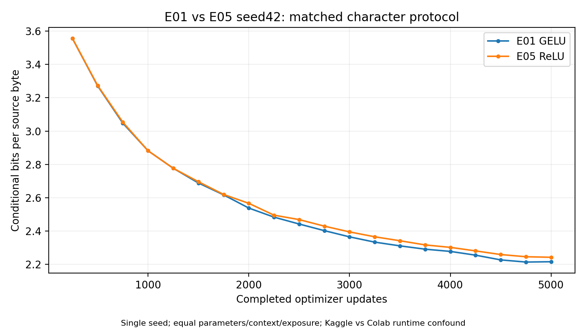
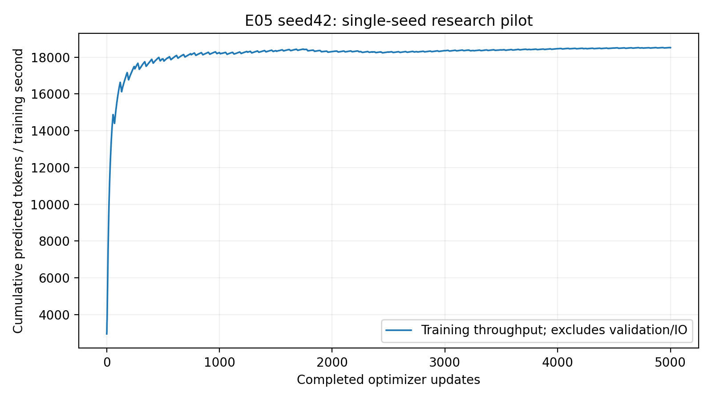
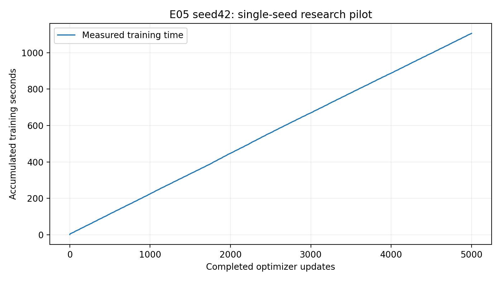
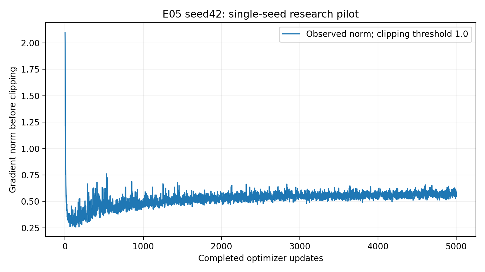
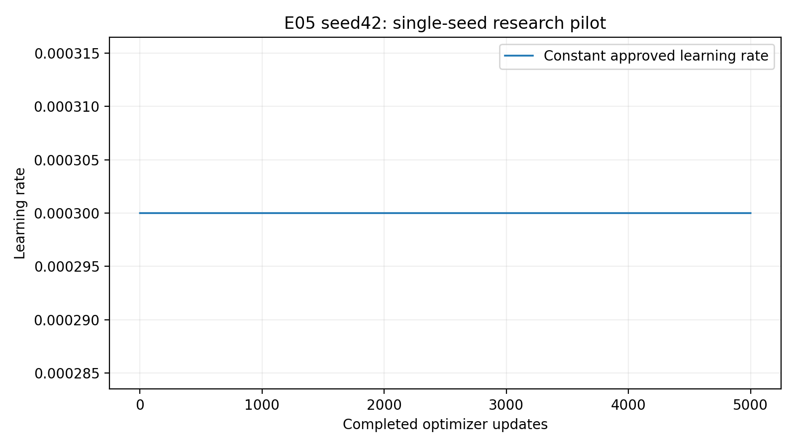

# E05 seed42 — ReLU activation Colab experiment

E05 completed exactly **5,000 optimizer updates**, **20 full sliding validations**, **20 complete validation checkpoint states**, and **21 verified immutable research snapshots**. Best checkpoint: update **5000**, validation loss **1.55449909**, conditional BPB **2.24266813**. Final update 5000: loss **1.55449909**, BPB **2.24266813**. Durable publication, independent archive download/hash verification, genuine best/final inference and compatible CUDA optimizer/RNG restoration passed.

## 1. Objective, hypothesis and authorized scope

Question: how does replacing GELU with ReLU affect predictive performance, learning dynamics, computational efficiency and generated text in the original small GPT architecture? The hypothesis was that changing the feed-forward nonlinearity might alter learning and computational cost. No improvement or regression was presumed.

The user authorized E05 seed42 for exactly 5,000 updates. This is fresh initialization, with no E01/E02 weights loaded, no other research seed, factor combination, 10k extension or test likelihood. A separate two-update smoke run, restored and continued to smoke step 4, is excluded from scientific results. The full multi-seed study remains separately gated.

## 2. Technical difference and implementation audit

ReLU computes `max(0,x)`: negative inputs are gated to zero; its derivative is zero on negative inputs and one on positive inputs. PyTorch chooses zero gradient at exactly zero. GELU computes `x·Φ(x)`, weighting input by the standard normal CDF and preserving small negative outputs. These nonlinearities contain no trainable parameters. The canonical baseline uses exact default `nn.GELU()` and E05 uses default `nn.ReLU()`. Formula sources: [Hendrycks and Gimpel, GELUs](https://arxiv.org/abs/1606.08415), [PyTorch ReLU documentation](https://docs.pytorch.org/docs/stable/generated/torch.nn.ReLU.html), [PyTorch GELU documentation](https://docs.pytorch.org/docs/stable/generated/torch.nn.GELU.html).

Potential computational savings and sparse activations were hypotheses. Validation and runtime measurements below determine the observed association. No mechanism is inferred from a validation difference alone.

The actual `TransformerBlock` MLP construction and strict `ModelConfig` resolver were inspected. Both CPU and qualified CUDA audits verified:

- Only resolved model difference from E01 is `activation: relu`; training defaults and character tokenizer unchanged.
- All four feed-forward blocks use actual `nn.ReLU`, and no `nn.GELU` exists in the E05 model.
- Each MLP remains 192→768→192; activation adds zero parameters. Total exactly 1,804,800.
- Shared LayerNorm, explicit Q/K/V causal attention, six heads, sinusoidal positions, embeddings, dropout and output projection retain their canonical code and shapes. No learned positions or RoPE.
- Every seed42 initial trainable parameter tensor equals independently constructed E01; all 68 state tensors match. Initial parameter-byte SHA256 `993d795eb33782ad0e1524e2e6f5ac202f1c052cd0319134ead5e7dfcd6582ba`.
- For the known input `[-2,-1,0,1,2]`, all four actual ReLU modules produce `[0,0,0,1,2]`, with gradients `[0,0,0,1,1]`; outputs distinguish them numerically from GELU.
- Backpropagation through each entire actual MLP confirms zero gradient at sampled negative preactivation inputs, with finite and nonzero MLP weight gradients.
- Shifted next-token targets, manual cross-entropy equivalence, finite CUDA logits/loss/all parameter gradients, causal masks and invariance of earlier logits to altered future tokens passed.

[CUDA activation audit](evidence/relu_audit.json), [existing tests](evidence/tests.json), [activation-specific test](evidence/activation_test.json). Existing suite: 39 tests passed in 36.25s; added activation test passed in 0.65s. No implementation bug or scientific-source fix was required.

## 3. Exact source and environment

- Clean trained source: `31e974b23b7e73b2f48b080b36865608efb879b8`, latest reviewed main when synchronized.
- Scientific source/config hash: `cdea42adb930904fb0cefcd282d784bb3ac8caa311d3f1e12ef568622f9c12d6`.
- Resolved E05 configuration hash: `74d2f4139fc5e4d2db659826ff6de1a007ffa7f5ad885813111978420c3d6de8`.
- E01 reference trained source: `444bca4c4ac19f97f46fae210a9fd361f8561537`; canonical source/config diff is empty against this run. Reviewed changes introduced orchestration/reports only.
- E05 orchestration was separately versioned on its dedicated feature branch; the notebook records that commit. The installed `nano_lm` package points to the pinned clean main checkout. No notebook model/training loop exists.
- [Executed notebook](https://colab.research.google.com/drive/1jXE5OshAxWDrT4i0F8bw7OuFM59HXUjz).
- Python `3.11.14`, PyTorch `2.5.1+cu124`, torch CUDA `12.4`; NumPy 1.26.4, tokenizers 0.21.0, pytest 8.3.4, Matplotlib 3.9.4. Exact 46-package E01/E02 transitive freeze matched, excluding editable project location.
- GPU `Tesla T4`, 1 visible device(s), training oncuda:0. Total GPU bytes 15,637,086,208. Full driver output and software freeze are preserved in [hardware](evidence/hardware.json) and [environment](evidence/environment.json).

Colab's native newer interpreter/framework was left intact and did not execute research training, evaluation or model generation. Isolated Python3.11.14/CUDA wheels were provisioned through the previously qualified workflow. `MPLBACKEND=Agg` was set before postprocessing.

E01 used Kaggle GPU0 of two allocated T4s, driver 580.178.04; this Colab run used driver 580.82.07. The same GPU model and dependency versions reduce some confounds, but host scheduling, driver, platform and storage differ. Runtime ratios are descriptive observations, not isolated activation speed effects.

## 4. Data, tokenizer and evaluation controls

Pinned Tiny Shakespeare revision `6f9487a6fe5b420b7ca9afb0d7c078e37c1d1b4e`. Raw SHA256 `86c4e6aa9db7c042ec79f339dcb96d42b0075e16b8fc2e86bf0ca57e2dc565ed`; character tokenizer SHA256 `ed96787d2f3f9741d69eba15160f31634ba6755b47e4c261ffedbb975fa0af77`. Vocabulary65. All source/split/tokenizer/manifest reference fields match E01. Original contiguous train/validation/test byte counts are1,003,854/55,770/55,770. Train-only tokenizer fitting and shifted windows preserve partition separation. [Verification](evidence/dataset_verification.json).

Validation used the entire 55,770-byte validation text, with the first 256 original bytes conditioning-only and exactly 55,514 target bytes/characters scored once per measurement. Full sliding evaluation batch 32/context 128 resets local positional indices exactly as E01. No cap, sampled validation or test likelihood. BPB is total NLL divided by `ln(2)×55,514`; with this identical ASCII character tokenizer it equals loss/ln(2). Both token cross-entropy and BPB compare directly across E01/E05. Perplexity is exp(loss). Best checkpoint selection minimizes full-validation loss.

## 5. Locked architecture and optimizer

Decoder-only from-scratch causal GPT: width 192, blocks 4, heads 6, head dimension 32, context 128, MLP expansion 4, **ReLU**, sinusoidal positions, dropout 0.1, vocabulary 65, **1,804,800 trainable parameters**. Explicit canonical attention is unchanged; no pretrained model or combined successful factors.

AdamW, constant LR 0.0003, weight decay 0.01, gradient clipping 1.0, seed42, float32, CUDA. Microbatch 4, accumulation 8, 4,096 predicted tokens/update; exactly 5,000 completed updates and zero AMP-skipped updates. Full validation every 250; nominal periodic checkpointing every 500 also saves every validation/best state. Optimizer/scheduler/scaler/RNG/sampling and complete histories are retained. [Execution settings](evidence/execution.json).

## 6. Actual learning curves and full matched validation

Initial recorded training loss: **4.45605695** at update 1. First full validation at 250: **2.46460224**. Final sampled-batch loss: **1.50328852**; trailing 100 mean **1.50264720**. No step-zero validation was invented.

| Update | E01 loss | E05 loss | E01 BPB | E05 BPB | E05−E01 loss |
|---:|---:|---:|---:|---:|---:|
| 250 | 2.46425110 | 2.46460224 | 3.55516284 | 3.55566943 | +0.00035114 |
| 500 | 2.26721599 | 2.26876453 | 3.27090127 | 3.27313533 | +0.00154854 |
| 750 | 2.11220971 | 2.11628082 | 3.04727447 | 3.05314784 | +0.00407111 |
| 1000 | 1.99768526 | 1.99752244 | 2.88205062 | 2.88181572 | -0.00016282 |
| 1250 | 1.92482598 | 1.92462087 | 2.77693689 | 2.77664098 | -0.00020511 |
| 1500 | 1.86354672 | 1.86864821 | 2.68852962 | 2.69588950 | +0.00510148 |
| 1750 | 1.81413472 | 1.81567936 | 2.61724317 | 2.61947161 | +0.00154464 |
| 2000 | 1.75925914 | 1.77887763 | 2.53807444 | 2.56637794 | +0.01961849 |
| 2250 | 1.72154866 | 1.72972780 | 2.48366971 | 2.49546972 | +0.00817914 |
| 2500 | 1.69282241 | 1.71123364 | 2.44222650 | 2.46878829 | +0.01841123 |
| 2750 | 1.66527225 | 1.68391780 | 2.40248002 | 2.42937986 | +0.01864555 |
| 3000 | 1.63945360 | 1.66004757 | 2.36523157 | 2.39494239 | +0.02059397 |
| 3250 | 1.61751165 | 1.63972940 | 2.33357603 | 2.36562947 | +0.02221775 |
| 3500 | 1.60199293 | 1.62325616 | 2.31118726 | 2.34186361 | +0.02126323 |
| 3750 | 1.58823999 | 1.60593605 | 2.29134596 | 2.31687597 | +0.01769605 |
| 4000 | 1.57893347 | 1.59575464 | 2.27791948 | 2.30218731 | +0.01682117 |
| 4250 | 1.56335215 | 1.58110302 | 2.25544039 | 2.28104948 | +0.01775087 |
| 4500 | 1.54364829 | 1.56590019 | 2.22701373 | 2.25911644 | +0.02225190 |
| 4750 | 1.53466801 | 1.55677357 | 2.21405793 | 2.24594951 | +0.02210556 |
| 5000 | 1.53601210 | 1.55449909 | 2.21599704 | 2.24266813 | +0.01848699 |

[All 20 matched measurements](matched_validation.csv), [E05 loss/perplexity/BPB table](validation.csv).







Lines connect observed validation endpoints; intermediate validation values are not measurements. The training smoother is descriptive. Sampled train batches use dropout, whereas validation uses evaluation mode; their gap alone is not evidence of overfitting. A single late fluctuation cannot establish deterioration or convergence.

## 7. E01-versus-E05 endpoint and efficiency comparison

| Metric | E01 GELU | E05 ReLU |
|---|---:|---:|
| Parameters | 1804800 | 1804800 |
| Best update | 4750 | 5000 |
| Best validation loss | 1.53466801 | 1.55449909 |
| Best BPB | 2.21405793 | 2.24266813 |
| Final update | 5000 | 5000 |
| Final validation loss | 1.53601210 | 1.55449909 |
| Final BPB | 2.21599704 | 2.24266813 |
| Final perplexity | 4.64602540 | 4.73271526 |
| Training-only seconds | 916.708 | 1106.074 |
| Full-validation seconds | 420.908 | 413.366 |
| Training tokens/sec | 22340.801 | 18515.948 |
| Optimizer updates/sec | 5.454297 | 4.520495 |
| Peak allocated GPU MiB | 151.712 | 151.712 |
| Clipping frequency | 0.140% | 0.120% |
| Target-token/source-byte exposure | 20,480,000 / 20,480,000 | 20,480,000 / 20,480,000 |
| Unique target bytes | 1003848 | 1003848 |

Best loss/BPB relative reduction for E05: **-1.2922%**; final loss/BPB reduction **-1.2036%**. Positive reduction means E05 lower; negative means regression. Training-only time change **+20.657%**. Loss improvement from3k to5k: E01 0.10344149; E05 0.10554848. Descriptive late fitted loss slopes per 1,000 updates: E01 -0.05359160, E05 -0.05404042; no forecasting or significance inference.

This architectural comparison matches parameter count, tokenizer, source-byte context, initial parameter tensors, effective batch, optimizer and update budget. E02's parameter/context/exposure confounds do not apply here. Platform runtime confounds and single-seed uncertainty remain.

Actual original save/export calls were timed by forwarding their unchanged arguments and return values. Local checkpoint saves: **2.819s**; verified Drive exports: **10.304s**; journal writes/fsync: **19.283s**. Engine observed wall time through completed final export: **1563.173s**. These operations are separate from training/evaluation time. Archive construction/publication: **36.476s**. Observed notebook workflow envelope from the first recorded setup GPU timestamp to independent verification: **2769.636s** (about 46.16minutes). This includes provisioning, mount, preflight, research, interactive pauses, recovery, generation, publication and retrieval, but excludes later report/PR work. It is derived from recorded clock endpoints with one-second start precision and different-host clock-source caveats, rather than a single continuous timer. Finish phase: **286.861s**; independent integrity/inference verification excludes download and took **8.150s**. [Timing provenance](evidence/pipeline_timing.json). Peak allocated memory excludes driver overhead/reserved memory. No FLOP measurement exists.




## 8. Gradient and measured activation behavior

All 5,000 recorded gradient norms are finite. Before clipping: mean0.523708, median0.536769, range0.257642–2.100657, final0.583081. 6 updates exceeded1.0 (0.120%), compared with E01's 0.140%. E01's complete norm aggregate is not in the committed summary; its original figure and recorded clipping fraction are the reference. [E05 diagnostics](evidence/gradient_diagnostics.json).




After training, best/final ReLU outputs were measured without optimizer updates on four predetermined 128-character training windows starting 0,10000,100000,900000 (512 positions), in evaluation mode. These are real activation statistics on a finite diagnostic sample, not validation/test selection.

| Checkpoint policy | Block | Zero-output fraction | Positive fraction | Units inactive throughout this sample |
|---|---:|---:|---:|---:|
| best | 1 | 0.660789 | 0.339211 | 0  / 768 |
| best | 2 | 0.632812 | 0.367188 | 0  / 768 |
| best | 3 | 0.632642 | 0.367358 | 0  / 768 |
| best | 4 | 0.643038 | 0.356962 | 0  / 768 |
| final | 1 | 0.660789 | 0.339211 | 0  / 768 |
| final | 2 | 0.632812 | 0.367188 | 0  / 768 |
| final | 3 | 0.632642 | 0.367358 | 0  / 768 |
| final | 4 | 0.643038 | 0.356962 | 0  / 768 |

[Full activation evidence](evidence/activation_diagnostics.json). Zero activations are expected for ReLU. A unit inactive on512 positions is not proven permanently dead; these data do not establish a dying-ReLU problem or its causal contribution. There is no longitudinal all-corpus unit-activity audit.

## 9. Genuine best/final text grid and qualitative observations

The unchanged `configs/generation_protocol.json` defines five prompts, greedy decoding, temperatures 0.7/1.0/1.2, seeds 42/123/456 and 256 new character tokens. Both checkpoint policies supply 50 settings each: **100 unedited labeled records**. [Complete JSON grid](generation.json), [complete readable grid](generation.md). Every record names the real checkpoint and checksum. No other language model generated or rewrote these outputs.

Best and final are the same step5000 weights; their matching outputs are duplicate labels and supply 50 unique settings, not100 independent samples.

### Observation

All five predetermined greedy continuations collapse into related phrase loops: `the sense of the sense`, `the sens of the sense`, and long runs of `so so so ... soul`. The Romeo sample begins `What is the send of the sent of the sensess of the see`; Juliet changes to a CORIOLANUS turn after an already repetitive opening. The king prompt retains king/son vocabulary but does not develop a coherent proposition. These samples show character-level word patterns and line breaks, rather than reliable spelling, grammar, narrative continuity or speaker-specific relevance.

Temperature0.7 increases speaker-turn diversity and occasionally yields locally readable phrases. The fixed king/seed42 continuation contains `My lord, and his comfort.` and `Nay, we will not have me made not shall her winds:` in adjacent KING RICHARD III turns; the first phrase is locally readable while the second illustrates broken grammar. Other0.7 outputs contain `prompemised`, `entreell`, `beggginst`, and `KING RICHARD IIII`. The entire15-setting0.7 grid remains preserved.

Temperatures1.0 and1.2 produce more diverse outputs with further malformed words and names: `prompemichancel`, `incervouablest`, `Geentlestians`, `RICHAS OF SORK`, and `NORTHUMBERLE`. Shared sampling seeds can make continuations converge across prompts; this is an observed decoding behavior, not independent evidence of prompt relevance. All50 unique settings were inspected, and all100 labeled records are retained unchanged.

E01's predetermined greedy grid also loops around `the world of the world` and contains malformed forms such as `seast` and `seasure`. E05 does not show a consistent qualitative improvement over it. Mean repeated8-gram position fraction for best-checkpoint greedy decoding is0.561446 for E05 versus0.522892 for E01; this is a descriptive increase, not a language-quality score or significance test. Sampling reduces literal repeated character windows while spelling and syntax errors remain. Low repetition at higher temperature does not imply stronger coherence.


### Predetermined best-checkpoint greedy examples

#### Prompt 'To be, or not to be'

```text
To be, or not to be the sent of the seems of the see
That we shall be stand the seems of the seems
And the sens of the sens of the sense of the see
That I shall be so so so so so so so so soul,
And the sens of the sense of the sense of the see
That I shall be so so so so so 
```

#### Prompt 'ROMEO:\n'

```text
ROMEO:
What is the send of the sent of the sensess of the see
That we shall be so so so so so so so so soul,
That I have so so so so so so so so so soul,
And the sens of the sense of the sense of the see
That I shall be so so so so so so so so soul,
And the sens 
```

#### Prompt 'JULIET:\n'

```text
JULIET:
The shall be so so so so so so so so so so.

CORIOLANUS:
What is the send the sentle of the sensess of the sea
And the sense of the sens of the sense of the see
That shall be so so so so so so so so so soul,
And the sens of the sense of the sense of the se
```

#### Prompt 'First Citizen:\n'

```text
First Citizen:
What shall be the send of the sens of the seems
And the sense of the sens of the sense of the sea
And the sens of the sense of the sense of the see
That I shall be so so so so so so so so soul,
And the sens of the sense of the sense of the see
That I shall
```

#### Prompt 'The king'

```text
The king of his son,
That shall be so so so so so so so so soul,
That I have seem the send of the sense of the see
That shall be so so so so so so so so so soul,
And the sens of the sense of the sense of the see
That I shall be so so so so so so so so soul,
And th
```

### Full-grid descriptive repetition comparison

| Experiment | Policy | Decoding | Samples | Mean repeated8-gram position fraction |
|---|---|---|---:|---:|
| E01 | best | greedy | 5 | 0.522892 |
| E01 | best | 0.7 | 15 | 0.001339 |
| E01 | best | 1.0 | 15 | 0.000000 |
| E01 | best | 1.2 | 15 | 0.001339 |
| E01 | final | greedy | 5 | 0.543775 |
| E01 | final | 0.7 | 15 | 0.005622 |
| E01 | final | 1.0 | 15 | 0.002677 |
| E01 | final | 1.2 | 15 | 0.000803 |
| E05 | best | greedy | 5 | 0.561446 |
| E05 | best | 0.7 | 15 | 0.008032 |
| E05 | best | 1.0 | 15 | 0.000803 |
| E05 | best | 1.2 | 15 | 0.000268 |
| E05 | final | greedy | 5 | 0.561446 |
| E05 | final | 0.7 | 15 | 0.008032 |
| E05 | final | 1.0 | 15 | 0.000803 |
| E05 | final | 1.2 | 15 | 0.000268 |

Repetition counts use character8-gram positions in the256-character continuation, excluding prompt. They are descriptive indicators, not fluency or narrative quality scores. Temperature trades repetition against diversity/error and cannot substitute for loss-based evaluation. Entire grids remain available to inspect unfavorable samples.

## 10. Persistent storage, archive and recovery

Before research, actual Drive quota and a fresh exclusive E05 directory were verified. Smoke checkpoint size22,767,372bytes; conservative storage budget3,350,479,024bytes; actual quota free approximately390,460,000,000bytes as shown in Drive UI. Drive FUSE disk usage was not treated as account quota. All 3 smoke manifests/file hashes verified; fresh-directory checkpoint checksum, actual CUDA loading/inference and complete-state continuation passed.

Research run: `E05_seed42_f36219171999455dbc35c098ad8458f9`. All 20 validation checkpoint states and extra completed-summary snapshot survived verified export. Every checkpoint's optimizer counters, scheduler epoch, history length and byte/token exposure were audited. Research failure/resume events: **0**; histories retain actual events. [Checkpoint audit](evidence/checkpoint_audit.json), [snapshot index](evidence/snapshot_index.json).

Fresh compatible CUDA process restored model, AdamW, scheduler, scaler, Python/NumPy/torch/CUDA/sampling RNG and training state. A save/read roundtrip compared all state structures exactly; all passed. Best/final GPU inference ran from restored snapshots, with **zero additional optimizer updates**. [CUDA recovery receipt](evidence/cuda_recovery.json).

- [Private durable E05 folder](https://drive.google.com/drive/folders/1Yevhub7gVALet12-4w-YRfevLSeO7U8r).
- [Complete archive](https://drive.google.com/file/d/10ZPEIBH_rfB-tuh7Y3NrXf44pbvnFme2/view): **402,733,955bytes**.
- Archive SHA256: `c965eb22ca41bcd884e74ff74743d983d62942c53b1212e7c1e3df062a33b859`.
- [Archive manifest](evidence/artifact_manifest.json), [ordered part checksums](evidence/archive_parts.json).

The archive was published using the tested staged-rename publisher, then read back and hash-verified. Every internal entry's CRC/hash was checked. Numbered parts under the connector's transfer cap were independently downloaded and concatenated. Independent local checks verified exact archive SHA256, 64entry hashes/paths/CRC, all20 actual checkpoint optimizer/scheduler states,5000 histories and20 full validations. Authentic generation checkpoint hashes and best/final CPU inference passed. [Independent retrieval receipt](evidence/independent_verification.json).

Local CPU inference used Python3.10.0 / torch2.11.0 for inference migration only. Exact training resume was validated on the locked CUDA environment, not this newer CPU framework. Large weights and datasets remain outside GitHub. The pinned manifest permits data reacquisition without including source text in the archive.

## 11. Failures and scientific limitations

Initial notebook authoring produced an unterminated string syntax error before any setup or training executed. The cell was corrected and the environment provisioned successfully. Host pytest was unavailable; qualified Colab executed the real test suite and new activation test. These preflight/authoring observations are separated from research logs. Independent local part00 download encountered HTTP/2 INTERNAL_ERROR92 after a partial transfer; part01 completed and matched its hash. Part00 resumed over HTTP/1.1 through a refreshed authenticated file reference, then both hashes and the complete reconstructed archive passed. The incomplete transfer was not counted as preservation evidence. [Failure history](evidence/failures.json). No unresolved execution or preservation failure remains.

One seed supplies no variance estimate or statistical significance. Only the original architecture/budget was tested. Equal initial weights and sample budget improve control, but distinct nonlinearities lead to distinct gradient trajectories. Kaggle/Colab driver/host differences limit runtime attribution. Evaluation is conditional sliding likelihood, not whole-file entropy. Generated text coherence is qualitative;8-gram repetition is not a human quality measure. Limited post-training activation samples cannot establish permanent inactive units or causal failure mechanisms. No test likelihood, unseen-factor interaction or5k→10k continuation was performed.

## 12. Interpretation and implications


Every research gradient norm was finite;6/5000 updates exceeded the clipping threshold, versus7/5000 in E01. On the four fixed training windows,63.26–66.08% of ReLU outputs were zero across the four blocks, and **no MLP unit was inactive across all512 sampled positions**. All768 units in each block activated at least once in this diagnostic sample. These measurements offer no evidence of a permanent dying-ReLU problem at the final checkpoint, while not constituting a longitudinal all-corpus activation audit.

E05 loss is lower at the1k and1.25k measurements and higher at the other18 matched points. Best loss/BPB is1.2922% higher than E01's best; final loss/BPB is1.2036% higher than E01's final. Validation continued improving through5k, and the3k-to5k loss decrease is0.10554848 versus E01's0.10344149. There is no observed late plateau or final deterioration in E05. The measured training-only time is20.657% higher on this Colab run, with equal allocated-memory peak; uncontrolled platform/driver/host conditions prevent attributing this timing difference solely to ReLU.

### Conclusion

Under this matched seed42,5000-update baseline architecture, ReLU did not improve predictive performance or generated-text quality. The evidence supports retaining GELU as the reference activation for now. The small loss/BPB regression is an observed single-seed association, not a statistically established universal disadvantage. Additional separately authorized seeds would be needed before changing the final activation choice. No failure was established from activation sparsity, and no combined optimized configuration or extension was launched.


E02 best BPB2.02659521, E03 RoPE2.07327076 and E04 learned positions2.23778869 provide context for separately varied factors. They were not combined into E05. This run does not authorize a combined optimized configuration. Preserve this endpoint and review the evidence before additional seeds/extensions.

## 13. Collaboration and delivery

Dedicated E05 branch/report/notebook/Drive namespace. Primary researcher owns E06; a coordination comment on its PR records the separation. E01–E04 reports/artifacts and E06 branch were untouched; canonical scientific files remain unchanged. [Review PR](https://github.com/rayyan-merchant/Nano-Language-Model/pull/10) includes orchestration, correctness test, small evidence, tables, plots and documentation. No merge was performed.
