# E06 seed42 four-head attention experiment -- 2026-10-12

One explicitly authorized attention-head ablation: **5000 completed optimizer
updates**, seed42. E01–E04 historical evidence is preserved. The second researcher
is assigned E05 on Colab; that execution is untouched here. No other seed,
configuration or10k continuation was launched. The broader three-seed study remains
separately gated. This report presents observed measurements and limitations,
without assuming fewer heads are superior or statistical significance.

## Research objective, hypothesis and technical rationale

Measure how reducing six heads to four changes next-token prediction, learning
and computational costs at fixed model width192. **Hypothesis:** fewer, wider
heads could change learned attention grouping; neither improvement nor regression
is presumed. This fixed-width, fixed-depth result cannot generalize to other models.

## Implementation audit and controlled factor

Only n_heads differs. Q/K/V remain independent192-to192 linear projections,
then reshape to(batch,4,sequence,48). Scores divide by sqrt(48), followed by the
unchanged causal mask and softmax/dropout. Heads merge back to192 before the
unchanged output projection. Token plus sinusoidal positions remain active;
no learned position embedding or RoPE rotation is used. Parameters1804800,
and every initial seed42 parameter value matches E01 exactly. Fresh initialization,
not weights from another experiment. Training dropout RNG trajectories may differ
because attention-probability tensors have different head counts; the locked
implementation and seed policy are preserved.

CPU and actual CUDA audits passed13 checks: sole head-count override, parameter
count/initial values, projected QKV shapes, split/merge identity, independent
sqrt48 reference and wrong-scale rejection, sinusoidal/no-RoPE behavior, masking,
manual next-token CE, future invariance, finite/nonzero QKV gradients, dropout
train/eval behavior and cropped generation consistency. Local positional indices
reset after context truncation exactly as in the existing shared implementation.
No scientific code correction or initialization change was introduced.

## Exact source, environment and reproducibility

- Reviewed main: `31e974b23b7e73b2f48b080b36865608efb879b8`.
- Clean trained source: `fc08577afb63d4bd3ecad43bf33355c65ddd985c`.
- E01 trained source: `444bca4c4ac19f97f46fae210a9fd361f8561537`.
- Shared audited core hash: `cdea42adb930904fb0cefcd282d784bb3ac8caa311d3f1e12ef568622f9c12d6`.
- E06 resolved configuration hash: `f594276a9e5c853662a79d63a437d60559e07c51a27917e2dda57ca6afd5d47f`.
- E06 unique research run: `E06_seed42_98d4288fc83b430ebc931365a541345f`.
- [Private research notebook, saved version1](https://www.kaggle.com/code/rayyannmerchant/nano-e06-pilot-20261012-62c30c02).
- [Private fresh recovery notebook](https://www.kaggle.com/code/rayyannmerchant/nano-e06-recovery-20261012-cab9c7aa).
- GPU: Tesla T4, device0, 2 allocated devices;
  GPU0 total 15,636,037,632 bytes.
- Python 3.11.14, PyTorch 2.5.1+cu124, torch CUDA 12.4.
- OS: Linux-6.18.48+-x86_64-with-glibc2.39. Full freeze and nvidia-smi/driver information: evidence.

The qualified Python3.11.14/torch2.5.1+cu124/NumPy1.26.4/transitive freeze was
reproduced; native Kaggle packages were untouched. E01/E06 freeze comparison passed
except editable Git SHA. Separate GPU sessions introduce clock/load/thermal and
instance variability; timing differences are descriptive, not isolated hardware
benchmarks. The source diff and tests reviewed orchestration only; no human PR
approval is represented as obtained. All code used for research was committed,
clean and CPU-CI tested before submission.

## Data, architecture, optimization and evaluation

Pinned Karpathy char-rnn revision6f9487a6fe5b420b7ca9afb0d7c078e37c1d1b4e;
raw SHA25686c4e6aa9db7c042ec79f339dcb96d42b0075e16b8fc2e86bf0ca57e2dc565ed.
Character tokenizer SHA256ed96787d2f3f9741d69eba15160f31634ba6755b47e4c261ffedbb975fa0af77;
vocabulary65. Source/splits/tokenizers/manifest match E01 exactly. Contiguous
train/validation/test bytes1003854/55770/55770; fit on training only and no windows
cross partitions. The test partition was not used for likelihood or selection.

Decoder-only pre-LayerNorm GPT: width192,4 blocks,4 heads,48 dimensions/head,
context128,MLP expansion4,GELU,dropout0.1,sinusoidal,**1,804,800 parameters**.
AdamW3e-4,constant schedule,weight decay0.01,gradient clip1,float32 CUDA,seed42,
microbatch4,accumulation8,4096 predicted targets/update,5000 optimizer updates.
No early stopping, AMP, LR change, architecture change or training-history restart.
Separate development checks precede a fully reseeded research run; they are not
counted as experimental optimizer updates or validation observations.

Full sliding validation every250 updates, complete55770-byte validation partition,
256 original conditioning bytes excluded,55514 target bytes/tokens scored once.
Conditional BPB=sum NLL/(ln2 * scored bytes), perplexity=exp(token NLL). Character
BPB equals token loss/ln2 here; these are related measures, not independent evidence.
No capped/sampled validation or invented step-zero measurement is included.
The existing checkpoint policy saves every validation state and every500-step
boundary, selects best on actual validation and exports immutable snapshots.

Train loss uses sampled batches/dropout; validation is eval-mode/full sliding.
Same-step gaps are noisy, unequal-protocol diagnostics. Training100-step trailing
means are labeled smoothing, not additional measurements. Equal tokens/steps do
not guarantee equal FLOPs or bytes of usable conditional context across variants.

## Genuine measured E06 results

| Quantity | Recorded value |
|---|---:|
| First training loss, update1 | 4.46209067 |
| First validation loss, update250 | 2.45707253 |
| Final training loss | 1.46448022 |
| Final100-step trailing training mean | 1.47807136 |
| Best observed validation step | 4750 |
| Best validation loss / conditional BPB | 1.52865285 / 2.20537989 |
| Final validation loss / conditional BPB | 1.52920435 / 2.20617553 |
| Final validation perplexity | 4.61450382 |
| Processed predicted tokens / source bytes | 20,480,000 / 20,480,000 |
| Unique target source bytes | 1,003,848 |
| Gradient clipping updates | 7/5000 (0.14%) |
| Peak allocated GPU memory,MiB | 145.712 |

Source-byte exposure includes repeats, not independent epochs. Uncovered target
source bytes: **6**, as reflected in the measured coverage;
the first source byte cannot be a target without a preceding token. Allocated
GPU memory excludes reserved/driver/device overhead.

| Update | Validation loss | Conditional BPB | Perplexity |
|---|---:|---:|---:|
| 250 | 2.45707253 | 3.54480635 | 11.67059614 |
| 500 | 2.23768358 | 3.22829500 | 9.37159756 |
| 750 | 2.08023114 | 3.00113915 | 8.00631930 |
| 1000 | 1.98987097 | 2.87077698 | 7.31458990 |
| 1250 | 1.90476290 | 2.74799198 | 6.71781461 |
| 1500 | 1.84669195 | 2.66421331 | 6.33881567 |
| 1750 | 1.80283678 | 2.60094369 | 6.06683337 |
| 2000 | 1.76129042 | 2.54100496 | 5.81994275 |
| 2250 | 1.71545677 | 2.47488098 | 5.55921422 |
| 2500 | 1.68167805 | 2.42614858 | 5.37456721 |
| 2750 | 1.65684636 | 2.39032402 | 5.24275099 |
| 3000 | 1.63278406 | 2.35560947 | 5.11810401 |
| 3250 | 1.61495740 | 2.32989103 | 5.02767374 |
| 3500 | 1.59448055 | 2.30034919 | 4.92576973 |
| 3750 | 1.57858646 | 2.27741886 | 4.84809800 |
| 4000 | 1.56746034 | 2.26136727 | 4.79445645 |
| 4250 | 1.55286467 | 2.24031016 | 4.72498636 |
| 4500 | 1.53999554 | 2.22174393 | 4.66456948 |
| 4750 | 1.52865285 | 2.20537989 | 4.61195965 |
| 5000 | 1.52920435 | 2.20617553 | 4.61450382 |

## E01 versus E06: matched observations

Delta=E06 minus E01; negative loss/BPB differences favor E06. Relative differences are
percentages of the E01 metric, not statistical effect-size estimates.

| Metric | E01 | E06 | Delta | Relative,% |
|---|---:|---:|---:|---:|
| best_loss | 1.53466801 | 1.52865285 | -0.00601516 | -0.392 |
| final_loss | 1.53601210 | 1.52920435 | -0.00680776 | -0.443 |
| best_bpb | 2.21405793 | 2.20537989 | -0.00867804 | -0.392 |
| final_bpb | 2.21599704 | 2.20617553 | -0.00982152 | -0.443 |
| final_training_loss | 1.46865343 | 1.46448022 | -0.00417320 | -0.284 |
| training_seconds | 916.70840175 | 917.23246517 | 0.52406343 | 0.057 |
| validation_seconds | 420.90800282 | 389.11135555 | -31.79664727 | -7.554 |
| peak_gpu_bytes | 159081984.00000000 | 152790528.00000000 | -6291456.00000000 | -3.955 |
| parameters | 1804800.00000000 | 1804800.00000000 | 0.00000000 | 0.000 |

| Update | E01 loss | E06 loss | Delta loss | E01 BPB | E06 BPB |
|---|---:|---:|---:|---:|---:|
| 250 | 2.46425110 | 2.45707253 | -0.00717857 | 3.55516284 | 3.54480635 |
| 500 | 2.26721599 | 2.23768358 | -0.02953241 | 3.27090127 | 3.22829500 |
| 750 | 2.11220971 | 2.08023114 | -0.03197856 | 3.04727447 | 3.00113915 |
| 1000 | 1.99768526 | 1.98987097 | -0.00781429 | 2.88205062 | 2.87077698 |
| 1250 | 1.92482598 | 1.90476290 | -0.02006308 | 2.77693689 | 2.74799198 |
| 1500 | 1.86354672 | 1.84669195 | -0.01685478 | 2.68852962 | 2.66421331 |
| 1750 | 1.81413472 | 1.80283678 | -0.01129794 | 2.61724317 | 2.60094369 |
| 2000 | 1.75925914 | 1.76129042 | 0.00203128 | 2.53807444 | 2.54100496 |
| 2250 | 1.72154866 | 1.71545677 | -0.00609189 | 2.48366971 | 2.47488098 |
| 2500 | 1.69282241 | 1.68167805 | -0.01114436 | 2.44222650 | 2.42614858 |
| 2750 | 1.66527225 | 1.65684636 | -0.00842589 | 2.40248002 | 2.39032402 |
| 3000 | 1.63945360 | 1.63278406 | -0.00666954 | 2.36523157 | 2.35560947 |
| 3250 | 1.61751165 | 1.61495740 | -0.00255425 | 2.33357603 | 2.32989103 |
| 3500 | 1.60199293 | 1.59448055 | -0.00751238 | 2.31118726 | 2.30034919 |
| 3750 | 1.58823999 | 1.57858646 | -0.00965353 | 2.29134596 | 2.27741886 |
| 4000 | 1.57893347 | 1.56746034 | -0.01147312 | 2.27791948 | 2.26136727 |
| 4250 | 1.56335215 | 1.55286467 | -0.01048747 | 2.25544039 | 2.24031016 |
| 4500 | 1.54364829 | 1.53999554 | -0.00365275 | 2.22701373 | 2.22174393 |
| 4750 | 1.53466801 | 1.52865285 | -0.00601516 | 2.21405793 | 2.20537989 |
| 5000 | 1.53601210 | 1.52920435 | -0.00680776 | 2.21599704 | 2.20617553 |

The shared results collector validated both final checkpoint histories, metadata,
configuration/data/tokenizer hashes and comparison policy. Final private sampling
RNG states and source-byte coverage arrays also matched exactly. Only attention head count
differs in the models. One seed per configuration means sample SD is undefined,
not zero. Machine-readable comparison/CSV files preserve all20 matched validation
points and explicit incomplete-study seed counts. No E02 data are included.

| E01 reference update | E01 recorded loss | First observed E06 update at/below it |
|---|---:|---:|
| 1000 | 1.99768526 | 1000 |
| 2000 | 1.75925914 | 2250 |
| 3000 | 1.63945360 | 3000 |
| 4000 | 1.57893347 | 3750 |
| 5000 | 1.53601210 | 4750 |

These are retrospective thresholds on actual250-update observations, not exact
crossing times, interpolated measurements or a modified stopping rule. Both runs
completed5000 updates irrespective of intermediate comparisons.

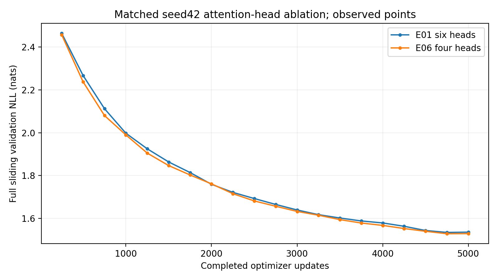

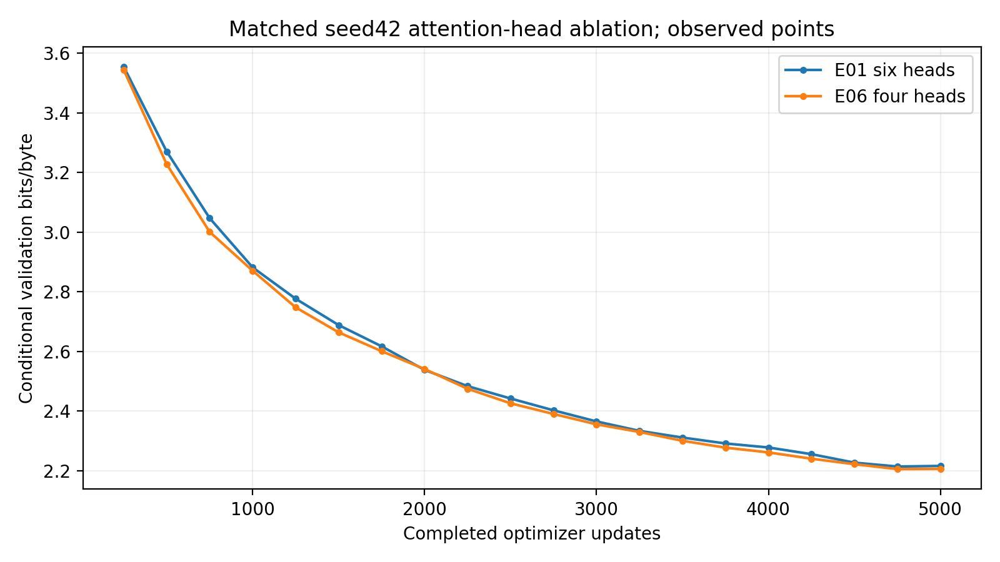

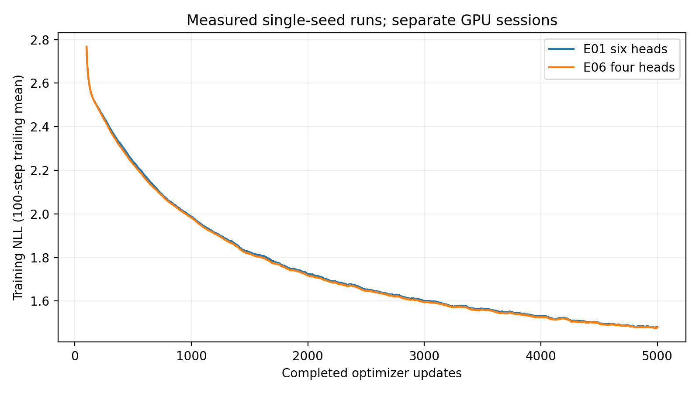

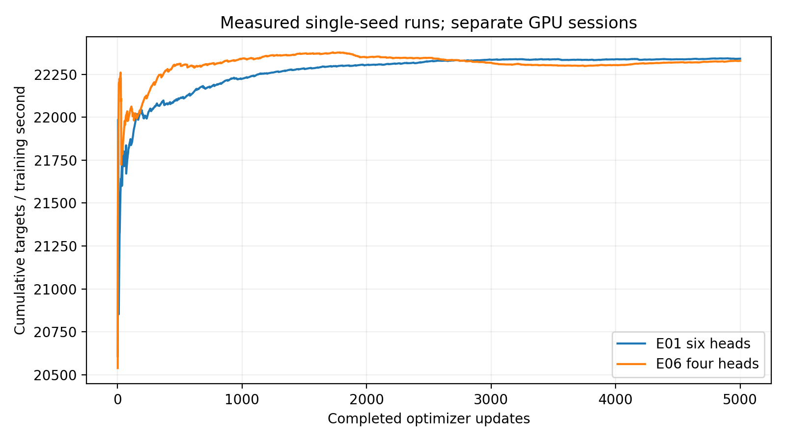

## Separate positional-ablation context

| Experiment | Factor | Best conditional BPB | Best step |
|---|---|---:|---:|
| E01 | six-head sinusoidal baseline | 2.21405793 | 4750 |
| E03 | RoPE | 2.07327076 | 5000 |
| E04 | learned positions | 2.23778869 | 5000 |

E03/E04 change position, not head count; they are contextual observations, not
combined-factor controls. E04 adds24576 parameters and extra initialization RNG
draws. E06 versus E01 is the principal matched architecture comparison.

## Runtime, throughput and overhead

| Measured scope | Seconds |
|---|---:|
| Training only | 917.232 |
| Full validation,20 evaluations | 389.111 |
| Checkpoint calls | 2.589 |
| Verified snapshot export calls | 7.045 |
| Journal fsync/flush calls | 17.621 |
| Training CLI wall | 1342.310 |
| Archive compression and checksum scope | 21.077 |
| Notebook clone to archive-complete pipeline | 1633.921 |
| Complete genuine100-sample generation | 177.269 |

Training-only average: 5.4512 updates/sec,
22328.04 predicted tokens/sec. Generation
and archive scopes lie within the measured notebook pipeline; do not double-count
them. Pipeline timestamps exclude queue, final notebook conversion/output
publication and external download. Recovery evidence is recorded below; full network-transfer and
recovery wall time were not measured. Individual validation times were not logged; cumulative total is
genuine. No measured dollars or full-session lifetime is invented.

## E06 measured figures

Validation lines connect only20 actual observations. Training smoothing uses the
declared100-step trailing mean. Full PNG/PDF evidence is in the verified archive.

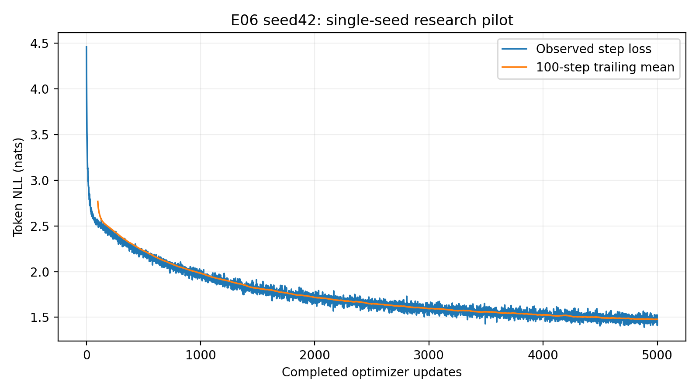

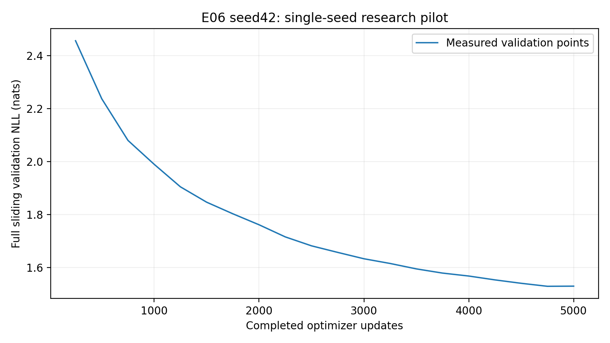

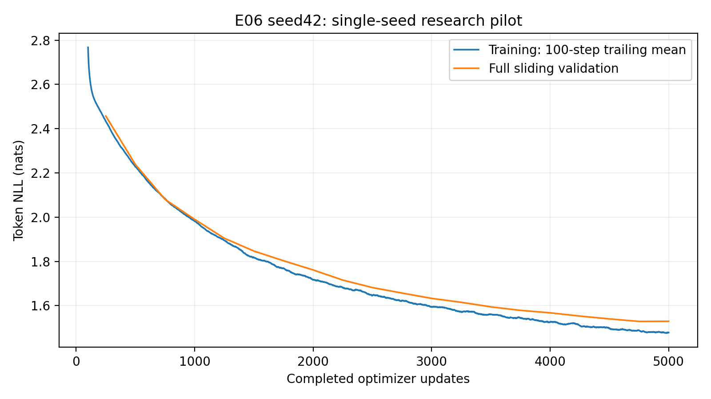

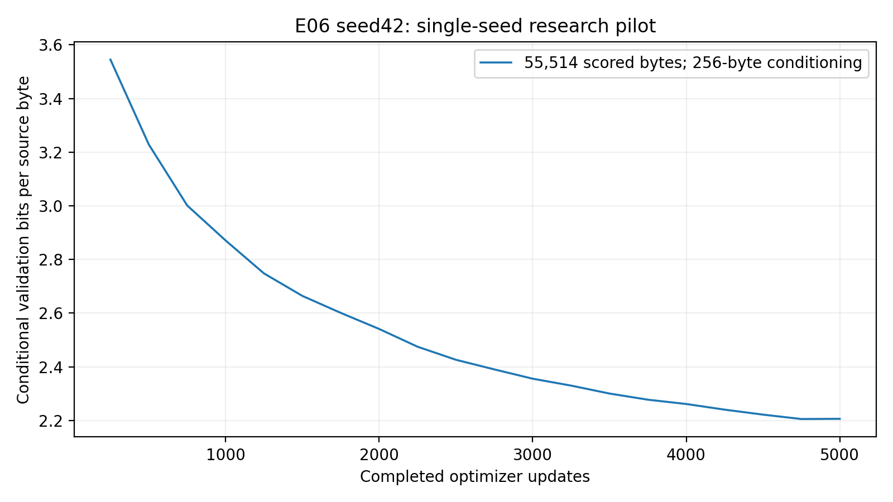

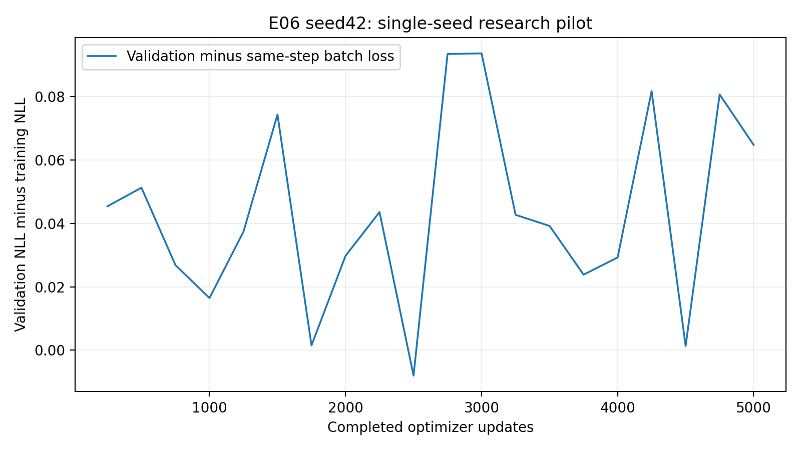

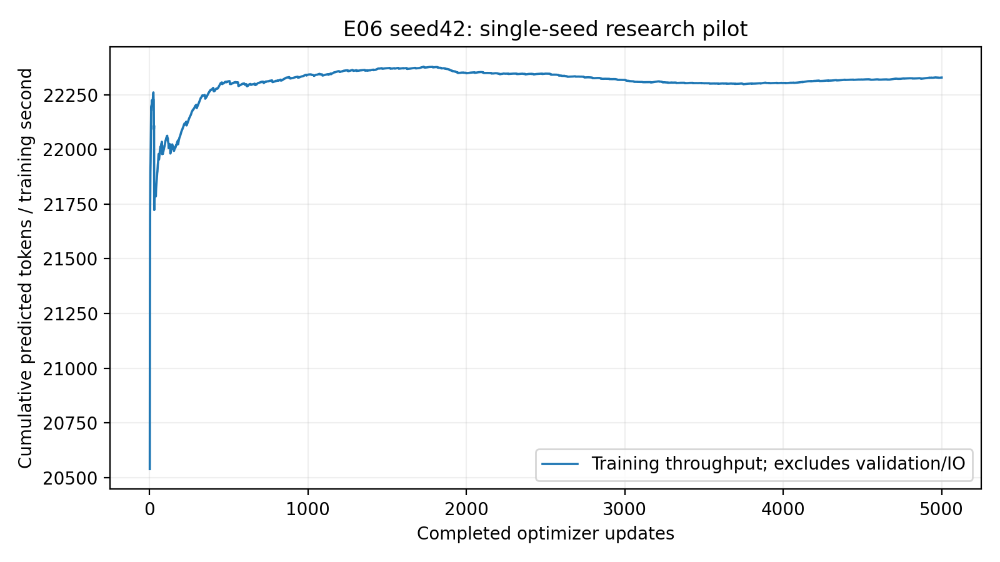

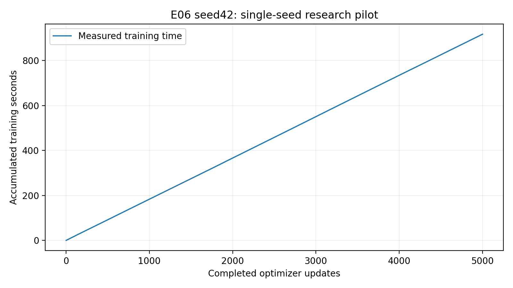

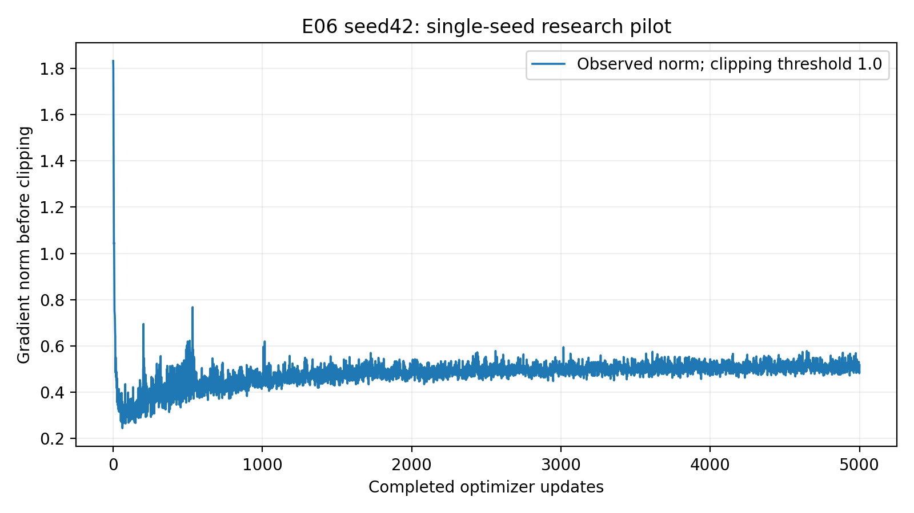

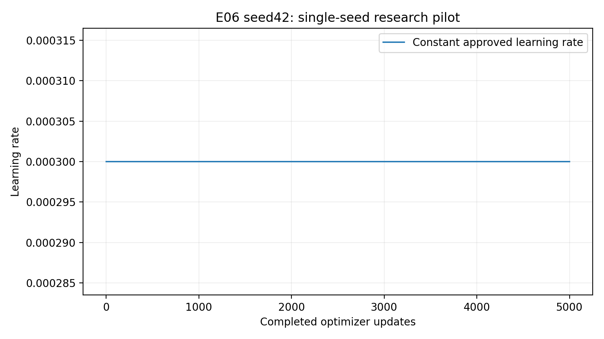

## Convergence descriptors and interpretation boundary

**Observation:** Actual3000 to 5000 validation loss improvement is
0.10357971 nats/token. A descriptive least-squares
slope through actual3000-5000 points is -0.05386162
nats/token per1000 updates. Best observed step4750; final
is 0.00055149 above that minimum.
The subsequent reviewed interpretation discusses the shape, intervals, generation
and E01 comparison without treating small fluctuations as conclusive overfitting.
Observed best is selected from scheduled evaluations, not unknown intermediate
steps. No claim about double descent or long-context extrapolation is implied.

## Genuine fixed-protocol text generation

[Complete unedited100-sample grid](generation.md) and generation.json preserve all
five prompts, best/final checkpoints, greedy seed42 and temperatures0.7/1.0/1.2
with seeds42/123/456,256 new tokens. No external model generated or edited text.
Five predetermined best-checkpoint greedy outputs follow, without cherry-picking.
Qualitative comparisons use the same settings; coherent-looking output does not
establish statistical superiority, understanding or memorization absence.

### Prompt 'To be, or not to be'

Checkpoint `step_004750.pt`, greedy,seed42,256 new tokens.

```text
To be, or not to be so man the son,
And the seem of the sent of the seems
That thou art the seem of the seems of the see
That thou art the seem of the world of the world.

Second Servingman:
The shall be so do the world of the world of the world.

Second Servingman:
The shal
```

### Prompt 'ROMEO:\n'

Checkpoint `step_004750.pt`, greedy,seed42,256 new tokens.

```text
ROMEO:
I would not so do the so die to the soul
And the seem of the sent of the prove
To the seem of the seem of the seems of the world.

DUKE OF YORK:
What is the shall be so do the seem of the world.

DUKE OF YORK:
What is the shall be so do the world of the wo
```

### Prompt 'JULIET:\n'

Checkpoint `step_004750.pt`, greedy,seed42,256 new tokens.

```text
JULIET:
The shall be so death the so death,
And the seem of the sent of the seen
That will be the son of the son the world of the world.

DUKE OF YORK:
And the shall be so do the world of the world.

DUKE OF YORK:
What is the shall be so do the world of the world.
```

### Prompt 'First Citizen:\n'

Checkpoint `step_004750.pt`, greedy,seed42,256 new tokens.

```text
First Citizen:
The shall be so death the so die of the seen
To the seem of the seem of the son the world.

Second Murderer:
The shall be so do the world of the world of the world.

Second Servingman:
The shall be so do the world of the world of the world.

Second Serving
```

### Prompt 'The king'

Checkpoint `step_004750.pt`, greedy,seed42,256 new tokens.

```text
The king of the soul of the seems of the soul
And the seem of the sent of the seems of the son
That was the seem of the seems of the world of the world.

Second Servingman:
The shall be so do the world of the world of the world.

Second Servingman:
The shall be so
```

## Publication, independent recovery and checkpoint manifest

Final checkpoint: `runs/E06_seed42_98d4288fc83b430ebc931365a541345f/checkpoints/step_005000.pt`.
Best checkpoint: `runs/E06_seed42_98d4288fc83b430ebc931365a541345f/checkpoints/step_004750.pt`.
All20 resumable weights and21 immutable snapshots are preserved. Exact optimizer,
constant scheduler,scaler,RNG and sampling/training history are included. No
restart, unrelated history concatenation or additional optimizer update occurred.
Fresh compatible Kaggle CUDA state roundtrip passed all audited state fields,
and best/final generation worked. Independent downloaded archive best/final CPU
inference also passed. Actual10k continuation was not started.

Archive bytes: **402,500,855**; SHA256 `bf224ad20d4eca03359d08da820289ac1e9cef2c8f082f9d94e229f8edb29530`.
All **58 archive files** were independently CRC/path/
file-set/hash verified. [Complete manifest](evidence/artifact_manifest.json).
The archive stores complete research checkpoints once; full immutable snapshot
copies remain in published notebook output. Dataset/tokenizer manifest,resolved
configuration,environment,full5000-step history,20 validations,figures and genuine
generations are included. Small receipts are committed byte-for-byte; checkpoints,
datasets and full journals are excluded from GitHub.

| Checkpoint update | SHA256 |
|---|---|
| 250 | `ceacf70facf38c9f8804af2aded763d484688258f6293bb672acd6d8cab80612` |
| 500 | `8f379d9d495a88a5c8634f62e919e043323f60fe0387f5ea1e00a196b31d946e` |
| 750 | `85383e7c4bfab210a1a2ff657838f0893b9d1ba10e9b34782b6954ddac2096ec` |
| 1000 | `7afcd0615eea8499d5eb2a9fd91f6d272e506feb75715e55b33ea6a0a6776c35` |
| 1250 | `2255fc87d67b7667bd15bd9540b6a7d61f57d42e335a185728cbf339d82c745b` |
| 1500 | `36d5f93904fbbe3e305418f36a294eb6608dd14b545b7e46e8b71479a3eed5dd` |
| 1750 | `cffb8a1aee4c990a5983d070bf3fe11e64733e6da72c4fe4ce314c782220f324` |
| 2000 | `7e3530acf4c7c420466e51d6a871246b072cf9f830f708190ad50a1b92928dd8` |
| 2250 | `9b4ff42d7fa55fc115679a6541f1c413c90b86ae065053543a05cf6d45d51edf` |
| 2500 | `23f359a7e4783ad720829bd79767d054e3099ce9c25fa511caf1976a00b4d4fa` |
| 2750 | `f971bd76cee7766cc8b9cf9cd3efcecd7e34a151826491511b12e0d805635344` |
| 3000 | `e977bef240ee55ab7baa58d004c5ff1997e1706313eaabf59c420737b80bc287` |
| 3250 | `33364fb033e625a400c1bc363cb3ab24c3b7b09ce0882adf6c75f3e4bc63659b` |
| 3500 | `047b0a42b9783d8bf894a6e7c8583c8a894866ac27f598cd07872b178c9614a5` |
| 3750 | `5477dcbd1293356fa4768beeba759f1bc4c0019adc08af3dd0173fff685268e9` |
| 4000 | `07cc57057ed705f635ce3f46159076f2f51550cc38c60054d495de06f50176cb` |
| 4250 | `74829dcc7e7173df93678ecb5caf70f9f67696b9cfa2d9620a97a0ea783bb884` |
| 4500 | `0604032ae28519b9f31ae671b2af554844bafe8cf35a00b25b961467ee16b091` |
| 4750 | `df84b991b93f346aec4deaa6595a1d08c86ca8576944954824b977a9ca7e4807` |
| 5000 | `2a032889bdd3c894093cd1d4fc99edc0becda62953b6ab67d57679d283a8ef85` |

## Scientific limitations and remaining scope

Single matched seed provides no significance test or across-seed SD. Validation
selects checkpoints; held-out test remains reserved. This is a fixed-context
attention-head comparison, not proof about other widths, depths or long-range
reasoning. Speed comparisons use separate sessions of the same GPU model, not
controlled repeated timing trials. Framework/seed matching does not guarantee
identical optimization trajectories when attention math changes. Greedy and
stochastic decoding quality are different diagnostics. Short phrase overlaps
may be ordinary Shakespeare language; they neither prove nor exclude memorization.
Baseline convergence cannot establish every architecture's training requirement.
Further seeds,configurations or10k extensions require separate authorization.

[Detailed evidence-backed interpretation and execution/retrieval instructions](interpretation.md)
complete the qualitative analysis and recommendations.
