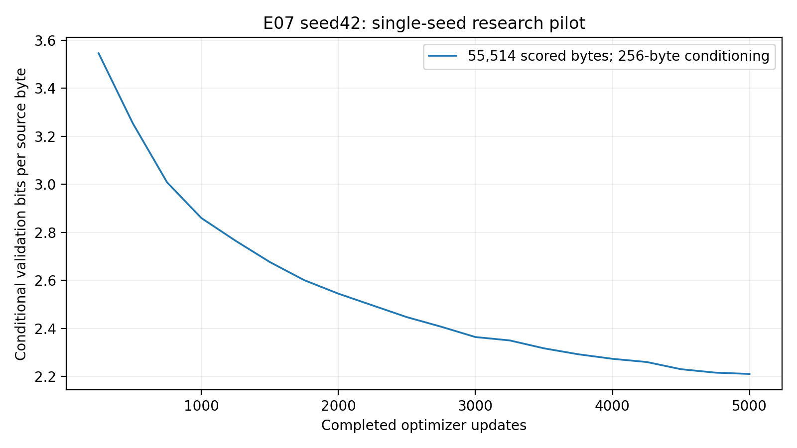

# E07 seed42 — eight-head attention experiment

The authoritative checkpoint trajectory contains **5,000 completed optimizer updates**, **20 full sliding validations**, **20 complete validation checkpoint states**, and **21 verified immutable snapshots**. Best: step **5000**, loss **1.53221244**, conditional BPB **2.21051529**. Final at 5,000: loss **1.53221244**, BPB **2.21051529**. Authentic fixed-protocol generations, independent archive integrity/inference and compatible CUDA full-state restoration passed. Single seed; no significance claim.

The interrupted original saved journal contains 207 later step attempts that were replayed from the last durable checkpoint. Their available original journal evidence is preserved; all recorded replay losses, gradient norms and sampling/exposure counters match exactly. The known physical research-update count is at least 5,207, while the verified final checkpoint/history counter is exactly 5,000. Later unsaved original progress remains unknown. See the recovery section for timing and exposure accounting.

## 1. Question, hypothesis and scope

How does changing six attention heads with 32 dimensions each to eight heads with 24 dimensions each, at the same model width of 192 and parameter count, affect next-token prediction, optimization, efficiency and generated text? More heads provide additional independently normalized attention distributions with smaller per-head spaces. Improvement, regression and negligible differences were possible hypotheses. No direction was assumed.

The authorized research scope is E07 seed42, exactly 5,000 updates, fresh initialization. No other research configurations, seeds, interactions or 10,000 extension ran. Labeled smoke updates and recovery checks are separate engineering evidence. After Colab refused GPU allocation, the user explicitly requested Kaggle and completion on its verified account. This platform change is documented; scientific settings stayed frozen. No test likelihood or test-based selection.

## 2. Technical head-count distinction and correctness audit

The unchanged implementation projects Q/K/V from 192 to 192, splits to `(batch,8,length,24)`, computes `(Q @ K.T)/sqrt(24)`, masks future positions, softmaxes along key positions per head, applies training attention dropout 0.1, aggregates V, merges to 192 and applies the existing 192-dimensional output projection. E01 instead splits to 6×32. Projection tensor shapes and trainable parameter counts are identical. Head splitting changes the score distributions and attention/dropout tensor sizes; shared seed initialization does not force identical optimization trajectories.

CPU and qualified CUDA numerical audits inspected all four actual Transformer blocks. Manual sqrt(24) probabilities/output matched; incorrect sqrt(32) and sqrt(192) references differed numerically. QKV/logit/merge shapes, per-head key softmax, future mask, train/eval dropout scaling, GELU MLP 192→768→192, sinusoidal positions and absence of ReLU/RoPE/learned positions passed. All 68 initial E01/E07 state tensors matched under seed42 in the same environment. CUDA initial parameter-byte SHA256: `993d795eb33782ad0e1524e2e6f5ac202f1c052cd0319134ead5e7dfcd6582ba`.

Shifted next-token targets, manual cross-entropy, finite forward/backward/all parameter gradients and nonzero gradients for every Q/K/V/output projection passed. Altering future tokens preserved earlier logits. One greedy generation token matched prediction from the last128-token cropped context. Parameter count exactly **1,804,800**. No scientific implementation fix was needed. [Full audit](https://github.com/rayyan-merchant/Nano-Language-Model/blob/8f88edee89dfceb6d0a8c84e385a886c4e058356/report/pilots/E07_seed42/evidence/heads_audit.json), [existing suite](https://github.com/rayyan-merchant/Nano-Language-Model/blob/8f88edee89dfceb6d0a8c84e385a886c4e058356/report/pilots/E07_seed42/evidence/tests.json), [focused attention test](https://github.com/rayyan-merchant/Nano-Language-Model/blob/8f88edee89dfceb6d0a8c84e385a886c4e058356/report/pilots/E07_seed42/evidence/attention_test.json). Test counts/times are recorded in those actual outputs.

## 3. Source, software and hardware

- Clean trained reviewed source: `5bb03b18943e7c45a305ce1d78b3446c31829ae7`.
- Scientific source SHA256: `cdea42adb930904fb0cefcd282d784bb3ac8caa311d3f1e12ef568622f9c12d6`.
- Actual resolved E07 config SHA256: `77fe03469eb15eaba27561b0f59adacee2dfee37548d5ece3ddb2cd3aeaa3147`.
- E01 source: `444bca4c4ac19f97f46fae210a9fd361f8561537`; canonical source/config diff and historical audited hash establish equivalent shared model/tokenizer/training/evaluation semantics.
- Installed shared `nano_lm` remained at pinned clean main. Separately committed orchestration was executed from its own checkout; notebook contains exact orchestration SHA. No separate training loop/model implementation.
- [Research notebook](https://www.kaggle.com/code/syedarijaali/e07-seed42-verified-recovery?scriptVersionId=357803921), [qualification notebook](https://www.kaggle.com/code/syedarijaali/e07-seed42-gpu-qualification).
- Isolated Python 3.11.14, PyTorch 2.5.1+cu124, torch CUDA 12.4, NumPy 1.26.4, tokenizers 0.21.0, Matplotlib 3.9.4, pytest 8.3.4. Exact 46-package qualified transitive freeze matched E01/E02/E05 apart from editable project location.
- Tesla T4; 2 visible devices, cuda:0 used for this one run. Per-device total memory 15,636,037,632bytes. Driver/hardware in [hardware receipt](https://github.com/rayyan-merchant/Nano-Language-Model/blob/5f3bfd8b3a95c346be9f70aa0404e1cdf2fbd430/report/pilots/E07_seed42/evidence/hardware.json); full freeze/platform details in [environment](https://github.com/rayyan-merchant/Nano-Language-Model/blob/5f3bfd8b3a95c346be9f70aa0404e1cdf2fbd430/report/pilots/E07_seed42/evidence/environment.json).

The original execution wrapper is preserved as [exact original saved notebook](https://github.com/rayyan-merchant/Nano-Language-Model/blob/8f88edee89dfceb6d0a8c84e385a886c4e058356/notebooks/kaggle_e07_seed42_research_executed.ipynb), and continuation/final processing as [exact saved recovery notebook](https://github.com/rayyan-merchant/Nano-Language-Model/blob/8f88edee89dfceb6d0a8c84e385a886c4e058356/notebooks/kaggle_e07_seed42_recovery_executed.ipynb). Their code indentation and genuine stdout were captured from the saved rendered notebook PRE blocks, with execution counts and capture provenance. Version-history preview text collapses literal indentation, so it was not used as executable source. The preserved recovery wrapper metadata identifies native Python 3.13.15; every scientific subprocess uses the isolated Python 3.11.14 interpreter. Historic notebook output still labels Drive retrieval pending at its execution time; the later independent publication receipt records completion.

Kaggle native Python 3.13/PyTorch 2.11 was left unchanged and did not train/evaluate/generate the research model. `MPLBACKEND=Agg`, deterministic settings and OMP threads 1 reproduced the qualified workflow. E01 also ran Kaggle/T4/driver580.178.04; software and accelerator matches reduce runtime confounds, while different host/session scheduling and thermal/load conditions remain uncontrolled. No isolated head-count speed mechanism or FLOP claim.

## 4. Dataset, tokenizer and likelihood policy

Pinned Tiny Shakespeare revision `6f9487a6fe5b420b7ca9afb0d7c078e37c1d1b4e`; raw SHA256 `86c4e6aa9db7c042ec79f339dcb96d42b0075e16b8fc2e86bf0ca57e2dc565ed`; character SHA256 `ed96787d2f3f9741d69eba15160f31634ba6755b47e4c261ffedbb975fa0af77`. Train/validation/test 1,003,854/55,770/55,770 bytes; vocabulary 65. All reference manifest fields verified. Splits precede train-only fitting; windows/shifted targets remain within their partition. [Data evidence](https://github.com/rayyan-merchant/Nano-Language-Model/blob/5f3bfd8b3a95c346be9f70aa0404e1cdf2fbd430/report/pilots/E07_seed42/evidence/dataset_verification.json).

Every full sliding validation uses complete 55,770-byte validation text,256 conditioning-only bytes and exactly 55,514 scored target bytes/characters, each once, context 128, batch 32, eval dropout disabled and canonical local position reset. No cap/subsampling/test likelihood. Conditional BPB equals NLL/(ln2×55514) and character loss/ln2; perplexity=exp(loss). E01/E07 loss and BPB compare directly. Full-validation loss selects the best checkpoint.

## 5. Frozen model and optimizer

Decoder-only from-scratch GPT, character vocabulary 65, width 192,4 blocks,8 heads / 24 dimensions per head, context 128, MLP expansion 4 (192→768→192), GELU, sinusoidal, dropout 0.1. Sole intended E01 change `n_heads:8`; parameters 1,804,800.

Seed 42, float32 CUDA, AdamW, learning rate 0.0003, constant LR, weight decay 0.01, clipping 1.0, microbatch 4, accumulation 8,4,096 predicted targets per update.5000 completed updates; no AMP-skipped updates. Validation every 250 updates / periodic checkpoints every 500 with every validation state preserved. Full optimizer/scheduler/scaler/RNG/sampling/history state retained; no fine-tuning or dynamic hyperparameter changes. [Execution receipt](https://github.com/rayyan-merchant/Nano-Language-Model/blob/8f88edee89dfceb6d0a8c84e385a886c4e058356/report/pilots/E07_seed42/evidence/execution.json).

## 6. Genuine training and matched full validation curves

Recorded update 1 train loss 4.45922834; first full validation at 250 loss 2.45814260; final sampled train loss 1.48213620; descriptive trailing 100 mean 1.48400847. No step-zero measurement invented.

| Update | E01 loss | E07 loss | E01 BPB | E07 BPB | E07−E01 loss |
|---:|---:|---:|---:|---:|---:|
| 250 | 2.46425110 | 2.45814260 | 3.55516284 | 3.54635014 | -0.00610850 |
| 500 | 2.26721599 | 2.25564964 | 3.27090127 | 3.25421455 | -0.01156635 |
| 750 | 2.11220971 | 2.08519372 | 3.04727447 | 3.00829864 | -0.02701598 |
| 1000 | 1.99768526 | 1.98233428 | 2.88205062 | 2.85990384 | -0.01535098 |
| 1250 | 1.92482598 | 1.91656108 | 2.77693689 | 2.76501316 | -0.00826490 |
| 1500 | 1.86354672 | 1.85517837 | 2.68852962 | 2.67645663 | -0.00836835 |
| 1750 | 1.81413472 | 1.80303099 | 2.61724317 | 2.60122387 | -0.01110373 |
| 2000 | 1.75925914 | 1.76394477 | 2.53807444 | 2.54483437 | +0.00468563 |
| 2250 | 1.72154866 | 1.73001517 | 2.48366971 | 2.49588431 | +0.00846651 |
| 2500 | 1.69282241 | 1.69617469 | 2.44222650 | 2.44706281 | +0.00335228 |
| 2750 | 1.66527225 | 1.66857484 | 2.40248002 | 2.40724465 | +0.00330259 |
| 3000 | 1.63945360 | 1.63871218 | 2.36523157 | 2.36416194 | -0.00074141 |
| 3250 | 1.61751165 | 1.62901556 | 2.33357603 | 2.35017267 | +0.01150392 |
| 3500 | 1.60199293 | 1.60615901 | 2.31118726 | 2.31719765 | +0.00416608 |
| 3750 | 1.58823999 | 1.58902298 | 2.29134596 | 2.29247557 | +0.00078298 |
| 4000 | 1.57893347 | 1.57586049 | 2.27791948 | 2.27348612 | -0.00307298 |
| 4250 | 1.56335215 | 1.56663852 | 2.25544039 | 2.26018162 | +0.00328637 |
| 4500 | 1.54364829 | 1.54585716 | 2.22701373 | 2.23020046 | +0.00220887 |
| 4750 | 1.53466801 | 1.53600283 | 2.21405793 | 2.21598367 | +0.00133482 |
| 5000 | 1.53601210 | 1.53221244 | 2.21599704 | 2.21051529 | -0.00379966 |

[Matched 20-point CSV](https://github.com/rayyan-merchant/Nano-Language-Model/blob/5f3bfd8b3a95c346be9f70aa0404e1cdf2fbd430/report/pilots/E07_seed42/matched_validation.csv), [full E07 validation/perplexity table](validation.csv).





Lines join measured validation endpoints. Smoothing is descriptive. Dropout-active sampled train loss is not full train-corpus likelihood; its gap with evaluation-mode validation alone cannot establish overfitting. One final fluctuation does not prove convergence or deterioration.


## 7. Endpoint and efficiency comparison

| Metric | E01 six heads / 32 dimensions | E07 eight heads / 24 dimensions |
|---|---:|---:|
| Parameters | 1,804,800 | 1,804,800 |
| Best step | 4,750 | 5,000 |
| Best loss | 1.53466801 | 1.53221244 |
| Best BPB | 2.21405793 | 2.21051529 |
| Final loss | 1.53601210 | 1.53221244 |
| Final BPB | 2.21599704 | 2.21051529 |
| Final perplexity | 4.64602540 | 4.62840557 |
| Retained trajectory training seconds | 916.70840175 | 946.00038413 |
| Full validation seconds | 420.90800282 | 425.20904058 |
| Updates/sec | 5.45429712 | 5.28541012 |
| Predicted tokens/sec | 22340.80102352 | 21649.03983496 |
| Peak allocated MiB | 151.71240234 | 161.72802734 |
| Clipping fraction | 0.00140000 | 0.00140000 |
| Unique target bytes | 1,003,848 | 1,003,848 |

Best loss/BPB reduction: +0.1600%; final reduction +0.2474%. Positive means lower E07; negative means regression. Training-time change +3.195%. Both runs exposed 20,480,000 predicted tokens/original target bytes. Exposure includes repeats; unique coverage is not independent sample count or complete epochs.

Loss decrease3k→5k: E01 0.10344149, E07 0.10649974. Descriptive late fitted loss slopes per 1,000 updates: E01 -0.05359160, E07 -0.05653502; no prediction of longer-run behavior.

Timing scope: **resumed segment only; prior checkpoint/export overhead unavailable**. The saved checkpoint retains cumulative training/validation times, while absent prior IO measurements and lost volatile runtime are not reconstructed or invented. Measured local checkpoint overhead 1.244s; snapshot export into Kaggle saved-output staging 3.357s (**Kaggle local exports**, not Drive upload latency); journal/fsync 8.009s; engine wall 642.875s. Archive construction/local staged publication 33.467s. Platform saved-version publication and later Drive uploads are distinct stages; only separately recorded timings are claimed. Peak allocated memory excludes reserved memory/driver overhead.


## 8. Gradients and head-related observations

All 5,000 gradient norms finite. Mean 0.496471, median 0.507738, min 0.251173, max 1.837447, final 0.567897. 7 updates exceeded 1.0 (0.140%). E01 clipping 0.140%. [Actual diagnostics](https://github.com/rayyan-merchant/Nano-Language-Model/blob/5f3bfd8b3a95c346be9f70aa0404e1cdf2fbd430/report/pilots/E07_seed42/evidence/gradient_diagnostics.json).


Finite gradients and the preflight math audit establish observed numerical correctness; they do not identify a learned attention diversity mechanism. No systematic trained-head specialization, causal head ablation or representation-diversity audit was collected. Loss changes alone cannot establish those mechanisms.

## 9. Best/final authentic text generation

Unchanged generation protocol: five fixed prompts, greedy and temperatures0.7/1.0/1.2, seeds42/123/456,256new character tokens, best/final policies.100 unedited labels (50settings/policy), checkpoint hashes verified. [Full readable grid](https://github.com/rayyan-merchant/Nano-Language-Model/blob/5f3bfd8b3a95c346be9f70aa0404e1cdf2fbd430/report/pilots/E07_seed42/generation.md), [full JSON](generation.json).

Best/final identical weights;50duplicate policy pairs are not independent evidence.

### Observations from the complete fixed grid

All 50 distinct E07 best-policy settings were inspected. The final-policy grid is an exact duplicate of those settings because best and final are the same step-5000 weights; the independent verifier checks every pair. All 100 slots remain in the unedited grid. These are decoding probes from one trained model, not independent training replicates.

- **Dialogue form:** sampling often produces uppercase speaker labels and line-separated speeches, including BUCKINGHAM, ROMEO, CORIOLANUS and FRIAR LAURENCE. This resembles the dataset's surface format. It does not establish sustained dialogue understanding.
- **Word formation and grammar:** common words and names mix with interior malformed words such as `kingdrel`, `faming`, `brunks`, `kingdrat`, `lapinish'd` and `Norfolkspition`. Pronoun agreement, verb selection and phrase composition frequently break down. The forced 256-character cutoff produces terminal fragments; those alone are not counted as spelling failures.
- **Prompt relevance:** the model retains the supplied prefix and sometimes continues `The king` into `The kingdom`, but Romeo/Juliet identity and the semantic question in `To be, or not to be` are weakly sustained. Similar phrases appear under different prompts and common sampling seeds. This observation does not identify an attention mechanism.
- **Greedy decoding:** every fixed prompt develops repetitive `sent`/`stand` phrases, often recycling whole line templates. E01 also loops, typically around `world`/`seal`; E07's recorded repetition fraction is higher under both matched checkpoint policies.
- **Temperature:** 0.7 breaks the greedy loops and often preserves recognizable labels, while still producing malformed grammar. At 1.0 and 1.2, visible lexical/name corruption and erratic punctuation become more common in these examples. Lower repeated-character statistics at higher temperature are not evidence of better narrative quality.

### Matched descriptive repetition statistic

For each continuation, count repeated positions among its 249 overlapping 8-character grams; average across all five greedy prompts or all 15 prompt/seed samples per temperature. This is a transparent string statistic, not a semantic quality score.

| Experiment | Policy | Decoding | Samples | Mean repeated 8-gram position fraction |
|---|---|---|---:|---:|
| E01 | best | greedy | 5 | 0.52289157 |
| E01 | best | 0.7 | 15 | 0.00133869 |
| E01 | best | 1.0 | 15 | 0.00000000 |
| E01 | best | 1.2 | 15 | 0.00133869 |
| E01 | final | greedy | 5 | 0.54377510 |
| E01 | final | 0.7 | 15 | 0.00562249 |
| E01 | final | 1.0 | 15 | 0.00267738 |
| E01 | final | 1.2 | 15 | 0.00080321 |
| E07 | best | greedy | 5 | 0.66265060 |
| E07 | best | 0.7 | 15 | 0.00321285 |
| E07 | best | 1.0 | 15 | 0.00214190 |
| E07 | best | 1.2 | 15 | 0.00026774 |
| E07 | final | greedy | 5 | 0.66265060 |
| E07 | final | 0.7 | 15 | 0.00321285 |
| E07 | final | 1.0 | 15 | 0.00214190 |
| E07 | final | 1.2 | 15 | 0.00026774 |

E07 greedy repetition is 66.2651%, versus E01 best 52.2892% and final 54.3775%: increases of 13.9759 and 11.8876 percentage points. This is a genuine decoding regression in this fixed grid despite the small validation-likelihood improvement. Both models remain weak at grammar and sustained coherence; no overall generation-quality improvement is established.

### Genuine examples selected by a fixed rule

The examples below include **all five E07 greedy prompts**, and the **first protocol prompt with seed42 at each temperature**, and the matched E01 best ROMEO greedy output. Selection follows protocol order rather than perceived quality. Every example contains its entire unedited 256-token continuation; the full grid includes every remaining seed/temperature and the duplicate final policy.

#### E07 grid entry 1: greedy=True, temperature=1.0, seed=42

```text
To be, or not to be the sentence the sent
That the sent the senter of the sent of the sent
That the sent of the sent of the sent of the stand
That I shall be the sent of the sent of the stand
That I shall be the sent of the sent of the stand
That I shall be the sent of the s
```

#### E07 grid entry 2: greedy=False, temperature=0.7, seed=42

```text
To be, or not to be the king.

BUCKINGHAM:
Thou distand thee, that, and thy company.

ROMEO:
But I say think the luke thou aid a kingdrel.

KING EDWARD IV:
What's a merry, that great it change should do with
the portice see, and my souls now chow too the sel,
Thy did name wo
```

#### E07 grid entry 5: greedy=False, temperature=1.0, seed=42

```text
To be, or not to bed,
His affused panter to a modething heart:
There's now fair with lapinish'd we speak!

KING RICHARD III:
I am it didle content in thy brothers;
And thou hast prompt against dead, he is never
unor in as in my wring; as now ever thou thus?

MERCUTIO:
Nay, l
```

#### E07 grid entry 8: greedy=False, temperature=1.2, seed=42

```text
To be, or not to bed,
His affused pleasured armonital.
The brother, any this oachily lapinish'd
Is burns and state; 'ticlian, be ever follow
An England, I'll have an ever, that great, my hand-pread
Nor in wife'd horse. He is nor my sons, now
even too just'? my lord--
I have 
```

#### E07 grid entry 11: greedy=True, temperature=1.0, seed=42

```text
ROMEO:
The shall be the sent the sent the sent the sent
That the sent the sent the sent of the sent
That shall be stand the sent of the sent of his
shall be the sent of the sent of the sea,
The shall be stand the sent of the sent of his
shall be the sent of the s
```

#### E07 grid entry 21: greedy=True, temperature=1.0, seed=42

```text
JULIET:
Why, the sent the sent the sent the sent the sent
The sent of the senten the sent of the sent
That shall be so so the sent of the seal of the stand
That I shall be the sent of the sent of the stand
That I shall be the sent of the sent of the stand
That I s
```

#### E07 grid entry 31: greedy=True, temperature=1.0, seed=42

```text
First Citizen:
Where is the stand of the senten the sent the sent
That shall be the sent the sent of the sent
That heart the sent of the sent of the stands,
And the sent the sent of the sent of the stands,
And the sent the sent of the sent of the stands,
And the sent the
```

#### E07 grid entry 41: greedy=True, temperature=1.0, seed=42

```text
The king of the senten of the senter of the sent
That the sent the sent the sent of the sent
That shall be the sent of the sent of the stands,
And the sent the sent of the sent of the stands,
And the sent the sent of the sent of the stands,
And the sent the sent o
```

#### E01 best ROMEO greedy, unchanged reference

```text
ROMEO:
What shall I will not the world of the seal of the son
That the seal the serve of the sends of the seal of the
shall be so much a poor the world of the world,
And the send of the world the world of the world
That the send of the world the world of the worl
```


## 10. Durable storage and independent recovery

Colab failed allocation before any code/training. Kaggle's legitimate verified account provided T4 access. Before research, a real E07 smoke checkpoint was exported with manifests/hash checks, saved as a private persistent Kaggle output version, independently downloaded/verified and published/read back from Drive. A fresh compatible isolated CUDA process restored complete model/AdamW/scheduler/scaler/Python/NumPy/torch/CUDA/sampling RNG/training state from the mounted saved smoke archive and compared an exact state roundtrip. Working-directory copies alone were not treated as persistent storage. Final artifacts use the shared verified snapshot workflow and staged-rename publisher; no Drive FUSE hard links assumed.

Research run `E07_seed42_f00363fe26f64ec1b3bb5ad00d19c4bd`.20 checkpoints and 21 snapshots preserved. Each checkpoint's optimizer counters/scheduler epoch/history length/metadata verified. Research failure/resume events: 1. [Inventory](https://github.com/rayyan-merchant/Nano-Language-Model/blob/5f3bfd8b3a95c346be9f70aa0404e1cdf2fbd430/report/pilots/E07_seed42/evidence/checkpoint_audit.json), [snapshot index](https://github.com/rayyan-merchant/Nano-Language-Model/blob/5f3bfd8b3a95c346be9f70aa0404e1cdf2fbd430/report/pilots/E07_seed42/evidence/snapshot_index.json).

Before final publication, a fresh compatible CUDA child process restored all six complete state structures from verified immutable snapshots exactly; best/final inference passed with zero additional updates. No 10,000 continuation executed. [CUDA receipt](https://github.com/rayyan-merchant/Nano-Language-Model/blob/5f3bfd8b3a95c346be9f70aa0404e1cdf2fbd430/report/pilots/E07_seed42/evidence/cuda_recovery.json).

- [Persistent private Drive folder](https://drive.google.com/drive/folders/1wl_3R9p3DUaW7aYLJqeBiYJLCtNVhUD0).
- [Saved Kaggle research output](https://www.kaggle.com/code/syedarijaali/e07-seed42-verified-recovery?scriptVersionId=357803921).
- Complete archive size **408,106,575bytes**; SHA256 `ba92cd87bd6a3aafa6164cdaef037a47d0fae9c208e0648c3775b19c9e6aa06d`.
- [File-hash manifest](evidence/artifact_manifest.json), [numbered parts](https://github.com/rayyan-merchant/Nano-Language-Model/blob/5f3bfd8b3a95c346be9f70aa0404e1cdf2fbd430/report/pilots/E07_seed42/evidence/archive_parts.json), [independent integrity/inference receipt](https://github.com/rayyan-merchant/Nano-Language-Model/blob/5f3bfd8b3a95c346be9f70aa0404e1cdf2fbd430/report/pilots/E07_seed42/evidence/independent_verification.json).

Independent retrieval/reconstruction verified full archive hash/size,173safe unique entries/CRC/per-file hashes, all 20 actual checkpoint state inventories,5,000 history rows/20 full validations and all 100 generation checkpoint hashes/protocol settings. Best/final CPU inference succeeded; CPU migration profile Python 3.10.0 / torch 2.11.0 is not the exact training-resume environment. Fresh CUDA recovery used the approved profile. Large weights/datasets remain outside GitHub.

### Recorded interruption, replay and timing limits

The original Kaggle session was off when work resumed. Saved version 2 contained 2,957 original step events, but its latest complete durable checkpoint was step 2,750. All 11 snapshots passed hashes, and a fresh qualified T4 process restored model, optimizer, scheduler, scaler, RNG and sampling/training state exactly before any resumed updates. The original 2,957-event journal remains in [original saved attempts](https://github.com/rayyan-merchant/Nano-Language-Model/blob/5f3bfd8b3a95c346be9f70aa0404e1cdf2fbd430/report/pilots/E07_seed42/evidence/original_saved_attempts.json). The authoritative restored journal starts from its unmodified snapshot; the original attempt journal was preserved separately.

Steps 2,751–2,957 were replayed. Every recorded training loss, pre-clipping gradient norm, target/source-byte exposure, unique-byte count, learning rate, accumulation and overflow counter matches the original attempt exactly. This is a comparison of genuine recorded metrics with zero recomputation updates: [207-step replay check](https://github.com/rayyan-merchant/Nano-Language-Model/blob/5f3bfd8b3a95c346be9f70aa0404e1cdf2fbd430/report/pilots/E07_seed42/evidence/replayed_attempt_comparison.json). Subsequent authoritative checkpoints reach exactly step 5,000 and contain all 5,000 history rows / 20 validations.

The retained trajectory records **946.000384 seconds** of training and **425.209041 seconds** of full validation. The 207 superseded original attempts add **38.317729 measured training seconds** and **847,872 predicted target bytes/tokens** outside that retained trajectory. Thus known physical research execution is at least **5,207 updates**, **21,327,872 predicted tokens** and **984.318113 training seconds**. Later unsaved original progress and complete physical pipeline time are unknown. No extension beyond checkpoint step 5,000 was launched. [Timing/exposure accounting](https://github.com/rayyan-merchant/Nano-Language-Model/blob/5f3bfd8b3a95c346be9f70aa0404e1cdf2fbd430/report/pilots/E07_seed42/evidence/replay_timing.json).

Checkpoint/export/journal/engine-wall measurements cover the resumed segment only. The final processing phase measured 245.799442 seconds, including 206.576958 seconds before archive construction and 33.467406 seconds of archive construction/local staged publication; the remaining phase time includes part creation and verification. Those nested times must not be added again to the complete finish phase. Independent reconstruction/inference timings are in their receipts and exclude downloads. Initial IO overhead, complete transfer latency and total physical pipeline wall time are unavailable; no estimates replace them. The recorded creation-to-final-step timestamp span is 17016.268 seconds, including the interruption and recovery staging; [scope and timestamps](https://github.com/rayyan-merchant/Nano-Language-Model/blob/8f88edee89dfceb6d0a8c84e385a886c4e058356/report/pilots/E07_seed42/evidence/observed_wall_span.json) distinguish it from training-only and later pipeline phases.

Drive first rejected a 209,715,200-byte part at its 104,857,600-byte upload bridge limit before invoking the Drive action. The same verified ZIP was repartitioned into seven parts of at most 67,108,864 bytes. All published Drive parts and manifests were then independently downloaded, reconstructed and verified. The complete ZIP SHA256 stayed unchanged. [Transfer event](https://github.com/rayyan-merchant/Nano-Language-Model/blob/8f88edee89dfceb6d0a8c84e385a886c4e058356/report/pilots/E07_seed42/evidence/transfer_failure.json), [publication/read-back receipt](https://github.com/rayyan-merchant/Nano-Language-Model/blob/5f3bfd8b3a95c346be9f70aa0404e1cdf2fbd430/report/pilots/E07_seed42/evidence/Drive_publication.json).

A local transfer helper initially used `hashlib.file_digest`, unavailable on the host Python 3.10; it was replaced with streaming SHA256 before copying/verifying parts. An early verifier invocation consequently found missing staged parts and failed. Successful preservation was claimed only after the subsequent complete hash/CRC/state/inference checks passed. These utility failures affected no research model or optimizer state.

## 11. Failures, uncertainty and limitations

Colab GPU usage limits blocked its initial attempt with zero research/smoke updates. User authorized Kaggle fallback and its profile was independently qualified. All actual additional failures and timing limitations are retained in the evidence; incomplete transfers/checks are never counted as successful preservation. One seed offers no variance/significance estimate. Same initialization and source/effective budget improve control, but changing head count changes attention shapes/dropout RNG consumption and optimization trajectory. Same platform/GPU/software does not fully control host/runtime conditions. Validation is conditional sliding likelihood, not whole-file entropy. Repetition metrics and human qualitative assessment do not measure narrative quality formally. No test-based tuning, other trained configuration/seed or extension.

## 12. Interpretation, optimization implications and recommendations

Eight heads are competitive with the six-head baseline under this frozen 5k budget: best likelihood improves by only 0.1600%, final likelihood by 0.2474%. The curves cross (10 of 20 matched points favor E07), so this is not a consistent stepwise advantage. Peak allocated memory increases and the budget-matched training counter is slower; session/recovery/export conditions prevent an isolated speed claim. Greedy looping worsens in the fixed grid, and grammar remains weak under sampling. E06 four heads has a lower verified endpoint loss in this seed. These findings do not justify adopting eight heads or combining factors; additional authorized seeds and explicit generation diagnostics are needed. No head-diversity mechanism is inferred.

Additional independently authorized seeds are needed to estimate variance and decide whether head count should change in the final architecture. Longer training would require a separately approved continuation from verified step-5,000 state, preserving constant schedule/optimizer/RNG. No combined configuration is authorized by this result. Learned attention diversity requires targeted diagnostics before a mechanism claim.

## 13. E06/E01/E07 and collaboration

E06 is now merged in reviewed main `d1ca09df3d20478aabcdd3b4999f8cef6e0d5782` (PR9). Its verified report is the only E06 result source; no E06 run or file was edited. The complete matched three-way table and loss/BPB figures are preserved.

| Experiment | Heads | Dimensions/head | Parameters | Best step | Best loss | Best BPB | Final loss | Final BPB |
|---|---:|---:|---:|---:|---:|---:|---:|---:|
| E06 | 4 | 48 | 1804800 | 4750 | 1.52865285 | 2.20537989 | 1.52920435 | 2.20617553 |
| E01 | 6 | 32 | 1804800 | 4750 | 1.53466801 | 2.21405793 | 1.53601210 | 2.21599704 |
| E07 | 8 | 24 | 1804800 | 5000 | 1.53221244 | 2.21051529 | 1.53221244 | 2.21051529 |


[Matched 20-point table](https://github.com/rayyan-merchant/Nano-Language-Model/blob/5f3bfd8b3a95c346be9f70aa0404e1cdf2fbd430/report/pilots/E07_seed42/matched_three_heads.csv). E06 has the lowest best/final loss in this seed. Separate sessions, stochastic optimization trajectories and one seed prevent significance or a general head-count ranking.


Dedicated E07 branch, private Kaggle notebooks, Drive namespace and report. Primary researcher owns E06; coordination on PR9 records separate scopes. E01–E06 evidence/scientific files unchanged. [Review PR](https://github.com/rayyan-merchant/Nano-Language-Model/pull/11) contains reproducible scripts/launcher and exact executed notebook snapshots, tests, small evidence, tables, figures and detailed documentation. No merge.
