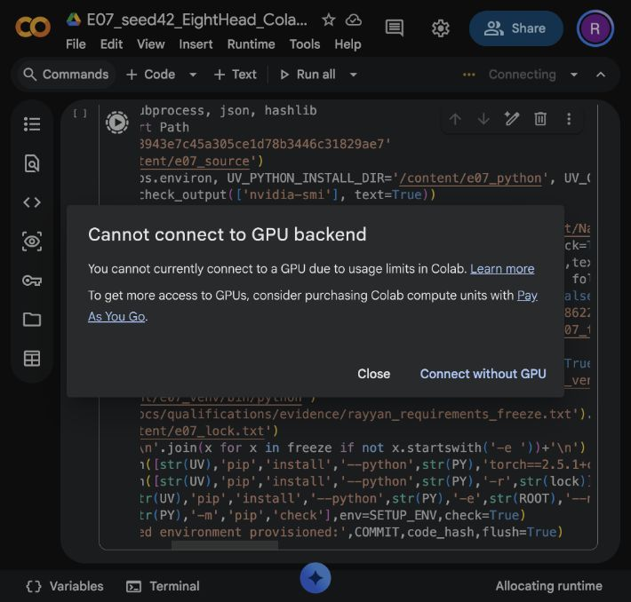

# E07 seed42 eight-head attention — preflight blocked

**Research execution has not started.** On 2026-10-12, Colab refused the requested
T4 runtime with: “You cannot currently connect to a GPU due to usage limits in Colab.”
Completed E07 research updates: **0/5000**. Full validations: **0/20**. Smoke updates:
**0**. No checkpoint, research archive, trained sample or measured research result
exists. This document preserves the actual preflight outcome, not a completed study.

## Objective and hypothesis

Investigate changing E01's six 32-dimensional attention heads to eight
24-dimensional heads while keeping width192 and parameter count fixed. Additional
independently normalized attention distributions and smaller per-head dimensions
may change learning; the direction of predictive or generation effects is unknown.
Head count alone does not establish representation diversity or a causal mechanism.

## Frozen source and planned configuration

- Reviewed main: `5bb03b18943e7c45a305ce1d78b3446c31829ae7`.
- Scientific code SHA256: `cdea42adb930904fb0cefcd282d784bb3ac8caa311d3f1e12ef568622f9c12d6`.
- Planned resolved config SHA256: `77fe03469eb15eaba27561b0f59adacee2dfee37548d5ece3ddb2cd3aeaa3147`.
- Committed orchestration: `4098d8b8e2d3a14c8cfdf885244dbfc93d0fae3e`.

Source synchronization fetched reviewed main. Diff against E05's trained commit
`31e974b23b7e73b2f48b080b36865608efb879b8` found no changes in `src`, `configs`,
or `experiments/configs`. Recomputed scientific hash matched the historical audited
hash. Model/training/tokenizer/evaluation/checkpoint semantics remain unchanged.
The E07 feature branch adds isolated orchestration/audits only.

Canonical sole model override: `n_heads=8`. Character vocabulary65, width192,
four blocks, context128, GELU, sinusoidal positions, dropout0.1, MLP192→768→192.
Measured CPU parameter count: **1,804,800**. No ReLU, BPE, RoPE or learned positions.

Planned training: fresh seed42 initialization, float32 CUDA, AdamW3e-4, constant
LR, weight decay0.01, clipping1.0, microbatch4/accumulation8,4096 targets/update,
5000 completed updates, full sliding validation every250, checkpoints every500
retaining every validation state. These settings have not been executed.
[Planned resolved configuration](evidence/planned_resolved_configuration.json).

## Actual CPU attention correctness audit

The independent audit passed against the unchanged shared implementation:

| Check | Observation |
|---|---|
| Sole E01→E07 model difference | `n_heads:8` |
| Q/K/V shapes, all four blocks | `(2,8,7,24)` |
| Attention logits/probabilities | `(2,8,7,7)` |
| Score scaling | Manual `sqrt(24)` reference matched |
| Incorrect scaling alternatives | `sqrt(32)` and `sqrt(192)` numerically distinguished |
| Softmax and causal mask | Key-axis normalization per head; future probabilities zero |
| Attention dropout | Train p0.1/inverted scaling verified; eval identity verified |
| Concatenation/output | Merged representation `(2,7,192)` |
| MLP and positions | Four GELU blocks192→768→192, sinusoidal, no RoPE/learned/ReLU |
| Initial E01/E07 state | All68 tensors equal under identical seed42 construction |
| Forward/backward | Finite logits/loss and all parameter gradients |
| Projection gradients | All16 Q/K/V/output weight gradients finite and nonzero |
| Next-token target shifting | Shifted tensors and manual cross-entropy matched |
| Future-token invariance | Changing future inputs preserved earlier logits |
| Generation | One greedy token matched the last128-token context prediction |

[Complete numerical audit](evidence/cpu_heads_audit.json). Local CPU Python3.10.0 /
PyTorch2.11.0 is correctness-only evidence. It is **not** the required research
software profile. Initial tensor equality is an E01/E07 comparison within that
same environment; qualified CUDA equality remains pending. The required full
pytest suite and CUDA preflight were not run in Colab because no runtime was
allocated. Python compilation and launcher cell syntax checks passed locally.

## Failed Colab gate and pending storage qualification

[Attempted E07 notebook](https://colab.research.google.com/drive/1JqPgdwg__E-jLj32-ibFPM_pc6AwK1S3)
was created separately from E05. T4 was selected. Executing its provisioning cell
triggered the provider usage-limit refusal before any code executed.

No GPU/driver/memory/software freeze was observed for E07. Required isolated
Python3.11.14/PyTorch2.5.1+cu124/CUDA12.4/NumPy1.26.4/Tokenizers0.21.0 and the
exact46-package freeze remain unqualified for this attempt. No CPU fallback or
other-account run was launched.

Drive mount, account quota/free space, fresh E07 artifact destination, staged-rename
write/export, smoke manifest/hash verification, independent checkpoint loading,
full-state continuation and artifact budget remain **pending**. No persistent
checkpoint storage qualification is claimed. [Gate receipt](evidence/preflight_status.json).
The attempted notebook itself was independently retrieved from Drive and hashed;
that preserves authoring evidence only, not research artifacts.

## Dataset and evaluation controls awaiting fresh runtime

The locked reference is pinned Tiny Shakespeare raw SHA256
`86c4e6aa9db7c042ec79f339dcb96d42b0075e16b8fc2e86bf0ca57e2dc565ed` and character
SHA256 `ed96787d2f3f9741d69eba15160f31634ba6755b47e4c261ffedbb975fa0af77`.
Reference partition sizes are1003854/55770/55770 bytes. Fresh E07 acquisition and
verification have not run. The planned canonical validation excludes256 conditioning
bytes, scores55514 bytes exactly once, uses context128/local positional indices,
batch32 and evaluation mode, with no cap. No test likelihood was evaluated.

## E01/E06/E07 comparison status

| Metric | Verified E01 six heads | E07 eight heads |
|---|---:|---|
| Parameters | 1804800 | 1804800 (CPU instantiation only) |
| Best checkpoint | 4750 | Not trained |
| Best loss | 1.53466801 | Unavailable |
| Best BPB | 2.21405793 | Unavailable |
| Final loss | 1.53601210 | Unavailable |
| Final BPB | 2.21599704 | Unavailable |
| Training seconds | 916.708 | Unavailable |
| Peak allocated GPU MiB | 151.712 | Unavailable |

E01 values come from the committed verified E01 report. A matched20-point E07
comparison, learning curves, throughput, gradient statistics, trained head
behavior and best/final generation analysis cannot be produced without E07 data.
No synthetic substitute was generated. E06 PR9 remains independently owned and
open; its unapproved results are not used. Three-way comparison remains pending.

## Preservation, collaboration and next gate

Dedicated branch `research/e07-eight-head-seed42-colab-20261012`, [draft PR11](https://github.com/rayyan-merchant/Nano-Language-Model/pull/11).
Orchestration was committed/pushed before the runtime attempt. A coordination
comment on E06 PR9 records independent branch/report/artifact scope. E01–E06
reports and artifacts are untouched. No merge was performed.

Both the exact attempted notebook and a separate clean launcher are preserved
under `notebooks`. The former contains one unexecuted provisioning cell and no
outputs; the failure appeared in Colab's allocation dialog. The screenshot is the
failure evidence. Its byte-preserved snapshot/provenance must not be described as
an executed5000-step notebook. No weights, datasets, credentials or bearer URLs
are committed.

**Required next gate:** legitimate Colab GPU allocation must become available.
Then reproduce the qualified environment and pass actual CUDA/data/Drive smoke
recovery checks before using the existing seed42/5000 authorization. No reset time
was supplied by Colab. No claim is made about when access will return. No paid
purchase, account switching, other configuration, seed or extension was attempted.

There is no trained-source commit, actual research config hash, archive SHA256,
best/final checkpoint or research conclusion yet. Planned provenance is labeled
as planned. E07 remains incomplete; the current evidence identifies the failed
execution gate without claiming durable training preservation or scientific results.
