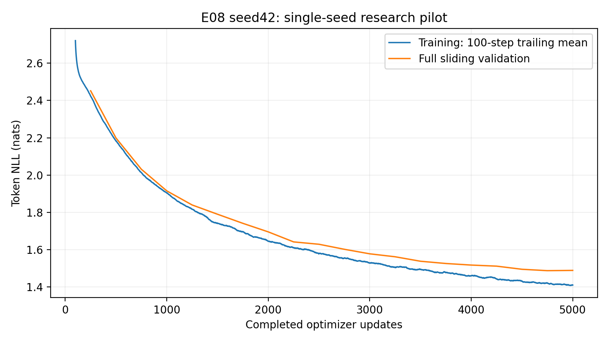
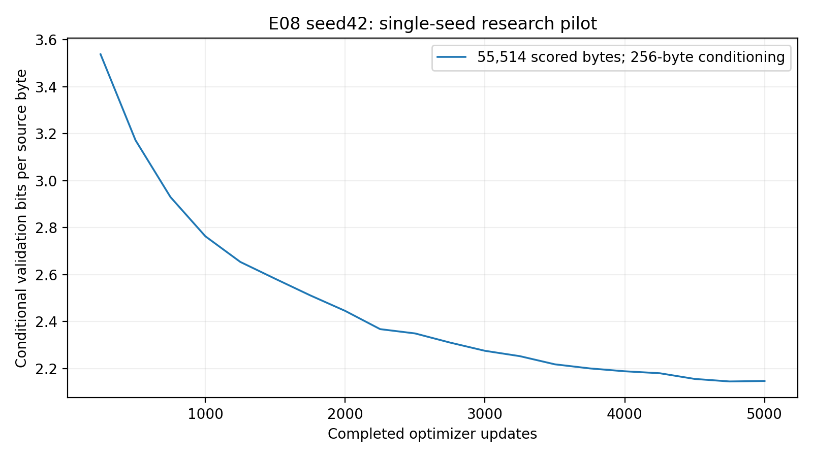

# E08 seed42 six-block Transformer experiment -- 2026-10-13

One explicitly authorized depth ablation: **5000 completed optimizer updates**,
seed42. Prior E01-E06 evidence is preserved; E07 Colab work is untouched.
No other seed, configuration or10k continuation was launched. The broader
three-seed study remains separately gated. Hypotheses and interpretations are
separate from observed measurements; superiority is not presumed.

## Research objective, hypothesis and capacity confound

Study the effect of changing four blocks to six at width192. **Hypothesis:**
additional sequential transformations and capacity might improve prediction,
but could increase cost or change optimization. Neither direction is assumed.
E08 has2694528 parameters, **889728 more than E01**. Depth, capacity and compute
change together; better scores cannot isolate depth independently of capacity.

## Architecture-specific correctness and initialization audit

Only n_layers changes4-to6. Each of six independent pre-LayerNorm blocks applies
x+dropout(attention(norm1(x))), then the MLP residual on norm2 of that result.
Explicit Q/K/V projections split to(batch,6,sequence,32), scale by sqrt(32),
apply causal masking/softmax/dropout and merge to192. GELU, sinusoidal encoding,
context128, MLP4 and dropout.1 are unchanged; no RoPE/learned positions.
Fresh seed42 initialization was used, never another experiment's weights.

CPU and actual CUDA audits passed13 checks: sole override/training controls,
six-block count, independent storage, exact parameter counts, seed42 repeat
construction, independent reference calculations through all six preLN/residual
paths, position/activation controls, six attention shapes/masking, finite loss
and manualCE, future-token invariance, finite/nonzero weight gradients in every
block, train/eval dropout and context-cropped generation. Per-block smoke
norms and observed shared E01 parameter equality are in depth_audit.json.
Matching seeds do not imply every initial parameter matches across depths:
shared first-four-block weights match, while the later output projection differs
because additional blocks consume initialization RNG. Different dropout/RNG
trajectories are expected. Numerical smoke gradients prove connectivity only,
not research vanishing/exploding gradients. No scientific algorithm was changed.

## Exact source, environment and reproducibility

- Reviewed main: `fad0afe2fc6259bd5fd2ddb5f004ce57e87bd34c`.
- Clean trained source: `72fdd4b64610e8e6df178e7fd452ec9429faab8f`.
- E01 trained source: `444bca4c4ac19f97f46fae210a9fd361f8561537`.
- Shared audited core hash: `cdea42adb930904fb0cefcd282d784bb3ac8caa311d3f1e12ef568622f9c12d6`.
- E08 resolved configuration hash: `df027c10efc9bdbc7172fec022f11fa5f0c0a517ad78665219150fd04ddf8b73`.
- E08 unique research run: `E08_seed42_a3d3b380c15940599e2efc2e08ac584a`.
- [Private research notebook, saved version1](https://www.kaggle.com/code/rayyannmerchant/nano-e08-pilot-20261013-79fc614d).
- [Private fresh recovery notebook](https://www.kaggle.com/code/rayyannmerchant/nano-e08-recovery-20261013-75b12285).
- GPU: Tesla T4, device0, 2 allocated devices;
  GPU0 total 15,636,037,632 bytes.
- Python 3.11.14, PyTorch 2.5.1+cu124, torch CUDA 12.4.
- OS: Linux-6.18.48+-x86_64-with-glibc2.39. Full freeze and nvidia-smi/driver information: evidence.

The qualified Python3.11.14/torch2.5.1+cu124/NumPy1.26.4/transitive freeze was
reproduced; native Kaggle packages were untouched. E01/E08 freeze comparison passed
except editable Git SHA. Separate GPU sessions introduce clock/load/thermal and
instance variability; timing differences are descriptive, not isolated hardware
benchmarks. The source diff and tests reviewed orchestration only; no human PR
approval is represented as obtained. All code used for research was committed,
clean and CPU-CI tested before submission.

## Data, architecture, optimization and evaluation

Pinned Karpathy char-rnn revision6f9487a6fe5b420b7ca9afb0d7c078e37c1d1b4e;
raw SHA25686c4e6aa9db7c042ec79f339dcb96d42b0075e16b8fc2e86bf0ca57e2dc565ed.
Character tokenizer SHA256ed96787d2f3f9741d69eba15160f31634ba6755b47e4c261ffedbb975fa0af77;
vocabulary65. The reference tokenizer hash is SHA256 of its canonical sorted
JSON descriptor; archive file checksums separately identify serialized bytes.
Source/splits/tokenizers/manifest match E01 exactly. Contiguous
train/validation/test bytes1003854/55770/55770; fit on training only and no windows
cross partitions. The test partition was not used for likelihood or selection.

Decoder-only pre-LayerNorm GPT: width192,6 blocks,6 heads,32 dimensions/head,
context128,MLP expansion4,GELU,dropout0.1,sinusoidal,**2,694,528 parameters**.
AdamW3e-4,constant schedule,weight decay0.01,gradient clip1,float32 CUDA,seed42,
microbatch4,accumulation8,4096 predicted targets/update,5000 optimizer updates.
No early stopping, AMP, LR change, architecture change or training-history restart.
Separate development checks precede a fully reseeded research run; they are not
counted as experimental optimizer updates or validation observations.

Full sliding validation every250 updates, complete55770-byte validation partition,
256 original conditioning bytes excluded,55514 target bytes/tokens scored once.
Conditional BPB=sum NLL/(ln2 * scored bytes), perplexity=exp(token NLL). Character
BPB equals token loss/ln2 here; these are related measures, not independent evidence.
No capped/sampled validation or invented step-zero measurement is included.
The existing checkpoint policy saves every validation state and every500-step
boundary, selects best on actual validation and exports immutable snapshots.

Train loss uses sampled batches/dropout; validation is eval-mode/full sliding.
Same-step gaps are noisy, unequal-protocol diagnostics. Training100-step trailing
means are labeled smoothing, not additional measurements. Equal tokens/steps do
not guarantee equal FLOPs or bytes of usable conditional context across variants.

## Genuine measured E08 results

| Quantity | Recorded value |
|---|---:|
| First training loss, update1 | 4.33467585 |
| First validation loss, update250 | 2.45202861 |
| Final training loss | 1.41117279 |
| Final100-step trailing training mean | 1.40996556 |
| Best observed validation step | 4750 |
| Best validation loss / conditional BPB | 1.48713993 / 2.14548940 |
| Final validation loss / conditional BPB | 1.48858993 / 2.14758132 |
| Final validation perplexity | 4.43084333 |
| Processed predicted tokens / source bytes | 20,480,000 / 20,480,000 |
| Unique target source bytes | 1,003,848 |
| Gradient clipping updates | 5/5000 (0.10%) |
| Peak allocated GPU memory,MiB | 166.104 |

Source-byte exposure includes repeats, not independent epochs. Uncovered target
source bytes: **6**, as reflected in the measured coverage;
the first source byte cannot be a target without a preceding token. Allocated
GPU memory excludes reserved/driver/device overhead.

| Update | Validation loss | Conditional BPB | Perplexity |
|---|---:|---:|---:|
| 250 | 2.45202861 | 3.53752952 | 11.61187882 |
| 500 | 2.19864459 | 3.17197365 | 9.01278922 |
| 750 | 2.03101794 | 2.93013951 | 7.62184100 |
| 1000 | 1.91519610 | 2.76304391 | 6.78826983 |
| 1250 | 1.83958034 | 2.65395344 | 6.29389642 |
| 1500 | 1.78987539 | 2.58224435 | 5.98870616 |
| 1750 | 1.74101803 | 2.51175807 | 5.70314643 |
| 2000 | 1.69522491 | 2.44569257 | 5.44787109 |
| 2250 | 1.64145074 | 2.36811284 | 5.16265373 |
| 2500 | 1.62878345 | 2.34983781 | 5.09766940 |
| 2750 | 1.60181301 | 2.31092768 | 4.96202046 |
| 3000 | 1.57751282 | 2.27586993 | 4.84289568 |
| 3250 | 1.56169820 | 2.25305424 | 4.76690952 |
| 3500 | 1.53768990 | 2.21841760 | 4.65382706 |
| 3750 | 1.52561756 | 2.20100089 | 4.59798222 |
| 4000 | 1.51716093 | 2.18880055 | 4.55926274 |
| 4250 | 1.51139377 | 2.18048030 | 4.53304442 |
| 4500 | 1.49460210 | 2.15625504 | 4.45756255 |
| 4750 | 1.48713993 | 2.14548940 | 4.42442325 |
| 5000 | 1.48858993 | 2.14758132 | 4.43084333 |

## E01 versus E08: matched observations

Delta=E08 minus E01; negative loss/BPB differences favor E08. Relative differences are
percentages of the E01 metric, not statistical effect-size estimates.

| Metric | E01 | E08 | Delta | Relative,% |
|---|---:|---:|---:|---:|
| best_loss | 1.53466801 | 1.48713993 | -0.04752808 | -3.097 |
| final_loss | 1.53601210 | 1.48858993 | -0.04742217 | -3.087 |
| best_bpb | 2.21405793 | 2.14548940 | -0.06856853 | -3.097 |
| final_bpb | 2.21599704 | 2.14758132 | -0.06841573 | -3.087 |
| final_training_loss | 1.46865343 | 1.41117279 | -0.05748063 | -3.914 |
| training_seconds | 916.70840175 | 1511.35744620 | 594.64904445 | 64.868 |
| validation_seconds | 420.90800282 | 593.27936810 | 172.37136527 | 40.952 |
| peak_gpu_bytes | 159081984.00000000 | 174173184.00000000 | 15091200.00000000 | 9.486 |
| parameters | 1804800.00000000 | 2694528.00000000 | 889728.00000000 | 49.298 |

| Update | E01 loss | E08 loss | Delta loss | E01 BPB | E08 BPB |
|---|---:|---:|---:|---:|---:|
| 250 | 2.46425110 | 2.45202861 | -0.01222249 | 3.55516284 | 3.53752952 |
| 500 | 2.26721599 | 2.19864459 | -0.06857140 | 3.27090127 | 3.17197365 |
| 750 | 2.11220971 | 2.03101794 | -0.08119176 | 3.04727447 | 2.93013951 |
| 1000 | 1.99768526 | 1.91519610 | -0.08248916 | 2.88205062 | 2.76304391 |
| 1250 | 1.92482598 | 1.83958034 | -0.08524564 | 2.77693689 | 2.65395344 |
| 1500 | 1.86354672 | 1.78987539 | -0.07367133 | 2.68852962 | 2.58224435 |
| 1750 | 1.81413472 | 1.74101803 | -0.07311670 | 2.61724317 | 2.51175807 |
| 2000 | 1.75925914 | 1.69522491 | -0.06403424 | 2.53807444 | 2.44569257 |
| 2250 | 1.72154866 | 1.64145074 | -0.08009792 | 2.48366971 | 2.36811284 |
| 2500 | 1.69282241 | 1.62878345 | -0.06403896 | 2.44222650 | 2.34983781 |
| 2750 | 1.66527225 | 1.60181301 | -0.06345924 | 2.40248002 | 2.31092768 |
| 3000 | 1.63945360 | 1.57751282 | -0.06194077 | 2.36523157 | 2.27586993 |
| 3250 | 1.61751165 | 1.56169820 | -0.05581345 | 2.33357603 | 2.25305424 |
| 3500 | 1.60199293 | 1.53768990 | -0.06430303 | 2.31118726 | 2.21841760 |
| 3750 | 1.58823999 | 1.52561756 | -0.06262243 | 2.29134596 | 2.20100089 |
| 4000 | 1.57893347 | 1.51716093 | -0.06177254 | 2.27791948 | 2.18880055 |
| 4250 | 1.56335215 | 1.51139377 | -0.05195838 | 2.25544039 | 2.18048030 |
| 4500 | 1.54364829 | 1.49460210 | -0.04904619 | 2.22701373 | 2.15625504 |
| 4750 | 1.53466801 | 1.48713993 | -0.04752808 | 2.21405793 | 2.14548940 |
| 5000 | 1.53601210 | 1.48858993 | -0.04742217 | 2.21599704 | 2.14758132 |

The shared results collector validated both final checkpoint histories, metadata,
configuration/data/tokenizer hashes and comparison policy. Final private sampling
RNG states and source-byte coverage arrays also matched exactly. Only block count
differs in configuration, adding889728 parameters and changing compute. One seed per configuration means sample SD is undefined,
not zero. Machine-readable comparison/CSV files preserve all20 matched validation
points and explicit incomplete-study seed counts. No E02 data are included.

| E01 reference update | E01 recorded loss | First observed E08 update at/below it |
|---|---:|---:|
| 1000 | 1.99768526 | 1000 |
| 2000 | 1.75925914 | 1750 |
| 3000 | 1.63945360 | 2500 |
| 4000 | 1.57893347 | 3000 |
| 5000 | 1.53601210 | 3750 |

These are retrospective thresholds on actual250-update observations, not exact
crossing times, interpolated measurements or a modified stopping rule. Both runs
completed5000 updates irrespective of intermediate comparisons.


## Depth comparison framework

E01 has4 blocks; E08 has6. E09 has8 blocks but was not authorized or trained here.
Its metric fields remain null in [depth_framework.json](https://github.com/rayyan-merchant/Nano-Language-Model/blob/5f3bfd8b3a95c346be9f70aa0404e1cdf2fbd430/report/pilots/E08_seed42/comparison/depth_framework.json).
Depth and model capacity change together; no isolated depth-causality claim is made.

## Separate positional-ablation context (not depth controls)

| Experiment | Factor | Best conditional BPB | Best step |
|---|---|---:|---:|
| E01 | six-head sinusoidal baseline | 2.21405793 | 4750 |
| E03 | RoPE | 2.07327076 | 5000 |
| E04 | learned positions | 2.23778869 | 5000 |

E03/E04 change position, not depth; they are contextual observations, not
combined-factor controls. E04 adds24576 parameters and extra initialization RNG
draws. E08 versus E01 is the principal matched architecture comparison.

## Runtime, throughput and overhead

| Measured scope | Seconds |
|---|---:|
| Training only | 1511.357 |
| Full validation,20 evaluations | 593.279 |
| Checkpoint calls | 3.671 |
| Verified snapshot export calls | 10.657 |
| Journal fsync/flush calls | 17.583 |
| Training CLI wall | 2147.337 |
| Archive compression and checksum scope | 33.941 |
| Notebook clone to archive-complete pipeline | 2602.147 |
| Complete genuine100-sample generation | 280.250 |

Training-only average: 3.3083 updates/sec,
13550.73 predicted tokens/sec. Generation
and archive scopes lie within the measured notebook pipeline; do not double-count
them. Pipeline timestamps exclude queue, final notebook conversion/output
publication and external download. Local archive verification and CPU recovery took
51.751s. Network-transfer and full fresh-GPU-recovery wall time were
not measured. Individual validation times were not logged; cumulative total is
genuine. No measured dollars or full-session lifetime is invented.

## E08 measured figures

Validation lines connect only20 actual observations. Training smoothing uses the
declared100-step trailing mean. Full PNG/PDF evidence is in the verified archive.







## Convergence descriptors and interpretation boundary

**Observation:** Actual3000 to 5000 validation loss improvement is
0.08892289 nats/token. A descriptive least-squares
slope through actual3000-5000 points is -0.04531772
nats/token per1000 updates. Best observed step4750; final
is 0.00145000 above that minimum.
The subsequent reviewed interpretation discusses the shape, intervals, generation
and E01 comparison without treating small fluctuations as conclusive overfitting.
Observed best is selected from scheduled evaluations, not unknown intermediate
steps. No claim about double descent or long-context extrapolation is implied.

## Genuine fixed-protocol text generation

[Complete unedited100-sample grid](https://github.com/rayyan-merchant/Nano-Language-Model/blob/5f3bfd8b3a95c346be9f70aa0404e1cdf2fbd430/report/pilots/E08_seed42/generation.md) and generation.json preserve all
five prompts, best/final checkpoints, greedy seed42 and temperatures0.7/1.0/1.2
with seeds42/123/456,256 new tokens. No external model generated or edited text.
Five predetermined best-checkpoint greedy outputs follow, without cherry-picking.
Qualitative comparisons use the same settings; coherent-looking output does not
establish statistical superiority, understanding or memorization absence.

### Prompt 'To be, or not to be'

Checkpoint `step_004750.pt`, greedy,seed42,256 new tokens.

```text
To be, or not to be so so so so so so so.

Second Servingman:
And the service of the words of the world,
And the sent the service of the world of the world
The service of the world of the world of the world
The service of the world of the world of the world
The service of th
```

### Prompt 'ROMEO:\n'

Checkpoint `step_004750.pt`, greedy,seed42,256 new tokens.

```text
ROMEO:
And the world the world the seat of the world,
And the send the seat of the words of the words
That the sent the service of the world of the world
The service of the world of the world of the world
The service of the world of the world of the world
The ser
```

### Prompt 'JULIET:\n'

Checkpoint `step_004750.pt`, greedy,seed42,256 new tokens.

```text
JULIET:
And the world the world the seat of the world,
And the send the service of the words,
And the sent that the service of the world
The service of the world of the world of the world
The service of the world of the world of the world
The service of the world 
```

### Prompt 'First Citizen:\n'

Checkpoint `step_004750.pt`, greedy,seed42,256 new tokens.

```text
First Citizen:
And the world the service of the world,
And the send the send that the seat of the words
That the sent the service of the world of the world
The service of the world of the world of the world
The service of the world of the world of the world
The service o
```

### Prompt 'The king'

Checkpoint `step_004750.pt`, greedy,seed42,256 new tokens.

```text
The king of the world of the world,
And the send that the send that the seat of the
That the sent the seates of the world of the world
The service of the world of the world of the world
The service of the world of the world of the world
The service of the world of
```

## Publication, independent recovery and checkpoint manifest

Final checkpoint: `runs/E08_seed42_a3d3b380c15940599e2efc2e08ac584a/checkpoints/step_005000.pt`.
Best checkpoint: `runs/E08_seed42_a3d3b380c15940599e2efc2e08ac584a/checkpoints/step_004750.pt`.
All20 resumable weights and21 immutable snapshots are preserved. Exact optimizer,
constant scheduler,scaler,RNG and sampling/training history are included. No
restart, unrelated history concatenation or additional optimizer update occurred.
Fresh compatible Kaggle CUDA state roundtrip passed all audited state fields,
and best/final generation worked. Independent downloaded archive best/final CPU
inference also passed. Actual10k continuation was not started.

Archive bytes: **598,768,138**; SHA256 `f1071463a41c18954cb8eb177b9e8a24ba9a692077ddb97e438c8af49d881fb4`.
All **59 archive files** were independently CRC/path/
file-set/hash verified. [Complete manifest](evidence/artifact_manifest.json).
The archive stores complete research checkpoints once; full immutable snapshot
copies remain in published notebook output. Dataset/tokenizer manifest,resolved
configuration,environment,full5000-step history,20 validations,figures and genuine
generations are included. Small receipts are committed byte-for-byte; checkpoints,
datasets and full journals are excluded from GitHub.

| Checkpoint update | SHA256 |
|---|---|
| 250 | `0bbf6f4df43449dd3a2e8084f7cbdae55532228e5a753ef2f77834cc1026cb72` |
| 500 | `55142e752c5a3bee332f76450da4d32c95be48f0589e6ca391bc8707f604885a` |
| 750 | `82cf42ffbf3e1480774af17107fb9f248e470ef95cf73878eb1fb0cb6a2a2d0a` |
| 1000 | `43fb755d69cd19dc6ff2a8ee5811d1a2b535ff79a29a1d11d8b6675a31487fad` |
| 1250 | `0e5b219d75ae989cbe53d426016b53abd97f367198a8b9e756df99f079a7a757` |
| 1500 | `b39d23874448e8887b80c67610cdbf46572e3fb0e72f489c8115370399789888` |
| 1750 | `0471b735cde937fab9478f8656cf4baef5331f0cdc40dedd717403f8e2261a3d` |
| 2000 | `9f62c6bdb97f3b85f1bb006d2ffdb0197d2ea36a5218c38e99488c431dbc8d05` |
| 2250 | `097fc59ee18cc4b7c46185b346a2b2a0f67e54ac0cb8fb48c7e995a6b348d67f` |
| 2500 | `7660976744b4f1738707410a028d98285fd3ded8cc9a36e16edd76fb4e5eb82b` |
| 2750 | `58882cc75d1d2704309fd3fb4732d16dc06575df49565b848274375a95d9a208` |
| 3000 | `5f002861156e5b85ce969a2a1e5e7e6b493d783d0736ca454487ce986a48dd2f` |
| 3250 | `a7c217b5bdd33b48b505c0f3fd9e486b80f4c17daf5734423471a9a931308948` |
| 3500 | `e2300327e4e953a26b74b793f2803fa02a9f1dabd873a071c0e00793514755a8` |
| 3750 | `4e1432688268f48fe7e19bc814772f0b7cc8275b2aa13828cf5d944e982458f3` |
| 4000 | `9772f7f4019b7a01162d4052d30934e5424799a265cd36b89e915688059fa053` |
| 4250 | `cce0b0bd23b36072c4af6ca628fe994af4812a7b4e345c7d8b47e64bf0de9c05` |
| 4500 | `c49e1221d7bbf82b91b1b685954a56391f10a2924b71c21497e18c3d38cc7007` |
| 4750 | `f8031ed720f2ad4d050fbbe84d2e828cc6cfc6ac2d44fbb15b7d7e27043adabb` |
| 5000 | `8e755113d38f1c2e53133e21e934f0fc27f2fd2a39cc31f84759e573e94250ad` |

## Scientific limitations and remaining scope

Single matched seed provides no significance test or across-seed SD. Validation
selects checkpoints; held-out test remains reserved. This is a fixed-context
depth comparison, not proof about other widths, depths or long-range
reasoning. Speed comparisons use separate sessions of the same GPU model, not
controlled repeated timing trials. Framework/seed matching does not guarantee
identical optimization trajectories when depth and RNG consumption change. Greedy and
stochastic decoding quality are different diagnostics. Short phrase overlaps
may be ordinary Shakespeare language; they neither prove nor exclude memorization.
Baseline convergence cannot establish every architecture's training requirement.
Further seeds,configurations or10k extensions require separate authorization.

[Detailed evidence-backed interpretation and execution/retrieval instructions](interpretation.md)
complete the qualitative analysis and recommendations.
