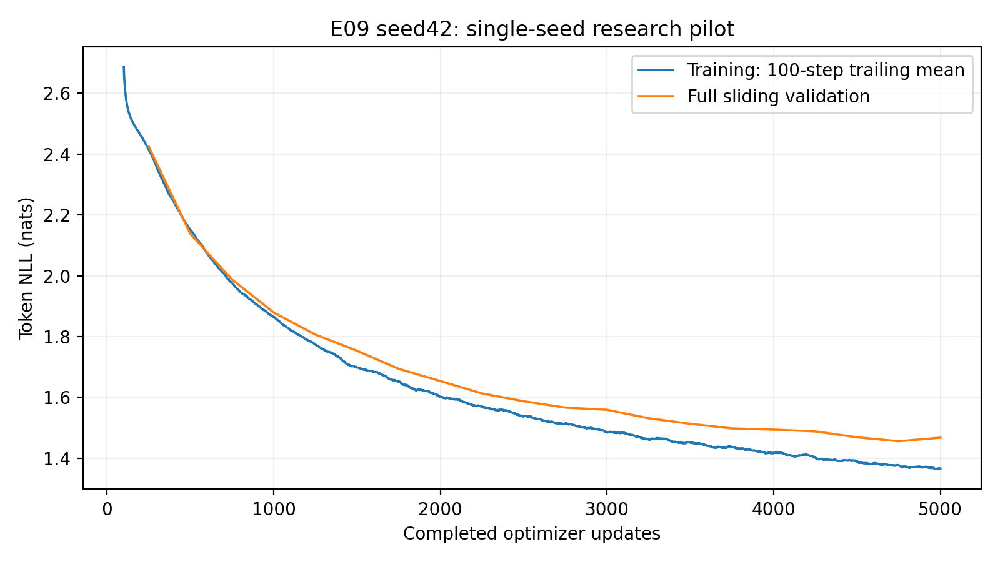
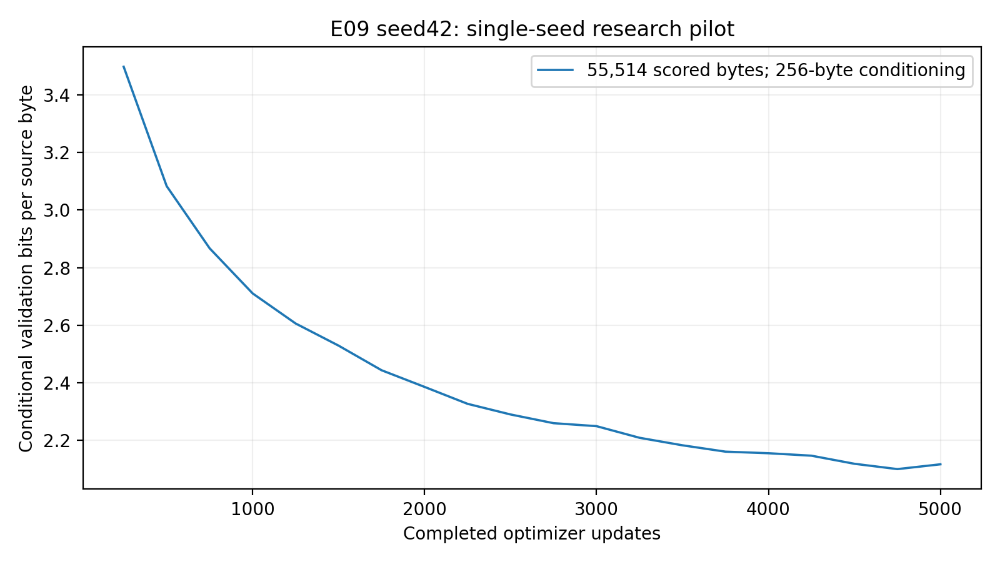

# E09 seed42: eight-block Transformer research experiment

One explicitly authorized run: 5,000 completed optimizer updates and 20 full sliding
validations. No other seed/configuration/extension was launched. Prior reports
and E07 work are preserved. The broader three-seed study remains separately gated.

## Research question and prior hypothesis

How do eight blocks change next-character likelihood, optimization, cost and
generation relative to four/six blocks? Additional sequential transformations and
capacity might improve or worsen outcomes; improvement was not assumed. E09 adds
1779456 parameters versus E01 (98.59574468%) and889728 versus E08. Depth, capacity,
initialization RNG consumption and compute change together, so this is not an
isolated depth-causality experiment. Observations and interpretation are separated.

## Exact provenance and architecture audit

- Merged preparation main:d1ca09df3d20478aabcdd3b4999f8cef6e0d5782 (E08 PR12).
- Clean trained source:`c555269ad6de293c016d88beec2e1437e4289e3f`.
- Scientific code hash:`cdea42adb930904fb0cefcd282d784bb3ac8caa311d3f1e12ef568622f9c12d6`; equivalent audited E01 source/configs.
- Resolved configuration hash:`882555343517864baf79b810c43a5e38cb5abd26b521d11c234599b0f7602a2c`; unique run:`E09_seed42_380197e606df4082b22b5ddff146946d`.
- [Private research saved notebook v1](https://www.kaggle.com/code/rayyannmerchant/nano-e09-pilot-20261013-b9ea5610).
- [Fresh CUDA recovery v1](https://www.kaggle.com/code/rayyannmerchant/nano-e09-recovery-20261013-66f79ad5).
- GPU:Tesla T4,device0,total15,636,037,632 bytes;
  2 GPUs allocated, one training device.
- Python3.11.14,torch2.5.1+cu124,torch CUDA12.4;OSLinux-6.18.48+-x86_64-with-glibc2.39.
- Exact freeze, driver information and source state are retained in evidence.

Character vocabulary 65, width 192, eight blocks, six heads of dimension 32,
context 128, MLP expansion 4, GELU, sinusoidal positions, dropout 0.1 and
pre-LayerNorm; **3,584,256 trainable parameters**. No RoPE/learned positions.
The15 CPU/CUDA numerical checks include eight independent parameter allocations,
preLN residual reference computations, Q/K/V shape(2,6,128,32), sqrt32 causal
softmax/value/merge192 reference, finite manual next-token CE, future invariance,
finite/nonzero gradients in all eight blocks, train/eval dropout and generation
cropping. Full audits and block-gradient measurements are in evidence.
Smoke gradients establish connectivity only, not research vanishing/exploding
behavior. Shared initialization equality is recorded rather than presumed; the
first four blocks/token embedding match E01, while output-head weights differ
after extra blocks consume RNG. All research weights were initialized freshly.

## Locked training, data and evaluation

AdamW with LR 0.0003, constant scheduler, weight decay 0.01, clipping norm 1,
float32 CUDA, seed 42, microbatch 4, accumulation 8, 4,096 targets per update,
exactly 5,000 updates. No AMP,
early stopping, LR/protocol change or previous trained weights. Independent
development smoke steps precede full reseeding and are not research observations.

Pinned Tiny Shakespeare revision6f9487a6fe5b420b7ca9afb0d7c078e37c1d1b4e.
Raw SHA25686c4e6aa9db7c042ec79f339dcb96d42b0075e16b8fc2e86bf0ca57e2dc565ed;
character canonical descriptor SHA256ed96787d2f3f9741d69eba15160f31634ba6755b47e4c261ffedbb975fa0af77.
Source/partition/tokenizer/manifest fields matched audited reference. Contiguous
train/validation/test1003854/55770/55770 bytes; train-only fitting/windows,
no partition-crossing windows or test likelihood/selection.

Full sliding validation every 250 updates: all 55,770 validation bytes, 256
conditioning-only bytes, 55,514 scored original target bytes exactly once,
dropout-free,context128,batch32. BPB=sumNLL/(ln2*scored bytes); character
BPB=loss/ln2 and perplexity=exp(loss). BPB and NLL are related measures.
Positions reset within cropped128-token windows as in the canonical evaluator.
Training losses are sampled/dropout-on; gaps against sliding validation are
unequal-protocol diagnostics. No invented step-zero evaluation or capped
research validation. All20 validation states and21 snapshots are preserved.

## Tests actually executed

| Verification | Actual result |
|---|---|
| Eight-block CPU numerical audit | 15 checks passed |
| Eight-block CUDA numerical audit | 15 checks passed |
| Focused orchestration, depth and generation tests | 8 passed in 19.03 s |
| Final Windows full suite | 46 passed, 1 CUDA-only skip in 122.72 s |
| Actual Kaggle CUDA full suite | 47 passed in 32.43 s |
| Real-data development CUDA preflight | Training, validation, save/load, export/restore, ZIP CRC, headless plotting and generation passed |
| Published archive recovery | Exact file set, all file hashes, ZIP CRC, best/final CPU inference passed |
| Fresh compatible CUDA recovery | All saved training states restored, zero extra optimizer updates |

The development smoke update and test optimizer updates are separate from the
5,000-update research history. Exact executed commands and evidence receipts
are linked from interpretation.md.

## Actual measured results

| Quantity | Value |
|---|---:|
| First training loss,step1 | 4.27872092 |
| First validation loss,step250 | 2.42444016 |
| Final training loss | 1.35987592 |
| Final100-step trailing mean | 1.36598722 |
| Best step | 4750 |
| Best loss/BPB | 1.45571123/2.10014737 |
| Final loss/BPB | 1.46725990/2.11680859 |
| Final perplexity | 4.33733413 |
| Processed targets/source bytes | 20,480,000/20,480,000 |
| Unique target-byte coverage | 1,003,848 |
| Peak allocated GPU MiB | 199.370 |

Repeated byte exposure is not independent examples/epochs. Peak allocated
memory excludes reserved/device/driver overhead. Missing target coverage is
6 bytes; the first source byte lacks a prior target context.

| Update | E01 loss | E08 loss | E09 loss | E01 BPB | E08 BPB | E09 BPB |
|---|---:|---:|---:|---:|---:|---:|
| 250 | 2.46425110 | 2.45202861 | 2.42444016 | 3.55516284 | 3.53752952 | 3.49772780 |
| 500 | 2.26721599 | 2.19864459 | 2.13702635 | 3.27090127 | 3.17197365 | 3.08307732 |
| 750 | 2.11220971 | 2.03101794 | 1.98724841 | 3.04727447 | 2.93013951 | 2.86699343 |
| 1000 | 1.99768526 | 1.91519610 | 1.87870559 | 2.88205062 | 2.76304391 | 2.71039924 |
| 1250 | 1.92482598 | 1.83958034 | 1.80630387 | 2.77693689 | 2.65395344 | 2.60594563 |
| 1500 | 1.86354672 | 1.78987539 | 1.75293922 | 2.68852962 | 2.58224435 | 2.52895671 |
| 1750 | 1.81413472 | 1.74101803 | 1.69370242 | 2.61724317 | 2.51175807 | 2.44349609 |
| 2000 | 1.75925914 | 1.69522491 | 1.65356903 | 2.53807444 | 2.44569257 | 2.38559584 |
| 2250 | 1.72154866 | 1.64145074 | 1.61284919 | 2.48366971 | 2.36811284 | 2.32684953 |
| 2500 | 1.69282241 | 1.62878345 | 1.58724586 | 2.44222650 | 2.34983781 | 2.28991174 |
| 2750 | 1.66527225 | 1.60181301 | 1.56627862 | 2.40248002 | 2.31092768 | 2.25966240 |
| 3000 | 1.63945360 | 1.57751282 | 1.55909603 | 2.36523157 | 2.27586993 | 2.24930012 |
| 3250 | 1.61751165 | 1.56169820 | 1.53111307 | 2.33357603 | 2.25305424 | 2.20892924 |
| 3500 | 1.60199293 | 1.53768990 | 1.51299129 | 2.31118726 | 2.21841760 | 2.18278502 |
| 3750 | 1.58823999 | 1.52561756 | 1.49770940 | 2.29134596 | 2.20100089 | 2.16073792 |
| 4000 | 1.57893347 | 1.51716093 | 1.49391445 | 2.27791948 | 2.18880055 | 2.15526297 |
| 4250 | 1.56335215 | 1.51139377 | 1.48798939 | 2.25544039 | 2.18048030 | 2.14671491 |
| 4500 | 1.54364829 | 1.49460210 | 1.46851718 | 2.22701373 | 2.15625504 | 2.11862246 |
| 4750 | 1.53466801 | 1.48713993 | 1.45571123 | 2.21405793 | 2.14548940 | 2.10014737 |
| 5000 | 1.53601210 | 1.48858993 | 1.46725990 | 2.21599704 | 2.14758132 | 2.11680859 |

## Three-way measured depth/capacity comparison

| Metric | E01 | E08 | E09 |
|---|---:|---:|---:|
| Parameters | 1804800.00000000 | 2694528.00000000 | 3584256.00000000 |
| Best loss | 1.53466801 | 1.48713993 | 1.45571123 |
| Best BPB | 2.21405793 | 2.14548940 | 2.10014737 |
| Best step | 4750.00000000 | 4750.00000000 | 4750.00000000 |
| Final BPB | 2.21599704 | 2.14758132 | 2.11680859 |
| Training seconds | 916.70840175 | 1511.35744620 | 1811.12558491 |
| Validation seconds | 420.90800282 | 593.27936810 | 739.04941797 |
| Peak allocated bytes | 159081984.00000000 | 174173184.00000000 | 209054720.00000000 |

| Reference | Candidate | Metric | Absolute delta | Relative,% |
|---|---|---|---:|---:|
| E01 | E08 | best_loss | -0.04752808 | -3.097 |
| E01 | E08 | final_loss | -0.04742217 | -3.087 |
| E01 | E08 | best_bpb | -0.06856853 | -3.097 |
| E01 | E08 | final_bpb | -0.06841573 | -3.087 |
| E01 | E08 | training_seconds | 594.64904445 | 64.868 |
| E01 | E08 | validation_seconds | 172.37136527 | 40.952 |
| E01 | E08 | parameters | 889728.00000000 | 49.298 |
| E01 | E08 | peak_gpu_bytes | 15091200.00000000 | 9.486 |
| E01 | E09 | best_loss | -0.07895679 | -5.145 |
| E01 | E09 | final_loss | -0.06875220 | -4.476 |
| E01 | E09 | best_bpb | -0.11391057 | -5.145 |
| E01 | E09 | final_bpb | -0.09918846 | -4.476 |
| E01 | E09 | training_seconds | 894.41718316 | 97.568 |
| E01 | E09 | validation_seconds | 318.14141515 | 75.585 |
| E01 | E09 | parameters | 1779456.00000000 | 98.596 |
| E01 | E09 | peak_gpu_bytes | 49972736.00000000 | 31.413 |
| E08 | E09 | best_loss | -0.03142871 | -2.113 |
| E08 | E09 | final_loss | -0.02133003 | -1.433 |
| E08 | E09 | best_bpb | -0.04534204 | -2.113 |
| E08 | E09 | final_bpb | -0.03077273 | -1.433 |
| E08 | E09 | training_seconds | 299.76813871 | 19.834 |
| E08 | E09 | validation_seconds | 145.77004987 | 24.570 |
| E08 | E09 | parameters | 889728.00000000 | 33.020 |
| E08 | E09 | peak_gpu_bytes | 34881536.00000000 | 20.027 |

Collector/schema/config/environment/data/tokenizer compatibility passed for all
three genuine5000-step histories. Private sampling RNG and coverage arrays match.
Equal update/token counts do not equal FLOPs or wall time. Sample SD is undefined
for one seed, not zero. No statistical significance or test-selected winner.


Separate contextual E03 RoPE best BPB2.07327076,parameters1804800: a position ablation, not a depth control or combined-architecture result.

## Actual optimization descriptors

| Experiment | Median norm | p95 | Maximum | Clipped updates |
|---|---:|---:|---:|---:|
| E01 | 0.49782375 | 0.54196362 | 1.83285689 | 7/5000 |
| E08 | 0.49895141 | 0.54184342 | 2.16419029 | 5/5000 |
| E09 | 0.49622917 | 0.53815512 | 2.39997935 | 4/5000 |

Aggregate pre-clipping norms only; no longitudinal layerwise research gradients. Actual3k-to5k loss improvement0.09183613; descriptive observed-point slope-0.04614789 per1000 updates. See interpretation.md for convergence and generalization conclusions.

## Runtime scopes

| Measured scope | Seconds |
|---|---:|
| Training only | 1811.126 |
| 20 full validations | 739.049 |
| Checkpoint calls | 4.376 |
| Snapshot export calls | 14.798 |
| Journal flush/fsync | 17.726 |
| Training CLI wall | 2597.752 |
| 100-output generation | 343.650 |
| Archive/hash scope | 42.674 |
| Clone-to-archive pipeline | 3117.872 |
| Local verification/CPU inference | 32.289 |

Training-only2.7607 updates/s,11307.89 targets/s. Pipeline excludes queue, final conversion/publication, download and fresh GPU recovery wall time. Inner measured scopes overlap the pipeline; do not sum twice. Individual validation duration and dollar costs were not recorded. Separate T4 sessions confound speed comparisons.

## Genuine E09 figures







## Complete fixed generation protocol

[All100 unedited samples](generation.md) and generation.json preserve best/final,
five prompts,greedy,temperatures.7/1/1.2,seeds42/123/456,256 new tokens.
Five predetermined best greedy outputs follow; no external text editing/model.

### 'To be, or not to be'

`step_004750.pt`,greedy,seed42,256 new tokens.

```text
To be, or not to be a man of the world.

Second Murderer:
What should have so man the seast of the seast?

Second Murderer:
What shall be so so so so so so so doubt?

Second Servant:
What should have the prove of the presence?

Second Murderer:
What shall he will have the pr
```

### 'ROMEO:\n'

`step_004750.pt`,greedy,seed42,256 new tokens.

```text
ROMEO:
I will not so so much a man of the season.

Second Murderer:
What shall I have so much a man a present to thee?

Second Murderer:
What shall he will have the present of the prince?

Second Servant:
What should have the present of the presence?

Second Murd
```

### 'JULIET:\n'

`step_004750.pt`,greedy,seed42,256 new tokens.

```text
JULIET:
And the sea of the seat of the seat of the seat,
And the season of the season of the season of the
secret the seater of the present of the prince.

Second Servant:
What should be so man?

Second Murderer:
What should have the present of the prince?

Second
```

### 'First Citizen:\n'

`step_004750.pt`,greedy,seed42,256 new tokens.

```text
First Citizen:
And therefore the world will not the world.

Second Murderer:
What shall I have so much a man a present to thee?

Second Murderer:
What shall he will have the present of the prince?

Second Servant:
What should have the present of the presence?

Second Mur
```

### 'The king'

`step_004750.pt`,greedy,seed42,256 new tokens.

```text
The king of the world will be so so so so.

Second Murderer:
What should I have so made the season of the seast?

Second Murderer:
What shall he will have the present of the prince?

Second Murderer:
What shall he will have the present of the prince?

Second Murde
```

## Durable publication and independent recovery

Archive794,894,378 bytes; SHA256`293aaecba3bd794fcd41a58dff08791a63d897bf20a5b913a75b2adbaa3a7b21`.
All59 file hashes, exact file set, safe paths and ZIP CRC
passed independently. Best/final CPU inference and fresh compatible CUDA inference
passed. Full model/optimizer/scheduler/scaler/RNG/sampling/history state restored
at 5,000 with zero additional updates. All 20 checkpoint counters independently
verified; 21 immutable snapshots stay in published outputs. Exact checkpoint/file
hashes are in evidence/artifact_manifest.json and snapshot_index.json. Large files
are outside Git on D: and in published Kaggle outputs. No research failure/resume event.

**Best:** `runs/E09_seed42_380197e606df4082b22b5ddff146946d/checkpoints/step_004750.pt`. **Final:** `runs/E09_seed42_380197e606df4082b22b5ddff146946d/checkpoints/step_005000.pt`.

## Interpretation and limitations

[Detailed observations, qualitative analysis, recommendations and executed/retrieval commands](interpretation.md)
complete this report. Hypothesis is separate from measurement; one-seed results
cannot establish significance or depth-only causality. Context128, one dataset,
initialization/dropout RNG differences, extra capacity and separate GPU-session
conditions constrain interpretation. Character BPB and NLL are mathematically
related; generation repetition/phrase overlap do not establish memorization or
understanding. No unapproved extensions or test selection occurred.
