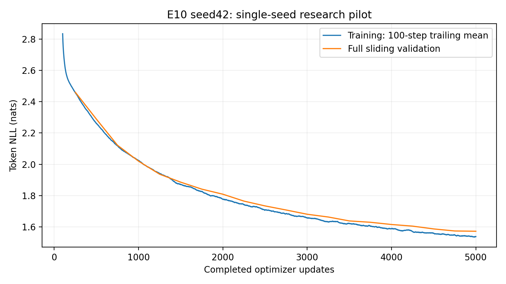
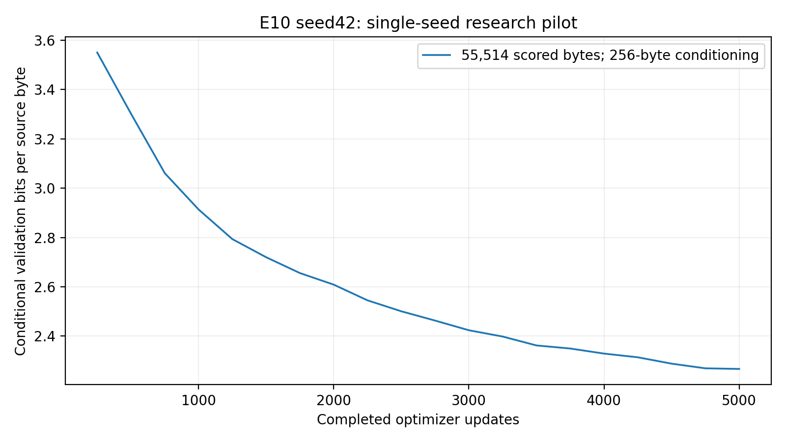

# E10 seed42: 2× MLP expansion research experiment

One authorized run: exactly 5,000 completed optimizer updates and 20 full sliding
validations. No other configuration, seed, hybrid or extension was launched.
Earlier reports and the collaborator's E07 PR11 are preserved. The broader
three-seed study remains separately gated/NO-GO.

## Research objective and prior hypothesis

How does reducing feed-forward expansion from 4× to 2× affect prediction,
optimization, efficiency and text quality? The smaller MLP could retain much of
the baseline's predictive quality with lower cost, or lose useful capacity.
Neither improvement nor regression was presumed. Architecture and capacity
change together; this does not isolate parameter count alone.

## Architecture and numerical audit

Only `mlp_expansion` changes. Four independent pre-LayerNorm blocks each contain
Linear(192,384), GELU and Linear(384,192), totaling 148,032 MLP parameters per
block instead of 295,872. Total **1,213,440 parameters**, 591,360 fewer than E01
(32.765957%). Width192, six heads/head32, context128, sinusoidal positions,
dropout0.1 and explicit causal attention remain unchanged. No RoPE or learned
positions. No prior experiment weights were loaded.

The 14 CPU/CUDA checks cover the sole override/training defaults, deterministic
seed42 construction, independent block storage, both projection dimensions and
counts, a separate F.linear/GELU MLP reference, preLN residual references,
explicit Q/K/V reshape/sqrt32/causal softmax/value aggregation, sinusoidal-only
positions, shifted next-token CE, future invariance, finite gradients reaching
both MLP projections in every block, dropout train/eval and cropped generation.
Actual audit receipts include projection gradient norms and compatible-shape
initialization equality. Changed tensor sizes consume initialization/dropout RNG
differently; equal seeds do not imply equal whole-model weights. Initialization
algorithms are unchanged. Smoke gradients establish connectivity, not longitudinal
research gradient behavior.

## Exact source and qualified environment

- Synchronized main: a6b28d7d97f9739dddd24ec4c7c3765bc65265dc, after E09 PR13 merge.
- Clean trained source: `75bc0c4257f0be6a8c0280ddee1dcee52fecb0af`.
- Audited scientific hash: `cdea42adb930904fb0cefcd282d784bb3ac8caa311d3f1e12ef568622f9c12d6`.
- Resolved configuration hash: `3282a80a5a16a3de11ac87b175c35718a80d95c9b562b91e92b8745a5aa74560`; run: `E10_seed42_a15bcd2b54f346fcb25830c70aa10b7b`.
- [Private Kaggle research saved version1](https://www.kaggle.com/code/rayyannmerchant/nano-e10-pilot-20261013-403eb78d).
- [Fresh zero-update CUDA recovery version1](https://www.kaggle.com/code/rayyannmerchant/nano-e10-recovery-20261013-e2fb429a).
- GPU Tesla T4, device0; 2 devices allocated, one used for training;
  total GPU0 15,636,037,632 bytes.
- Python 3.11.14, PyTorch 2.5.1+cu124, CUDA 12.4, NumPy1.26.4.
- OS Linux-6.18.48+-x86_64-with-glibc2.39; exact freeze, driver and hardware metadata in evidence.

Qualified transitive freeze matches E01 except editable source SHA. Native
Kaggle packages were untouched. No uncommitted Windows training source or CPU
fallback was used. Separate T4 sessions confound precise speed comparisons.

## Data and fixed training/evaluation protocol

Pinned Tiny Shakespeare revision6f9487a6fe5b420b7ca9afb0d7c078e37c1d1b4e.
Raw SHA25686c4e6aa9db7c042ec79f339dcb96d42b0075e16b8fc2e86bf0ca57e2dc565ed.
Character tokenizer SHA256ed96787d2f3f9741d69eba15160f31634ba6755b47e4c261ffedbb975fa0af77,
vocabulary65. All source/partition/tokenizer/manifest reference fields matched.
Contiguous train/validation/test bytes1,003,854/55,770/55,770; train-only fitting,
no crossing windows, no test likelihood or test-based checkpoint selection.

AdamW LR0.0003 constant, weight decay0.01, clipping1, float32 CUDA, seed42,
microbatch4, accumulation8, 4,096 targets/update, exactly5,000 updates. No AMP,
early stopping or protocol change. Independent development preflight precedes
full reseeding. Full sliding validation every250 scores exactly55,514 original
bytes after256 conditioning-only bytes, dropout disabled, context128/batch32.
Conditional BPB=sumNLL/(ln2×scored bytes); character BPB=loss/ln2 and
perplexity=exp(loss). These are related measures, not independent achievements.
Local positions reset in cropped windows as in E01. No capped research validation
or invented step-zero measurement. Training uses sampled/dropout-on windows;
validation gaps are unequal-protocol diagnostics, not memorization rates.

## Tests actually executed

- CPU/CUDA MLP audits: 14 checks each passed.
- Focused suite: 8 passed in 1.66s.
- Final Windows suite: 49 passed, 1 CUDA-only skip in 127.39s.
- Actual Kaggle CUDA suite: 49 passed in 31.20s.
- Real-data CUDA smoke: training/validation/save/load/export/restore/ZIP/Agg/generation passed.
- All20 optimizer/scheduler checkpoint counters, journals and BPB identity passed.
- Archive CRC/all-file hashes/CPU inference and fresh full-state CUDA restore passed.

The first Windows full-suite attempt had20 fixture setup errors because its new
D-drive parent did not exist. The parent was created and the full rerun passed;
this was resolved before submission, without changing scientific code. Actual
commands and final integrity checks are in evidence/commands.json and final_checks.json.

## Measured results

| Quantity | Actual value |
|---|---:|
| First training loss, update1 | 4.40269762 |
| First validation loss, update250 | 2.46074905 |
| Final training loss | 1.54933034 |
| Final100-update training mean | 1.53724579 |
| Best validation update | 5000 |
| Best validation loss/BPB | 1.57144692/2.26711868 |
| Final validation loss/BPB | 1.57144692/2.26711868 |
| Final perplexity | 4.81360807 |
| Predicted tokens/source-byte exposure | 20,480,000/20,480,000 |
| Unique target-byte coverage | 1,003,848 |
| GPU peak allocated MiB | 139.705 |

Repeated target exposure is not unique examples, input traffic, corpus epochs or
FLOPs. Peak allocation excludes reserved/driver memory. No missing value is invented.

## All twenty matched E01/E10 validations

| Update | E01 loss | E10 loss | Δloss | E01 BPB | E10 BPB |
|---|---:|---:|---:|---:|---:|
| 250 | 2.46425110 | 2.46074905 | -0.00350205 | 3.55516284 | 3.55011046 |
| 500 | 2.26721599 | 2.28866270 | 0.02144671 | 3.27090127 | 3.30184232 |
| 750 | 2.11220971 | 2.12161268 | 0.00940297 | 3.04727447 | 3.06084009 |
| 1000 | 1.99768526 | 2.01961762 | 0.02193236 | 2.88205062 | 2.91369233 |
| 1250 | 1.92482598 | 1.93627208 | 0.01144610 | 2.77693689 | 2.79345013 |
| 1500 | 1.86354672 | 1.88536860 | 0.02182187 | 2.68852962 | 2.72001192 |
| 1750 | 1.81413472 | 1.84083448 | 0.02669975 | 2.61724317 | 2.65576277 |
| 2000 | 1.75925914 | 1.80832794 | 0.04906880 | 2.53807444 | 2.60886575 |
| 2250 | 1.72154866 | 1.76420626 | 0.04265760 | 2.48366971 | 2.54521162 |
| 2500 | 1.69282241 | 1.73346898 | 0.04064657 | 2.44222650 | 2.50086710 |
| 2750 | 1.66527225 | 1.70733564 | 0.04206339 | 2.40248002 | 2.46316466 |
| 3000 | 1.63945360 | 1.68017620 | 0.04072260 | 2.36523157 | 2.42398186 |
| 3250 | 1.61751165 | 1.66247215 | 0.04496050 | 2.33357603 | 2.39844033 |
| 3500 | 1.60199293 | 1.63747140 | 0.03547847 | 2.31118726 | 2.36237187 |
| 3750 | 1.58823999 | 1.62883205 | 0.04059205 | 2.29134596 | 2.34990791 |
| 4000 | 1.57893347 | 1.61457784 | 0.03564437 | 2.27791948 | 2.32934344 |
| 4250 | 1.56335215 | 1.60416730 | 0.04081515 | 2.25544039 | 2.31432420 |
| 4500 | 1.54364829 | 1.58628321 | 0.04263492 | 2.22701373 | 2.28852293 |
| 4750 | 1.53466801 | 1.57316820 | 0.03850019 | 2.21405793 | 2.26960196 |
| 5000 | 1.53601210 | 1.57144692 | 0.03543482 | 2.21599704 | 2.26711868 |

## Predictive quality and resource tradeoffs

| Metric | E01 | E10 | Absolute delta | Relative,% |
|---|---:|---:|---:|---:|
| best_loss | 1.53466801 | 1.57144692 | 0.03677891 | 2.397 |
| final_loss | 1.53601210 | 1.57144692 | 0.03543482 | 2.307 |
| best_bpb | 2.21405793 | 2.26711868 | 0.05306075 | 2.397 |
| final_bpb | 2.21599704 | 2.26711868 | 0.05112164 | 2.307 |
| final_training_loss | 1.46865343 | 1.54933034 | 0.08067691 | 5.493 |
| training_seconds | 916.70840175 | 921.33051428 | 4.62211253 | 0.504 |
| validation_seconds | 420.90800282 | 315.43040345 | -105.47759937 | -25.060 |
| peak_gpu_bytes | 159081984.00000000 | 146490880.00000000 | -12591104.00000000 | -7.915 |
| parameters | 1804800.00000000 | 1213440.00000000 | -591360.00000000 | -32.766 |

```json
{
  "parameters_removed": 591360,
  "parameter_reduction_percent": 32.765957446808514,
  "delta_best_BPB_per_million_parameters_removed": 0.08972664582860328,
  "E01_targets_per_training_second": 22340.8010235238,
  "E10_targets_per_training_second": 22228.722138998943,
  "training_seconds_saved": -4.622112528996922,
  "GPU_allocated_bytes_saved": 12591104,
  "scope": "Descriptive quality-resource tradeoffs; BPB divided by parameters is not an intrinsic quality/efficiency score. Capacity and MLP architecture change together."
}
```

Both final private sampling RNG and byte-coverage arrays match. The collector
validated configuration, code/profile, dataset/tokenizer hashes and complete
histories. Lower BPB is better; dividing BPB by parameter count is not an intrinsic
efficiency score. Interpret paired quality/cost and explicit marginal tradeoffs,
with single-seed and separate-session caveats. Capacity and MLP architecture change
together. SD is undefined for one seed, not zero; no significance or superiority
claim follows merely from a smaller/faster model.


## Actual optimizer and gradient descriptors

| Experiment | Median norm | p95 | Maximum | Clipped updates |
|---|---:|---:|---:|---:|
| E01 | 0.49782375 | 0.54196362 | 1.83285689 | 7/5000 |
| E10 | 0.49697378 | 0.54495330 | 1.74943924 | 8/5000 |

Aggregate pre-clipping norms only. These do not establish layerwise vanishing/exploding gradients; finite smoke gradients establish connectivity. AdamW, constant LR0.0003 and clipping threshold1 remained fixed.

## Runtime scopes

| Measured scope | Seconds |
|---|---:|
| Training only | 921.331 |
| 20 full validations | 315.430 |
| Checkpoint calls | 2.155 |
| Snapshot export calls | 4.975 |
| Journal flush/fsync | 16.368 |
| Training CLI wall | 1268.990 |
| 100-output generation | 175.083 |
| Archive/hash scope | 14.249 |
| Clone-to-archive pipeline | 1586.809 |
| Independent local CPU verification/inference | 17.101 |

Training-only 5.4269 updates/s and 22228.72 targets/s. Inner scopes overlap the pipeline and must not be added twice. Pipeline excludes queue, final notebook conversion/publication, network download and fresh recovery. Their combined end-to-end wall time, individual validation durations, FLOPs and dollar cost were not recorded.

## Genuine E10 learning/optimization figures







## Convergence descriptors

Observed3k–5k NLL improvement 0.10872927; late observed-point slope -0.05532467 per1,000 updates. Best scheduled update 5000; final minus best 0.00000000. This is descriptive, not a forecast or interpolation of missing measurements. See interpretation.md for actual trends and limitations.

## Complete genuine generation protocol

[All100 unedited outputs](https://github.com/rayyan-merchant/Nano-Language-Model/blob/5f3bfd8b3a95c346be9f70aa0404e1cdf2fbd430/report/pilots/E10_seed42/generation.md) preserve five fixed prompts, best/final, greedy, temperatures0.7/1/1.2, seeds42/123/456 and256 new tokens. Five predetermined best greedy samples follow, including poor outputs. No external model generated or improved text.

### 'To be, or not to be'

Checkpoint `step_005000.pt`,greedy,seed42,256 new tokens.

```text
To be, or not to be the seems of the see
That with the seem of the seems of the see
That with the see the see the see to the see
And the see the sent of the sense of the see
That was the sent of the see shall be some to the see
That with the see the sense of the senself,
Tha
```

### 'ROMEO:\n'

Checkpoint `step_005000.pt`,greedy,seed42,256 new tokens.

```text
ROMEO:
The senter of the seems of the seem of the see
That the sent of the seems of the see the see
That was the see the see the sense of the see
That was the sent of the see shall be some to the see
That with the see the sent of the see stands,
And the see the s
```

### 'JULIET:\n'

Checkpoint `step_005000.pt`,greedy,seed42,256 new tokens.

```text
JULIET:
What is the seems of the see the see to the see
That the seems of the seem of the see the see
That words the see the see the sense of the see
That was the sent of the see shall be some to the see
that with the see the sense of the see the see
That was the 
```

### 'First Citizen:\n'

Checkpoint `step_005000.pt`,greedy,seed42,256 new tokens.

```text
First Citizen:
The sent the seem of the seem of the seems of the see
That with the see the shall be so so soul,
And the see the sense of the sent of the see
That was the sent of the see shall be some to the see
That with the see the sense of the senself,
That with the se
```

### 'The king'

Checkpoint `step_005000.pt`,greedy,seed42,256 new tokens.

```text
The king of the seems of the seems of the see
That the seems of the seems of the see
That with the see the see the see to the see
That was the sent of the see the sense of the see
That was the sent of the see the sense of the see
That was the sent of the see shall
```

Best and final are the same weight state. Their separately labeled grids duplicate the same fixed settings, not independent draws or two independently trained models.

## Durable preservation and independent recovery

Archive 272,568,662 bytes; SHA256 `f20b2394f1d0a99f132caa90a3148cb08a03fb7682b4507c4dce206015d9bf8b`. Exact entry set, safe paths, ZIP CRC and all 59 file hashes passed independently. Best/final CPU and fresh CUDA inference passed. All20 checkpoint counters and21 immutable snapshots are verified. Full optimizer/scheduler/scaler/RNG/sampler/history restored at5,000 with zero extra updates. Archive retains all20 resumable states; duplicate immutable snapshot files remain in published outputs. Large artifacts stay on D: and Kaggle, excluded from Git.

Best: `runs/E10_seed42_a15bcd2b54f346fcb25830c70aa10b7b/checkpoints/step_005000.pt`. Final: `runs/E10_seed42_a15bcd2b54f346fcb25830c70aa10b7b/checkpoints/step_005000.pt`. Exact per-file hashes are in [artifact manifest](evidence/artifact_manifest.json). No research failure/resume event appears in the journal.

## Interpretation, limitations and next-stage implications

[Detailed observations, genuine generation analysis and recommendations](interpretation.md) complete this report. [Retrieval instructions](artifact_retrieval.md) locate large evidence. One seed/dataset, finite context, changed capacity/initialization RNG and separate GPU sessions constrain interpretation. Phrase overlap/repetition do not prove memorization or understanding. Additional seeds and10k extensions require separate approval; none was launched.
