# E11 seed42: 64-token causal context experiment

## Scope, objective and hypothesis

One explicitly authorized E11 seed42 run: 5,000 completed updates, twenty full
sliding validations. No additional seeds, E12, hybrid or extension were launched.
The broader three-seed study remains separately gated. Earlier evidence is preserved. Full acceptance status: INCOMPLETE — fresh CUDA restoration pending.
Question: how does shortening causal context128→64 affect prediction,
optimization, runtime, memory and generated text? Less available preceding text
may remove useful dependencies; shorter tensors may reduce computation, but
sixteen accumulation microbatches may increase overhead. Neither outcome was assumed.

## Architecture and correctness

Only context_length changes. Parameters remain **1,804,800**: vocabulary65,
width192, four independent preLN blocks, six heads/head32, MLP192→768→192,
GELU, sinusoidal positions and dropout0.1. No learned positions or RoPE.
The14 development CPU/CUDA checks verify sole override, seed42 weight equality,
sinusoidal0–63 matching E01's prefix, shifted64-token targets, finite CE,
64×64 causal masks, independent explicit sqrt32 Q/K/V reference, future
invariance, overlength rejection, all finite nonzero parameter gradients,
train/eval dropout, repeated generation cropping64, sequential sliding evaluator
reference and analytic character BPB. Numerical fixtures are development evidence;
they are not Tiny Shakespeare measurements. Full real-data CUDA preflight is
recorded separately in evidence/full_validation_preflight.json.

Seed42 produces identical initial trainable tensors for E01 and E11 because the
shortened sinusoidal buffer consumes no initialization RNG. Training trajectories
still differ through window shapes, dropout draws and private sampling progression.

## Reproducible source and environment

- Synchronized reviewed main:317ba670112ffa3123c4bc26baddf9fa1059c60c, including E10PR14/E07PR11.
- Clean trained source:`e7f77205de0c7eabddf6c299029ef5d4b685ffc8`.
- Scientific hash:`cdea42adb930904fb0cefcd282d784bb3ac8caa311d3f1e12ef568622f9c12d6`; canonical package unchanged.
- Run:`E11_seed42_67e185eafe9243dab68959e730a72eec`; configuration hash:`c502b80d174e06cbe7681fae4e32e7c9340d3e7067f40853c529e64114dcf466`.
- [Kaggle research version1](https://www.kaggle.com/code/rayyannmerchant/nano-e11-pilot-20261013-dafeeadf).
- [Fresh zero-update recovery version1](https://www.kaggle.com/code/rayyannmerchant/nano-e11-recovery-20261013-e7000753).
- GPU:Tesla T4, training device0, 15,636,037,632 total device-memory bytes;
  2 devices attached, one used for training.
- Python3.11.14, torch2.5.1+cu124, CUDA12.4, NumPy1.26.4.
- OS:Linux-6.18.48+-x86_64-with-glibc2.39. Exact qualified transitive freeze and driver output preserved.

Native Kaggle packages were untouched. No CPU fallback, AMP or uncommitted
Windows training source was used. Scientific algorithms were not modified;
the thin wrapper derives context/accumulation and checks resolved settings.

## Data, training and validation method

Pinned Tiny Shakespeare revision6f9487a6fe5b420b7ca9afb0d7c078e37c1d1b4e;
source SHA25686c4e6aa9db7c042ec79f339dcb96d42b0075e16b8fc2e86bf0ca57e2dc565ed;
character tokenizer SHA256ed96787d2f3f9741d69eba15160f31634ba6755b47e4c261ffedbb975fa0af77.
All manifest/source/tokenizer/partition fields matched. Vocabulary65; original
train/validation/test bytes1,003,854/55,770/55,770. Train-only tokenizer fitting,
no crossing training windows, no test likelihood or test-based selection.

Fresh seed42; AdamW, constant LR0.0003, weight decay0.01, clipping1.0,
float32 CUDA, microbatch4, accumulation16, exactly4096 targets/update and5000
updates. No early stopping or automatic extension. The separate one-update
smoke does not count toward research updates; canonical training reseeds afterward.

Full sliding validation every250: exclude common first256 bytes from scoring,
score all55,514 suffix bytes exactly once, context64, batch32, dropout disabled.
The256-byte exclusion is not attention context: each prediction sees at most
its preceding64 tokens, with local sinusoidal positions reset in each crop.
BPB=sumNLL/(ln2×scored bytes), character BPB=loss/ln2, perplexity=exp(loss).
Loss/BPB are comparable to E01 on identical targets under different intended
conditioning restrictions. No capped research validation or step-zero fiction.

## Token budget, sampling and optimization confound

| Run | Context | Microbatch | Accumulation | Windows/update | Targets/update |
|---|---:|---:|---:|---:|---:|
| E01 |128|4|8|32|4096|
| E11 |64|4|16|64|4096|

E11 samples320,000 windows versus E01's160,000. Both predict20,480,000 target
positions/source bytes, but window grouping, maximum start index and private
sampling RNG progression differ. Independent replay regenerated each saved
private RNG and exact source-target union; equality between runs was not required.
Equal token exposure does not imply equal FLOPs, contextual information or
gradient grouping. This is an optimization/computation confound beyond the
intended context restriction. Target-byte coverage is not input traffic or epochs.

```json
[
  {
    "status": "private_sampling_RNG_and_exact_target_union_replayed",
    "context_length": 128,
    "micro_batch_size": 4,
    "accumulation": 8,
    "sampled_windows_per_update": 32,
    "total_sampled_windows": 160000,
    "target_positions": 20480000,
    "unique_target_bytes": 1003848,
    "scope": "ASCII canonical character dataset; exact RNG/window union replay, no optimizer updates"
  },
  {
    "status": "private_sampling_RNG_and_exact_target_union_replayed",
    "context_length": 64,
    "micro_batch_size": 4,
    "accumulation": 16,
    "sampled_windows_per_update": 64,
    "total_sampled_windows": 320000,
    "target_positions": 20480000,
    "unique_target_bytes": 1003846,
    "scope": "ASCII canonical character dataset; exact RNG/window union replay, no optimizer updates"
  }
]
```

## Genuine measured results

| Quantity | Value |
|---|---:|
| First recorded training loss/update1 |4.45461488|
| First recorded validation loss/update250 |2.32440627|
| Final training loss |1.41863027|
| Final100-update mean |1.46372949|
| Best checkpoint update |5000|
| Best loss/BPB |1.49301304/2.15396251|
| Final loss/BPB |1.49301304/2.15396251|
| Final perplexity |4.45048484|
| Training seconds |1868.694|
| Full-validation seconds |267.250|
| Pipeline seconds |2523.689|
| Updates/training second |2.67567|
| Targets/training second |10959.524|
| GPU peak allocated MiB |116.146|
| Repeated predicted targets/source bytes |20,480,000/20,480,000|
| Unique target-byte coverage |1,003,846|

Peak allocation excludes reserved/driver memory. Pipeline duration is the
measured notebook execution interval through archive construction; queue,
publication, network transfer and independent recovery are separate. Training
excludes validation/IO. Separately measured overheads:

```json
{
  "training_updates_per_second": 2.6756651243771663,
  "targets_per_training_second": 10959.524349448873,
  "checkpoint_seconds": 2.6071815250001578,
  "export_seconds": 6.863361045000147,
  "journal_seconds": 17.160218080993445,
  "generation_seconds": 182.44072139799982,
  "archive_seconds": 21.605344756999784,
  "pipeline_seconds": 2523.689202022
}
```

## All twenty matched validations

| Update | E01 loss | E11 loss | Δloss | E01 BPB | E11 BPB |
|---|---:|---:|---:|---:|---:|
|250|2.46425110|2.32440627|-0.13984483|3.55516284|3.35340941|
|500|2.26721599|2.07437265|-0.19284334|3.27090127|2.99268713|
|750|2.11220971|1.95935575|-0.15285396|3.04727447|2.82675282|
|1000|1.99768526|1.89034848|-0.10733678|2.88205062|2.72719638|
|1250|1.92482598|1.83099348|-0.09383249|2.77693689|2.64156522|
|1500|1.86354672|1.76095243|-0.10259429|2.68852962|2.54051734|
|1750|1.81413472|1.73625689|-0.07787783|2.61724317|2.50488921|
|2000|1.75925914|1.68987575|-0.06938340|2.53807444|2.43797536|
|2250|1.72154866|1.64720413|-0.07434453|2.48366971|2.37641323|
|2500|1.69282241|1.61977308|-0.07304933|2.44222650|2.33683859|
|2750|1.66527225|1.59511899|-0.07015326|2.40248002|2.30127026|
|3000|1.63945360|1.58162258|-0.05783101|2.36523157|2.28179906|
|3250|1.61751165|1.56234263|-0.05516902|2.33357603|2.25398396|
|3500|1.60199293|1.55139489|-0.05059804|2.31118726|2.23818971|
|3750|1.58823999|1.53455944|-0.05368056|2.29134596|2.21390129|
|4000|1.57893347|1.52463193|-0.05430153|2.27791948|2.19957893|
|4250|1.56335215|1.51412633|-0.04922581|2.25544039|2.18442255|
|4500|1.54364829|1.50357299|-0.04007530|2.22701373|2.16919730|
|4750|1.53466801|1.49736125|-0.03730676|2.21405793|2.16023565|
|5000|1.53601210|1.49301304|-0.04299906|2.21599704|2.15396251|

## E01 comparison and resource costs

| Metric | E01 | E11 | Δ E11−E01 | Relative % |
|---|---:|---:|---:|---:|
|best_loss|1.53466801|1.49301304|-0.04165497|-2.714|
|final_loss|1.53601210|1.49301304|-0.04299906|-2.799|
|best_bpb|2.21405793|2.15396251|-0.06009542|-2.714|
|final_bpb|2.21599704|2.15396251|-0.06203453|-2.799|
|final_training_loss|1.46865343|1.41863027|-0.05002315|-3.406|
|training_seconds|916.70840175|1868.69423772|951.98583598|103.848|
|validation_seconds|420.90800282|267.24997295|-153.65802988|-36.506|
|peak_gpu_bytes|159081984.00000000|121787904.00000000|-37294080.00000000|-23.443|
|parameters|1804800.00000000|1804800.00000000|0.00000000|0.000|

Lower loss/BPB is better. Speed and memory are observed in separate T4 sessions; no controlled repeated timing or statistical significance is claimed. Same parameter count does not imply equal computation.

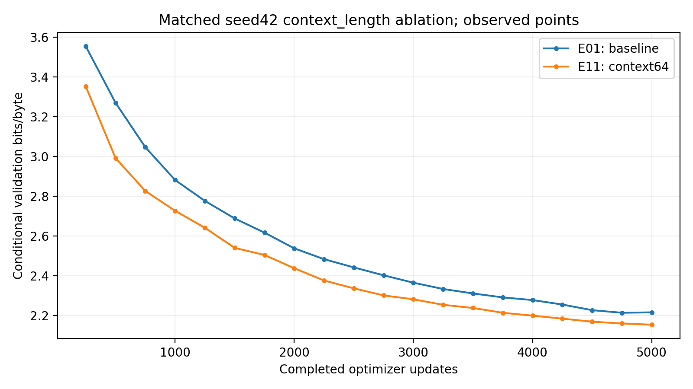

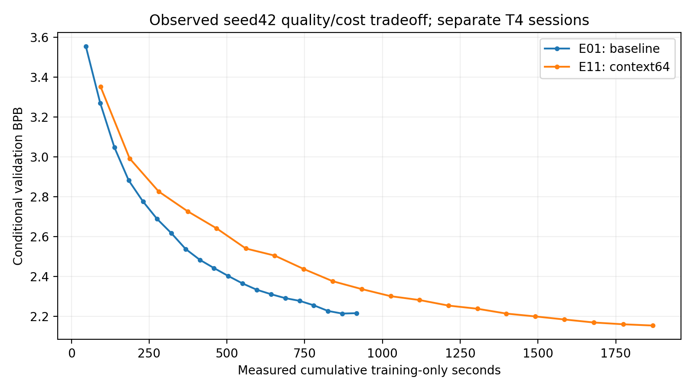

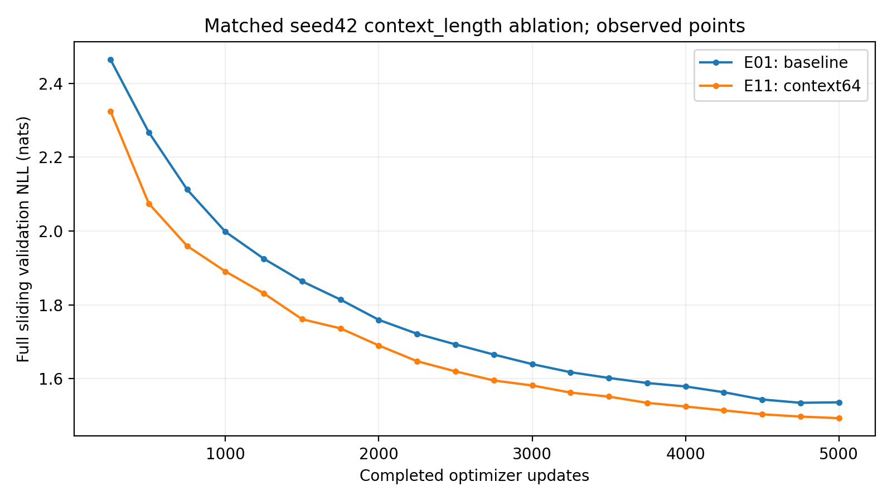

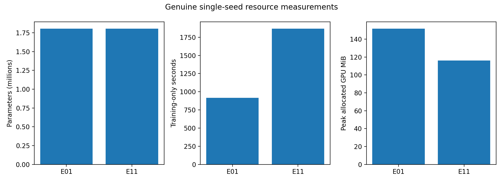

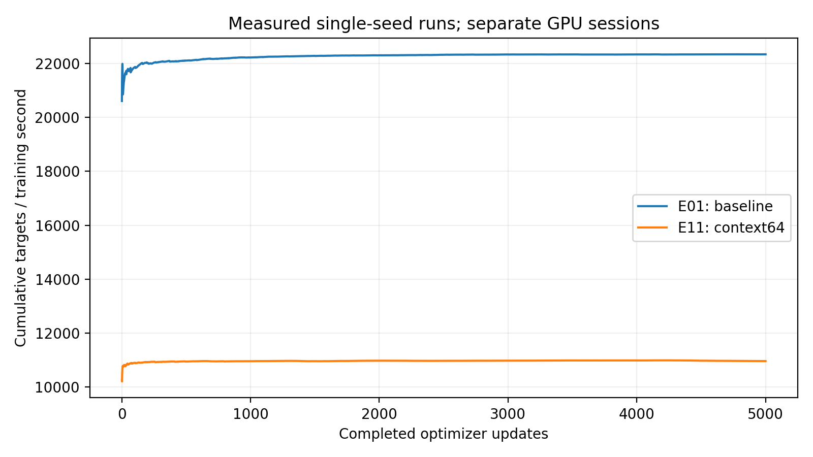

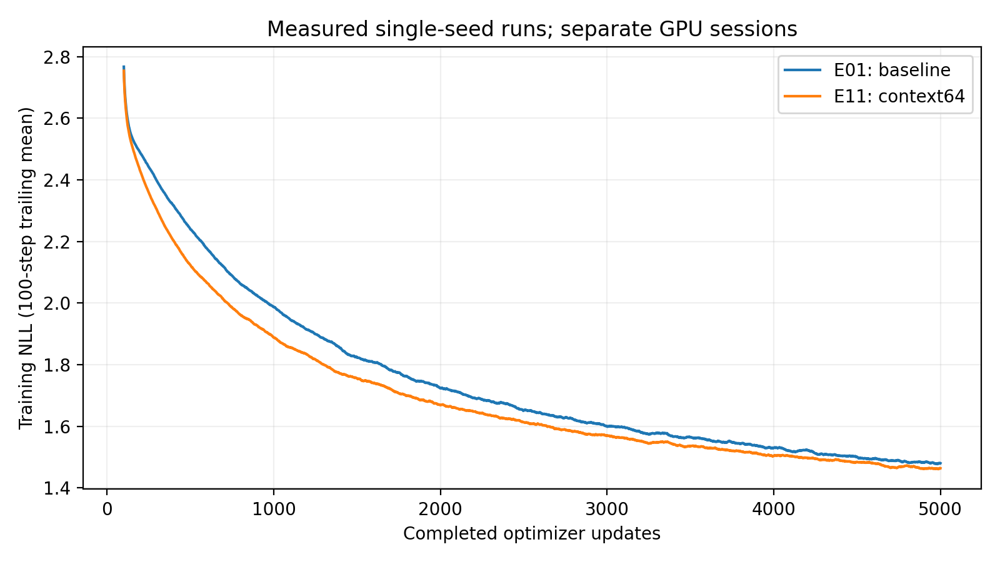

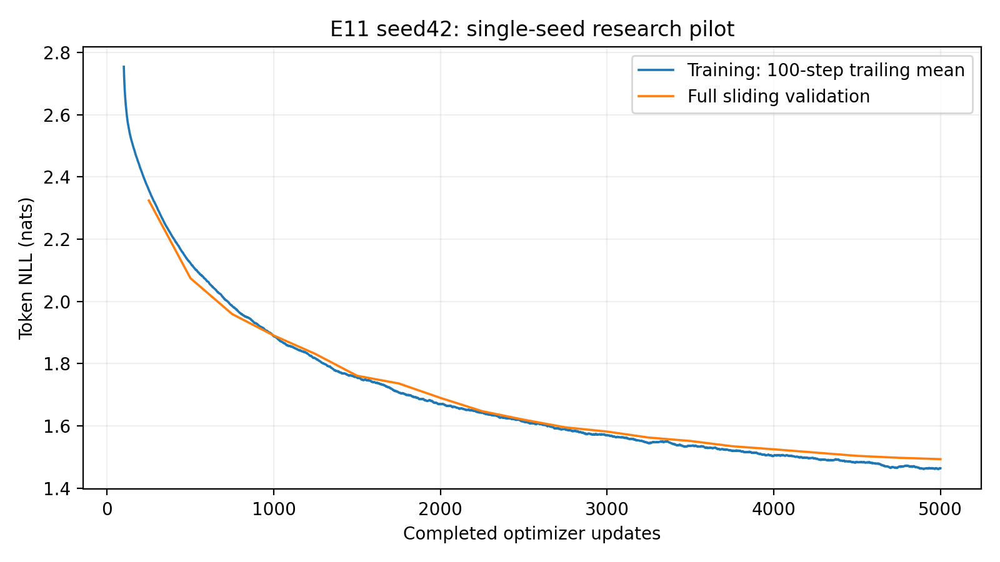

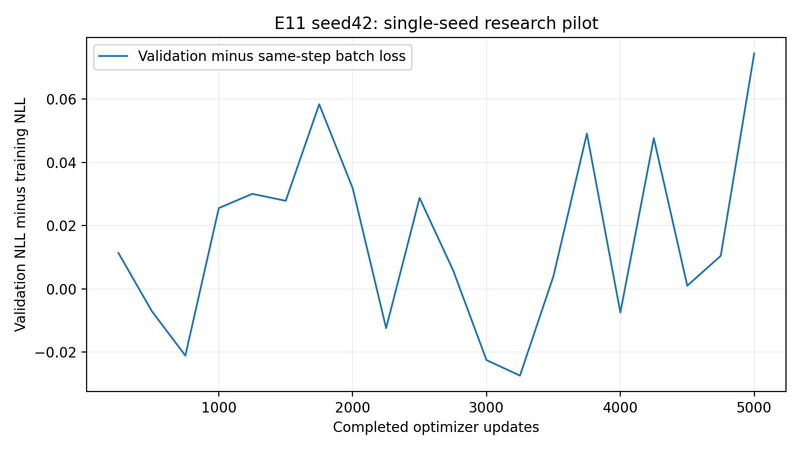

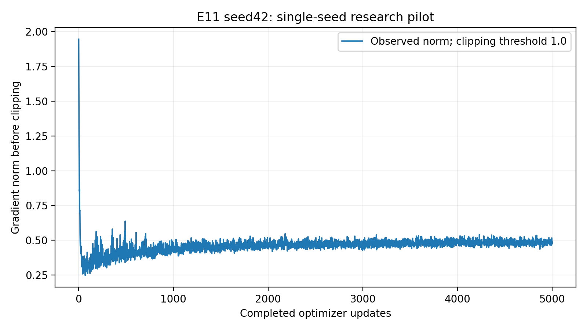

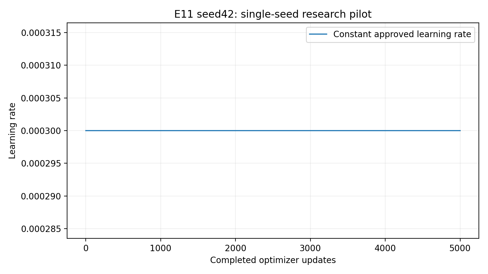

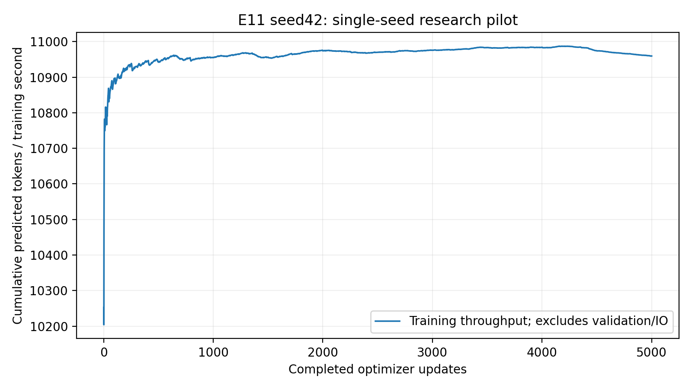

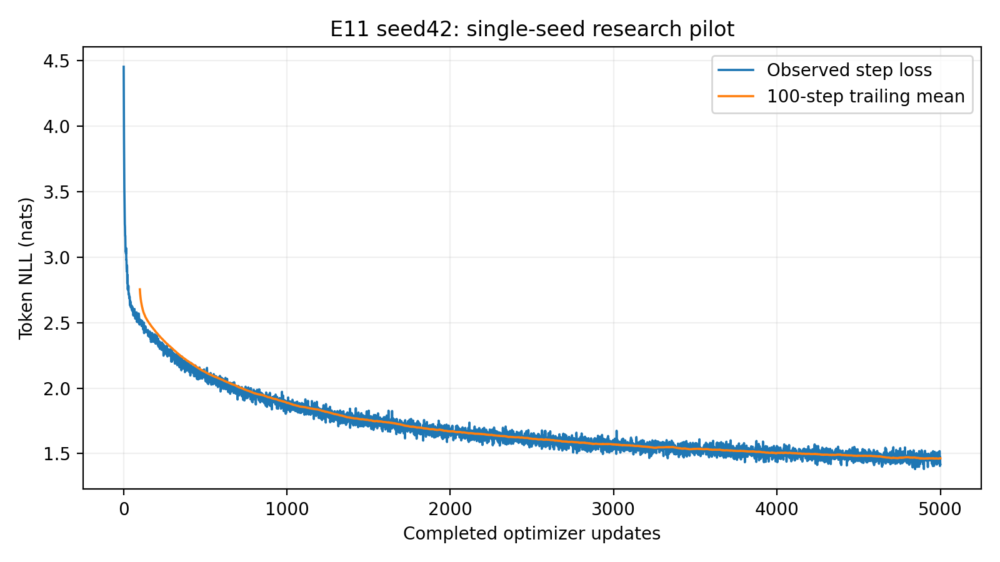

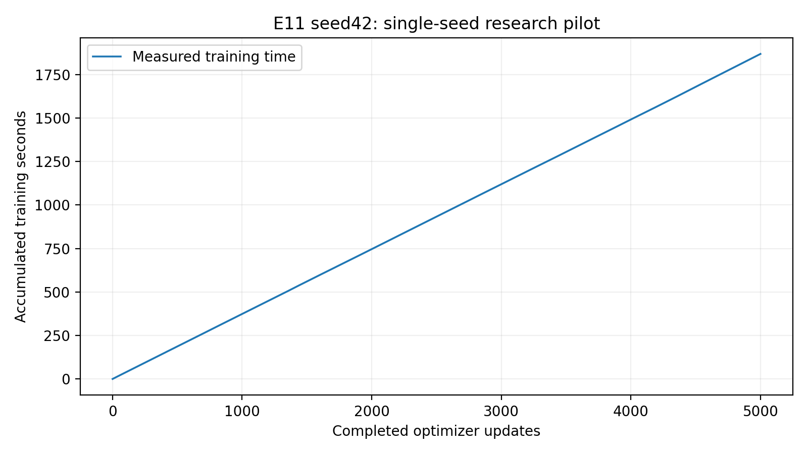

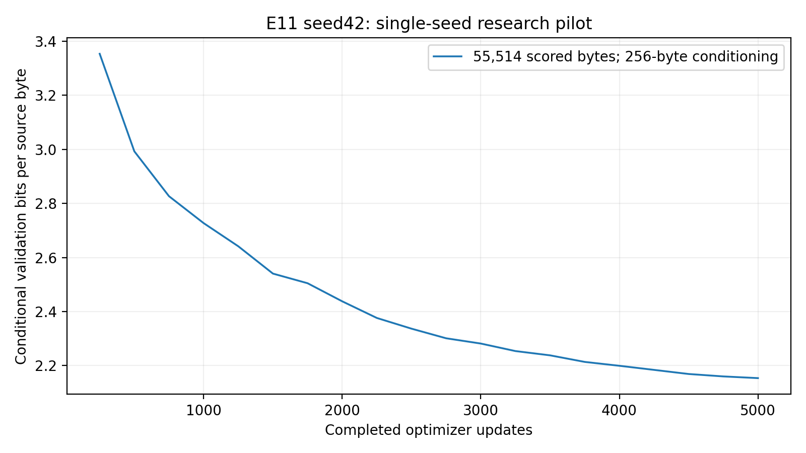

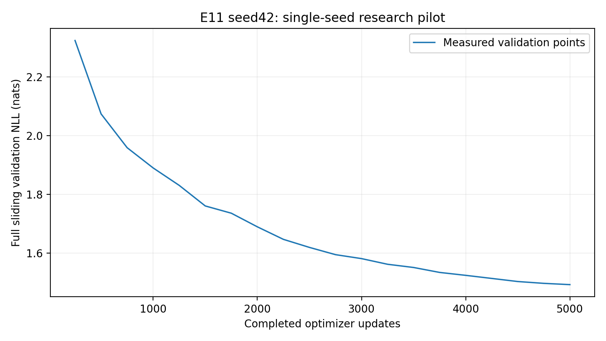

## Convergence and gradient observations

Observed3k–5k loss decrease:0.08860954; recorded-point slope:-0.04436394 per1000 updates; final-minus-best:0.00000000. These describe scheduled measurements, not interpolated observations or guaranteed future convergence.

```json
[
  {
    "experiment": "E01",
    "median": 0.4978237450122833,
    "p95": 0.5419636189937591,
    "maximum": 1.8328568935394287,
    "clipped_updates": 7,
    "clipping_fraction": 0.0014,
    "first100_mean": 0.4534429593384266,
    "last100_mean": 0.5208895719051361,
    "scope": "Aggregate pre-clipping research norms; no longitudinal per-layer gradient data"
  },
  {
    "experiment": "E11",
    "median": 0.46727563440799713,
    "p95": 0.5053501158952713,
    "maximum": 1.94566810131073,
    "clipped_updates": 6,
    "clipping_fraction": 0.0012,
    "first100_mean": 0.4433388814330101,
    "last100_mean": 0.4874174138903618,
    "scope": "Aggregate pre-clipping research norms; no longitudinal per-layer gradient data"
  }
]
```

Aggregate norms are pre-clipping; no longitudinal per-layer gradient measurements or vanishing/exploding-gradient claim. Training uses dropout-on sampled windows; validation uses dropout-off full sliding targets. Their gap is not a direct memorization rate. Single-seed fluctuations cannot prove overfitting.

## Complete genuine text generation

[All100 unedited outputs](generation.md) include best/final, five fixed prompts, greedy and temperatures0.7/1/1.2 with seeds42/123/456,256 new tokens. Context64 enforced at every step. No output editing or favorable-only selection. Five predetermined best greedy examples follow.

### Prompt 'To be, or not to be'

Checkpoint:step_005000.pt; seed42; greedy;256 new tokens.

```text
To be, or not to be so much a part to the world.

LADY GREY:
I will not the world of the world of the world.

LADY GREY:
I will not the world of the world of the world.

LADY GREY:
I will not the world of the world of the world.

LADY GREY:
I will not the world of the world 
```

### Prompt 'ROMEO:\n'

Checkpoint:step_005000.pt; seed42; greedy;256 new tokens.

```text
ROMEO:
I will not the stand of the world of the world
That I will see the world of the world of the world
Than the world of the world of the world of the world
Than the world of the world of the world of the world
Than the world of the world of the world of the w
```

### Prompt 'JULIET:\n'

Checkpoint:step_005000.pt; seed42; greedy;256 new tokens.

```text
JULIET:
The world of the world of the world of the world
Than the world of the world of the world of the world
Than the world of the world of the world of the world
Than the world of the world of the world of the world
Than the world of the world of the world of t
```

### Prompt 'First Citizen:\n'

Checkpoint:step_005000.pt; seed42; greedy;256 new tokens.

```text
First Citizen:
The world of the world of the world of the world.

LADY GREY:
The world of the world of the world of the world.

LADY GREY:
The world of the world of the world of the world.

LADY GREY:
The world of the world of the world of the world.

LADY GREY:
The worl
```

### Prompt 'The king'

Checkpoint:step_005000.pt; seed42; greedy;256 new tokens.

```text
The king of the world of the world of the world
That I will see the world of the world of the world
Than the world of the world of the world of the world
Than the world of the world of the world of the world
Than the world of the world of the world of the world
Th
```

Generation quality statistics and100 matched E01/E11 settings are preserved in generation_quality.json. Repeated8-grams describe loops, not grammatical quality. Exact train-text overlap in checkpoint_diagnostics.json is a descriptive memorization indicator, not proof. Context-related failures must be interpreted alongside sampling/optimization differences. See interpretation.md for observations from the actual full grid.

## Durable publication and independent recovery

Archive:402,283,332 bytes, SHA256`a23789511ce10aa70ac3484ca279f2327eee5a9d1d4db319e4ab2f47df7484ce`. Independently retrieved archive:CRC/exact inventory/60 file hashes verified. All20 resumable validation checkpoint states and21 immutable snapshots verified. Best/final recovered CPU inference passed. Fresh compatible CUDA full-state restoration is PENDING: existing zero-update recovery notebook remains RUNNING, log endpoint returns HTTP500, and no recovery receipt is available. No success or additional updates are claimed. Full E11 acceptance remains incomplete until this gate passes. Constant LR retains its regime for a later separately approved extension.

Large artifacts are outside Git. Local retrieval root:`D:\Nano-Language-Model-artifacts\E11_published_20261013_dafeeadf_resume1\verified`. Durable source:the private research version1 linked above; snapshots remain in its saved outputs. Complete run/logs/metadata/generation/figures are in E11_seed42_pilot.zip with artifact_manifest.json. Use scripts/pilot/download_kaggle_archive.py and inspect_archive.py; fresh CUDA recovery uses build_notebook.py --restore-only --source-kernel with exact trained source. Never treat /kaggle/working alone as permanent.

## Failures, evidence boundaries and recommendations

Journal reports0 research failures and0 resumes. Transport/platform/setup evidence and actual commands are recorded in evidence; later operational issues must remain explicit. No invented missing metrics or standard deviation.

Interpretation and budget recommendation must follow actual late validation trend and matched comparisons, not the assumption that shorter context is faster or weaker. One dataset and one seed cannot establish generalization or significance. The future context framework contains genuine E11/E01 results and E12=null/NOT_AUTHORIZED_NOT_RUN. No E12 launch or10k extension. Additional seeds/context256 require separate approval.

## Executed tests and operational evidence

CPU initial58passed1skip92.80s; final59passed1CUDA-only skip105.72s; focused13passed3.07s. Actual Kaggle suite60passed33.76s. CPU/CUDA context audits passed14checks each. [Actual commands](evidence/commands.json), [test/CI receipts](evidence/execution_review.json), [interpretation](interpretation.md), [operational failures and remaining gate](operations.md). No fresh GPU success is claimed until a genuine recovery receipt is available.

### Remaining acceptance blocker

The zero-update fresh CUDA recovery submission is over two hours old, including queue time. User-visible status confirms stillqueued/running; API statusRUNNING, empty failure_message, log endpointHTTP500, no recovery receipt. This is not a measured GPU execution duration or proof that restoration failed. FullE11acceptance isINCOMPLETE until the existing job becomes verifiable. Independent publication/archive/CPUinference are already passed. No duplicate recovery or training was launched. [All21 independently downloaded snapshotmanifest/index checks](evidence/snapshot_manifest_verification.json) passed; physical snapshotexports were verified natively before publication.

Final delivery rerun:59passed/1CUDA-only skip110.70s. SourceCI38355927555 and reportingCI38360929613 bothsuccess. [Available acceptance checks](evidence/final_checks.json) passed with freshCUDArestoration explicitlypending. Driver580.178.04 advertisesCUDA13.0 maximum compatibility; the approved PyTorch build/runtime remainsCUDA12.4. NativeKaggle packages were untouched.
