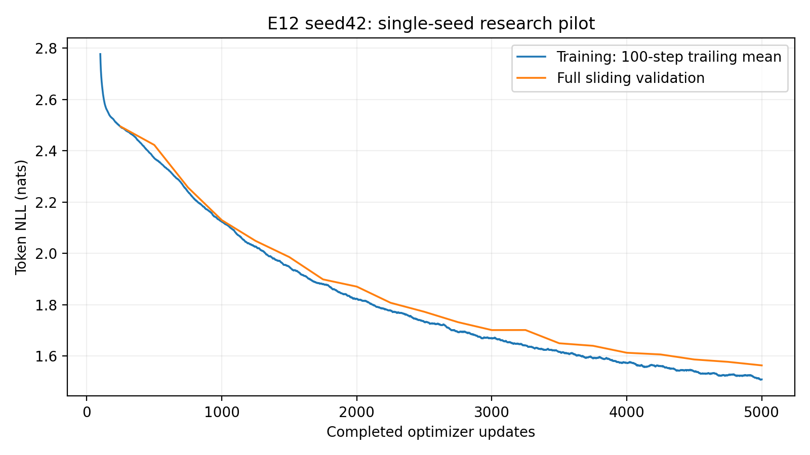
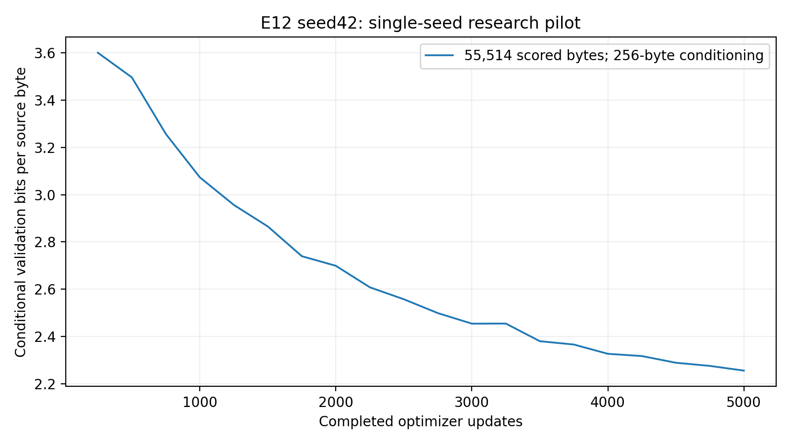

# E12 seed42 — context length 256

## Result and research question

E12 completed the sole authorized seed42 run at **5,000 authoritative optimizer
updates**. Best and final both select step 5,000: conditional BPB
**2.25627886**, worse than E01's best 2.21405793 and final
2.21599704. Longer context did not improve prediction under this budget.
Training was faster, memory allocation and validation time increased, and greedy
text still entered repeated-phrase loops. No other research seed, experiment,
combined configuration or extension was trained. These are descriptive single-seed results.

The question was how increasing causal context from 128 to 256 characters affects
next-character prediction, optimization, efficiency, memory and generated text.
Longer conditioning might support distant dependencies; larger attention matrices
and different training-window grouping might also change cost and optimization.
Neither improvement nor regression was assumed before the run.

## Architecture and numerical audit

The sole E12 architecture override is `context_length: 256`. The character
vocabulary is 65, width 192, with four independent Transformer blocks, six heads
of dimension 32, MLP 192→768→192, GELU, sinusoidal positions and dropout 0.1.
There are **1,804,800 trainable parameters**, unchanged from E01. Explicit Q/K/V,
sqrt(32) scaling, causal masking, softmax and value aggregation remain canonical.

Focused CPU and qualified CUDA checks passed: resolved context and sole override;
256×256 masks and sinusoidal indices 0–255; shifted targets; forward/backward CE;
independent six-head attention reference; future-token invariance; finite nonzero
gradients through all blocks; dropout in train/eval modes; original MLP and GELU;
overlength rejection; generation cropping to the final 256 tokens; and a sequential
full-sliding evaluator reference. The audit also checks identical seed42 initial
trainable tensors against E01; sinusoidal buffers consume no initialization RNG.
The scientific hash is checked independently. Synthetic fixtures and development
smoke/benchmark updates are engineering evidence, not research measurements.
Qualified preflight passed the full 67-test CUDA suite.

## Source, software, dataset and optimizer

- Clean trained source: `e1f0c9861fcdd38d07cd24e746900d53a314b740`.
- Scientific hash: `cdea42adb930904fb0cefcd282d784bb3ac8caa311d3f1e12ef568622f9c12d6`.
- Run: `E12_seed42_4fef43b3dd454ee0bda3a63d52280c8b`; configuration hash: `3b79b376bc9eafbca71c3a077bbbd410d1bd6fe463254a77c23947e3583583ca`.
- [Saved research version 358085129](https://www.kaggle.com/code/syedarijaali/e12-seed42-context-256-verified-research?scriptVersionId=358085129).
- [Fresh final CUDA recovery version 358138796](https://www.kaggle.com/code/syedarijaali/e12-seed42-final-cuda-recovery?scriptVersionId=358138796).
- Tesla T4, CUDA device 0, isolated Python 3.11.14, PyTorch 2.5.1+cu124,
  CUDA 12.4, NumPy 1.26.4, Tokenizers 0.21.0, exact qualified dependency
  freeze (46 non-editable packages). Native Kaggle packages were not used for research.

Canonical Tiny Shakespeare source SHA256 is
`86c4e6aa9db7c042ec79f339dcb96d42b0075e16b8fc2e86bf0ca57e2dc565ed`;
character tokenizer SHA256 is
`ed96787d2f3f9741d69eba15160f31634ba6755b47e4c261ffedbb975fa0af77`.
Original train/validation/test partitions contain 1,003,854/55,770/55,770 bytes.
Dataset manifests, tokenizer, boundaries and random-window sampling remain unchanged.
No test-set likelihood or test-based selection was performed.

Training reseeded from fresh initialization: AdamW, constant learning rate 0.0003,
weight decay 0.01, clipping norm 1.0, float32 CUDA, microbatch four, accumulation
four. There was no AMP, early stopping, trained-weight reuse or settings change in
response to results. Full model, optimizer, scheduler, scaler, RNG, sampling and
training-history state was retained.

## Context, token exposure and validation

| Experiment | Context | Microbatch | Accumulation | Windows/update | Targets/update |
|---|---:|---:|---:|---:|---:|
| E11 |64|4|16|64|4096|
| E01 |128|4|8|32|4096|
| E12 |256|4|4|16|4096|

All three budgets predict 20,480,000 target tokens. E12 samples 80,000 windows,
versus E01's 160,000 and E11's 320,000. Equal targets do not imply equal FLOPs,
input traffic, runtime, contextual information or gradient grouping. Different
start-index ranges, random draws and dropout shapes also change the trajectories.
E12 recorded 20,480,000 repeated original target bytes and
1,003,849 unique target bytes. Independent private-sampler replay
matched the saved RNG and exact target-position union without optimizer updates.
E01 covered 1,003,848 unique target bytes; E11 covered 1,003,846. Coverage measures
predicted target positions, not every byte supplied as context or complete epochs.

Each full sliding validation excludes the common first 256 original bytes from
scoring, then scores all 55,514 remaining original bytes exactly once. It runs every
250 updates with dropout disabled and batch size 32, without subsampling. E12 may
condition on 256 preceding characters, E01 on 128, E11 on 64. The common excluded
prefix is a scoring policy, conceptually separate from model context. Local
sinusoidal positions reset in each canonical crop. BPB = NLL/(ln(2)×scored bytes);
perplexity = exp(loss). All three likelihoods use identical scored targets under
their intended conditioning restrictions.

## Genuine measurements and resource costs

Best/final step 5,000: loss **1.56393333**, BPB
**2.25627886**, perplexity **4.77757611**.
The first recorded training loss is 4.46573353;
final loss is 1.51228538; the final 100-update mean is
1.50944264. No step-zero validation is invented.

| E12 measured quantity | Value |
|---|---:|
| Training-only seconds |475.030|
| Twenty full-validation seconds |927.393|
| Updates/training second |10.52564|
| Targets/training second |43113.040|
| Peak allocated GPU MiB |277.908|
| Engine wall seconds |1439.444|
| Checkpoint write seconds |2.620|
| Immutable export seconds |6.915|
| Journal write seconds |18.032|
| Fixed-grid GPU generation seconds |176.371|

Training time excludes validation and IO. Allocation excludes reserved and driver
memory. The recorded gradient norm ranges from 0.248381 to 1.837268,
with mean 0.518259; 7 of 5,000 updates
exceed the clipping threshold (0.14%). All 5,000 norms are finite. Learning rate
stayed 0.0003 and accumulation stayed four at every update; no AMP updates were skipped.
`measured_history.json` preserves per-step loss, norms, LR, exposure and timing.
`matched_validation.csv` also records milestone training loss, gradient norm and
cumulative training seconds alongside the three-way validation metrics.

The saved output's separately observed research-and-finish timer is
**1,684.159 seconds**, covering research, validation, IO, generation, verification
and local packaging. It excludes bootstrap, development smoke, platform publication
and independent download. The platform reported a successful **1,796.6-second**
research notebook run. Pre-archive postprocessing took 195.781 seconds; independent
archive download took 452.357 seconds; local integrity/CPU verification took 9.148
seconds. Fresh final CUDA recovery was a separate successful 105.0-second notebook
job. These scopes overlap or exclude different stages and must not be added as a
single measured end-to-end elapsed time. The pipeline preview capture and download
receipts make their scope explicit.

## All twenty matched validation points

| Update | E01 loss | E12 loss | E01 BPB | E12 BPB | E11 BPB | E12 train loss |
|---|---:|---:|---:|---:|---:|---:|
|250|2.46425110|2.49522181|3.55516284|3.59984413|3.35340941|2.46612895|
|500|2.26721599|2.42307877|3.27090127|3.49576372|2.99268713|2.33736473|
|750|2.11220971|2.25727011|3.04727447|3.25655240|2.82675282|2.20272183|
|1000|1.99768526|2.13012344|2.88205062|3.07311853|2.72719638|2.18538827|
|1250|1.92482598|2.04930827|2.77693689|2.95652688|2.64156522|1.98678160|
|1500|1.86354672|1.98615167|2.68852962|2.86541117|2.54051734|1.89947858|
|1750|1.81413472|1.89913074|2.61724317|2.73986651|2.50488921|1.83366919|
|2000|1.75925914|1.87100660|2.53807444|2.69929195|2.43797536|1.86196330|
|2250|1.72154866|1.80798888|2.48366971|2.60837659|2.37641323|1.75396970|
|2500|1.69282241|1.77296935|2.44222650|2.55785409|2.33683859|1.70051807|
|2750|1.66527225|1.73238744|2.40248002|2.49930676|2.30127026|1.68348041|
|3000|1.63945360|1.70152845|2.36523157|2.45478665|2.28179906|1.58939642|
|3250|1.61751165|1.70175885|2.33357603|2.45511905|2.25398396|1.63995978|
|3500|1.60199293|1.65006656|2.31118726|2.38054284|2.23818971|1.57322901|
|3750|1.58823999|1.64030852|2.29134596|2.36646497|2.21390129|1.58063170|
|4000|1.57893347|1.61316148|2.27791948|2.32730006|2.19957893|1.50027221|
|4250|1.56335215|1.60659041|2.25544039|2.31782002|2.18442255|1.51409540|
|4500|1.54364829|1.58696336|2.22701373|2.28950417|2.16919730|1.54443830|
|4750|1.53466801|1.57769619|2.21405793|2.27613446|2.16023565|1.56009471|
|5000|1.53601210|1.56393333|2.21599704|2.25627886|2.15396251|1.51228538|

## E01/E12 and genuine E11 context framework

| Metric | E11 | E01 | E12 |
|---|---:|---:|---:|
|Best BPB|2.153963|2.214058|2.256279|
|Final BPB|2.153963|2.215997|2.256279|
|Training seconds|1868.694238|916.708402|475.030290|
|Validation seconds|267.249973|420.908003|927.392574|
|Allocated MiB|116.145996|151.712402|277.907715|

Observed best BPB difference E12−E01: +0.04222093. These are matching recorded targets under different conditioning limits and gradient-window grouping. Separate T4 sessions are a timing confound. No single-seed statistical significance, causal coherence claim or future convergence guarantee. E11 measurements come from its reviewed independently recovered report; E11 was not launched here.

## Genuine generation and qualitative assessment

[All 100 unedited outputs](generation.md) and `generation.json` preserve both
checkpoint policies, all five predetermined prompts, greedy decoding, temperatures
0.7/1.0/1.2, seeds 42/123/456, and 256 new tokens. The unchanged protocol SHA256 is
`fd27b0ced14a8c2aea456a01f7ab426bb69b91c4403720ff7c7f7d7703e52c7c`. Generation crops to the final
256 tokens. Best/final share step-5,000 weights, and all 50 paired settings produce
identical outputs; the 100 policy records are not 100 independent observations.

[Detailed interpretation and predefined greedy examples](interpretation.md)
cover repetition, speaker labels, grammar, spelling and prompt responsiveness.
The complete 300-record E01/E11/E12 descriptive repetition calculation is in
`generation_quality.json`. Low repeated eight-gram fraction does not imply
coherence, correct spelling, originality or low memorization.

## Integrity, persistence and recovery

The complete archive is **407,902,560 bytes**, SHA256
`d5f5c534cf3a8f939bbc52657fbb086b8b39ef28b42c52822bcc88153aea94a1`. Independent saved-version retrieval passed ZIP CRC,
safe unique paths, exact inventory and every one of its 171
file hashes. All 20 resumable checkpoint states and 21 reconstructed immutable
snapshots passed, including optimizer/scheduler counters, metadata and complete
5,000-row authoritative history. Snapshot reconstruction uses exact central
checkpoint bytes rather than storing redundant weights in the ZIP.

Seven parts are published, each no larger than 64 MiB. The independent full-archive
download was sliced locally and each slice checked against the independently
retrieved published part index. Separate network downloads of every part are not
claimed. Independent CPU best/final inference passed under Python 3.10.0 and
PyTorch 2.11.0; that is an inference migration, not the research or optimizer environment.

Final saved-output CUDA verification: PASSED. A separate notebook mounted published research output, selected the fully verified final immutable snapshot and restored model, optimizer, scheduler, scaler, RNG, sampling and history exactly at 5000→5000, with zero additional updates. Best/final CUDA inference and checkpoint hashes matched independent CPU recovery.
The exact CUDA receipt was independently downloaded and matched the published
stdout. Native pre-publication CUDA roundtrip is retained separately; it was not
used as a substitute for this final gate. The published research and recovery
notebooks are the durable location; working-directory files alone are not publication.

## Update accounting, operational failures and preflight

The authoritative journal contains **5000** completed research step events
and **0** failure/resume events. The sole scientific trajectory has
5,000 known physical optimizer executions, zero observed interruption or replay,
and 475.030 retained training seconds. There is no evidence of superseded or lost
research progress. Completed saved output and checkpoint counters agree.

Real-data engineering execution was separate: four initial smoke updates, ten
benchmark updates, two fresh smoke continuation updates and two batch smoke
continuation updates (18 known development optimizer calls). Synthetic unit-test
optimizer calls are outside both counts; an overall count covering every fixture
is not asserted. Final CPU inference, private-sampler replay and both final CUDA
roundtrips performed zero optimizer updates. No further research was launched.

Preflight qualification version 358073577 verified the isolated freeze, CUDA
numerics, real E12 speed/memory/full-validation cost, checkpoint/export/ZIP sizes
and conservative storage/session budgets. A real 40,363,360-byte smoke archive was
published and independently retrieved, then full-state restoration and exact
step-2→4 CUDA continuation passed before substantive research. Ten benchmark
updates took 0.957251466 training seconds and one full validation took 42.762532966
seconds; these development estimates are not final research results. The storage
budget was 3,350,498,024 bytes against 20,940,603,392 free bytes and a 12-hour
session limit. UI showed 26 GPU hours before the final recovery.

Engineering issues are preserved in `evidence/operational_failures.json`: an
initial local import/path error, download-event timeout, premature asynchronous
hash check, stalled saved-output input mount, a 600-second upload bridge and the
legitimate single interactive-session cap. Resolution used a byte-identical
compact private smoke input and cancellation of the unused stalled draft on the
same account. Research remained gated until exact CUDA continuation passed.
The browser later became unavailable during final-result retrieval; reopening it
allowed retrieval of the already successful saved recovery job. A reporting check
also encountered E01's older protocol hash field name; its existing hash and full
protocol matched exactly. None of these issues changed scientific settings or
caused research replay. Large weights, datasets, archives and expiring URLs remain
outside GitHub. Notebook capture provenance is documented separately.

## Limitations and implications

The measured best BPB ranking is E11 (64), E01 (128), then E12 (256), but one seed
cannot establish an optimal context or statistical significance. Extra conditioning
was available; this training procedure did not make it beneficial at this budget.
Context, window grouping, dropout draws, private sampling and compute all change
together. Separate T4 sessions also confound wall-time comparisons. No FLOP count,
controlled equal-compute experiment or long-range dependency benchmark was measured.

The final validation minus sampled training loss is
0.05164795. Sampled dropout-on training
and dropout-off full sliding validation use different conditions, so this gap alone
does not prove overfitting or memorization. E12 was still improving near the endpoint;
that does not justify a claim about eventual convergence or an unauthorized extension.

At this seed and budget, context 256 offers no prediction-quality advantage over
E01, consumes more allocated memory and increases validation cost, while training was faster
with fewer accumulation microbatches in the observed environment. Selection
of a later optimized architecture should weigh those costs and the persistent text
failure modes. Adding seeds, combining configurations or extending training requires
separate authorization. The PR is for review; no merge is authorized here.
