# E13 seed42: width-144 research experiment

## Scope, objective and hypothesis

One explicitly authorized E13 seed42 run completed5000 authoritative optimizer
updates and20full sliding validations. No additional configurations, seeds,
hybrids or extensions were launched. E11 acceptance passed before E13 execution:
the original recovery restored all state at5000→5000zeroextra, and PR15 was
merged atb37c2d82bfee067c28d06c2b3c8c0649774a6388. Earlier results and the
collaborator's E12 work are preserved. Study-wide approval remains separately gated.

Question: how does reducing model width192→144 affect prediction, optimization,
resource use and generated text? The smaller model might retain useful quality
with lower memory/compute, or lose modeling capacity. No direction was assumed.

## Architecture and numerical correctness

Only d_model changes. Four preLN blocks, six heads, context128, MLP expansion4,
GELU, sinusoidal positions and dropout0.1 remain fixed. Width144 mechanically
derives head dimension24 and MLP144→576→144. Attention output144→144,
all LayerNorm dimensions144, sinusoidal buffer128×144, vocabulary65,
embedding65×144 and LMhead144→65. No RoPE/learned/ReLU/BPE factor was added.
Trainable parameters **1,021,824**, **782,976 fewer** than E01
(43.382979% reduction). MLP parameters166,608/block.

Twenty CPU/CUDA numerical checks verify the sole override/defaults, repeat-seed
initialization, independent blocks, all derived projections/counts, manual
linear/GELU/preLN residual references, Q/K/V shape(batch,6,128,24), independent
sqrt24/causal softmax/value aggregation, sinusoidal-only positions, shifted
next-token CE, finite nonzero parameter gradients/all blocks, future invariance,
dropout train/eval, context128 generation crop and overlength rejection.
Audit fixtures are development mathematics, not research measurements.

Matching seeds do not imply identical initial tensors across widths. Tensor
shapes, initialization fan-in scales, RNG consumption and sinusoidal frequency
spacing change mechanically. The initialization algorithm itself is unchanged.
Width changes capacity, head dimension, MLP width and embedding/output dimensions
together; this does not isolate any one of these consequences independently.

## Source, environment and dataset provenance

- Reviewed synchronized main:b37c2d82bfee067c28d06c2b3c8c0649774a6388.
- Clean trained source:`a62cd6cebda71d5fbe1606add9efd9f71171076a`.
- Unchanged scientific hash:`cdea42adb930904fb0cefcd282d784bb3ac8caa311d3f1e12ef568622f9c12d6`.
- Run:`E13_seed42_40d4850f3eb143058a6a447e071252c6`; configuration hash:`a380c3701aff5f9c690f37ed2a9c7550cd32792edde84bc52f07824c61ce193d`.
- [Private research saved version1](https://www.kaggle.com/code/rayyannmerchant/nano-e13-pilot-20261013-ee39c7d3).
- [Fresh zero-update CUDA recovery version1](https://www.kaggle.com/code/rayyannmerchant/nano-e13-recovery-20261013-a50107ba).
- GPU:Tesla T4, device0, total memory15,636,037,632bytes;
  2 devices attached, one used for research training.
- Python3.11.14, torch2.5.1+cu124, CUDA12.4, NumPy1.26.4;
  OS:Linux-6.18.48+-x86_64-with-glibc2.39; qualified transitive freeze reproduced exactly except editable source.

Canonical source revision6f9487a6fe5b420b7ca9afb0d7c078e37c1d1b4e.
Raw SHA25686c4e6aa9db7c042ec79f339dcb96d42b0075e16b8fc2e86bf0ca57e2dc565ed.
Character tokenizer SHA256ed96787d2f3f9741d69eba15160f31634ba6755b47e4c261ffedbb975fa0af77.
All source/tokenizer/partition/manifest fields matched; vocabulary65;
contiguous train/validation/test bytes1,003,854/55,770/55,770. Train-only fitting,
separate windows, no held-out training leakage, no test likelihood/selection.
Native Kaggle packages were untouched; no CPU fallback or uncommitted source.

## Training, evaluation and persistence preflight

Fresh seed42 initialization; AdamW LR0.0003constant, weight decay0.01, clipping1,
float32 CUDA, microbatch4, accumulation8,4096targets/update,32sampled windows/update,
5000updates. Full sliding validation every250,checkpoint cadence500 while
retaining every validation state. No AMP, early stopping or schedule change.
Independent real-data development smoke precedes full research reseeding.

Validation scores every one of55,514original suffix bytes after the common
256-byte exclusion, at context128/batch32/dropoutoff. Sliding crops reset local
sinusoidal positions. BPB=sumNLL/(ln2×scored bytes), character BPB=loss/ln2,
perplexity=exp(loss). These are related metrics. No capped research validation
or invented step-zero measurement; token perplexities are not compared with BPE.

Preflight passed real CUDA backward, full validation, checkpoint reload,
immutable snapshot export/restore, actual optimizer/scheduler/scaler/Python-NumPy-
torchCPU/CUDA-RNG/sampler/history roundtrip with zeroextra development updates,
restored inference, ZIPCRC/safe paths/embedded checkpoint SHA256, storage budget,
Agg plotting and generation. Actual checkpoint sizes drive storage planning.
E11's published and independently recovered account workflow was verified before
E13; E13 publication/retrieval is verified below, not inferred from local paths.

## Tests and recorded results

CPU suite63passed/1CUDA-only skip;
focused14passed;
actual Kaggle64passed in34.95s.
CPU/CUDA20-check width audits, real-data smoke and all recovered checkpoint
counter/BPB/sampler/archive checks passed. Actual commands/CI are in evidence.

| Quantity | Recorded value |
|---|---:|
| First training loss/update1 |4.34422624|
| First validation loss/update250 |2.47578366|
| Final training loss |1.59743473|
| Final100-update training mean |1.58467495|
| Best checkpoint |5000|
| Best loss/BPB |1.61153841/2.32495848|
| Final loss/BPB |1.61153841/2.32495848|
| Final perplexity |5.01051355|
| Predicted targets/source-byte exposure |20,480,000/20,480,000|
| Unique target-byte coverage |1,003,848|
| Training-only seconds |941.393|
| Full-validation seconds |310.326|
| Measured clone-to-archive seconds |1625.390|
| Updates/training second |5.31128|
| Targets/training second |21754.992|
| Peak allocated GPU MiB |132.291|

Training time excludes evaluation/IO. Pipeline timing excludes queue/publication/
network retrieval/fresh recovery. Peak allocation excludes reserved/driver memory.
Repeated target-byte exposure is not input traffic, unique examples, epochs or FLOPs.

```json
{
  "training_updates_per_second": 5.311277447630247,
  "targets_per_training_second": 21754.992425493492,
  "checkpoint_seconds": 1.9404332390001855,
  "export_seconds": 4.559139992000553,
  "journal_seconds": 17.913764502004426,
  "generation_seconds": 178.83544333400005,
  "archive_seconds": 12.400716457999806,
  "pipeline_seconds": 1625.39005959
}
```

## All twenty matched E01/E13 validations

| Update | E01 loss | E13 loss | Δloss | E01 BPB | E13 BPB |
|---|---:|---:|---:|---:|---:|
|250|2.46425110|2.47578366|0.01153256|3.55516284|3.57180081|
|500|2.26721599|2.37145926|0.10424327|3.27090127|3.42129251|
|750|2.11220971|2.19879030|0.08658060|3.04727447|3.17218387|
|1000|1.99768526|2.07306145|0.07537619|2.88205062|2.99079548|
|1250|1.92482598|2.00823062|0.08340464|2.77693689|2.89726435|
|1500|1.86354672|1.94477494|0.08122821|2.68852962|2.80571716|
|1750|1.81413472|1.88900764|0.07487292|2.61724317|2.72526196|
|2000|1.75925914|1.86540537|0.10614623|2.53807444|2.69121108|
|2250|1.72154866|1.82072929|0.09918063|2.48366971|2.62675712|
|2500|1.69282241|1.80133328|0.10851087|2.44222650|2.59877459|
|2750|1.66527225|1.76986721|0.10459496|2.40248002|2.55337865|
|3000|1.63945360|1.74559284|0.10613925|2.36523157|2.51835814|
|3250|1.61751165|1.72042366|0.10291201|2.33357603|2.48204668|
|3500|1.60199293|1.69722521|0.09523227|2.31118726|2.44857839|
|3750|1.58823999|1.68016693|0.09192693|2.29134596|2.42396849|
|4000|1.57893347|1.66561163|0.08667816|2.27791948|2.40296964|
|4250|1.56335215|1.65082152|0.08746937|2.25544039|2.38163202|
|4500|1.54364829|1.63188757|0.08823928|2.22701373|2.35431611|
|4750|1.53466801|1.62459682|0.08992880|2.21405793|2.34379777|
|5000|1.53601210|1.61153841|0.07552631|2.21599704|2.32495848|

## Predictive quality and measured resource tradeoffs

| Metric | E01 | E13 | ΔE13−E01 | Relative % |
|---|---:|---:|---:|---:|
|best_loss|1.53466801|1.61153841|0.07687040|5.009|
|final_loss|1.53601210|1.61153841|0.07552631|4.917|
|best_bpb|2.21405793|2.32495848|0.11090055|5.009|
|final_bpb|2.21599704|2.32495848|0.10896144|4.917|
|final_training_loss|1.46865343|1.59743473|0.12878130|8.769|
|training_seconds|916.70840175|941.39311104|24.68470929|2.693|
|validation_seconds|420.90800282|310.32610282|-110.58190000|-26.272|
|peak_gpu_bytes|159081984.00000000|138716672.00000000|-20365312.00000000|-12.802|
|parameters|1804800.00000000|1021824.00000000|-782976.00000000|-43.383|

Lower loss/BPB is better; fewer parameters alone do not establish superior quality. Equal targets are not equal FLOPs. Separate T4 sessions/no repeated timing confound speed comparisons; BPB divided by parameter count is not an intrinsic quality score.

```json
[
  {
    "status": "private_sampling_RNG_and_exact_target_union_replayed",
    "context_length": 128,
    "micro_batch_size": 4,
    "accumulation": 8,
    "sampled_windows_per_update": 32,
    "total_sampled_windows": 160000,
    "target_positions": 20480000,
    "unique_target_bytes": 1003848,
    "scope": "ASCII canonical character dataset; exact RNG/window union replay, no optimizer updates"
  },
  {
    "status": "private_sampling_RNG_and_exact_target_union_replayed",
    "context_length": 128,
    "micro_batch_size": 4,
    "accumulation": 8,
    "sampled_windows_per_update": 32,
    "total_sampled_windows": 160000,
    "target_positions": 20480000,
    "unique_target_bytes": 1003848,
    "scope": "ASCII canonical character dataset; exact RNG/window union replay, no optimizer updates"
  }
]
```

Both private samplers were independently replayed and final RNG/target unions match E01. Model/global initialization/dropout RNG are not assumed equal across widths.

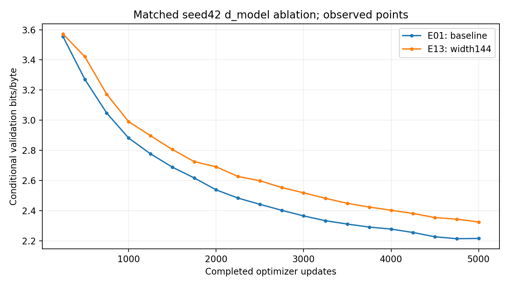

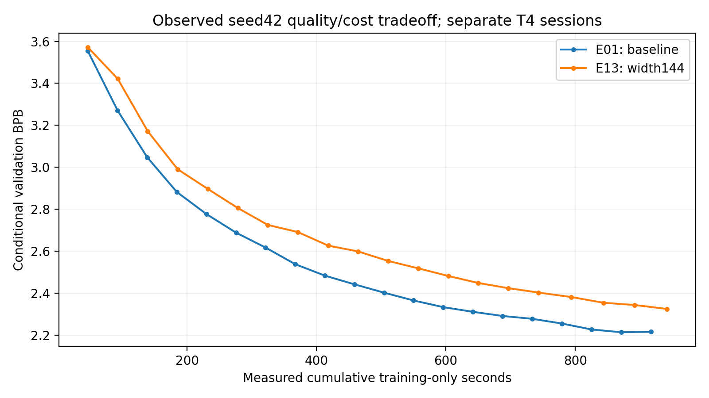


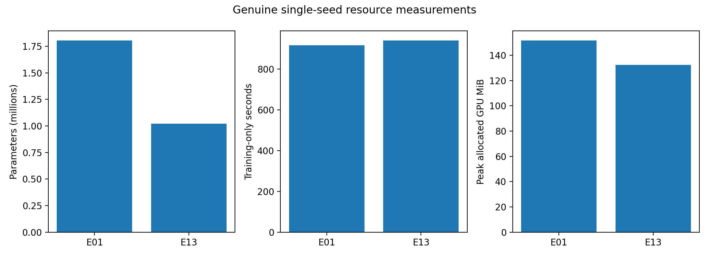

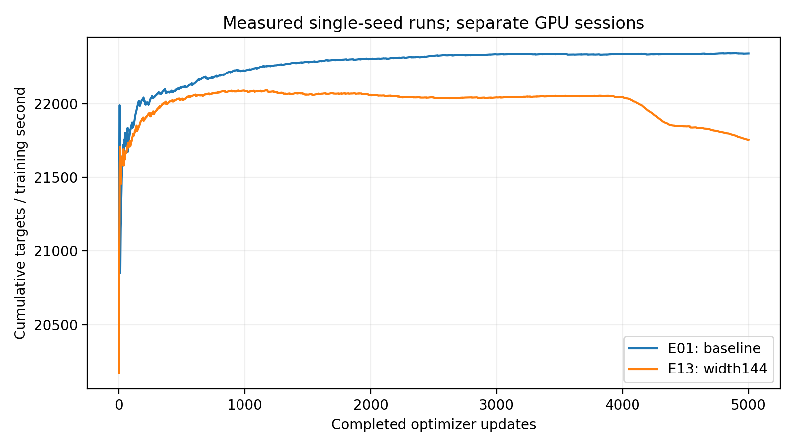

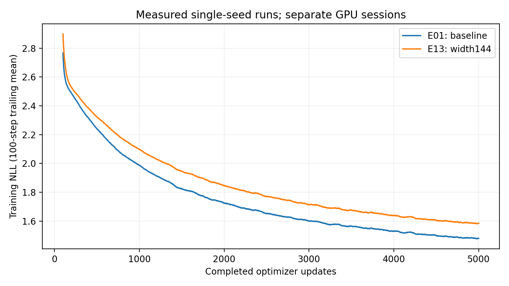

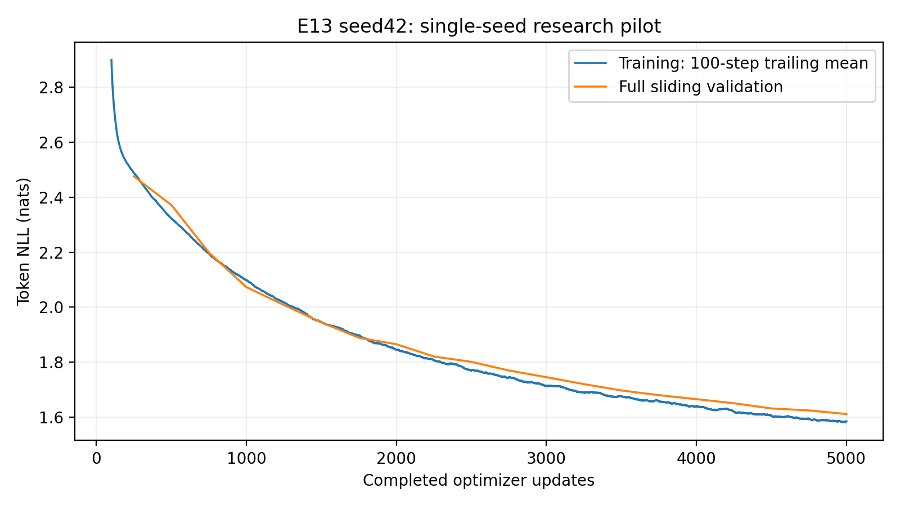

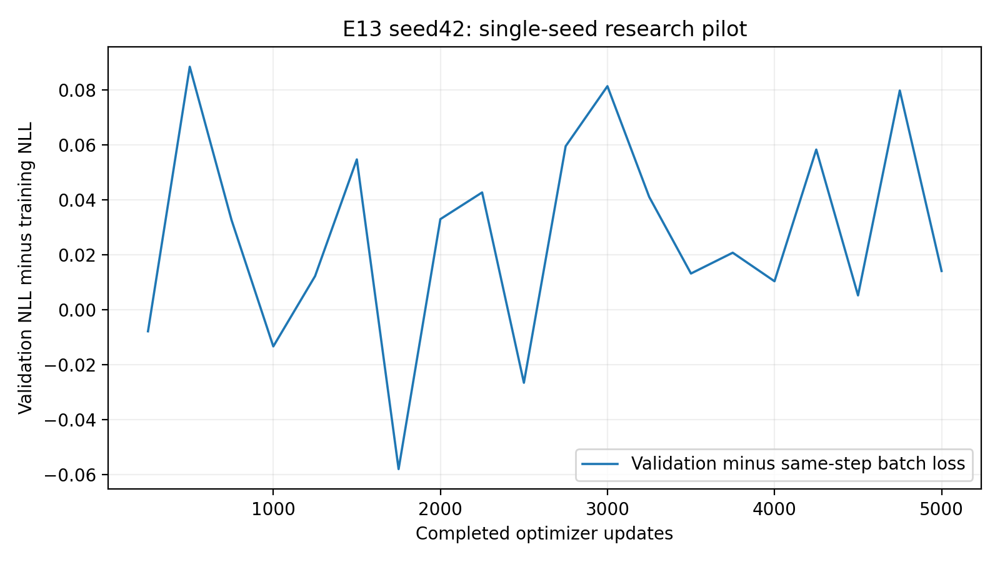

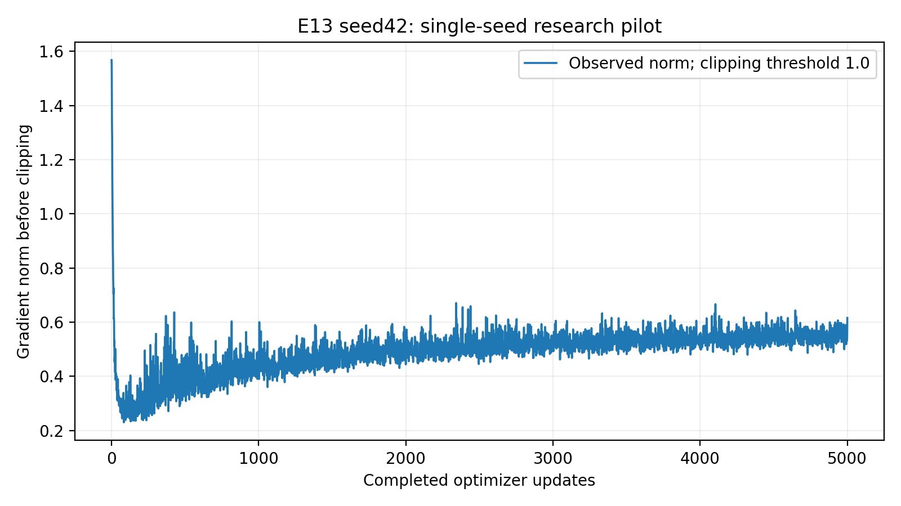

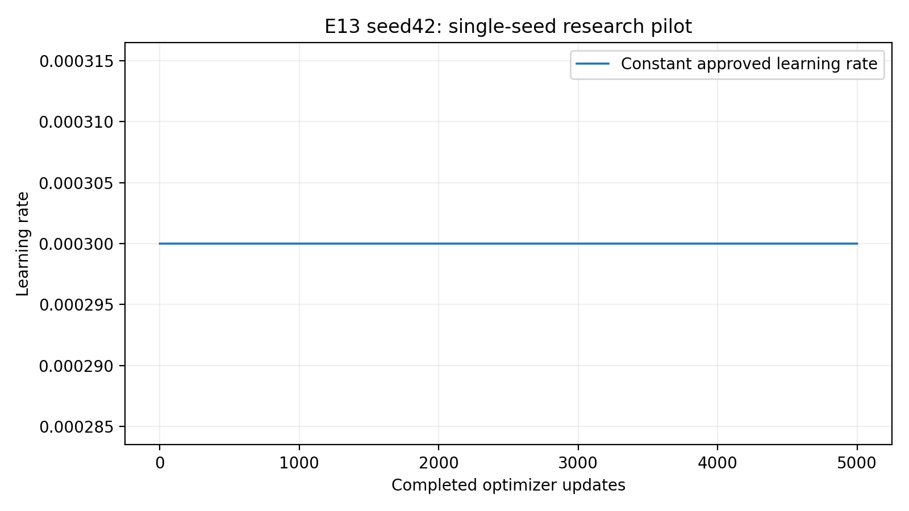

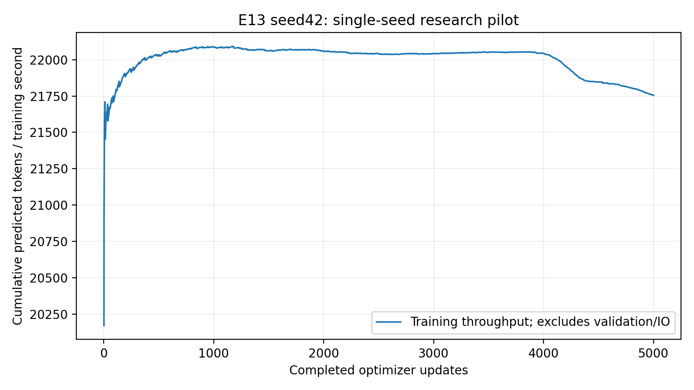

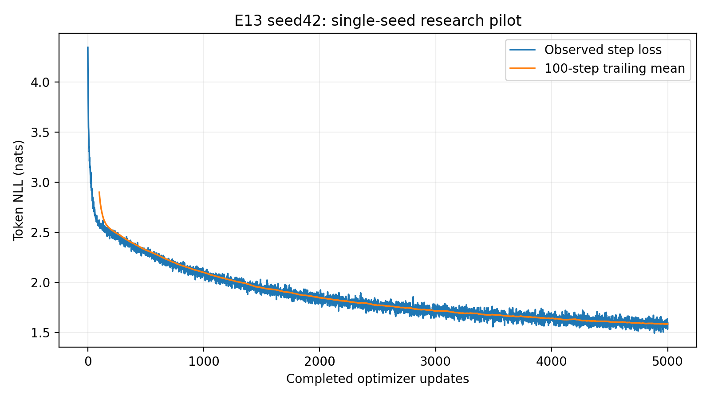

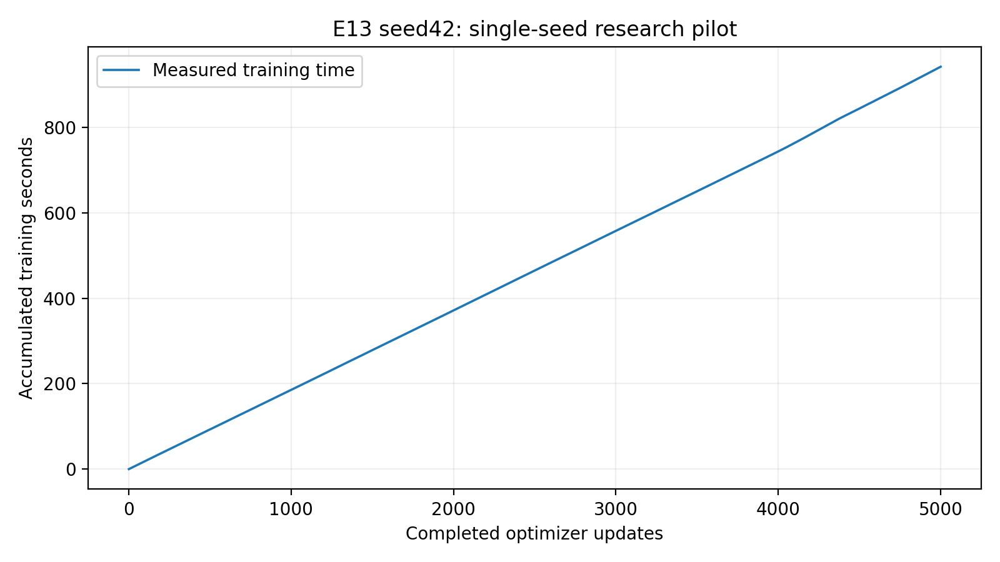

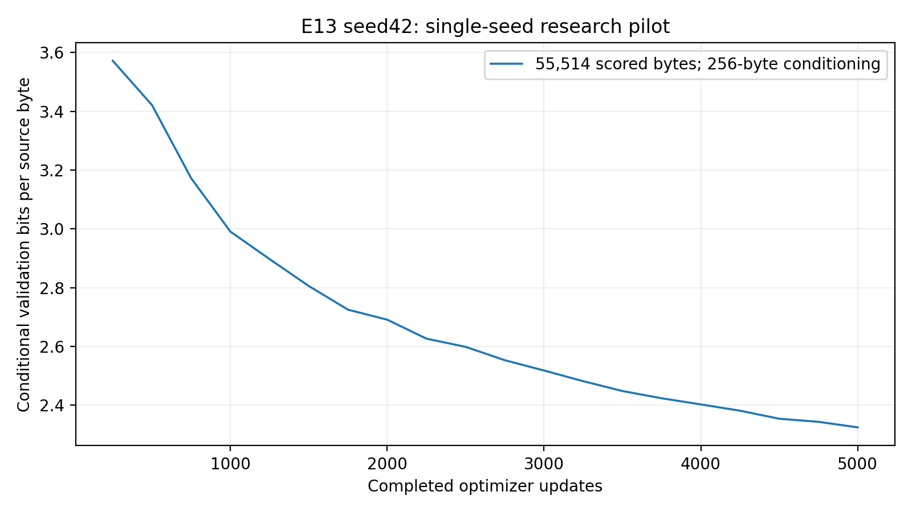

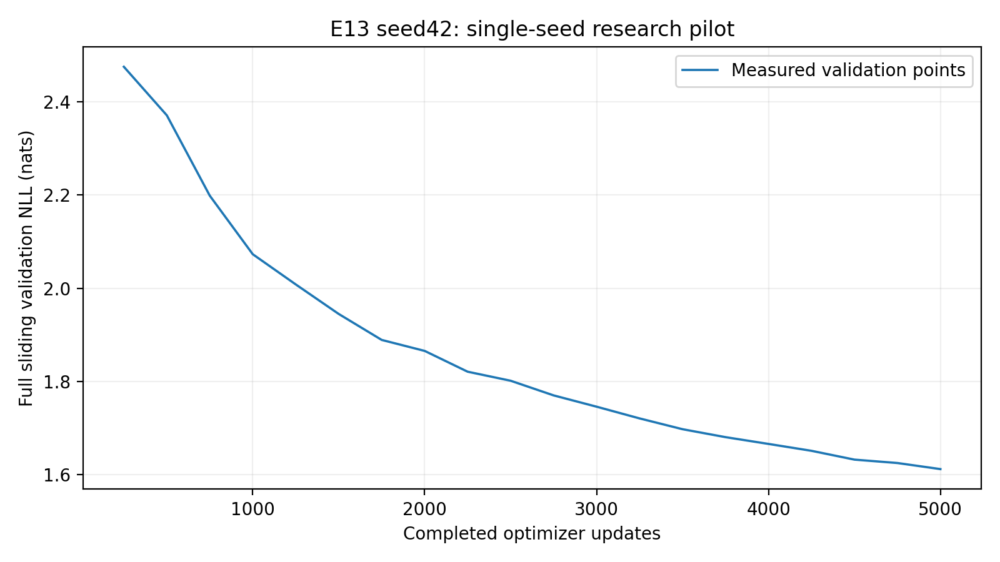

## Convergence and gradient observations

Observed3k–5k loss decrease0.13405443; late recorded-point slope-0.06558126 per1000updates; final-minus-best0.00000000. These are descriptors, not forecasts or interpolated observations.

```json
[
  {
    "experiment": "E01",
    "median": 0.4978237450122833,
    "p95": 0.5419636189937591,
    "maximum": 1.8328568935394287,
    "clipped_updates": 7,
    "clipping_fraction": 0.0014,
    "first100_mean": 0.4534429593384266,
    "last100_mean": 0.5208895719051361,
    "scope": "Aggregate pre-clipping research norms; no longitudinal per-layer gradient data"
  },
  {
    "experiment": "E13",
    "median": 0.5086221098899841,
    "p95": 0.5732059240341187,
    "maximum": 1.5678884983062744,
    "clipped_updates": 7,
    "clipping_fraction": 0.0014,
    "first100_mean": 0.44440355986356733,
    "last100_mean": 0.553589462339878,
    "scope": "Aggregate pre-clipping research norms; no longitudinal per-layer gradient data"
  }
]
```

Aggregate pre-clipping norms establish neither longitudinal per-layer behavior nor vanishing/exploding gradients. Training/dropout-on sampled windows and full sliding/dropout-off validation differ; their gap is not a direct memorization rate. Detailed interpretation is in interpretation.md.

## Complete genuine model generation

[All100 unedited outputs](generation.md) preserve five fixed prompts, greedy, temperatures0.7/1/1.2, seeds42/123/456,256new tokens, best/final and128-token crops. Five predetermined best greedy examples follow, including poor outputs. No external model produced or improved them.

### Prompt 'To be, or not to be'

Checkpointstep_005000.pt;greedy;seed42;256new tokens.

```text
To be, or not to be the see the see to the see
That the see the see the see to the see the see
That the see the see the see the see to heart
And the shall be the see to the see the see
That the shall be the see to the see the see
That the shall be the see to the see the see

```

### Prompt 'ROMEO:\n'

Checkpointstep_005000.pt;greedy;seed42;256new tokens.

```text
ROMEO:
Why, the shall the see the see to the see the see
That the see the see the see the see the see
That the see the see the see to the see the see
That the shall be the see to the see the see
That the shall be the see to the see the see
That the shall be the s
```

### Prompt 'JULIET:\n'

Checkpointstep_005000.pt;greedy;seed42;256new tokens.

```text
JULIET:
What is the sent the see to the see the see to the see
That the see the see the see the see the see
That the see the shall be the see to the see
That the shall be the see to the see the see
That the shall be the see to the see the see
That the shall be the
```

### Prompt 'First Citizen:\n'

Checkpointstep_005000.pt;greedy;seed42;256new tokens.

```text
First Citizen:
The shall the see to the see the see the see,
And the shall the see the see the see the see
That the see the shall be the see to the see
That the shall be the see to the see the see
That the shall be the see to the see the see
That the shall be the see to 
```

### Prompt 'The king'

Checkpointstep_005000.pt;greedy;seed42;256new tokens.

```text
The king of the sent of the sent of the see
That the see the see the see to the see the see
That the see the see the see the see to heart
And the shall be the see to the see the see
That the shall be the see to the see the see
That the shall be the see to the see 
```

Best/final are identical weights; the separately labeled grids duplicate deterministic settings, not100independent draws.

All100matched generation settings/repetition statistics are in generation_quality.json. Repetition is descriptive, not a coherence score. Exact train-phrase overlap in checkpoint_diagnostics.json is not conclusive memorization proof. Actual word/grammar/dialogue/prompt/repetition failures are discussed in interpretation.md without cherry-picking.

## Durable publication and independently verified recovery

Archive:230,564,978bytes; SHA256`0ddce4c76829e961ff862ab61f7d67f9a8ca679260d4fc3a8219fc617becf7e7`. Independently retrieved archive passed safe paths,ZIPCRC,exactinventory and all61filehashes; best/final CPUinference passed. All20resumable checkpoint counters/histories verified. Native wrapper verified21immutable exports before publication; independently retrieved snapshotmanifest parity is documented separately. Fresh qualified CUDA restoration restored all model/optimizer/scheduler/scaler/Python-NumPy-torchCPU/CUDA-RNG/sampler/history fields exactly at5000→5000 withzeroextra. Generation samples match recovered CPUoutputs. Large archives/weights/fulljournals remain outsideGit; current retrieval root:`D:\Nano-Language-Model-artifacts\E13_published_20261013_ee39c7d3\verified`. See artifact_retrieval.md and artifact_manifest.json.

Journal:0research failure events,0resume events. In the absence of interruptions, authoritative and known physical research updates both5000; independent development smoke is excluded. Any transport/API/setup failures remain in operations.md. No superseded/replayed research trajectory is fabricated or merged.

## Scientific conclusions and future width comparison

[Interpretation and recommendations](interpretation.md) distinguish hypotheses, observations and conclusions. One seed/dataset gives no SD/significance/equivalence estimate. Width changes capacity/head dimension/MLP width/initialization together; no isolated causality is claimed. The framework contains genuineE13/E01 results and E14=null/NOT_AUTHORIZED_NOT_RUN. NoE14/extra seed/extension or untested hybrid was executed.

## Final delivery verification

FinalWindows63passed/1CUDA-only skip157.49s; actualKaggle64passed34.95s; focused14passed1.85s andreporting17passed4.27s. [Commands](evidence/commands.json), [PhaseA E11closure](evidence/phaseA_E11_acceptance.json), [independent21snapshotchecks](evidence/snapshot_manifest_verification.json), [retrievalinstructions](artifact_retrieval.md), [operationalfailures](operations.md). SourceCI38382465043 andreportingCI38384086965 success. FullE13single-runacceptance passed; study-wideauthorization remains separatelygated.
